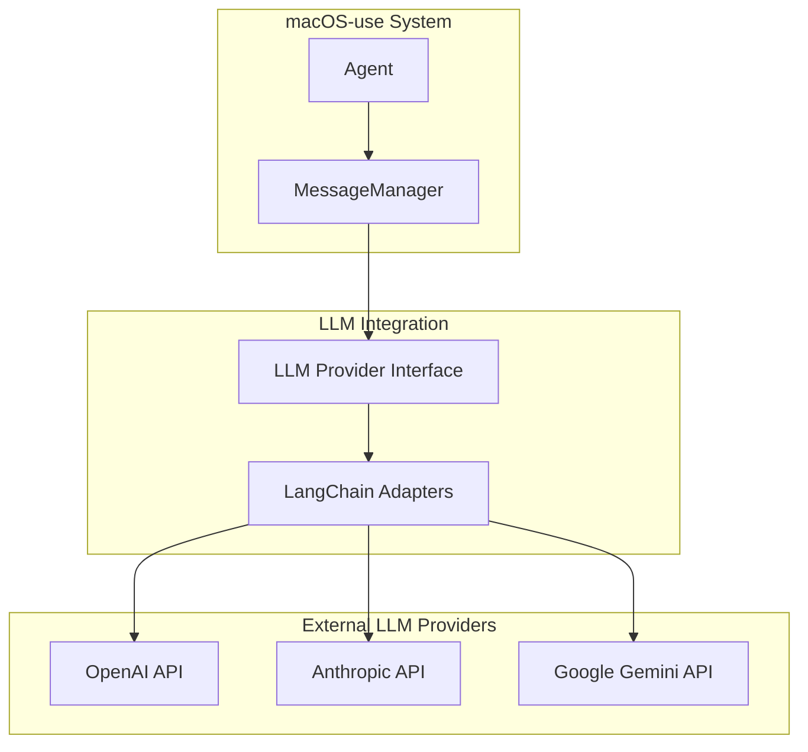
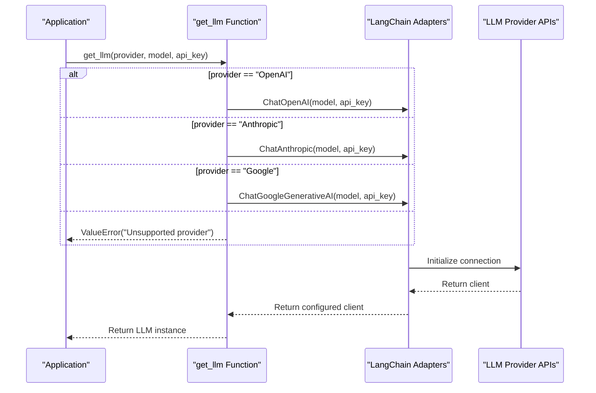
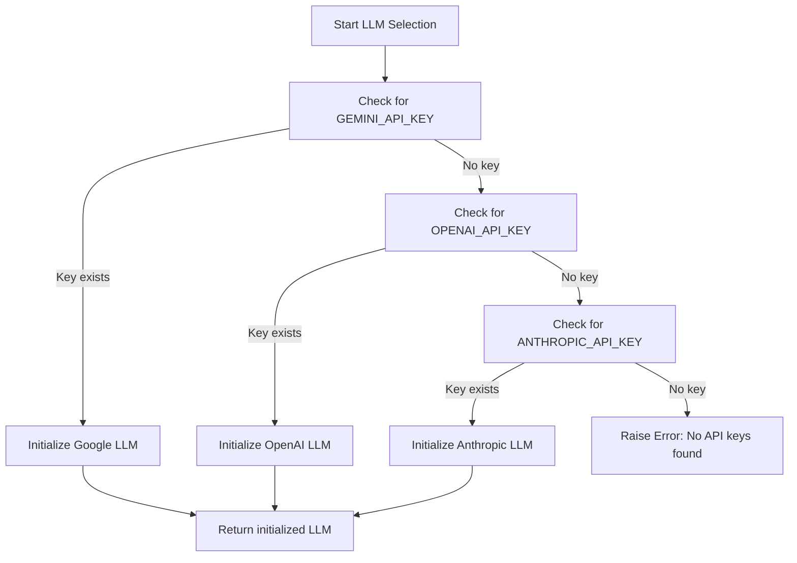
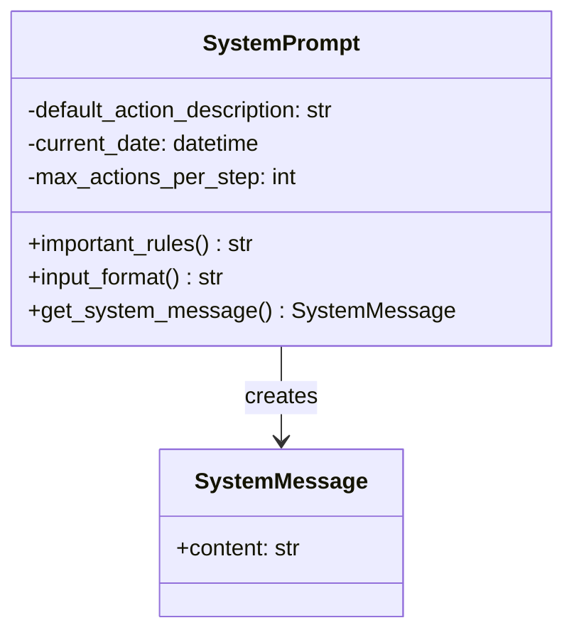
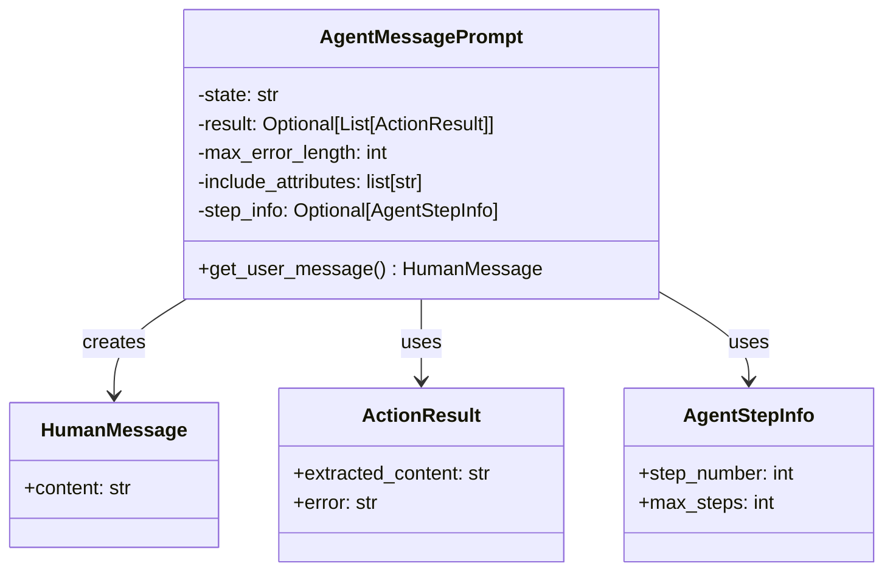
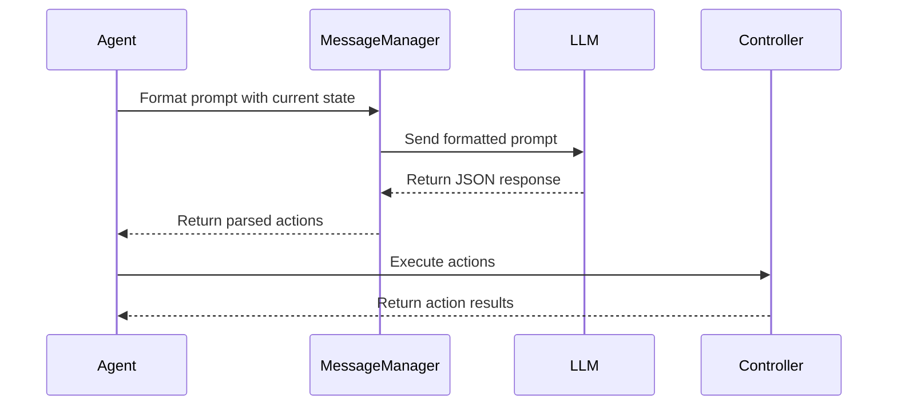

<!-- source: DeepWiki mcp.deepwiki.com · repo browser-use/macOS-use · page 2.4 LLM Integration · fetched 2026-10-30 -->

# LLM Integration

<details>
<summary>Relevant source files</summary>

The following files were used as context for generating this wiki page:

- [examples/try.py](examples/try.py)
- [gradio_app/src/models/llm_models.py](gradio_app/src/models/llm_models.py)
- [mlx_use/agent/prompts.py](mlx_use/agent/prompts.py)

</details>


This document explains how the macOS-use system integrates with Large Language Model (LLM) providers to power its AI decision-making capabilities. The LLM integration component serves as the intelligence layer, enabling the agent to interpret UI states and determine appropriate actions to complete user tasks.

For information about how the Agent system uses these LLMs, see [Agent System](#2.1). For configuration details on API keys, see [API Keys and Environment Variables](#5.1).

## Architecture Overview

The LLM integration component bridges the Agent system with external LLM providers through a standardized interface, allowing multiple AI models to be used interchangeably.



Sources: [examples/try.py:4-6](), [examples/try.py:22-29](), [gradio_app/src/models/llm_models.py:15-27]()

## Supported LLM Providers and Models

The system uses LangChain's provider-specific adapters to connect to different LLM services:

| Provider  | Client Class         | Default Models                              |
|-----------|----------------------|--------------------------------------------|
| OpenAI    | `ChatOpenAI`         | gpt-4o, o3-mini                            |
| Anthropic | `ChatAnthropic`      | claude-3-5-sonnet-20240620, claude-3-7-sonnet-20250219 |
| Google    | `ChatGoogleGenerativeAI` | gemini-1.5-flash-002, gemini-2.0-flash-exp |

The available models are defined in the LLM_MODELS dictionary:

```python
LLM_MODELS = {
    "OpenAI": ["gpt-4o", "o3-mini"],
    "Anthropic": ["claude-3-5-sonnet-20240620", "claude-3-7-sonnet-20250219"],
    "Google": ["gemini-1.5-flash-002", "gemini-2.0-flash-exp"],
    "alibaba": ["qwen-2.5-72b-instruct"]
}
```

Sources: [gradio_app/src/models/llm_models.py:8-13]()

## LLM Initialization Flow

The system follows a consistent pattern for initializing LLM clients across the codebase:



The `get_llm` function creates the appropriate LangChain client based on the provider name:

```python
def get_llm(provider: str, model: str, api_key: str) -> Optional[object]:
    """Initialize LLM based on provider"""
    try:
        if provider == "OpenAI":
            return ChatOpenAI(model=model, api_key=SecretStr(api_key))
        elif provider == "Anthropic":
            return ChatAnthropic(model=model, api_key=SecretStr(api_key))
        elif provider == "Google":
            return ChatGoogleGenerativeAI(model=model, api_key=SecretStr(api_key))
        else:
            raise ValueError(f"Unsupported provider: {provider}")
    except Exception as e:
        raise ValueError(f"Failed to initialize {provider} LLM: {str(e)}")
```

Sources: [gradio_app/src/models/llm_models.py:15-27](), [examples/try.py:18-31]()

## LLM Selection Logic

The system uses a fallback mechanism to select an available LLM provider based on which API keys are configured:



This selection logic is demonstrated in the `try.py` example script:

```python
# Try to set LLM based on available API keys
llm = None
if os.getenv('GEMINI_API_KEY'):
    llm = set_llm('google')
elif os.getenv('OPENAI_API_KEY'):
    llm = set_llm('OAI')
elif os.getenv('ANTHROPIC_API_KEY'):
    llm = set_llm('anthropic')

if not llm:
    raise ValueError("No API keys found. Please set at least one of GEMINI_API_KEY, OPENAI_API_KEY, or ANTHROPIC_API_KEY in your .env file")
```

Sources: [examples/try.py:33-43]()

## Prompt System

The LLM integration uses a sophisticated prompt structure to guide the model's behavior. The prompting system consists of two main components:

### System Prompt

The `SystemPrompt` class constructs a detailed instruction set for the LLM that defines:

- Response format requirements (JSON structure)
- Action execution rules and constraints
- App handling instructions
- Element interaction guidelines
- Task completion criteria
- Navigation and error handling strategies
- AppleScript support



The `get_system_message()` method combines all instructions into a comprehensive prompt for the LLM.

Sources: [mlx_use/agent/prompts.py:6-131]()

### Agent Message Prompt

The `AgentMessagePrompt` class creates contextual prompts that capture the current state of the system:



The `get_user_message()` method formats the current UI state, previous action results, and any errors into a message for the LLM.

Sources: [mlx_use/agent/prompts.py:133-175]()

## Agent-LLM Interaction

The Agent uses the LLM for decision-making by:

1. Collecting the current UI state via the MacUITreeBuilder
2. Formatting the state using the prompt system
3. Sending the formatted prompt to the LLM provider
4. Parsing the LLM's JSON response into executable actions
5. Executing the actions via the Controller



Sources: [mlx_use/agent/prompts.py:133-175](), [examples/try.py:50-71]()

## API Key Configuration

For the LLM integration to function, at least one of the following environment variables must be set:

| Provider  | Environment Variable | Purpose |
|-----------|---------------------|---------|
| OpenAI    | OPENAI_API_KEY      | Authentication for OpenAI API |
| Anthropic | ANTHROPIC_API_KEY   | Authentication for Anthropic API |
| Google    | GEMINI_API_KEY      | Authentication for Google Gemini API |

The system checks for these API keys when initializing and will raise an error if none are found.

Sources: [examples/try.py:33-43]()

## Best Practices

When working with the LLM integration:

1. **Provider Selection**:
   - OpenAI models excel at general purpose tasks and code generation
   - Anthropic Claude models handle complex reasoning with longer context
   - Google Gemini models offer competitive pricing for many tasks

2. **Model Performance vs. Cost**:
   - Larger models provide better results but cost more
   - Consider using smaller models for simple tasks to reduce costs

3. **Fallback Mechanism**:
   - Implement multiple provider options to handle API outages
   - The system's built-in fallback mechanism helps ensure reliability

4. **API Key Security**:
   - Always use environment variables or the `SecretStr` type to protect API keys
   - Never hardcode API keys in your application code

Sources: [examples/try.py:18-43](), [gradio_app/src/models/llm_models.py:15-27]()

---

