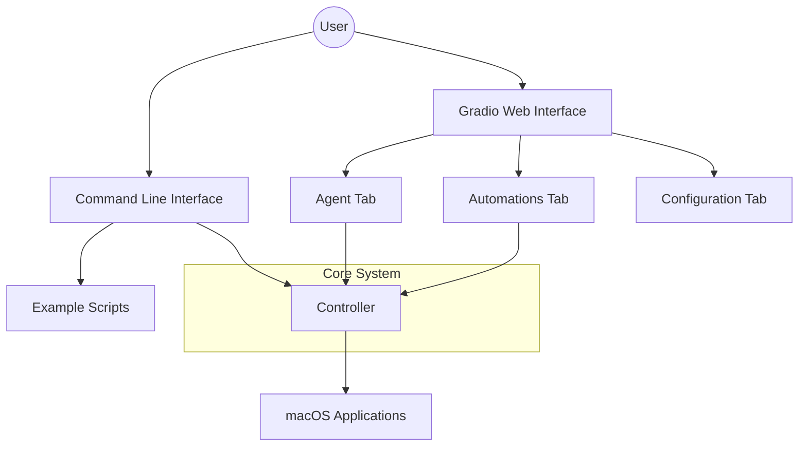
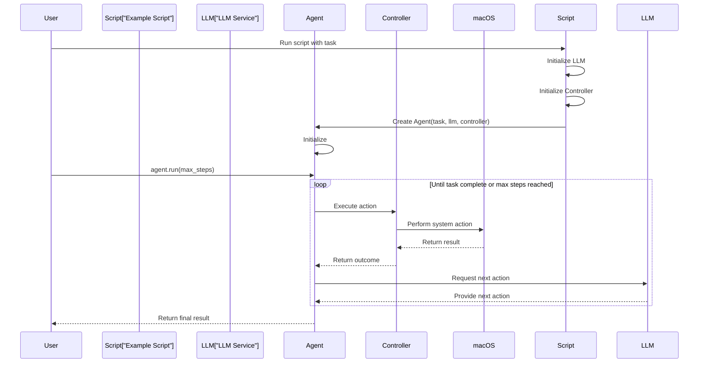
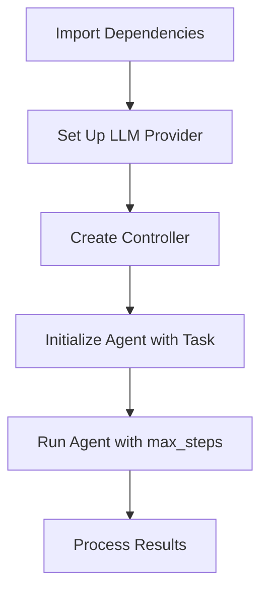
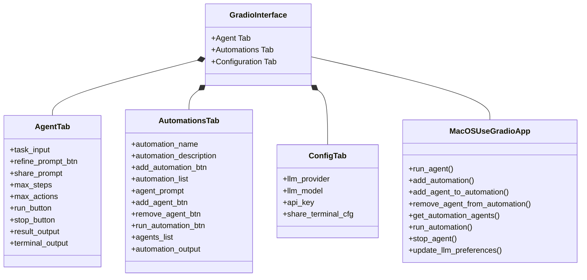
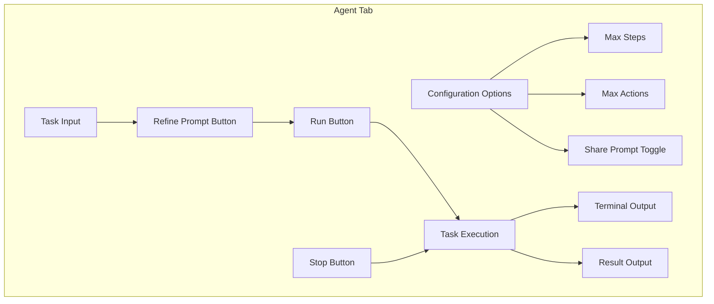
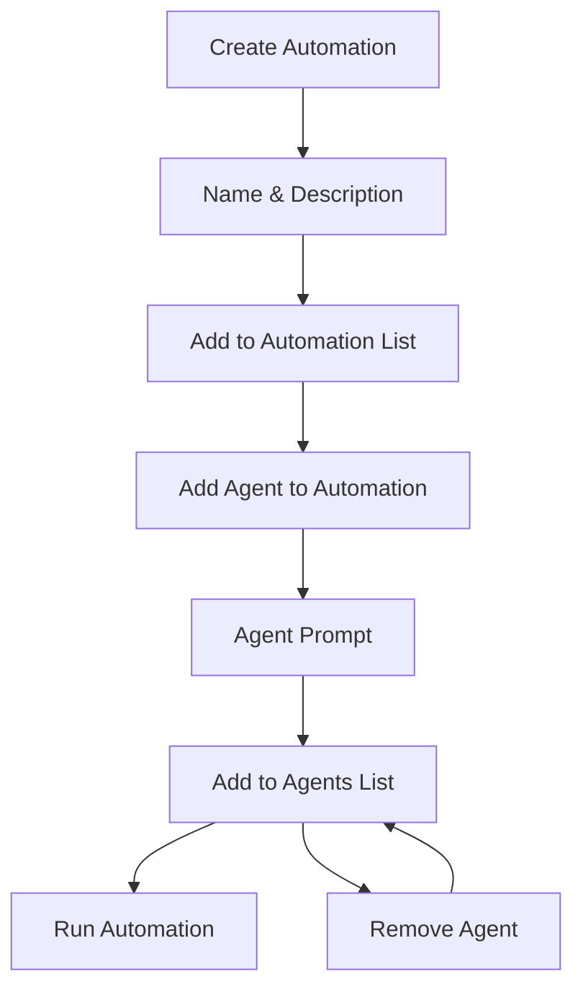
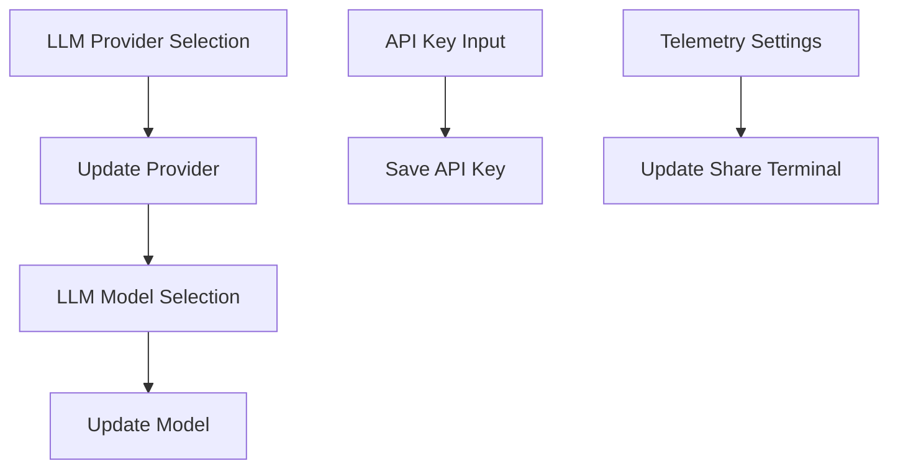
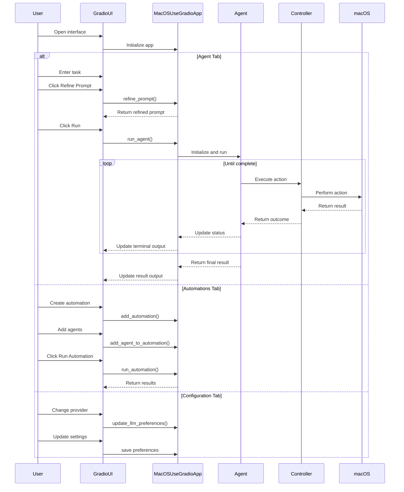
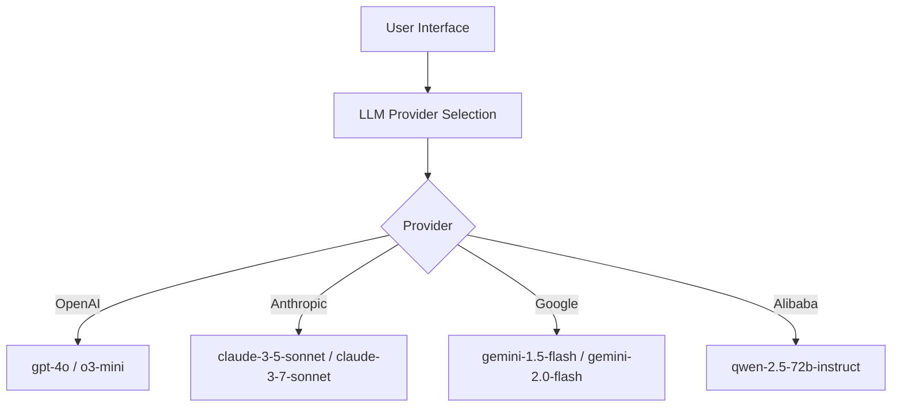

<!-- source: DeepWiki mcp.deepwiki.com · repo browser-use/macOS-use · page 3 User Interfaces · fetched 2026-10-30 -->

# User Interfaces

<details>
<summary>Relevant source files</summary>

The following files were used as context for generating this wiki page:

- [README.md](README.md)
- [examples/try.py](examples/try.py)
- [gradio_app/app.py](gradio_app/app.py)
- [gradio_app/src/models/llm_models.py](gradio_app/src/models/llm_models.py)
- [pyproject.toml](pyproject.toml)

</details>


## Purpose and Scope

This document provides a comprehensive overview of the user interfaces available in the macOS-use system. It covers the two primary interface options: the Command Line Interface (CLI) and the Gradio Web Interface. Each interface allows users to interact with the system in different ways, enabling AI agents to control macOS applications.

For details about the underlying Agent System that powers these interfaces, see [Agent System](#2.1). For information about the Controller System that executes actions on macOS, see [Controller System](#2.2).

## Overview of Available Interfaces

macOS-use provides two distinct user interfaces, each serving different use cases and user preferences:



Sources: [README.md:19-20](), [gradio_app/app.py:17-33]()

## Command Line Interface

The CLI provides a straightforward, script-based approach to interact with the macOS-use system. It is ideal for developers who prefer terminal-based workflows or need to integrate macOS-use into existing scripts.

### Structure and Components



Sources: [examples/try.py:48-73]()

### Example Scripts

The repository includes several example scripts in the `examples` directory that demonstrate different use cases:

| Script Name | Purpose | Command |
|-------------|---------|---------|
| try.py | Basic interaction with system | `python examples/try.py` |
| calculate.py | Calculate using macOS calculator | `python examples/calculate.py` |
| login_to_auth0.py | Automate web login process | `python examples/login_to_auth0.py` |
| check_time_online.py | Search for information online | `python examples/check_time_online.py` |
| excel.py | Manipulate data in spreadsheets | `python examples/excel.py` |

Sources: [README.md:70-82](), [README.md:92-95](), [README.md:104-107]()

### Example Usage

The standard pattern for CLI usage involves:

1. Setting up the LLM provider
2. Creating a controller
3. Initializing an agent with a task
4. Running the agent



A typical example script follows this pattern, as seen in `try.py`:

1. Import required modules and set up environment
2. Configure the LLM based on available API keys
3. Create a controller instance
4. Initialize and run the agent with a specific task
5. Process the results

Sources: [examples/try.py:1-74]()

## Gradio Web Interface

The Gradio web interface provides a more visual and user-friendly way to interact with macOS-use. It offers a browser-based GUI with multiple tabs for different functionalities.

### Architecture and Components

The Gradio interface is structured as a multi-tab application with specialized functionality in each tab:



Sources: [gradio_app/app.py:17-33](), [gradio_app/app.py:274-290]()

### Agent Tab

The Agent tab is the primary interface for running individual tasks:



Key components:
- Task input field for entering the task description
- Refine prompt button that uses the LLM to improve the task description
- Run button to execute the task
- Stop button to terminate execution
- Terminal output showing detailed execution logs
- Result output displaying the final outcome

Sources: [gradio_app/app.py:22-26](), [gradio_app/app.py:190-223]()

### Automations Tab

The Automations tab allows creating and managing sequences of agents to perform complex workflows:



Key components:
- Automation name and description fields
- Button to add a new automation
- List of existing automations
- Agent prompt field for adding agents to an automation
- List of agents in the selected automation
- Buttons to add and remove agents
- Button to run the selected automation

Sources: [gradio_app/app.py:27-31](), [gradio_app/app.py:149-168]()

### Configuration Tab

The Configuration tab provides options for configuring the system:



Key components:
- LLM provider selection (OpenAI, Anthropic, Google)
- LLM model selection based on the selected provider
- API key input field
- Telemetry settings for controlling data sharing

Sources: [gradio_app/app.py:33-35](), [gradio_app/app.py:247-257](), [gradio_app/src/models/llm_models.py:8-13]()

### Interface Lifecycle

The Gradio interface follows this lifecycle:



Sources: [gradio_app/app.py:190-233](), [gradio_app/app.py:149-188](), [gradio_app/app.py:234-257]()

## LLM Integration

Both interfaces integrate with various LLM providers to power the AI capabilities:



The system supports multiple LLM providers:
- OpenAI: gpt-4o, o3-mini
- Anthropic: claude-3-5-sonnet-20240620, claude-3-7-sonnet-20250219
- Google: gemini-1.5-flash-002, gemini-2.0-flash-exp
- Alibaba: qwen-2.5-72b-instruct

Sources: [gradio_app/src/models/llm_models.py:8-13](), [examples/try.py:22-29]()

## Installation and Setup

To use either interface, you need to:

1. Install the package: `pip install mlx-use` or clone the repository
2. Set up API keys for at least one LLM provider
3. Configure environment variables

For CLI usage, run the example scripts directly. For the Gradio interface, the server can be launched with:

```bash
# From the repository root
python -m gradio_app.app
```

Sources: [README.md:25-65](), [pyproject.toml:1-36]()

## Comparison of Interfaces

| Feature | CLI | Gradio Web Interface |
|---------|-----|----------------------|
| Complexity | Simple | Advanced |
| User Experience | Terminal-based | Visual, browser-based |
| Ideal For | Quick tasks, scripting, automation | Complex workflows, visual monitoring |
| Customizability | High (modify scripts) | Medium (use UI controls) |
| Learning Curve | Steeper (requires coding) | Gentler (GUI-based) |
| Integration | Easy to integrate with scripts | Standalone application |

Sources: [README.md:19-20](), [gradio_app/app.py:17-33](), [examples/try.py:1-74]()

## Best Practices

1. **For CLI Usage**:
   - Store API keys in environment variables or .env file
   - Create reusable scripts for common tasks
   - Define appropriate limits for max_steps and max_actions

2. **For Gradio Interface**:
   - Configure LLM provider and model before running tasks
   - Use the "Refine Prompt" feature to improve task descriptions
   - Create automations for recurring complex workflows
   - Monitor the terminal output for detailed execution progress

Sources: [examples/try.py:18-41](), [gradio_app/app.py:96-146]()

---

