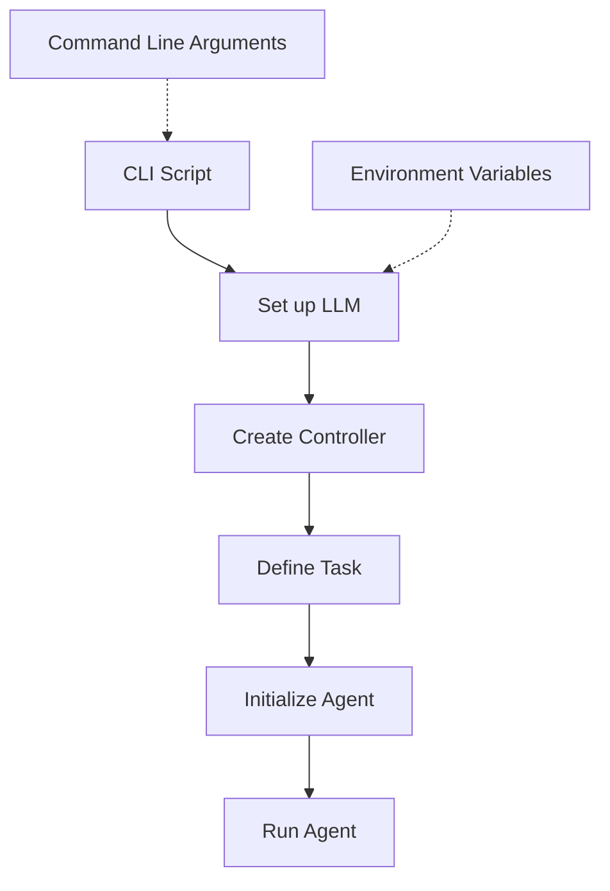
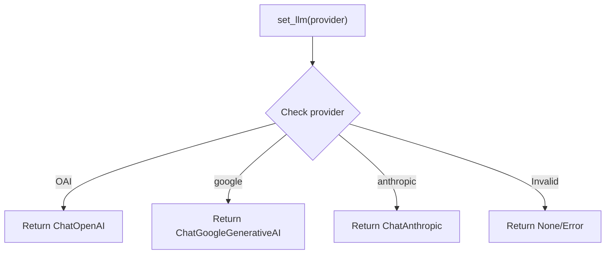
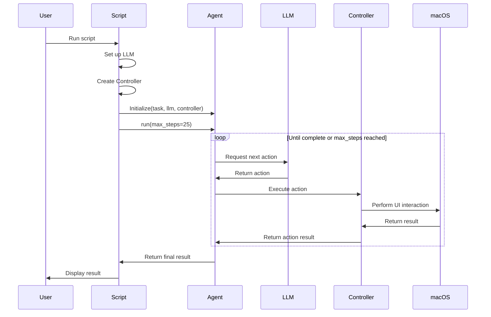

<!-- source: DeepWiki mcp.deepwiki.com · repo browser-use/macOS-use · page 3.1 Command Line Interface · fetched 2026-10-30 -->

# Command Line Interface

<details>
<summary>Relevant source files</summary>

The following files were used as context for generating this wiki page:

- [examples/calculate.py](examples/calculate.py)
- [examples/check_time_online.py](examples/check_time_online.py)
- [examples/login_to_auth0.py](examples/login_to_auth0.py)
- [examples/try.py](examples/try.py)
- [gradio_app/src/models/llm_models.py](gradio_app/src/models/llm_models.py)

</details>


This document explains how to use the macOS-use system via its command line interface (CLI). The CLI provides a straightforward way to run AI-powered macOS automation tasks through Python scripts. For information about the web-based interface, see [Gradio Web Interface](#3.2).

## Overview

The command line interface consists of Python example scripts that demonstrate various capabilities of the system. These scripts follow a common pattern for initializing LLM providers, setting up the controller, creating agents, and executing automation tasks.



Sources: [examples/try.py:1-74]()

## Script Structure and Components

All CLI scripts follow a similar structure with these key components:

1. **Imports**: Required libraries and the macOS-use components
2. **LLM Setup**: Initializing the appropriate language model provider
3. **Controller Creation**: Setting up the system that will execute actions
4. **Task Definition**: Specifying what the agent should accomplish
5. **Agent Initialization**: Creating an agent with the necessary parameters
6. **Execution**: Running the agent asynchronously

```mermaid
classDiagram
    class "CLI Script" {
        +set_llm()
        +Controller controller
        +Agent agent
        +main() async
    }
    
    class "Agent" {
        +String task
        +LLM llm
        +Controller controller
        +boolean use_vision
        +int max_actions_per_step
        +int max_failures
        +run(max_steps)
    }
    
    class "Controller" {
        +execute_actions()
    }
    
    class "LLM Provider" {
        +ChatOpenAI
        +ChatAnthropic
        +ChatGoogleGenerativeAI
    }
    
    "CLI Script" --> "Agent": creates
    "CLI Script" --> "Controller": creates
    "CLI Script" --> "LLM Provider": initializes
    "Agent" --> "Controller": uses
    "Agent" --> "LLM Provider": uses
```

Sources: [examples/try.py:1-74](), [examples/calculate.py:1-53]()

## Setting Up LLM Providers

Before running any script, you need to set up at least one LLM provider by configuring the appropriate API key in your environment variables. The system supports multiple providers:

| Provider   | Environment Variable | Default Models                       |
|------------|----------------------|-------------------------------------|
| OpenAI     | OPENAI_API_KEY       | gpt-4o, o3-mini                     |
| Anthropic  | ANTHROPIC_API_KEY    | claude-3-5-sonnet, claude-3-7-sonnet|
| Google     | GEMINI_API_KEY       | gemini-1.5-flash, gemini-2.0-flash  |

A typical LLM setup function looks like this:



Sources: [examples/try.py:18-31](), [gradio_app/src/models/llm_models.py:8-27]()

## Creating and Running an Agent

The Agent class is the core component that executes tasks. When initializing an Agent, you need to provide several parameters:

| Parameter            | Description                                                | Typical Values |
|----------------------|------------------------------------------------------------|----------------|
| task                 | The instruction for the agent to execute                   | String         |
| llm                  | The LLM provider instance                                  | LLM object     |
| controller           | The Controller instance for executing actions              | Controller     |
| use_vision           | Whether to use visual information                          | False          |
| max_actions_per_step | Maximum number of actions per step                         | 1-10           |
| max_failures         | Maximum number of allowed failures before stopping         | 5-10           |

To run the agent, call its `run()` method with the `max_steps` parameter, which limits the total number of interaction steps:



Sources: [examples/try.py:48-71](), [examples/calculate.py:39-49]()

## Example Scripts

The repository includes several example scripts demonstrating different use cases:

### 1. Basic Agent Interaction (try.py)

The most basic example that:
1. Greets the user
2. Takes a task input from the command line
3. Executes the provided task

Sources: [examples/try.py:1-74]()

### 2. Calculation (calculate.py)

Demonstrates using the agent to perform a simple calculation (5 × 4):

```
task = 'calculate how much is 5 X 4 and return the result, then call done.'
```

Sources: [examples/calculate.py:1-53]()

### 3. Web Information Retrieval (check_time_online.py)

Shows how to retrieve information from the web:

```
task = 'Can you check online what hour is Shabbat in israel this week? call done when you finish.'
```

Sources: [examples/check_time_online.py:1-54]()

### 4. Web Authentication (login_to_auth0.py)

Demonstrates a more complex web interaction involving authentication:

```
task = 'Go to auth0.com, sign in with google auth, choose ofiroz91@gmail.com account, login to the website and call done when you finish'
```

Sources: [examples/login_to_auth0.py:1-54]()

## Running the CLI Scripts

To run any of the example scripts:

1. Ensure you have set up at least one LLM provider API key in your environment
2. Navigate to the repository root directory
3. Run the script using Python:

```
python examples/try.py
```

The script will:
1. Initialize the appropriate LLM based on available API keys
2. Create a Controller instance
3. Set up an Agent with the specified task
4. Execute the task and display the results

Sources: [examples/try.py:1-74]()

## Creating Custom Scripts

To create your own custom CLI script:

1. Copy one of the example scripts as a starting template
2. Modify the `task` variable with your specific instructions
3. Adjust the agent parameters as needed:
   - Increase `max_actions_per_step` for more complex tasks
   - Increase `max_failures` for tasks that might encounter more errors
   - Set `use_vision=True` if visual understanding is required
   - Adjust `max_steps` based on expected task length

Example template:

```python
# Import necessary libraries
import os
import sys
sys.path.append(os.path.dirname(os.path.dirname(os.path.abspath(__file__))))
import asyncio
from mlx_use import Agent
from pydantic import SecretStr
from mlx_use.controller.service import Controller
from langchain_openai import ChatOpenAI

# Set up LLM
llm = ChatOpenAI(model='gpt-4o', api_key=SecretStr(os.getenv('OPENAI_API_KEY')))

# Create controller
controller = Controller()

# Define your task
task = 'Your custom task instructions here'

# Create agent
agent = Agent(
    task=task,
    llm=llm,
    controller=controller,
    use_vision=False,
    max_actions_per_step=5,
    max_failures=5
)

# Run agent
async def main():
    await agent.run(max_steps=25)

asyncio.run(main())
```

Sources: [examples/try.py:1-74](), [examples/calculate.py:1-53]()

## CLI Script Parameter Reference

When creating your own scripts, consider these common parameters:

| Component | Parameter | Description | Default/Recommendation |
|-----------|-----------|-------------|------------------------|
| Agent | task | The instruction to execute | Required, no default |
| Agent | llm | LLM provider instance | Required, no default |
| Agent | controller | Controller instance | Required, no default |
| Agent | use_vision | Use visual understanding | False |
| Agent | max_actions_per_step | Actions per iteration | 1-5 typical |
| Agent | max_failures | Failures before stopping | 5-10 typical |
| Agent.run() | max_steps | Maximum iterations | 25 typical |
| LLM | model | Model identifier | Provider-specific |
| LLM | api_key | API key for provider | From environment variable |

Sources: [examples/try.py:48-71](), [examples/calculate.py:39-49](), [examples/check_time_online.py:40-47](), [examples/login_to_auth0.py:39-46]()

## Troubleshooting

Common issues when running CLI scripts:

1. **Missing API Keys**: Ensure you have set at least one LLM provider's API key in your environment variables.

2. **ImportError**: Make sure you're running the script from the repository root or that the repository root is in your Python path.

3. **Maximum Steps Reached**: If your task doesn't complete, try increasing the `max_steps` parameter in the `agent.run()` call.

4. **Too Many Failures**: For complex or error-prone tasks, increase the `max_failures` parameter when initializing the Agent.

5. **Slow or Unresponsive Actions**: The default model might be having trouble with your task. Try a more advanced model or a different provider.

Sources: [examples/try.py:33-43]()

---

