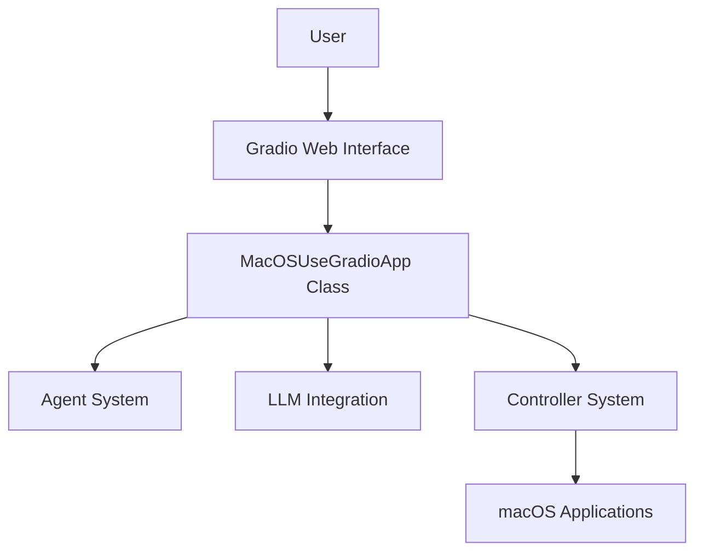
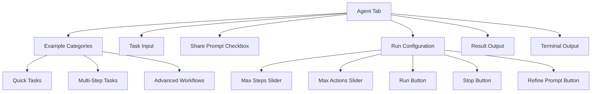
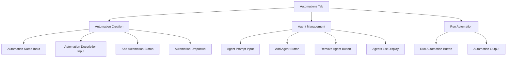
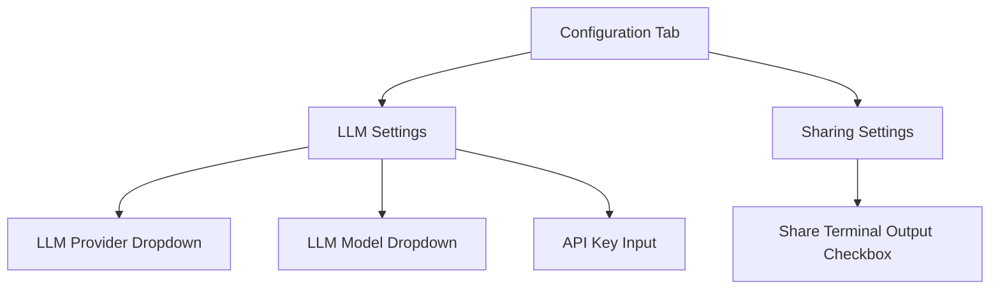
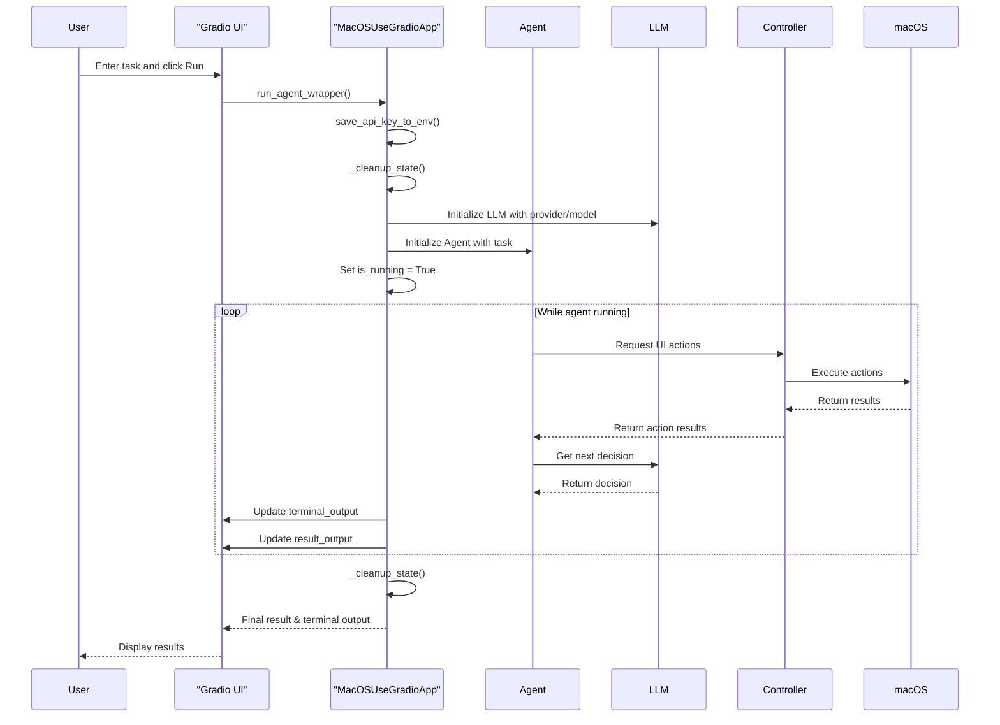
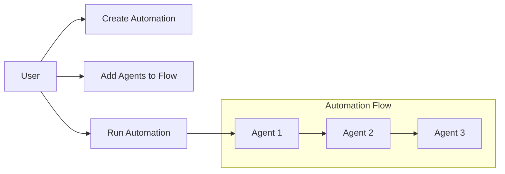
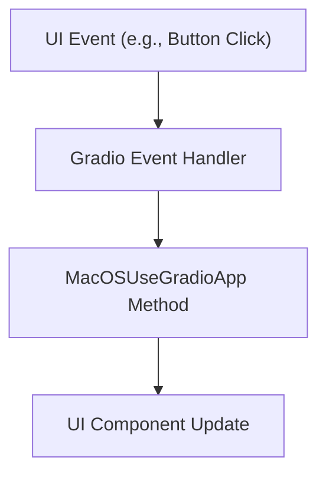

<!-- source: DeepWiki mcp.deepwiki.com · repo browser-use/macOS-use · page 3.2 Gradio Web Interface · fetched 2026-10-30 -->

# Gradio Web Interface

<details>
<summary>Relevant source files</summary>

The following files were used as context for generating this wiki page:

- [gradio_app/app.py](gradio_app/app.py)
- [gradio_app/src/models/app.py](gradio_app/src/models/app.py)
- [gradio_app/src/ui/interface.py](gradio_app/src/ui/interface.py)

</details>


This document details the web-based user interface implemented using the Gradio framework in the macOS-use project. The Gradio interface provides a user-friendly way to interact with the macOS-use system, run AI agents, create automation flows, and configure system settings. For information about using the command line interface, see [Command Line Interface](#3.1).

## Overview

The macOS-use Gradio web interface offers a browser-based method to control macOS applications using AI agents without requiring programming knowledge. It consists of three main tabs:

1. **Agent Tab**: Run single tasks with an AI agent
2. **Automations Tab**: Create and run sequences of agents
3. **Configuration Tab**: Manage LLM providers, models, and sharing settings



Sources: [gradio_app/app.py:17-259](), [gradio_app/src/models/app.py:23-571]()

## Interface Architecture

The Gradio interface is created using the `create_interface()` function, which sets up the three main tabs and their components. The interface communicates with the backend through the `MacOSUseGradioApp` class, which manages agent execution, LLM integration, and system state.

```mermaid
classDiagram
    class "create_interface()" {
        +Create Gradio UI components
        +Set up event handlers
        +Return Gradio demo object
    }
    
    class "MacOSUseGradioApp" {
        -agent
        -controller
        -is_running
        -preferences
        +run_agent()
        +stop_agent()
        +run_automation()
        +add_automation()
        +update_llm_preferences()
    }
    
    class "create_agent_tab()" {
        +Create Agent tab components
        +Return list of components
    }
    
    class "create_automations_tab()" {
        +Create Automations tab components
        +Return list of components
    }
    
    class "create_configuration_tab()" {
        +Create Configuration tab components
        +Return list of components
    }
    
    "create_interface()" --> "create_agent_tab()"
    "create_interface()" --> "create_automations_tab()"
    "create_interface()" --> "create_configuration_tab()"
    "create_interface()" --> "MacOSUseGradioApp"
```

Sources: [gradio_app/app.py:17-259](), [gradio_app/src/ui/interface.py:4-296]()

## Tab Components

### Agent Tab

The Agent tab allows users to run individual tasks using the AI agent.



Sources: [gradio_app/src/ui/interface.py:4-204]()

### Automations Tab

The Automations tab enables creating and running sequences of agents.



Sources: [gradio_app/src/ui/interface.py:206-258]()

### Configuration Tab

The Configuration tab manages system settings and LLM provider configuration.



Sources: [gradio_app/src/ui/interface.py:260-296]()

## Agent Execution Flow

When a user runs an agent from the Agent tab, the following sequence of events occurs:



Sources: [gradio_app/app.py:86-96](), [gradio_app/src/models/app.py:399-571]()

## Running Automations

Automations allow sequencing multiple agent tasks:



Sources: [gradio_app/src/models/app.py:264-364]()

## Key Components and Their Interactions

The table below shows the main components of the Gradio interface and their responsibilities:

| Component | File | Responsibility |
|-----------|------|----------------|
| `create_interface()` | gradio_app/app.py | Creates the Gradio UI and sets up event handlers |
| `main()` | gradio_app/app.py | Entry point that launches the Gradio server |
| `MacOSUseGradioApp` | gradio_app/src/models/app.py | Backend class that manages agent execution and state |
| `create_agent_tab()` | gradio_app/src/ui/interface.py | Creates the Agent tab components |
| `create_automations_tab()` | gradio_app/src/ui/interface.py | Creates the Automations tab components |
| `create_configuration_tab()` | gradio_app/src/ui/interface.py | Creates the Configuration tab components |

Sources: [gradio_app/app.py:17-259](), [gradio_app/src/models/app.py:23-571](), [gradio_app/src/ui/interface.py:4-296]()

## Starting the Gradio Interface

The `main()` function in the app.py file is responsible for initializing and launching the Gradio interface:

1. Creates an instance of `MacOSUseGradioApp`
2. Creates the Gradio interface with `create_interface()`
3. Launches the Gradio server on the specified port (default: 7860)
4. Falls back to alternative port if the specified port is unavailable

Sources: [gradio_app/app.py:274-304]()

## Example Usage

To use the Gradio interface effectively:

1. **In the Agent Tab:**
   - Select an example prompt or write your own
   - Configure max steps and actions per step if needed
   - Click "Run" to execute the agent
   - View results in the Result and Terminal Output sections

2. **In the Automations Tab:**
   - Create a new automation with a name and description
   - Add agent prompts to the automation flow
   - Select the automation from the dropdown and click "Run Automation"

3. **In the Configuration Tab:**
   - Select your preferred LLM provider and model
   - Enter your API key for the selected provider
   - Configure sharing preferences

Sources: [gradio_app/src/ui/interface.py:4-296]()

## Event Handling System

The Gradio interface uses a comprehensive event handling system to connect UI actions to backend functionality:



Key event handlers include:
- Run button click → `run_agent_wrapper()`
- Stop button click → `stop_agent()`
- LLM provider change → `update_provider()`
- Add automation button click → `add_automation_and_clear()`

Sources: [gradio_app/app.py:148-257]()

## Interface Customization

The Gradio interface includes custom CSS and styling to enhance the user experience, particularly for the scrollable example containers in the Agent tab:

```
.scrollable-container {
    height: 400px;
    overflow-y: auto;
    padding-right: 10px;
    margin-top: 10px;
}
```

The interface also includes responsive design elements that adapt to user actions, such as disabling the Run button while an agent is running and enabling the Stop button.

Sources: [gradio_app/src/ui/interface.py:138-162]()

---

