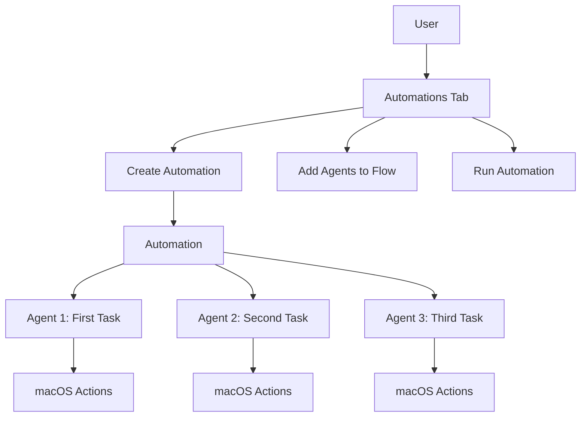
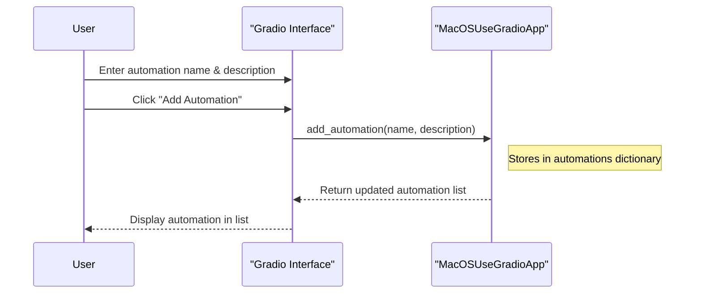
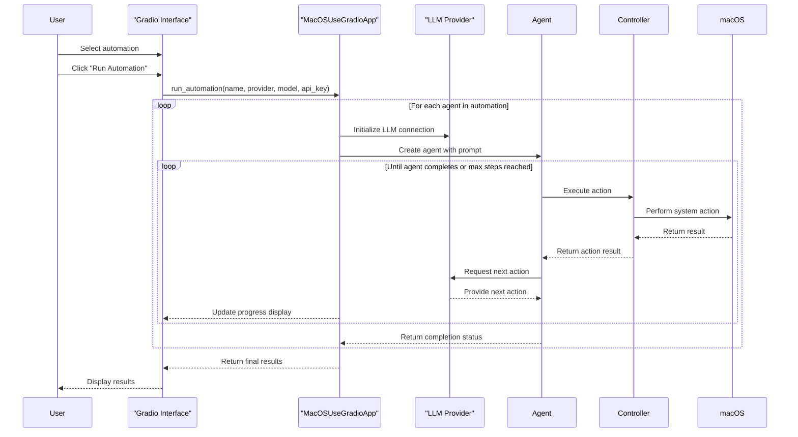
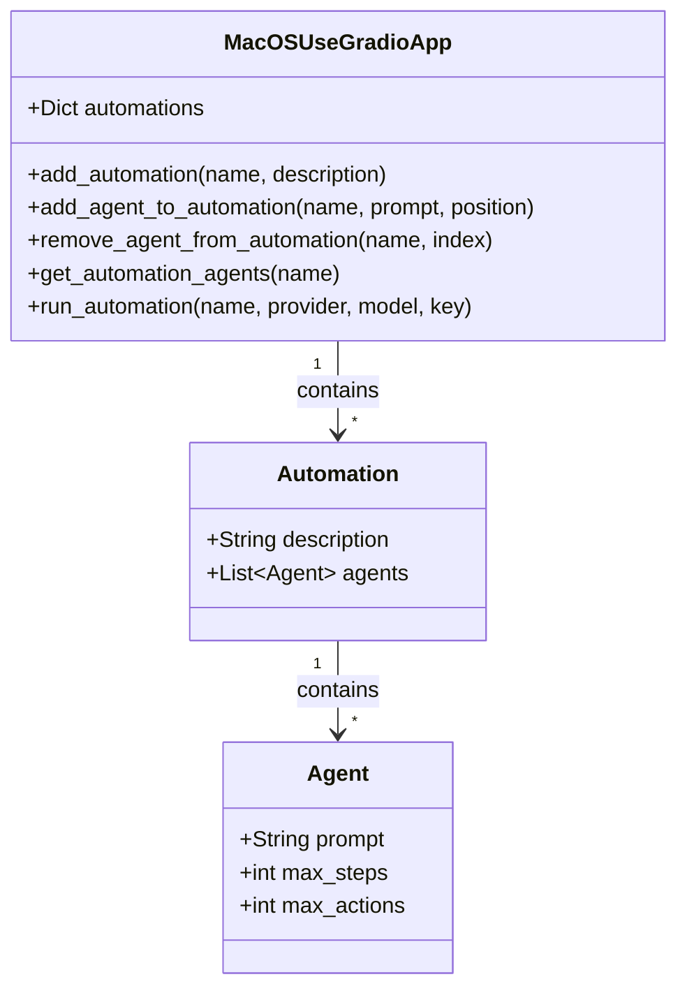

<!-- source: DeepWiki mcp.deepwiki.com · repo browser-use/macOS-use · page 3.3 Automation Flows · fetched 2026-10-30 -->

# Automation Flows

<details>
<summary>Relevant source files</summary>

The following files were used as context for generating this wiki page:

- [gradio_app/app.py](gradio_app/app.py)
- [gradio_app/src/config/example_prompts.py](gradio_app/src/config/example_prompts.py)
- [gradio_app/src/models/app.py](gradio_app/src/models/app.py)

</details>


This document details the Automation Flows feature in the macOS-use system. Automation Flows allow users to create sequences of agents that execute in order, enabling complex multi-step tasks to be performed across macOS applications. For information about basic agent interactions, see [Agent System](#2.1), and for details on using the Gradio interface, see [Gradio Web Interface](#3.2).

## 1. Overview of Automation Flows

Automation Flows provide a way to organize and execute multiple agents in sequence. Each agent in a flow performs a specific task, with the combined sequence accomplishing complex workflows that would be difficult to describe in a single prompt.

### Automation Flow Architecture



Sources: [gradio_app/app.py:27-31](), [gradio_app/src/models/app.py:110-158]()

## 2. Creating and Managing Automation Flows

### 2.1 Creating a New Automation

To create a new automation flow:

1. Navigate to the "Automations" tab in the Gradio interface
2. Enter a name for your automation in the "Automation Name" field
3. Optionally, enter a description in the "Description" field
4. Click the "Add Automation" button

This creates an empty automation flow that you can then populate with agents.



Sources: [gradio_app/app.py:41-47](), [gradio_app/src/models/app.py:110-119]()

### 2.2 Adding Agents to an Automation

Each automation flow consists of one or more agents that execute in sequence. To add agents to an automation:

1. Select the automation from the dropdown list
2. Enter the prompt for the agent in the "Agent Prompt" field
3. Click the "Add Agent" button

You can add multiple agents to create a sequence of actions.

#### Agent Configuration

Each agent in the automation has the following properties:

| Property | Default | Description |
|----------|---------|-------------|
| Prompt | (Required) | The instruction for the agent to perform |
| Max Steps | 25 | Maximum number of reasoning steps the agent can take |
| Max Actions | 1 | Maximum number of actions per step the agent can perform |

Sources: [gradio_app/app.py:49-54](), [gradio_app/src/models/app.py:121-137]()

### 2.3 Removing Agents from an Automation

To remove an agent from an automation:

1. Select the automation from the dropdown list
2. Select the agent to remove from the agents list
3. Click the "Remove Agent" button

The agent will be removed from the automation sequence.

Sources: [gradio_app/app.py:56-64](), [gradio_app/src/models/app.py:139-151]()

## 3. Running Automation Flows

### 3.1 Execution Process

When you run an automation flow, each agent in the sequence is executed one after another. The execution process follows these steps:

1. Select the automation from the dropdown list
2. Configure the LLM provider, model, and API key in the "Configuration" tab
3. Click the "Run Automation" button



Sources: [gradio_app/app.py:173-188](), [gradio_app/src/models/app.py:264-363]()

### 3.2 Monitoring Progress

As the automation executes, you can monitor its progress in the output display area. The display shows:

1. Which agent is currently running (e.g., "Running agent 1/3")
2. The terminal output of the current agent
3. Any results or errors that occur during execution

When an agent completes successfully, the automation moves to the next agent in the sequence. If an agent encounters an error, the automation stops and displays the error message.

Sources: [gradio_app/src/models/app.py:320-324](), [gradio_app/src/models/app.py:337-341]()

## 4. Internal Data Structure

### 4.1 Automation Storage

Automations are stored in the `automations` dictionary in the `MacOSUseGradioApp` class:



The structure of an automation in the dictionary is:

```
{
  "automation_name": {
    "description": "Automation description",
    "agents": [
      {
        "prompt": "First agent prompt",
        "max_steps": 25,
        "max_actions": 1
      },
      {
        "prompt": "Second agent prompt",
        "max_steps": 25,
        "max_actions": 1
      }
    ]
  }
}
```

Sources: [gradio_app/src/models/app.py:110-119](), [gradio_app/src/models/app.py:121-137]()

## 5. Example Use Cases

Automation Flows are particularly useful for complex tasks that involve multiple discrete steps across different applications. Some example use cases include:

### 5.1 Data Processing Workflow

Create an automation to:
1. Open a specific application to extract data
2. Process that data in another application
3. Save the results to a designated location

### 5.2 Regular System Maintenance

Create an automation to:
1. Check system status using System Information
2. Clean up temporary files
3. Generate a report of the actions taken

### 5.3 Multi-Application Tasks

Create an automation to:
1. Look up information in a web browser
2. Format and organize it in a document
3. Send the document via email or messaging

## 6. Best Practices

### 6.1 Agent Prompt Design

For effective automation flows:

- Make each agent's prompt focused on a single task or objective
- Be explicit about what state the system should be in when the agent completes
- Consider including "recovery" steps in case a previous agent leaves the system in an unexpected state

### 6.2 Debugging Automation Flows

When debugging automation flows:

1. Run agents individually first to ensure each step works correctly
2. Add explicit verification steps in agent prompts (e.g., "confirm that file X exists before proceeding")
3. Use the terminal output to identify which agent and which step encountered an error

Sources: [gradio_app/src/models/app.py:285-363]()

## 7. Technical Implementation

The Automation Flows feature is implemented through the following key components:

1. The `add_automation`, `add_agent_to_automation`, and `remove_agent_from_automation` methods in `MacOSUseGradioApp` handle creating and managing automations.

2. The `run_automation` method executes each agent in sequence, creating a new Agent instance for each step.

3. The Gradio interface in `create_automations_tab` provides the UI components for interacting with automation flows.

Sources: [gradio_app/app.py:27-31](), [gradio_app/src/models/app.py:110-158](), [gradio_app/src/models/app.py:264-363]()

---

