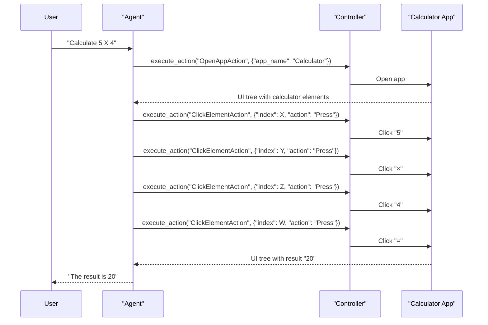
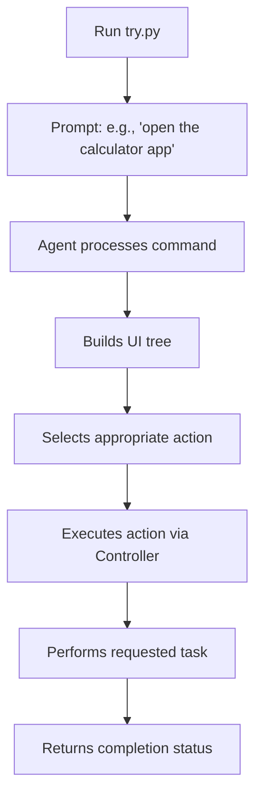
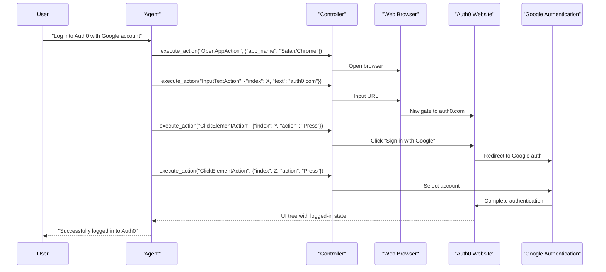
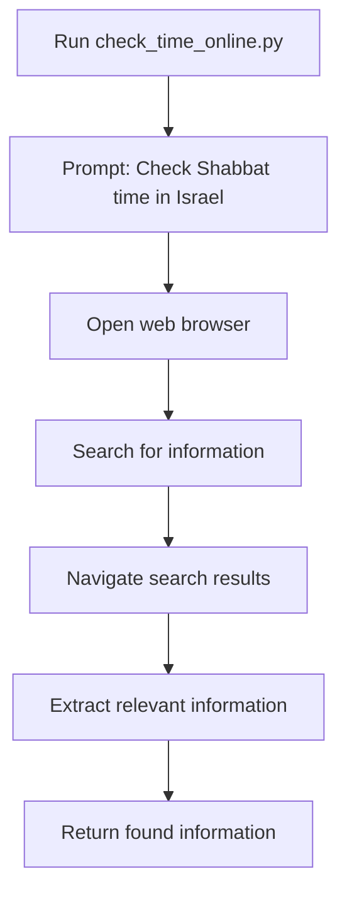
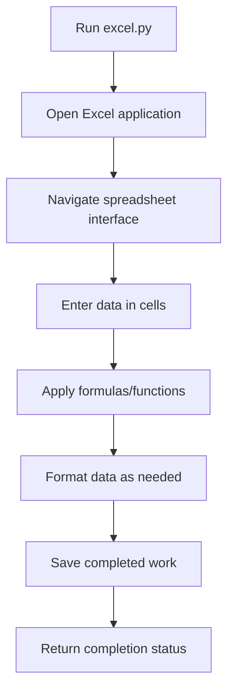
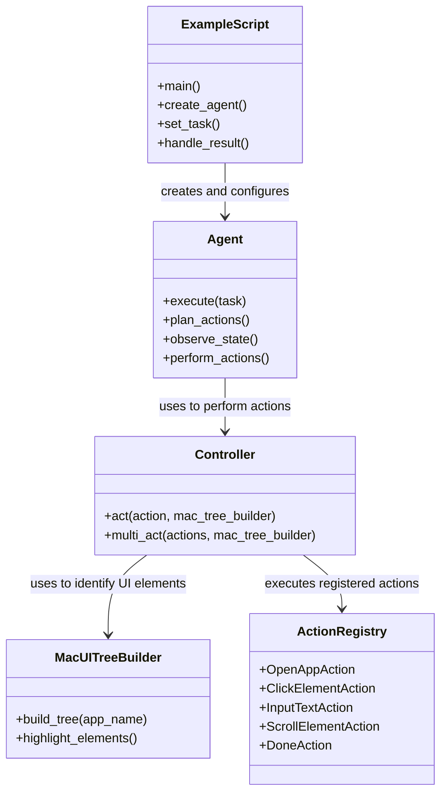

<!-- source: DeepWiki mcp.deepwiki.com · repo browser-use/macOS-use · page 4 Example Use Cases · fetched 2026-10-30 -->

# Example Use Cases

<details>
<summary>Relevant source files</summary>

The following files were used as context for generating this wiki page:

- [README.md](README.md)
- [pyproject.toml](pyproject.toml)
- [static/calc-5-X-4.gif](static/calc-5-X-4.gif)

</details>


This page provides an overview of practical applications and examples demonstrating how macOS-use can automate tasks across macOS applications. It showcases the system's capabilities through concrete examples that range from simple calculator operations to more complex web interactions and data manipulation tasks.

For information about the underlying system architecture, see [System Architecture](#2). For details on how to set up the system, see [Setup and Configuration](#5).

## Basic Examples

The macOS-use repository includes several basic examples that demonstrate core functionality and serve as starting points for new users.

### Simple Calculator Example

One of the simplest yet effective demonstrations is automating calculator operations. The system can:
1. Open the Calculator app
2. Input numbers and operations
3. Extract the result
4. Complete the task



Sources: [README.md:78-88](), [examples/calculate.py]()

### First-time User Example

The repository includes a simple example (`try.py`) designed for first-time users to verify system functionality:



To run this example:
```
python examples/try.py
```

This example is ideal for confirming that the system has been set up correctly and can successfully interact with macOS applications.

Sources: [README.md:61-73]()

## Web and App Automation Examples

macOS-use excels at automating web interactions and application workflows, enabling complex sequences of actions to be performed with simple natural language instructions.

### Web Login Automation

A powerful demonstration of the system's capabilities is automating login processes. The `login_to_auth0.py` example shows how the system can:

1. Navigate to a website
2. Identify and click authentication options
3. Complete the login process using stored credentials
4. Navigate through multi-step authentication flows



**Note:** This example demonstrates the system's power but also highlights important security considerations, as the agent can access and use stored credentials.

Sources: [README.md:91-100]()

### Online Information Retrieval

The `check_time_online.py` example demonstrates how the system can search for specific information online:



This example shows how the agent can:
1. Understand information-seeking tasks
2. Navigate to appropriate resources
3. Extract specific information from web pages
4. Summarize findings for the user

Sources: [README.md:103-112]()

## Data Manipulation Examples

macOS-use can automate data entry and manipulation tasks across various applications, including spreadsheet applications like Excel.

### Excel Automation

The system can interact with Excel or other spreadsheet applications to:
- Enter data systematically
- Apply formatting
- Execute formulas
- Extract and process information



This example demonstrates how macOS-use can automate repetitive data tasks that would normally require manual interaction with spreadsheet applications.

Sources: [README.md:115]()

## Integration Patterns

The following diagram illustrates how example use cases integrate with the core system components:



The example scripts (`try.py`, `calculate.py`, `login_to_auth0.py`, `check_time_online.py`, `excel.py`) all follow a similar pattern, creating an agent instance, setting a task, and then letting the agent autonomously interact with macOS applications to complete the specified task.

Sources: [README.md]()

## Common Use Case Patterns

Based on the provided examples, several common patterns emerge that demonstrate effective use of the macOS-use system:

| Use Case Category | Description | Example | Key Components |
|-------------------|-------------|---------|----------------|
| App Interaction | Opening and interacting with native macOS applications | Calculator example | OpenAppAction, ClickElementAction |
| Web Navigation | Browsing websites and extracting information | Check time online example | InputTextAction, ClickElementAction, ScrollElementAction |
| Authentication | Logging into services across websites | Auth0 login example | Complex sequences of ClickElementAction and InputTextAction |
| Data Processing | Manipulating data in productivity applications | Excel example | Targeted element interactions based on UI tree structure |

Each use case leverages the system's ability to:
1. Understand natural language instructions
2. Build a representation of the current UI state
3. Select appropriate actions based on the task and UI state
4. Execute actions that simulate human interaction
5. Observe results and adjust subsequent actions accordingly

Sources: [README.md]()

## Getting Started with Examples

To run any of the provided examples:

1. Ensure you have set up the environment and API keys as described in [Setup and Configuration](#5)
2. Navigate to the repository root directory
3. Run the desired example script:
   ```
   python examples/try.py
   # or
   python examples/calculate.py
   # or
   python examples/login_to_auth0.py
   # or
   python examples/check_time_online.py
   ```

Each example is designed to demonstrate specific capabilities of the system and can serve as a template for creating your own custom automation scripts.

Sources: [README.md:25-65]()

---

