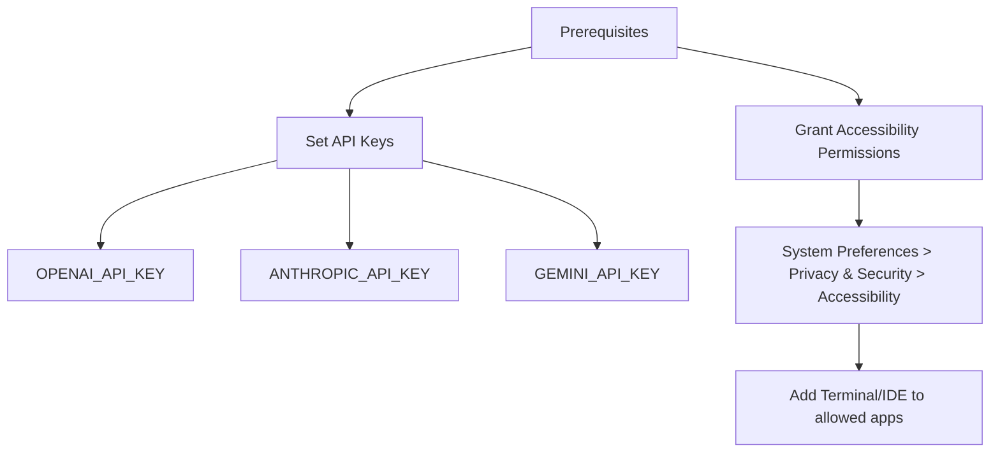
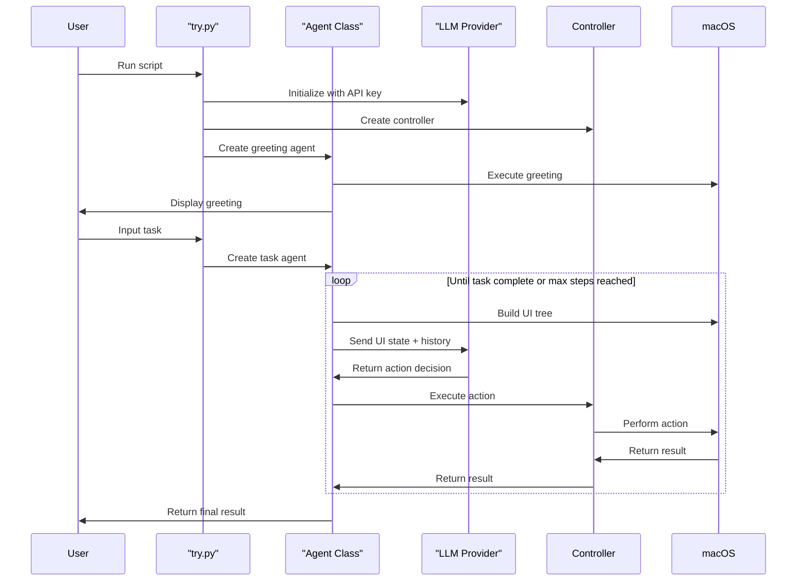
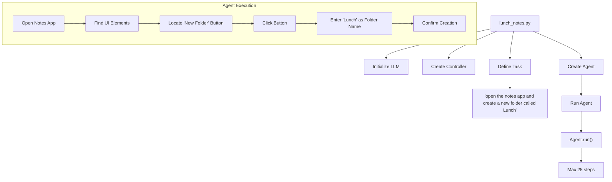
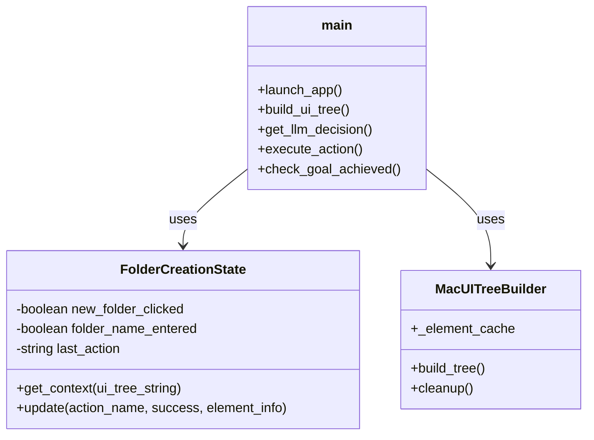
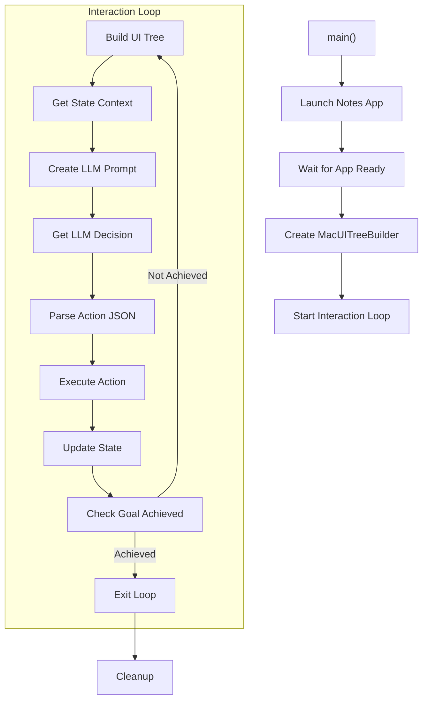
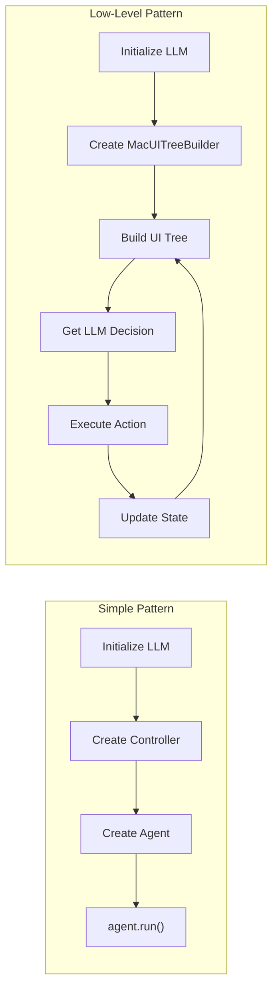

<!-- source: DeepWiki mcp.deepwiki.com · repo browser-use/macOS-use · page 4.1 Basic Usage Examples · fetched 2026-10-30 -->

# Basic Usage Examples

<details>
<summary>Relevant source files</summary>

The following files were used as context for generating this wiki page:

- [examples/basic_agent.py](examples/basic_agent.py)
- [examples/lunch_notes.py](examples/lunch_notes.py)
- [examples/try.py](examples/try.py)
- [gradio_app/src/models/llm_models.py](gradio_app/src/models/llm_models.py)
- [static/mlx-use-logo-dark.jpg](static/mlx-use-logo-dark.jpg)
- [static/mlx-use-logo.jpg](static/mlx-use-logo.jpg)

</details>


This document provides practical examples for using the macOS-use system to automate tasks on macOS. It demonstrates basic interaction patterns through sample scripts and explains the core concepts needed to get started with the system. For more complex automation scenarios, see [Web and App Automation](#4.2) and [Data Manipulation Examples](#4.3).

## Prerequisites

Before running the examples, you need to:

1. Set up at least one LLM provider API key as an environment variable:
   - `OPENAI_API_KEY` for OpenAI models
   - `ANTHROPIC_API_KEY` for Anthropic models
   - `GEMINI_API_KEY` for Google's Gemini models

2. Ensure macOS accessibility permissions are granted to your terminal or Python environment



Sources: [examples/try.py:17-43](), [gradio_app/src/models/llm_models.py:8-13]()

## Basic Example: Running a Simple Task

The simplest way to use macOS-use is through the `try.py` example script, which:
1. Sets up an LLM based on available API keys
2. Creates a Controller for executing actions
3. Runs a greeting agent
4. Takes a user-defined task as input
5. Executes the task using a new agent

### Running the Script

```bash
python examples/try.py
```

### Execution Flow



Sources: [examples/try.py:47-74]()

### Code Structure

The basic example initializes an LLM provider based on available API keys:

```python
# Example LLM initialization
if os.getenv('GEMINI_API_KEY'):
    llm = set_llm('google')
elif os.getenv('OPENAI_API_KEY'):
    llm = set_llm('OAI')
elif os.getenv('ANTHROPIC_API_KEY'):
    llm = set_llm('anthropic')
```

Then creates two agents:
1. A greeting agent that says hello:
```python
agent_greeting = Agent(
    task='Say "Hi there $whoami, What can I do for you today?"',
    llm=llm,
    controller=controller,
    use_vision=False,
    max_actions_per_step=1,
    max_failures=5
)
```

2. A task agent that executes the user-defined task:
```python
agent_task = Agent(
    task=task,
    llm=llm,
    controller=controller,
    use_vision=False,
    max_actions_per_step=4,
    max_failures=5
)
```

Sources: [examples/try.py:34-74]()

## Predefined Task Example

The `lunch_notes.py` example demonstrates how to automate a specific predefined task - creating a folder in the Notes app:



Sources: [examples/lunch_notes.py:1-52]()

### Key Components

1. **LLM Provider Setup**: The script selects and initializes an LLM provider
2. **Controller Creation**: Creates a `Controller` instance to handle actions
3. **Task Definition**: Specifies the exact task as a string
4. **Agent Configuration**: Creates an agent with the task and controller
5. **Execution**: Runs the agent for up to 25 steps

```python
# Define a specific task
task = 'open the notes app and create a new folder called "Lunch"'

# Create and run the agent
agent = Agent(
    task=task,
    llm=llm,
    controller=controller,
    use_vision=False,
    max_actions_per_step=5,
)

await agent.run(max_steps=25)
```

Sources: [examples/lunch_notes.py:36-49]()

## Agent Configuration Parameters

When creating an `Agent`, several parameters control its behavior:

| Parameter | Description | Example Value |
|-----------|-------------|--------------|
| `task` | The task description for the agent to execute | `"open the notes app and create a folder"` |
| `llm` | The language model provider instance | `ChatOpenAI(model='gpt-4o')` |
| `controller` | The controller instance for executing actions | `Controller()` |
| `use_vision` | Whether to use vision capabilities | `False` |
| `max_actions_per_step` | Maximum actions per decision cycle | `5` |
| `max_failures` | Maximum allowed consecutive failures | `5` |

Sources: [examples/try.py:50-57](), [examples/try.py:62-69](), [examples/lunch_notes.py:39-45]()

## Low-Level Example: Direct UI Interaction

The `basic_agent.py` script demonstrates a more advanced approach with direct UI interaction, state management, and explicit handling of the macOS accessibility API:



Sources: [examples/basic_agent.py:49-250]()

### Key Components

1. **State Management**: Uses a custom `FolderCreationState` class to track progress
2. **Direct UI Interaction**: Directly uses `MacUITreeBuilder` instead of the `Controller` abstraction
3. **App Launch and Detection**: Explicitly launches and identifies the Notes app
4. **UI Tree Building**: Builds the UI tree directly and processes it
5. **LLM Prompting**: Constructs detailed prompts with explicit instructions
6. **Action Execution**: Directly executes click and type actions on UI elements

```python
# Example of state management in basic_agent.py
class FolderCreationState:
    def __init__(self):
        self.new_folder_clicked = False
        self.folder_name_entered = False
        self.last_action = None

    def get_context(self, ui_tree_string: str) -> str:
        if not self.new_folder_clicked:
            return "Find and click the 'New Folder' button."
        elif not self.folder_name_entered:
            return "The 'New Folder' button has been clicked. Look for the newly appeared text field to type the folder name."
        else:
            return 'Folder name has been entered.'
```

Sources: [examples/basic_agent.py:49-72]()

### Execution Flow



Sources: [examples/basic_agent.py:75-248]()

## Common Usage Patterns

Based on the examples, here are the common patterns for using macOS-use:

1. **Simple Agent Pattern**:
   - Initialize an LLM
   - Create a Controller
   - Create an Agent with task and controller
   - Run the agent with a maximum number of steps

2. **Low-Level Interaction Pattern**:
   - Initialize an LLM
   - Create a MacUITreeBuilder
   - Build the UI tree
   - Get LLM decisions based on the UI state
   - Execute actions directly
   - Maintain state manually



Sources: [examples/try.py:1-74](), [examples/lunch_notes.py:1-52](), [examples/basic_agent.py:1-250]()

## Supported LLM Models

macOS-use supports multiple LLM providers and models:

| Provider | Models |
|----------|--------|
| OpenAI | gpt-4o, o3-mini |
| Anthropic | claude-3-5-sonnet-20240620, claude-3-7-sonnet-20250219 |
| Google | gemini-1.5-flash-002, gemini-2.0-flash-exp |
| Alibaba | qwen-2.5-72b-instruct |

Sources: [gradio_app/src/models/llm_models.py:8-13]()

## Summary

The basic usage examples demonstrate different ways to use macOS-use:

1. **User-driven tasks** via `try.py` - for ad-hoc automation
2. **Predefined tasks** via `lunch_notes.py` - for specific, repeatable automation
3. **Direct UI interaction** via `basic_agent.py` - for fine-grained control

The choice of approach depends on the level of abstraction and control needed for your automation tasks. For most users, the simplest approach using the `Agent` abstraction will be sufficient.

Sources: [examples/try.py:1-74](), [examples/lunch_notes.py:1-52](), [examples/basic_agent.py:1-250]()

---

