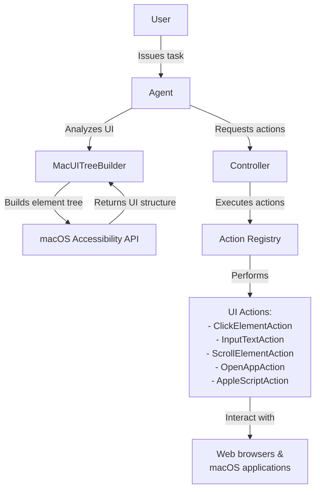
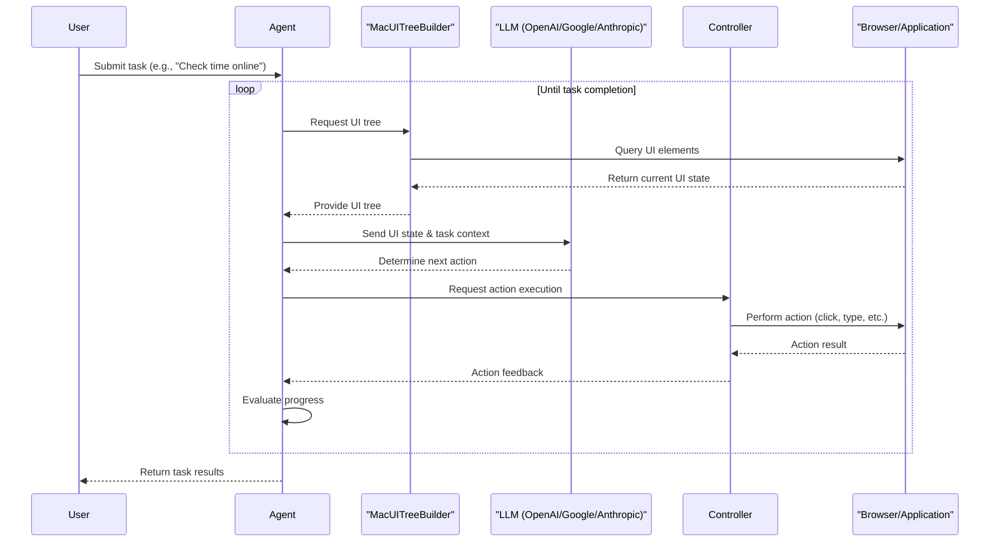
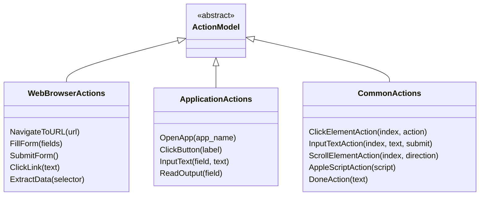
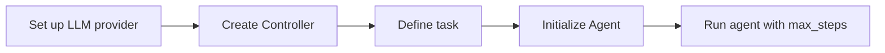

<!-- source: DeepWiki mcp.deepwiki.com · repo browser-use/macOS-use · page 4.2 Web and App Automation · fetched 2026-10-30 -->

# Web and App Automation

<details>
<summary>Relevant source files</summary>

The following files were used as context for generating this wiki page:

- [examples/calculate.py](examples/calculate.py)
- [examples/check_time_online.py](examples/check_time_online.py)
- [examples/login_to_auth0.py](examples/login_to_auth0.py)

</details>


## Purpose and Scope

This document explains how the macOS-use system automates interactions with web browsers and native macOS applications. It covers the core mechanisms for UI element identification, interaction patterns, and provides practical examples for common automation tasks. For information about data manipulation automation, see [Data Manipulation Examples](#4.3).

## Core Automation Architecture

The macOS-use system enables web and application automation through a layered architecture that connects natural language instructions to concrete UI interactions.



Sources: [examples/check_time_online.py:33-46](), [examples/login_to_auth0.py:33-46]()

## Automation Workflow

The process of automating web and application tasks follows a consistent pattern of perception, decision-making, and action:



Sources: [examples/login_to_auth0.py:39-50](), [examples/check_time_online.py:40-51]()

## Web Automation Examples

The system can automate various web-based tasks by controlling browsers and interacting with web content. Below are key examples:

### Example 1: Checking Time Information Online

This example demonstrates how the system searches for specific time information on the web:

```
Task: "Check online what hour is Shabbat in Israel this week? call done when you finish."
```

The agent performs the following actions:
1. Opens a browser
2. Navigates to a search engine
3. Searches for Shabbat times in Israel
4. Extracts the relevant information
5. Reports the findings

Sources: [examples/check_time_online.py:37-47]()

### Example 2: Web Authentication

This example shows how the system can handle complex authentication flows:

```
Task: "Go to auth0.com, sign in with google auth, choose ofiroz91@gmail.com account, login to the website and call done when you finish"
```

The agent performs these actions:
1. Opens a browser
2. Navigates to auth0.com
3. Locates and clicks the sign-in button
4. Selects Google authentication
5. Chooses the specified account
6. Completes the authentication flow

Sources: [examples/login_to_auth0.py:36-46]()

## Application Automation Example

In addition to web automation, the system can interact with native macOS applications:

### Calculator Example

```
Task: "calculate how much is 5 X 4 and return the result, then call done."
```

The agent performs these steps:
1. Opens the Calculator app
2. Inputs the first number (5)
3. Selects the multiplication operation
4. Inputs the second number (4)
5. Gets the result (20)
6. Reports the answer

Sources: [examples/calculate.py:36-45]()

## Core Components for Web and App Automation

The table below describes the key components involved in web and app automation:

| Component | Role in Automation | Key Features |
|-----------|-------------------|--------------|
| **Agent** | Coordinates the automation flow | - Processes the high-level task<br>- Maintains state and history<br>- Manages conversation with LLM<br>- Determines when task is complete |
| **MacUITreeBuilder** | Perceives application UI | - Queries macOS Accessibility API<br>- Creates hierarchical representation of UI<br>- Identifies interactive elements<br>- Assigns indices to elements for reference |
| **Controller** | Executes actions on applications | - Maps high-level intentions to concrete actions<br>- Performs clicks, typing, scrolling<br>- Opens applications<br>- Executes custom AppleScripts when needed |
| **LLM Provider** | Provides intelligence | - Interprets UI state<br>- Decides next actions<br>- Extracts relevant information<br>- Handles error recovery |

Sources: [examples/check_time_online.py:13-15](), [examples/login_to_auth0.py:12-14](), [examples/calculate.py:13-15]()

## Automation Action Types

The system supports various types of actions to interact with web browsers and applications:



Sources: [examples/check_time_online.py:33-34](), [examples/login_to_auth0.py:33-34](), [examples/calculate.py:33-34]()

## Automation Configuration

When implementing web and app automation, several parameters can be configured to optimize performance:

| Parameter | Purpose | Example Value |
|-----------|---------|--------------|
| `max_actions_per_step` | Maximum number of actions in a single step | 5-10 |
| `max_failures` | Number of action failures before task abortion | 5-10 |
| `max_steps` | Total number of steps permitted for task completion | 25 |
| `use_vision` | Whether to use visual analysis in addition to accessibility tree | `False` |
| `llm` | Language model provider to use | ChatOpenAI or ChatGoogleGenerativeAI |

Sources: [examples/check_time_online.py:40-46](), [examples/login_to_auth0.py:39-45](), [examples/calculate.py:39-45]()

## Implementation Pattern

All automation examples follow a similar implementation pattern, illustrated below:



The code typically includes:
1. Setting up the LLM provider (OpenAI, Google, or Anthropic)
2. Creating a Controller instance
3. Defining the task as a clear text instruction
4. Initializing the Agent with appropriate parameters
5. Running the agent with a maximum step limit

Sources: [examples/check_time_online.py:17-53](), [examples/login_to_auth0.py:17-53](), [examples/calculate.py:17-52]()

## Best Practices for Web and App Automation

- **Clear Task Definition**: Provide specific, unambiguous instructions
- **Error Handling**: Set appropriate `max_failures` to handle unexpected UI changes
- **Step Limitation**: Use `max_steps` to prevent infinite loops
- **Action Granularity**: Adjust `max_actions_per_step` based on task complexity
- **Authentication**: For login tasks, ensure higher failure tolerance
- **Task Completion**: Always include "call done when finished" in your task description

These practices help ensure reliable automation of web and application tasks while avoiding common pitfalls.

---

