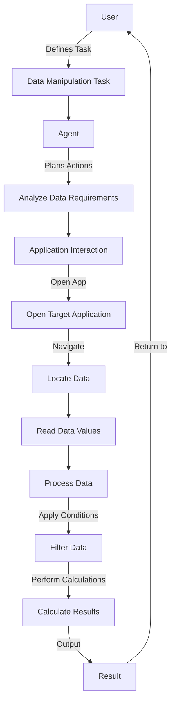
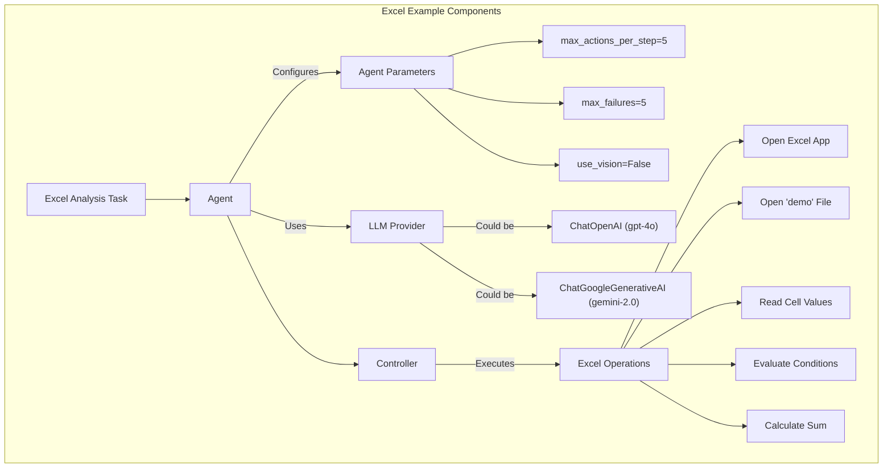
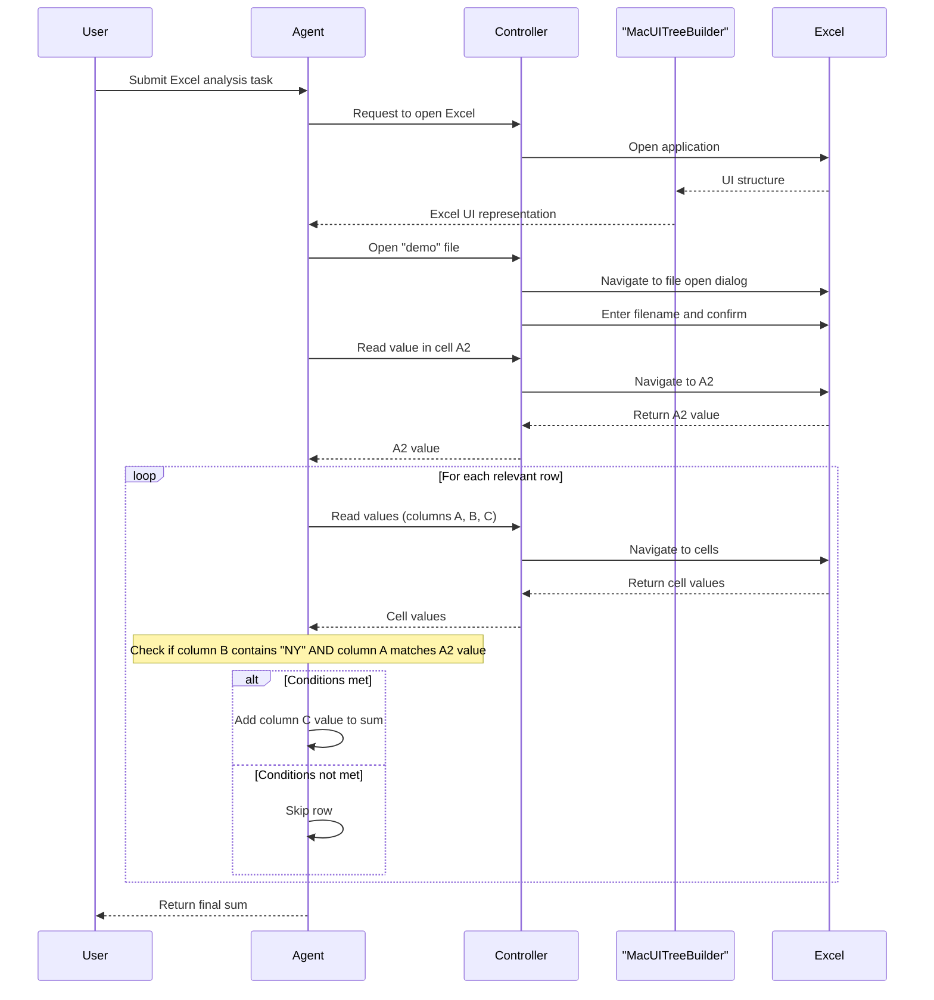
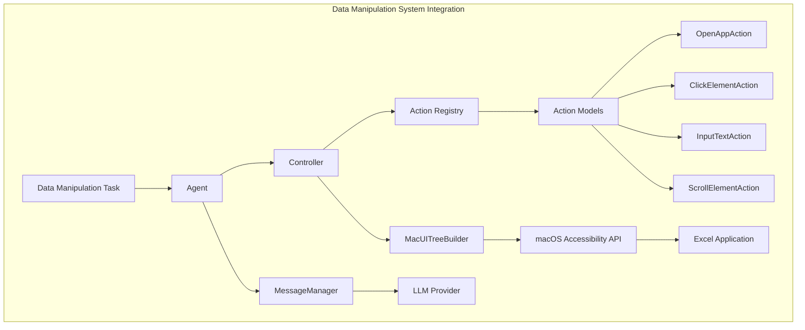
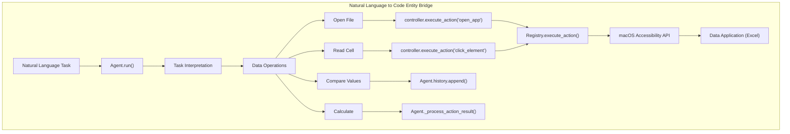

<!-- source: DeepWiki mcp.deepwiki.com · repo browser-use/macOS-use · page 4.3 Data Manipulation Examples · fetched 2026-10-30 -->

# Data Manipulation Examples

<details>
<summary>Relevant source files</summary>

The following files were used as context for generating this wiki page:

- [examples/excel.py](examples/excel.py)
- [static/calc-5-X-4.gif](static/calc-5-X-4.gif)

</details>


This page documents how the macOS-use system can be used for data manipulation tasks, demonstrating practical examples of working with structured data in applications like Excel. For related information about web and application automation, see [Web and App Automation](#4.2).

## Overview of Data Manipulation Capabilities

The macOS-use system enables interaction with data-centric applications through the Agent and Controller systems. These interactions can involve:

- Reading data from spreadsheets and tables
- Applying conditional filtering to datasets
- Performing calculations on filtered data
- Extracting specific information based on dynamic criteria



Sources: [examples/excel.py:41-45]()

## Excel Data Processing Example

The repository includes a detailed example showing how to use the macOS-use system to perform complex data analysis in an Excel spreadsheet.

### Task Description

The example demonstrates the following task:

```
Open up the Excel file called demo and add up all the numbers in column C, 
but only include them in the sum if the corresponding row in column B contains 'NY' 
AND the corresponding row in column A matches whatever value is in cell A2.
```

This task showcases several key capabilities:
1. Opening a specific file in Excel
2. Reading values from specific cells (cell A2 for comparison)
3. Applying multiple conditional filters (column B = 'NY' AND column A = value in A2)
4. Performing mathematical operations (summation of filtered values)

Sources: [examples/excel.py:42-45]()

### Implementation Components

The Excel example demonstrates the integration of several system components:



Sources: [examples/excel.py:38-53]()

### Execution Flow

The detailed process flow for the Excel example shows how the system components interact:



Sources: [examples/excel.py:57-63]()

## System Architecture Integration

The data manipulation examples leverage key components of the macOS-use architecture:



Sources: [examples/excel.py:13-15](), [examples/excel.py:18-41]()

## Excel Example Code Structure

The Excel example script demonstrates a complete implementation:

1. **LLM Configuration**:
   - Sets up either OpenAI or Google Gemini as the LLM provider
   - Retrieves API keys from environment variables

2. **Controller Initialization**:
   - Creates a Controller instance to manage interactions with macOS

3. **Task Definition**:
   - Defines the Excel data manipulation task as a natural language string

4. **Agent Configuration**:
   - Initializes an Agent with task, LLM, controller, and execution parameters
   - Sets parameters like `max_actions_per_step=5` and `max_failures=5`

5. **Execution**:
   - Runs the agent asynchronously with `max_steps=10`

Sources: [examples/excel.py:17-63]()

## Best Practices for Data Manipulation Tasks

When creating data manipulation tasks with macOS-use:

| Best Practice | Description |
|---------------|-------------|
| **Clear Task Definition** | Specify exactly what data to process and what operations to perform |
| **Condition Specificity** | Be explicit about all filtering conditions and how they combine |
| **Parameter Settings** | Adjust `max_actions_per_step` and `max_steps` based on task complexity |
| **Error Handling** | Set appropriate `max_failures` to handle potential interaction issues |
| **LLM Selection** | Choose an appropriate LLM based on the complexity of data analysis |

Sources: [examples/excel.py:46-53]()

## Potential Data Manipulation Applications

The architecture demonstrated in the Excel example can be extended to other data manipulation scenarios:

1. **Database Operations**: Querying, filtering, and exporting data
2. **Form Filling**: Populating forms with data from other sources
3. **Data Extraction**: Pulling specific information from documents
4. **Report Generation**: Creating summaries based on data analysis
5. **Data Cleanup**: Identifying and correcting inconsistencies



Sources: [examples/excel.py:42-63]()

## Example Script Overview

The example script in the repository (`excel.py`) provides a complete implementation that can be used as a template for creating other data manipulation tasks. The script:

1. Imports necessary libraries, including LLM providers
2. Sets up the LLM with appropriate API keys
3. Initializes the Controller
4. Defines the data manipulation task
5. Configures and runs the Agent

This pattern can be adapted for a wide range of data manipulation scenarios across different applications and data types.

Sources: [examples/excel.py:1-63]()

---

