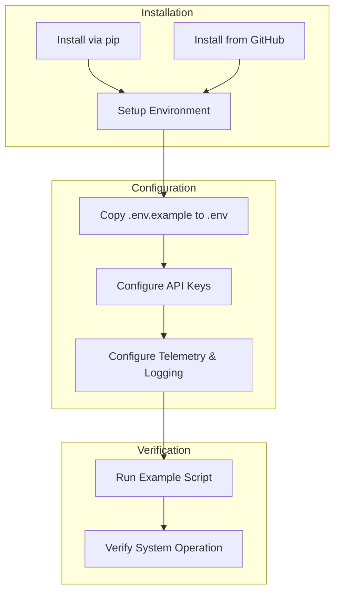
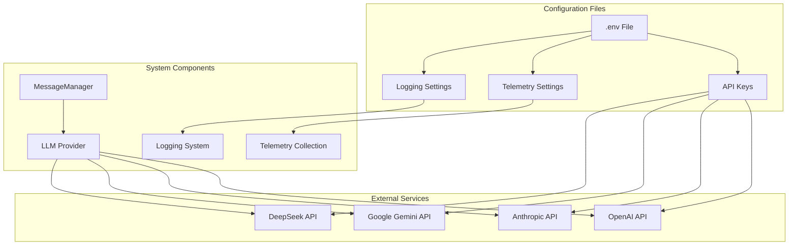
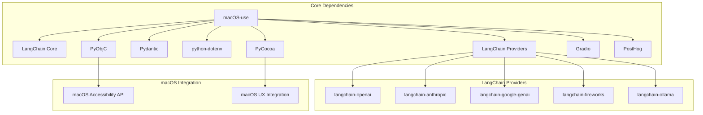

<!-- source: DeepWiki mcp.deepwiki.com · repo browser-use/macOS-use · page 5 Setup and Configuration · fetched 2026-10-30 -->

# Setup and Configuration

<details>
<summary>Relevant source files</summary>

The following files were used as context for generating this wiki page:

- [.env.example](.env.example)
- [README.md](README.md)
- [pyproject.toml](pyproject.toml)

</details>


This document provides comprehensive instructions for setting up and configuring the macOS-use system on your machine. It covers installation methods, environment setup, API key configuration, and system configuration options. For more specific information about API keys and environment variables, see [API Keys and Environment Variables](#5.1). For telemetry and logging configuration details, see [Telemetry and Logging](#5.2).

## Prerequisites

Before installing macOS-use, ensure your system meets the following requirements:

- **Python**: Python 3.11 or higher
- **Operating System**: macOS (the system is specifically designed for macOS)
- **Permissions**: Accessibility permissions must be granted to allow control of macOS applications

## Installation Methods

macOS-use can be installed using either pip or by cloning the GitHub repository.

### Installation via pip

The simplest way to install macOS-use is through pip:

```bash
pip install mlx-use
```

Sources: [pyproject.toml:1-4](), [README.md:25-29]()

### Installation from GitHub

For development or to access the latest updates:

1. Clone the repository:
```bash
git clone https://github.com/browser-use/macOS-use.git && cd macOS-use
```

2. Set up the environment (recommended with uv):
```bash
brew install uv && uv venv && source .venv/bin/activate
```

3. Install locally:
```bash
uv pip install --editable .
```

Sources: [README.md:32-65]()

## Environment Setup

macOS-use requires configuration through environment variables, particularly API keys for language model providers.

### Setting Up Environment Variables

1. Create an environment file by copying the example:
```bash
cp .env.example .env
```

2. Open the file to edit:
```bash
open ./.env
```

3. Add your API keys for at least one of the supported providers:
   - OpenAI
   - Anthropic
   - Google Gemini
   - DeepSeek (coming soon)

Sources: [README.md:40-51](), [.env.example:1-4]()

## Configuration Options

macOS-use provides several configuration options through environment variables.

### API Keys Configuration

At least one API key must be configured for macOS-use to function. The system supports multiple LLM providers:

```
OPENAI_API_KEY=your_openai_key_here
ANTHROPIC_API_KEY=your_anthropic_key_here
GEMINI_API_KEY=your_gemini_key_here
DEEPSEEK_API_KEY=your_deepseek_key_here
```

Note: While all providers are supported, OpenAI and Anthropic currently provide the most reliable performance.

Sources: [.env.example:1-4](), [README.md:40-42]()

### Telemetry and Logging

Control the system's telemetry and logging behavior:

```
# Set to false to disable anonymized telemetry
ANONYMIZED_TELEMETRY=false

# LogLevel: Set to debug for verbose logging, result for results only, or info for standard
BROWSER_USE_LOGGING_LEVEL=info
```

Available log levels:
- `result`: Shows only final results
- `info`: Default level with standard operational messages
- `debug`: Verbose logging for troubleshooting

Sources: [.env.example:7-11]()

## Configuration Flow

The diagram below illustrates the configuration flow from installation to system operation:



Sources: [README.md:21-73](), [.env.example:1-11]()

## System Configuration Architecture

The following diagram shows how configuration settings relate to the macOS-use system components:



Sources: [.env.example:1-11]()

## Dependency Architecture

macOS-use relies on several libraries to function properly. The core dependencies are defined in the project configuration:



Sources: [pyproject.toml:15-35]()

## Verifying Installation

After installation and configuration, verify that the system is working correctly by running one of the example scripts:

```bash
python examples/try.py
```

Try prompting it with a simple command:
```bash
open the calculator app
```

Successful execution of this command indicates that macOS-use is properly installed and configured.

Sources: [README.md:63-72]()

## Common Configuration Issues

| Issue | Possible Cause | Solution |
|-------|---------------|----------|
| API connection error | Missing or invalid API key | Check `.env` file for correct API keys |
| Permission error | Missing accessibility permissions | Go to System Preferences → Security & Privacy → Accessibility and allow your Terminal app |
| Missing dependencies | Incomplete installation | Reinstall using `pip install mlx-use` or check GitHub installation steps |
| Logging not working | Incorrect log level | Set `BROWSER_USE_LOGGING_LEVEL` to debug, info, or result as needed |
| LLM not responding | API rate limits or service down | Try using a different LLM provider |

Sources: [README.md:144-152](), [.env.example:1-11]()

## Next Steps

After setting up and configuring macOS-use, explore the example scripts to understand the system's capabilities:

- Basic usage: `examples/try.py`
- Calculator example: `examples/calculate.py`
- Web authentication: `examples/login_to_auth0.py`
- Web search: `examples/check_time_online.py`

For more detailed information on using these examples, see [Basic Usage Examples](#4.1) and [Web and App Automation](#4.2).

Sources: [README.md:74-111]()

---

