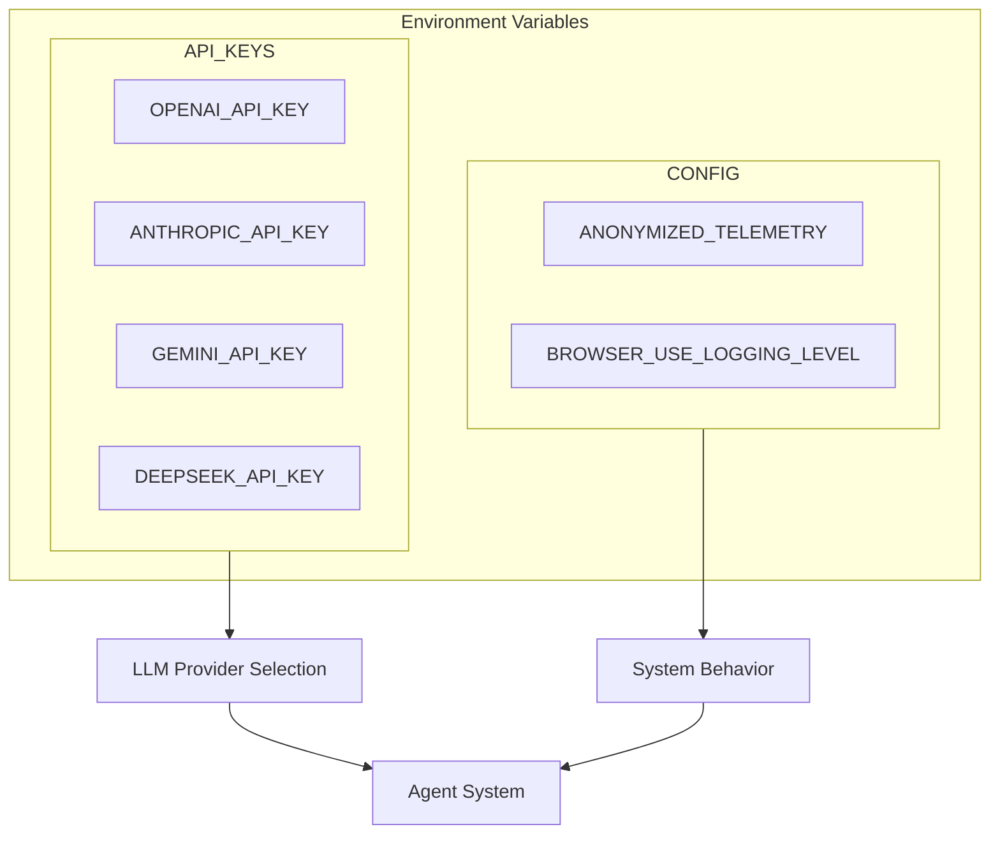
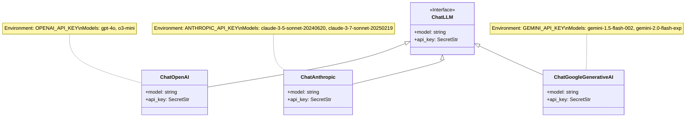
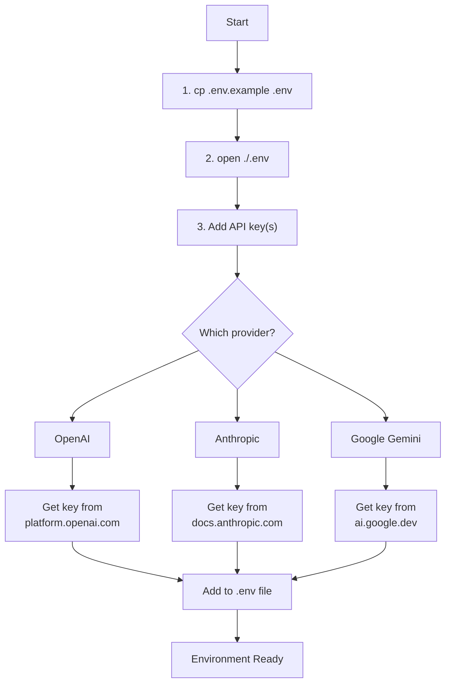
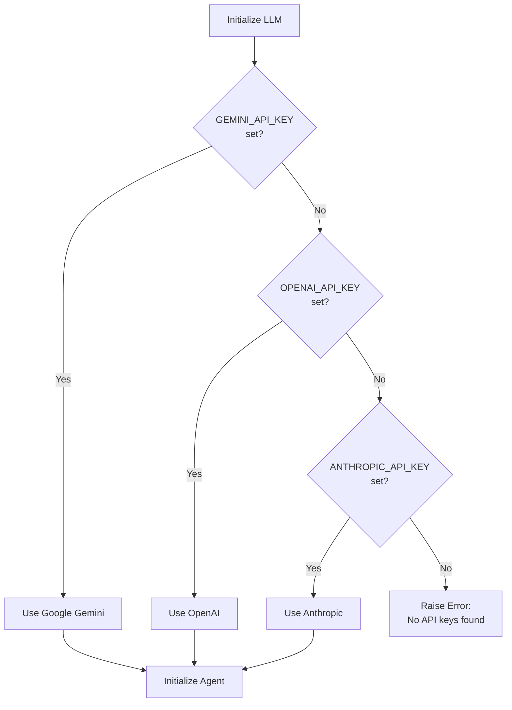

<!-- source: DeepWiki mcp.deepwiki.com · repo browser-use/macOS-use · page 5.1 API Keys and Environment Variables · fetched 2026-10-30 -->

# API Keys and Environment Variables

<details>
<summary>Relevant source files</summary>

The following files were used as context for generating this wiki page:

- [.env.example](.env.example)
- [README.md](README.md)
- [examples/try.py](examples/try.py)
- [gradio_app/src/models/llm_models.py](gradio_app/src/models/llm_models.py)
- [pyproject.toml](pyproject.toml)

</details>


This page documents how to set up and manage API keys for LLM providers and configure environment variables required by the macOS-use system. For information about telemetry and logging configuration, see [Telemetry and Logging](#5.2).

## Overview

macOS-use requires at least one LLM provider API key to function. The system supports multiple providers, with different capabilities and cost structures. Environment variables are used to configure both API keys and system behavior.



Sources: [.env.example:1-12](), [README.md:40-42](), [examples/try.py:18-43]()

## Supported LLM Providers and Models

macOS-use supports multiple LLM providers. You must configure at least one provider's API key for the system to function.

| Provider | Environment Variable | Supported Models | Recommendation |
|----------|---------------------|------------------|----------------|
| OpenAI | OPENAI_API_KEY | gpt-4o, o3-mini | Recommended for best reliability |
| Anthropic | ANTHROPIC_API_KEY | claude-3-5-sonnet-20240620, claude-3-7-sonnet-20250219 | Highly reliable |
| Google | GEMINI_API_KEY | gemini-1.5-flash-002, gemini-2.0-flash-exp | Free tier available but less reliable |
| Alibaba (future) | DEEPSEEK_API_KEY | qwen-2.5-72b-instruct | Not fully implemented yet |



Sources: [gradio_app/src/models/llm_models.py:1-27](), [examples/try.py:4-6](), [examples/try.py:18-43]()

## Setting Up Your Environment

### Initial Setup

1. Copy the example environment file to create your own:

```bash
cp .env.example .env
```

2. Open the .env file to edit it:

```bash
open ./.env
```

3. Add at least one API key from your preferred provider

### API Key Acquisition

To obtain API keys for the supported providers:

- **OpenAI**: Visit [OpenAI Platform](https://platform.openai.com/docs/quickstart)
- **Anthropic**: Visit [Anthropic Documentation](https://docs.anthropic.com/en/api/admin-api/apikeys/get-api-key)
- **Google Gemini**: Visit [Google AI](https://ai.google.dev/gemini-api/docs/api-key)



Sources: [README.md:46-51](), [.env.example:1-12]()

## Provider Selection and Fallback Logic

When initializing the system, macOS-use will attempt to use available API keys in this order:

1. Google Gemini (if GEMINI_API_KEY is set)
2. OpenAI (if OPENAI_API_KEY is set)
3. Anthropic (if ANTHROPIC_API_KEY is set)

If no valid API key is found, the system will raise an error. This behavior is implemented in the `try.py` example and should be followed in your applications.



Sources: [examples/try.py:33-43]()

## Additional Configuration Options

Besides API keys, the .env file can include the following configuration options:

| Variable | Purpose | Default | Valid Values |
|----------|---------|---------|-------------|
| ANONYMIZED_TELEMETRY | Controls whether anonymous usage data is collected | false | true/false |
| BROWSER_USE_LOGGING_LEVEL | Sets the verbosity of system logs | info | result/debug/info |

These settings affect system behavior but are not required for basic operation. For more details on telemetry and logging configuration, see [Telemetry and Logging](#5.2).

Sources: [.env.example:7-11]()

## Example Implementation

The `set_llm` function from the example applications demonstrates how to properly initialize LLM providers based on environment variables:

```python
def set_llm(llm_provider:str = None):
    if not llm_provider:
        raise ValueError("No llm provider was set")
    
    if llm_provider == "OAI" and os.getenv('OPENAI_API_KEY'):
        return ChatOpenAI(model='gpt-4', api_key=SecretStr(os.getenv('OPENAI_API_KEY')))
    
    if llm_provider == "google" and os.getenv('GEMINI_API_KEY'):
        return ChatGoogleGenerativeAI(model='gemini-2.0-flash-exp', api_key=SecretStr(os.getenv('GEMINI_API_KEY')))
    
    if llm_provider == "anthropic" and os.getenv('ANTHROPIC_API_KEY'):
        return ChatAnthropic(model='claude-3-sonnet-20240229', api_key=SecretStr(os.getenv('ANTHROPIC_API_KEY')))
    
    return None
```

Sources: [examples/try.py:18-31]()

The Agent initialization then uses this LLM provider in its constructor:

```python
agent = Agent(
    task=task,
    llm=llm,
    controller=controller,
    use_vision=False,
    max_actions_per_step=4,
    max_failures=5
)
```

Sources: [examples/try.py:62-69]()

## Troubleshooting

If you encounter errors related to API keys or environment variables, check the following:

1. Ensure your .env file exists and contains at least one valid API key
2. Verify that your API keys are correct and have not expired
3. Check that you have sufficient quota/credits with your LLM provider
4. For OpenAI users, ensure your account has been properly set up for API access

If you're using the application through a custom script, make sure the environment is properly loaded before the application starts.

Sources: [examples/try.py:42-43]()

---

