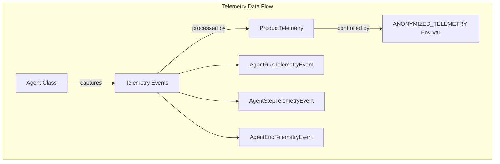
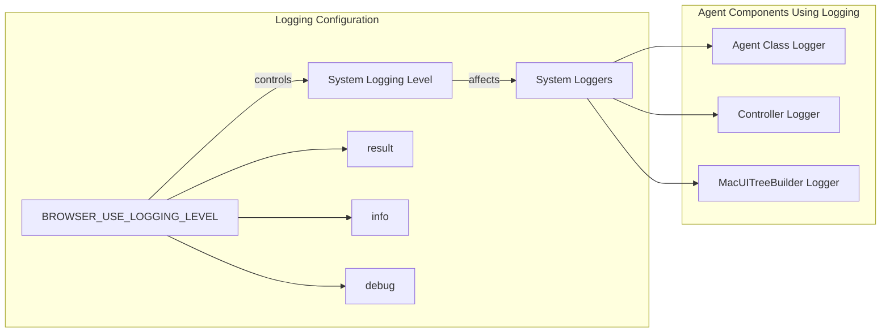
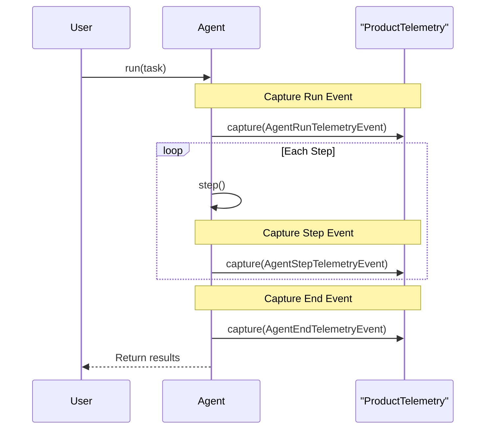
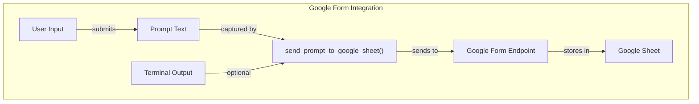

<!-- source: DeepWiki mcp.deepwiki.com · repo browser-use/macOS-use · page 5.2 Telemetry and Logging · fetched 2026-10-30 -->

# Telemetry and Logging

<details>
<summary>Relevant source files</summary>

The following files were used as context for generating this wiki page:

- [.env.example](.env.example)
- [gradio_app/src/services/google_form.py](gradio_app/src/services/google_form.py)
- [mlx_use/agent/service.py](mlx_use/agent/service.py)

</details>


This page documents the telemetry collection and logging capabilities of the macOS-use system. It explains how telemetry data is collected, what information is included, how to configure privacy settings, and how the logging system works.

## Overview

The macOS-use system includes instrumentation for collecting anonymized usage data and configurable logging to help with debugging and understanding system behavior. This document covers:

- Telemetry events captured during agent execution
- Privacy controls for opting out of telemetry
- Logging configuration options
- How telemetry data flows through the system

Sources: [mlx_use/agent/service.py:108-110](), [.env.example:7-11]()

## Telemetry System

### Telemetry Architecture

The telemetry system captures events at key points during the agent's execution cycle, providing insights into how the system is being used while maintaining user privacy.



Sources: [mlx_use/agent/service.py:40-45](), [mlx_use/agent/service.py:108-110]()

### Telemetry Events

The system captures three primary types of telemetry events:

| Event Type | Captured At | Information Included |
|------------|-------------|----------------------|
| `AgentRunTelemetryEvent` | Start of agent run | Agent ID, task description, model name, library used, system version |
| `AgentStepTelemetryEvent` | Each agent step | Agent ID, step number, actions performed, errors encountered |
| `AgentEndTelemetryEvent` | End of agent run | Agent ID, success status, total steps, errors summary |

Each event is associated with a unique agent ID (UUID) that allows for correlating events while preserving anonymity.

Sources: [mlx_use/agent/service.py:247-255](), [mlx_use/agent/service.py:389-399](), [mlx_use/agent/service.py:434-442]()

### Configuration and Privacy Controls

Users can opt out of telemetry collection by setting the `ANONYMIZED_TELEMETRY` environment variable to `false` in their `.env` file:

```
# Set to false to disable anonymized telemetry
ANONYMIZED_TELEMETRY=false
```

This setting is respected by the `ProductTelemetry` service, which will not capture or transmit data when telemetry is disabled.

Sources: [.env.example:7-8]()

## Logging System

### Logging Configuration

Logging in macOS-use is built on Python's standard logging module. The system provides configurable logging levels through environment variables.



Sources: [mlx_use/agent/service.py:7-11](), [.env.example:10-11]()

### Log Levels

macOS-use supports the following logging levels:

| Level | Description | Use Case |
|-------|-------------|----------|
| `result` | Minimal logging, showing only final results | Production use with minimal verbosity |
| `info` | Standard logging level with key operational information | Normal operation and monitoring |
| `debug` | Verbose logging with detailed information | Troubleshooting and development |

Set the desired level in your `.env` file:

```
# LogLevel: Set to debug to enable verbose logging, set to result to get results only
BROWSER_USE_LOGGING_LEVEL=info
```

Sources: [.env.example:10-11]()

### Key Logging Points

The system logs various events during execution:

1. Step execution: `"📍 Step {step_number}"` 
2. Evaluation of previous goal: Success/failure indicators with emojis
3. Agent actions: Details about each action being performed
4. Error states: Detailed error information with stack traces in debug mode

The `Agent` class, as the central coordinator, produces the majority of log entries.

Sources: [mlx_use/agent/service.py:196-197](), [mlx_use/agent/service.py:330-344]()

## Telemetry Data Collection Points

The telemetry system is integrated at key points in the agent execution flow to capture meaningful data about system usage and performance.



Sources: [mlx_use/agent/service.py:389-399](), [mlx_use/agent/service.py:247-255](), [mlx_use/agent/service.py:434-442]()

### Agent Steps and Telemetry

Each agent step captures detailed information about what actions were performed and any errors that occurred. The step telemetry provides insights into:

1. The specific actions executed (e.g., clicking elements, typing text)
2. Consecutive failure counts for error analysis
3. Step-specific errors encountered

Sources: [mlx_use/agent/service.py:247-255]()

### Run Completion Telemetry

At the end of a run, the system captures a summary of the entire execution, including:

1. Overall success/failure status
2. Total number of steps executed
3. Whether the maximum step limit was reached
4. A summary of errors encountered

This information helps in analyzing the effectiveness of the system for different tasks.

Sources: [mlx_use/agent/service.py:434-442]()

## Google Form Integration

The system includes an optional integration for sending prompt data to a Google Form, which serves as an additional telemetry collection mechanism focused specifically on the prompts used.



### Form Submission Process

The Google Form integration:

1. Takes prompt text and optional terminal output
2. Formats the data for submission
3. Sends it to a Google Form endpoint
4. Logs the success or failure of the submission

This integration can be used to collect examples of effective prompts for system improvement.

Sources: [gradio_app/src/services/google_form.py:1-36]()

### Data Limitations

To prevent issues with form submission, terminal output is limited to a reasonable maximum length (100,000 characters). Longer outputs are truncated with a notification in the logs.

Sources: [gradio_app/src/services/google_form.py:18-22]()

## Best Practices

### Configuring for Development

During development, it's recommended to:

1. Set `BROWSER_USE_LOGGING_LEVEL=debug` for maximum information
2. Leave telemetry enabled to help improve the system

### Configuring for Production

For production use:

1. Consider setting `BROWSER_USE_LOGGING_LEVEL=result` or `info` for better performance
2. Set `ANONYMIZED_TELEMETRY=false` if privacy is a concern

Sources: [.env.example:7-11]()

---

