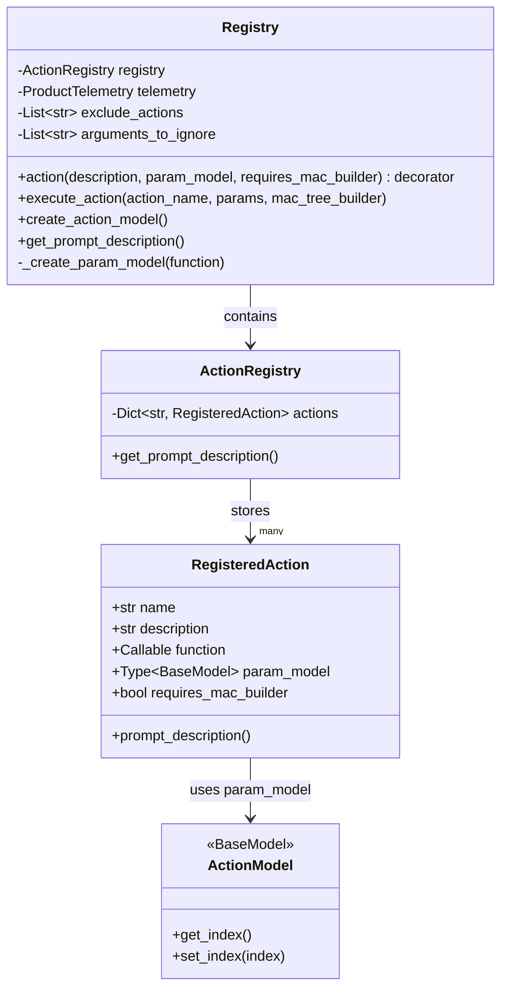
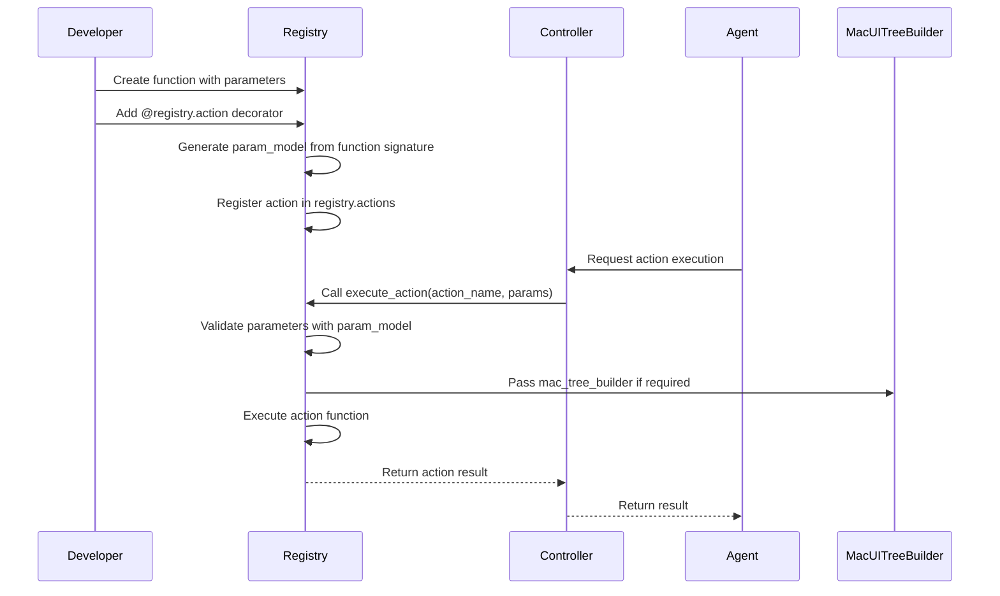
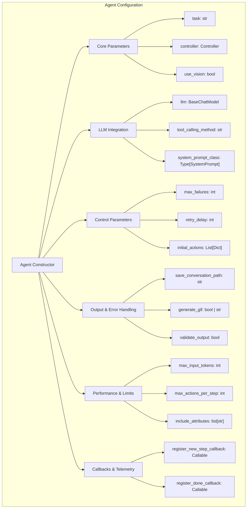
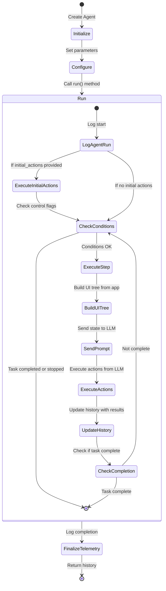
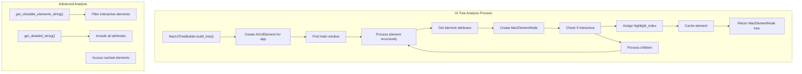
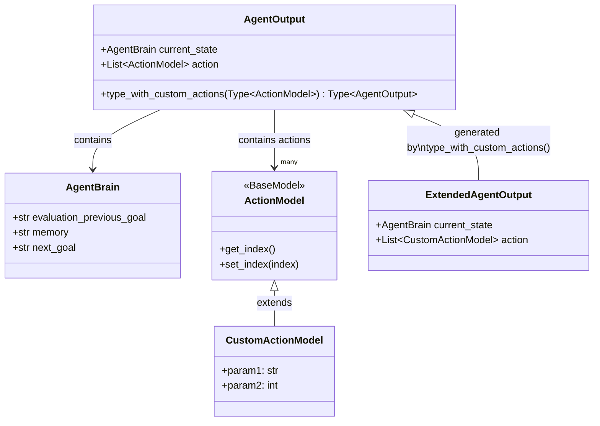
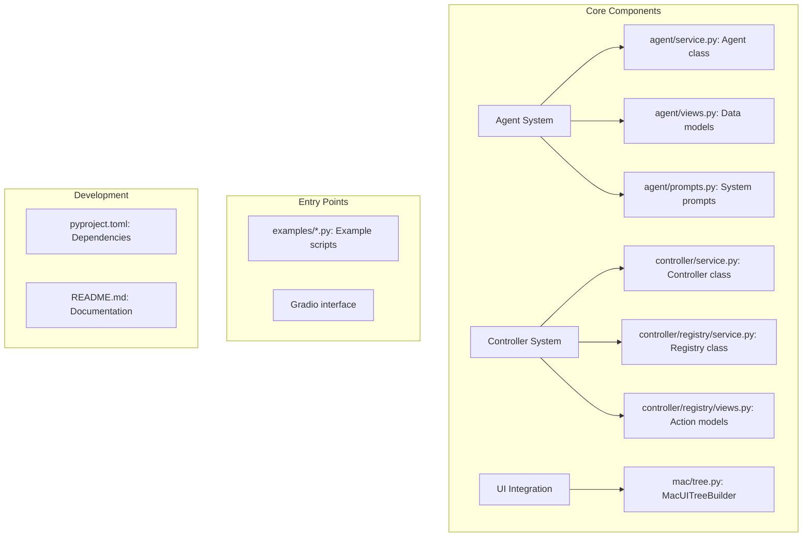
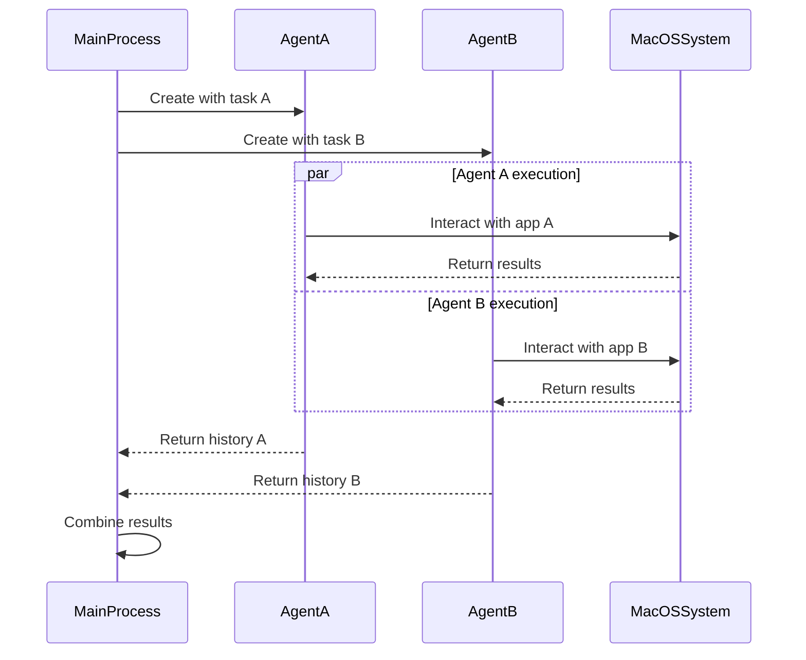

<!-- source: DeepWiki mcp.deepwiki.com · repo browser-use/macOS-use · page 6 Advanced Topics · fetched 2026-10-30 -->

# Advanced Topics

<details>
<summary>Relevant source files</summary>

The following files were used as context for generating this wiki page:

- [README.md](README.md)
- [examples/print_app_tree.py](examples/print_app_tree.py)
- [mlx_use/agent/service.py](mlx_use/agent/service.py)
- [mlx_use/agent/views.py](mlx_use/agent/views.py)
- [mlx_use/controller/registry/service.py](mlx_use/controller/registry/service.py)
- [mlx_use/controller/registry/views.py](mlx_use/controller/registry/views.py)
- [pyproject.toml](pyproject.toml)

</details>


This page covers advanced usage patterns and development topics for the macOS-use system, focusing on extending the core functionality and contributing to the codebase. These topics are intended for developers who want to customize the system for specific needs or contribute to the project.

For basic usage of the system, please refer to [Overview](#1). For information on setting up the environment, see [Setup and Configuration](#5).

## Custom Action Registration

The macOS-use system provides a powerful mechanism for extending functionality through custom actions. The Registry system enables you to define new actions that can be performed by the agent.

### The Registry System Architecture

The Registry is the central component that manages all available actions in the system. It handles registration, validation, and execution of actions.



Sources: [mlx_use/controller/registry/service.py:20-142](), [mlx_use/controller/registry/views.py:6-71]()

### Creating Custom Actions

To create a custom action, you need to:

1. Define a function with the desired parameters
2. Decorate it with the `@registry.action` decorator
3. Implement the action logic

Here's the pattern for creating custom actions:



Sources: [mlx_use/controller/registry/service.py:45-85](), [mlx_use/controller/service.py]()

### Creating a Simple Custom Action

A custom action requires:

1. A clear description for the LLM to understand when to use it
2. Parameter validation using Pydantic models
3. Proper error handling

Example pattern for a custom action:

```
# Define function with proper type annotations
@registry.action(
    description="Description of what the action does",
    requires_mac_builder=True/False  # Whether the action needs UI access
)
async def my_custom_action(param1: str, param2: int, mac_tree_builder=None):
    # Implementation
    # If requires_mac_builder is True, mac_tree_builder will be injected
    return ActionResult(...)
```

When registering an action, the Registry automatically:
1. Creates a Pydantic model from the function signature
2. Wraps synchronous functions to make them asynchronous
3. Adds the action to the available actions list for the LLM

Sources: [mlx_use/controller/registry/service.py:45-85]()

## Advanced Agent Configuration

The Agent class provides numerous configuration options for fine-tuning behavior, performance, and capabilities.

### Agent Configuration Parameters



Sources: [mlx_use/agent/service.py:54-147]()

### Advanced Agent Control

The Agent can be dynamically controlled during execution through several methods:

- **Pause and Resume**: Using the `_paused` flag to temporarily halt execution
- **Stop Execution**: Using the `_stopped` flag to terminate execution
- **Custom Step Logic**: Using the `step_info` parameter to inject custom step information

The agent also provides advanced control mechanisms:

1. **Error Handling and Retries**: Configure `max_failures` and `retry_delay` to control retry behavior
2. **Token Management**: Use `max_input_tokens` to manage context window size
3. **Action Limits**: Use `max_actions_per_step` to limit action execution per step
4. **Initial Actions**: Seed the agent with a set of actions to perform before the first step

Sources: [mlx_use/agent/service.py:402-462]()

### Agent Execution Flow



Sources: [mlx_use/agent/service.py:402-442]()

## Advanced UI Tree Analysis

The MacUITreeBuilder is a powerful system for analyzing and manipulating the UI structure of macOS applications. Advanced usage involves understanding how to extract specific elements, navigate complex interfaces, and handle dynamic content.

### UI Tree Structure Analysis



Sources: [examples/print_app_tree.py:16-88]()

### Exploring Application UI Structures

The `print_app_tree.py` example shows how to analyze the UI structure of macOS applications:

1. Launch an application by name
2. Find its PID and activate it
3. Build a UI tree representation
4. Explore both interactive elements and the full structure

This is particularly useful for:
- Developing custom actions for specific applications
- Troubleshooting interaction issues
- Understanding what elements the agent can interact with

To use this tool:

```
python examples/print_app_tree.py
```

Sources: [examples/print_app_tree.py:16-88]()

## Creating Custom System Prompts

The `system_prompt_class` parameter in the Agent constructor allows you to define custom system prompts that control agent behavior.

### System Prompt Structure

A custom system prompt class must:

1. Subclass the base SystemPrompt class
2. Define prompts for different aspects of the agent's behavior
3. Be passed to the Agent constructor

The MessageManager uses this class to construct prompts for the LLM. Key components include:

- Task instructions
- Available actions
- Context about MacOS applications
- Formatting instructions for output

### Custom Agent Output Models

For advanced usage, you can customize the agent's output model structure:



Sources: [mlx_use/agent/views.py:39-58]()

## Telemetry and Debugging

The macOS-use system includes advanced telemetry capabilities for monitoring and debugging agent performance.

### Telemetry Events

The system captures several types of telemetry events:

1. **AgentRunTelemetryEvent**: Fired when the agent starts running
2. **AgentStepTelemetryEvent**: Fired for each step executed
3. **AgentEndTelemetryEvent**: Fired when the agent completes
4. **ControllerRegisteredFunctionsTelemetryEvent**: Shows registered actions

These events help with:
- Debugging complex automation flows
- Understanding agent decision-making
- Tracking errors and performance issues

### Conversation Debugging

The `save_conversation_path` parameter enables detailed logging of agent-LLM conversations:

```
agent = Agent(
    task="Your task",
    llm=your_llm,
    save_conversation_path="./debug/conversation"
)
```

This creates files for each step of the conversation, including:
- Full prompt context
- LLM response
- Parsed actions and results

Sources: [mlx_use/agent/service.py:345-382]()

## Contributing to macOS-use

The macOS-use project welcomes contributions from developers. Here are guidelines for contributing to the project:

### Project Structure



Sources: [pyproject.toml:1-60](), [README.md:153-156]()

### Development Environment

To set up a development environment:

1. Clone the repository
2. Create a virtual environment (uv recommended)
3. Install the development dependencies:

```
uv pip install --editable ".[dev]"
```

The development dependencies include:
- tokencost: For analyzing token usage
- hatch and build: For package management
- pytest and pytest-asyncio: For testing

Sources: [pyproject.toml:38-45](), [README.md:52-60]()

### Roadmap and Priorities

The project's current priorities include:

1. Refining agent prompting for reliability
2. Improving self-correction capabilities
3. Adding features for the agent to check app availability
4. Adding user input capability
5. Supporting local inference with small fine-tuned models
6. Adding iPhone/iPad support

Contributors are encouraged to focus on these areas when submitting pull requests.

Sources: [README.md:121-142]()

## Advanced API Usage Examples

For more complex automation scenarios, the macOS-use system can be extended beyond the provided examples. Here are some advanced usage patterns:

### Custom Control Flow

This pattern demonstrates how to implement custom control flow for complex automations:

```
# Custom step callback
def step_callback(state, model_output, step_number):
    # Log or analyze the step information
    # Can manipulate the agent's behavior based on results
    pass

# Custom completion callback
def done_callback(history):
    # Process the final results
    # E.g., save data, trigger next automation, etc.
    pass

agent = Agent(
    task="Complex task",
    llm=your_llm,
    register_new_step_callback=step_callback,
    register_done_callback=done_callback
)
```

### Parallel Agents

For complex workflows, multiple agents can work in parallel:



This approach requires careful management of the macOS application focus, as only one application can have focus at a time.

Sources: [mlx_use/agent/service.py:132-134]()

## Conclusion

This page covered advanced topics for the macOS-use system, including custom action registration, advanced agent configuration, UI tree analysis, and contributing to the project. These concepts enable developers to extend the system's functionality and create complex automation solutions.

For more information on specific subsystems, refer to:
- [Custom Actions](#6.1) for detailed information on creating custom actions
- [Development and Contributing](#6.2) for guidelines on contributing to the project

---

