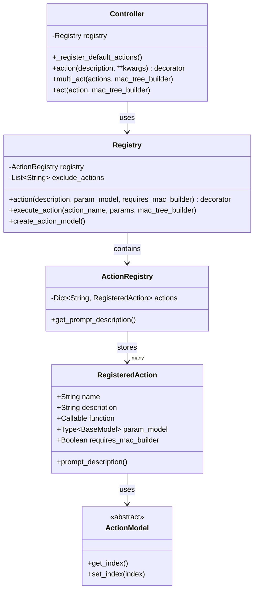
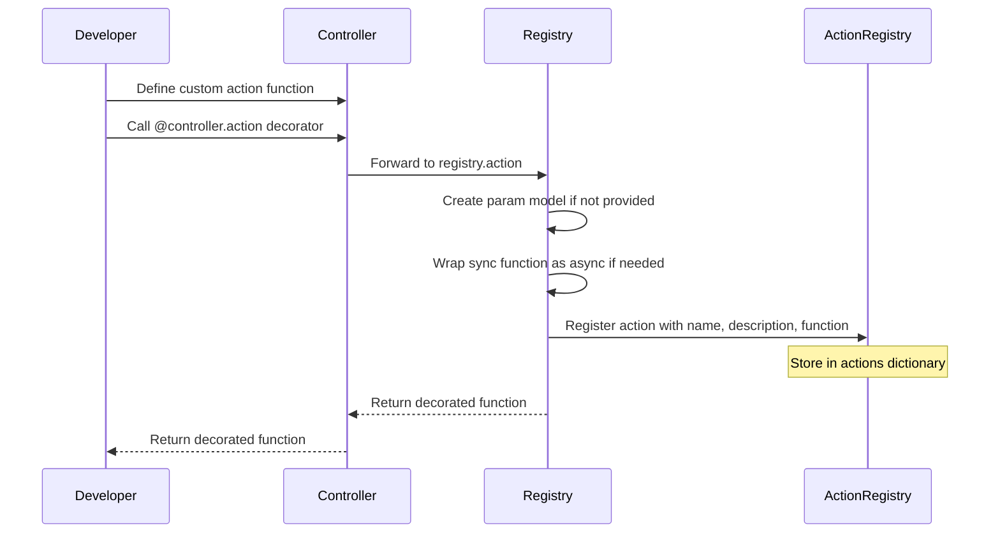
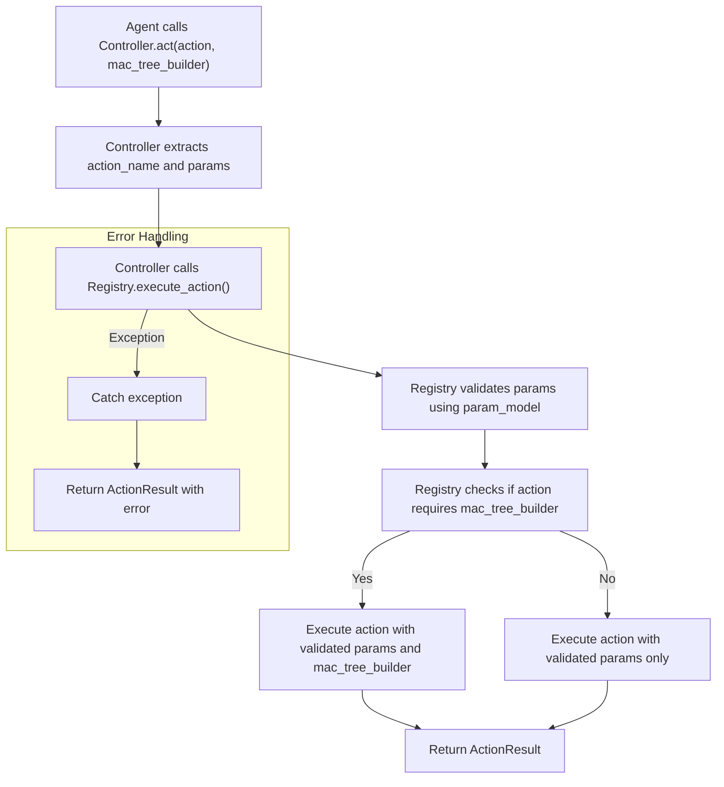
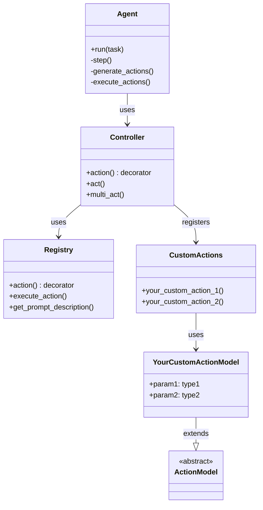

<!-- source: DeepWiki mcp.deepwiki.com · repo browser-use/macOS-use · page 6.1 Custom Actions · fetched 2026-10-30 -->

# Custom Actions

<details>
<summary>Relevant source files</summary>

The following files were used as context for generating this wiki page:

- [examples/print_app_tree.py](examples/print_app_tree.py)
- [mlx_use/agent/views.py](mlx_use/agent/views.py)
- [mlx_use/controller/registry/service.py](mlx_use/controller/registry/service.py)
- [mlx_use/controller/registry/views.py](mlx_use/controller/registry/views.py)
- [mlx_use/controller/service.py](mlx_use/controller/service.py)
- [mlx_use/controller/views.py](mlx_use/controller/views.py)
- [mlx_use/mac/actions.py](mlx_use/mac/actions.py)

</details>


## Purpose and Scope

This document explains how to extend the macOS-use system by creating custom actions. Custom actions allow you to add new functionality to control macOS applications beyond the default set of actions provided by the system. This page covers the action registration system, how to create and register custom actions, and the execution flow of these actions.

For information about the overall Controller System architecture, see [Controller System](#2.2).

## Action Registry System

The macOS-use system uses a registry pattern to manage actions that can be performed on macOS applications. Actions are registered with descriptions that help the LLM understand when to use them, along with parameter models that define their inputs.

### Registry Architecture



Sources:
- [mlx_use/controller/service.py:28-31]()
- [mlx_use/controller/registry/service.py:20-25]()
- [mlx_use/controller/registry/views.py:6-16]()
- [mlx_use/controller/registry/views.py:32-40]()
- [mlx_use/controller/registry/views.py:64-71]()

### Action Registration Flow



Sources:
- [mlx_use/controller/service.py:267-272]()
- [mlx_use/controller/registry/service.py:45-85]()

## Default Actions

The system comes with several built-in actions that provide core functionality for interacting with macOS applications:

| Action Name | Description | Purpose | Parameter Model |
|-------------|-------------|---------|----------------|
| `done` | Complete task with text for the user | Signals task completion | `DoneAction` |
| `input_text` | Input text | Types text into UI elements | `InputTextAction` |
| `click_element` | Click element and choose action | Clicks interactive UI elements | `ClickElementAction` |
| `right_click_element` | Right click element | Right-clicks UI elements | `RightClickElementAction` |
| `scroll_element` | Scroll element | Scrolls UI elements | `ScrollElementAction` |
| `open_app` | Open a mac app | Launches macOS applications | `OpenAppAction` |
| `run_apple_script` | Run a AppleScript | Executes AppleScript code | `AppleScriptAction` |

Sources:
- [mlx_use/controller/service.py:37-265]()
- [mlx_use/controller/views.py:8-31]()

## Creating Custom Actions

### Basic Custom Action Structure

To create a custom action, you define a function and decorate it with the `@controller.action` decorator:

```python
@controller.action(
    'Description of what the action does',
    param_model=YourParamModel,  # Optional - will be auto-generated if not provided
    requires_mac_builder=True     # Optional - if your action needs access to the UI tree
)
async def your_action_name(param1: type1, param2: type2, mac_tree_builder: MacUITreeBuilder = None):
    # Action implementation
    # ...
    return ActionResult(extracted_content='Success message')
```

### Custom Action Parameters

The `action` decorator accepts the following parameters:

1. `description` (str): A clear description of what the action does, which helps the LLM understand when to use it
2. `param_model` (Optional[Type[BaseModel]]): A Pydantic model defining the action's parameters
3. `requires_mac_builder` (bool): Set to `True` if the action needs access to the MacUITreeBuilder

If `param_model` is not provided, it will be automatically generated from the function's signature.

Sources:
- [mlx_use/controller/service.py:267-272]()
- [mlx_use/controller/registry/service.py:45-50]()

### Custom Action Models

Custom actions typically need a Pydantic model to define their parameters. These models should inherit from `BaseModel`:

```python
from pydantic import BaseModel

class YourCustomActionModel(BaseModel):
    param1: str
    param2: int
    param3: bool = False  # Optional parameter with default value
```

The model ensures proper validation of parameters and provides clear documentation of the action's requirements.

Sources:
- [mlx_use/controller/views.py:8-31]()
- [mlx_use/controller/registry/views.py:32-40]()

## Action Execution Flow

When an action is executed, the system follows a specific flow to validate parameters and invoke the function:



Sources:
- [mlx_use/controller/service.py:290-309]()
- [mlx_use/controller/registry/service.py:87-117]()
- [mlx_use/agent/views.py:21-29]()

## Action Result Handling

Actions should return an `ActionResult` object, which has the following structure:

```python
class ActionResult:
    is_done: Optional[bool] = False  # Whether the task is complete
    extracted_content: Optional[str] = None  # Text output from the action
    error: Optional[str] = None  # Error message if the action failed
    include_in_memory: bool = False  # Whether to include in agent memory
    current_app_pid: Optional[int] = None  # PID of the app (for open_app)
```

The `extracted_content` field is especially important as it provides feedback to the agent and user about what happened.

Sources:
- [mlx_use/agent/views.py:21-29]()

## Examples of Custom Actions

### Example 1: Custom Action to Check System Information

```python
from mlx_use.agent.views import ActionResult
from pydantic import BaseModel
import subprocess

class SystemInfoAction(BaseModel):
    info_type: str  # e.g., "cpu", "memory", "disk"

@controller.action(
    'Get system information such as CPU, memory, or disk usage',
    param_model=SystemInfoAction
)
async def get_system_info(info_type: str):
    try:
        if info_type.lower() == "cpu":
            command = ["sysctl", "-n", "machdep.cpu.brand_string"]
        elif info_type.lower() == "memory":
            command = ["vm_stat"]
        elif info_type.lower() == "disk":
            command = ["df", "-h"]
        else:
            return ActionResult(
                extracted_content=f"Unknown info type: {info_type}",
                error=f"Unsupported info_type: {info_type}"
            )
            
        result = subprocess.run(command, capture_output=True, text=True)
        if result.returncode == 0:
            return ActionResult(extracted_content=result.stdout)
        else:
            return ActionResult(
                extracted_content=f"Command failed: {result.stderr}",
                error=result.stderr
            )
    except Exception as e:
        return ActionResult(
            extracted_content=f"Error getting system info: {str(e)}",
            error=str(e)
        )
```

### Example 2: Custom Action with Mac UI Tree Access

```python
from mlx_use.agent.views import ActionResult
from mlx_use.mac.tree import MacUITreeBuilder
from pydantic import BaseModel

class FindElementByTextAction(BaseModel):
    text: str
    partial_match: bool = True

@controller.action(
    'Find an element containing specific text',
    param_model=FindElementByTextAction,
    requires_mac_builder=True
)
async def find_element_by_text(text: str, partial_match: bool, mac_tree_builder: MacUITreeBuilder):
    try:
        # Search through all cached elements
        matching_elements = []
        for idx, element in mac_tree_builder._element_cache.items():
            element_text = element.value or element.title or ""
            
            if (partial_match and text.lower() in element_text.lower()) or \
               (not partial_match and text.lower() == element_text.lower()):
                matching_elements.append((idx, element))
        
        if matching_elements:
            result_text = "Found elements:\n"
            for idx, element in matching_elements:
                result_text += f"- Index {idx}: {element.role} - '{element.value or element.title}'\n"
            return ActionResult(extracted_content=result_text)
        else:
            return ActionResult(
                extracted_content=f"No elements found containing text '{text}'",
                error=f"No matching elements for '{text}'"
            )
    except Exception as e:
        return ActionResult(
            extracted_content=f"Error finding elements: {str(e)}",
            error=str(e)
        )
```

Sources:
- [mlx_use/controller/service.py:39-265]()
- [mlx_use/mac/actions.py:19-62]()

## Integration with Agent System

Custom actions are automatically integrated with the agent system once registered. The LLM will be provided with descriptions of all available actions (including your custom ones) and can choose the appropriate action based on the current task.



Sources:
- [mlx_use/controller/service.py:267-272]()
- [mlx_use/agent/views.py:39-58]()

## Best Practices for Custom Actions

1. **Clear Descriptions**: Provide detailed descriptions of your actions to help the LLM understand when to use them.

2. **Proper Error Handling**: Always catch exceptions and return an `ActionResult` with appropriate error information.

3. **Meaningful Results**: Return useful information in the `extracted_content` field to give the agent context about what happened.

4. **Parameter Validation**: Use Pydantic models to define and validate your action parameters.

5. **Asynchronous Design**: Design your actions to work asynchronously to prevent blocking the main thread.

6. **UI Tree Handling**: If your action interacts with UI elements, set `requires_mac_builder=True` and handle element access properly.

Sources:
- [mlx_use/controller/service.py:39-265]()
- [mlx_use/agent/views.py:21-29]()

---

