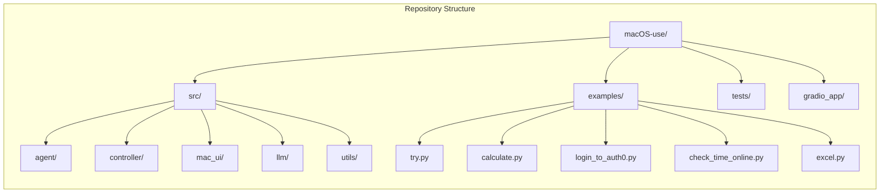
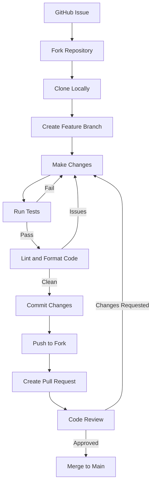

<!-- source: DeepWiki mcp.deepwiki.com · repo browser-use/macOS-use · page 6.2 Development and Contributing · fetched 2026-10-30 -->

# Development and Contributing

<details>
<summary>Relevant source files</summary>

The following files were used as context for generating this wiki page:

- [.gitignore](.gitignore)
- [README.md](README.md)
- [pyproject.toml](pyproject.toml)

</details>


This document provides information for developers who want to contribute to the macOS-use project. It covers setting up a development environment, understanding the code structure, and following proper contribution guidelines. For information about extending the system with custom actions, see [Custom Actions](#6.1).

## Setting Up a Development Environment

To contribute to macOS-use, you'll need to set up a local development environment that allows you to make changes and test them effectively.

### Prerequisites

- macOS operating system
- Python 3.11 or higher
- Git
- An API key from one of the supported LLM providers (OpenAI, Anthropic, or Google Gemini)

### Installation for Development

1. Clone the repository:

```bash
git clone https://github.com/browser-use/macOS-use.git
cd macOS-use
```

2. Set up environment variables:

```bash
cp .env.example .env
```

Edit the `.env` file to include your API keys and other configuration options.

3. Create a virtual environment (recommended using `uv`):

```bash
brew install uv
uv venv
source .venv/bin/activate
```

4. Install the package in development mode with dev dependencies:

```bash
uv pip install --editable ".[dev]"
```

Sources: [README.md:33-38](), [README.md:45-58](), [pyproject.toml:38-45]()

## Project Structure

The project follows a modular architecture that separates concerns between UI interaction, agent logic, and external services integration.



### Key Components

The development architecture maps to the following key components that you might work with as a contributor:

```mermaid
classDiagram
    class "Agent" {
        Main agent logic
        Task coordination
        Memory management
    }
    
    class "Controller" {
        UI action execution
        Action registry management
        System interaction
    }
    
    class "MacUITreeBuilder" {
        UI element discovery
        Accessibility integration
        Element indexing
    }
    
    class "LLMProvider" {
        Integration with LLM services
        Prompt formatting
        Response parsing
    }
    
    class "Registry" {
        Action registration
        Action execution
        Parameter validation
    }
    
    class "GradioApp" {
        Web interface
        Configuration management
        Visualization
    }
    
    Agent --> Controller: uses
    Agent --> LLMProvider: communicates with
    Controller --> MacUITreeBuilder: uses
    Controller --> Registry: manages
    GradioApp --> Agent: creates
```

Sources: [README.md:21-65]()

## Contributing Guidelines

### Code Style and Formatting

The project uses [ruff](https://github.com/astral-sh/ruff) for code linting and formatting. The configuration can be found in `pyproject.toml`:

- Line length: 130 characters
- Single quotes for strings
- Tab indentation
- Selected rules: E (pycodestyle), F (pyflakes), I (isort)

To lint and format your code:

```bash
ruff check .
ruff format .
```

Sources: [pyproject.toml:47-55]()

### Testing

Tests are written using pytest. When contributing, ensure that:

1. New features include appropriate test coverage
2. Existing tests continue to pass with your changes
3. Async code is tested using pytest-asyncio

To run tests:

```bash
pytest
```

Sources: [pyproject.toml:41-44]()

## Development Workflow

The following diagram illustrates the recommended workflow for contributing to the project:



### Branching Strategy

1. Fork the repository to your own GitHub account
2. Clone your fork to your local machine
3. Create a feature branch with a descriptive name (e.g., `feature/add-new-action` or `fix/ui-tree-builder-bug`)
4. Make your changes on this branch
5. Submit a pull request when ready

### Tips for Local Development

1. **Use example scripts**: The `examples/` directory contains several scripts that can be used to test functionality:

```bash
python examples/try.py
```

2. **Iterative testing**: When developing new features, create small test scripts to validate your changes incrementally.

3. **Debug logging**: Add temporary debug logging to help troubleshoot issues during development.

Sources: [README.md:153-156]()

## Project Roadmap and Contribution Opportunities

The project has defined several goals that contributors can help with:

1. **Improving MacBook Support:**
   - Refining agent prompting
   - Improving self-correction mechanisms
   - Adding user input capabilities
   - Testing and reliability improvements

2. **Local Inference Support:**
   - Integration with mlx and mlx-vlm for local model execution
   - Fine-tuning smaller models for on-device inference

3. **Platform Expansion:**
   - Adding support for iPhone/iPad

If you're interested in contributing to these areas, check the existing issues or create a new one to discuss your approach before submitting code.

Sources: [README.md:121-142]()

## Submission Guidelines

When submitting a pull request:

1. Ensure all tests pass
2. Make sure your code follows the project's style guidelines
3. Add documentation for new features
4. Include a clear description of the changes and their purpose
5. Reference any related issues

For larger changes, consider opening an issue first to discuss the approach and design before implementation.

## Getting Help

If you need help with development or have questions:

- Join the project's [Discord](https://link.browser-use.com/discord)
- Reach out to project maintainers on X/Twitter ([@OfirOzeri](https://x.com/OfirOzeri), [@gregpr07](https://x.com/gregpr07), [@mamagnus00](https://x.com/mamagnus00))
- Open an issue with the "question" label on GitHub

Sources: [README.md:7-11](), [README.md:152-156]()