# Page: Overview

# Overview

<details>
<summary>Relevant source files</summary>

The following files were used as context for generating this wiki page:

- [README.md](README.md)
- [pyproject.toml](pyproject.toml)

</details>


## Purpose and Scope

macOS-use is an open-source framework that enables AI agents to interact with macOS applications through natural language instructions. This system allows users to control any macOS application by simply describing what they want to accomplish. The framework integrates with various LLM providers to interpret instructions and uses the macOS Accessibility API to execute actions across the operating system.

This overview document provides a high-level introduction to the macOS-use system, its key components, and how they work together. For more detailed information about specific components, refer to their respective dedicated pages in this wiki.

Sources: [README.md:13-19](). [pyproject.toml:1-3]()

## Key Features

- **Universal Application Control**: Interact with any macOS application through natural language commands
- **Multi-LLM Support**: Compatible with OpenAI, Anthropic, and Google Gemini models
- **Multiple Interfaces**: Use through command-line interface or Gradio web interface
- **Automation Workflows**: Create and manage complex automation sequences
- **Accessibility Integration**: Deep integration with macOS Accessibility API for UI interaction
- **Application Awareness**: Ability to detect and interact with installed applications

Sources: [README.md:13-19](), [README.md:118-119](), [README.md:125-132]()

## System Architecture

The macOS-use system consists of several interconnected components that work together to interpret user instructions and execute them on macOS applications.

### System Component Overview

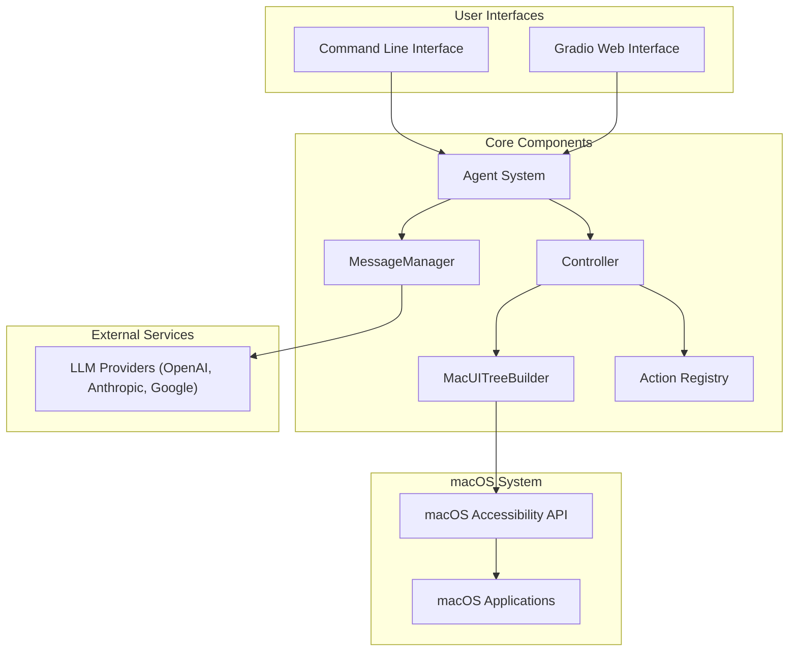

Sources: [README.md:19](), [README.md:40-42]()

### Execution Flow

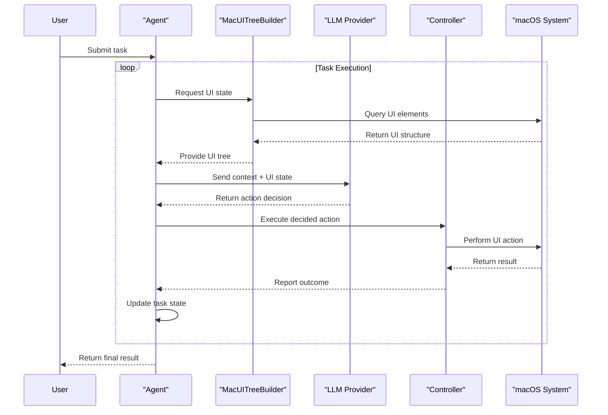

Sources: [README.md:76-112]()

## Core Components

### Agent System

The Agent serves as the central coordinator in the macOS-use system. It receives tasks from the user, manages the conversation with the LLM, decides which actions to take based on LLM responses, and directs the Controller to execute those actions. The Agent maintains the state and history of the interaction throughout the task execution.

For more details about the Agent System, see [Agent System](#2.1).

### Controller System

The Controller bridges between the Agent's decisions and the actual macOS interactions. It manages a registry of actions (clicking, typing, scrolling, etc.) that can be performed on UI elements and executes these actions through the macOS Accessibility API. The Controller works closely with the MacUITreeBuilder to identify and interact with UI elements.

For more details about the Controller System, see [Controller System](#2.2).

### MacUITreeBuilder

The MacUITreeBuilder creates a hierarchical representation of UI elements in macOS applications by interfacing with the macOS Accessibility API. This tree representation allows the Agent to understand what's on screen and what can be interacted with. Each interactive element is assigned an index for easy reference during action execution.

For more details about the MacUITreeBuilder, see [MacOS UI Tree System](#2.3).

### LLM Integration

macOS-use supports multiple LLM providers, including OpenAI, Anthropic, and Google Gemini. These models interpret user instructions, understand the state of the UI, and determine appropriate actions to take. The system uses structured prompts to communicate with LLMs and expects structured outputs that can be translated into actionable commands.

For more details about LLM Integration, see [LLM Integration](#2.4).

Sources: [README.md:40-42]()

## Usage Modes

### Command Line Interface

macOS-use provides a command-line interface through various example scripts that demonstrate different functionalities:

```
python examples/try.py         # Basic usage example
python examples/calculate.py   # Calculator application example
python examples/login_to_auth0.py  # Authentication example
python examples/check_time_online.py  # Web searching example
```

For more details about the CLI, see [Command Line Interface](#3.1).

### Gradio Web Interface

The Gradio web interface provides a more user-friendly way to interact with the system, featuring:

- Agent Tab: For submitting and monitoring tasks
- Automations Tab: For creating and managing automation workflows
- Configuration Tab: For setting up LLM providers and API keys

For more details about the Gradio interface, see [Gradio Web Interface](#3.2).

Sources: [README.md:25-72]()

## Technical Implementation

### Action System

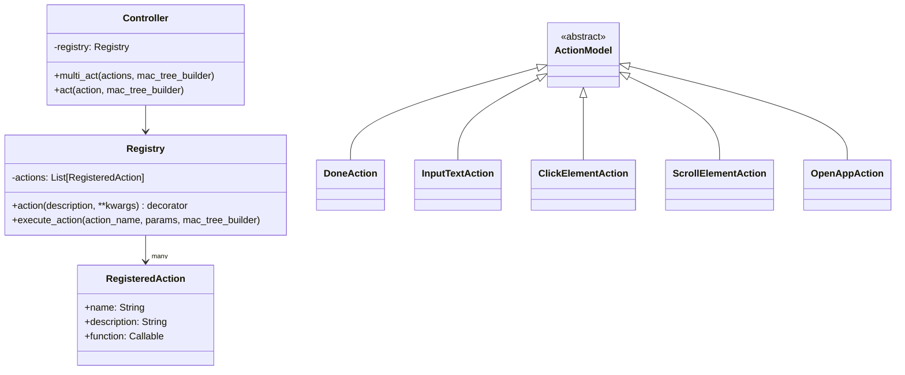

The action system uses a registry pattern where actions are registered with descriptive metadata and then executed through the Controller. This extensible design allows for adding new types of actions as needed.

Sources: [README.md:125-132]()

## Installation and Setup

macOS-use can be installed via pip:

```bash
pip install mlx-use
```

Or directly from the GitHub repository:

```bash
git clone https://github.com/browser-use/macOS-use.git
cd macOS-use
```

Configuration requires setting up API keys for the LLM provider of choice. The system currently works best with OpenAI or Anthropic, although Google Gemini is also supported.

For detailed setup instructions, see [Setup and Configuration](#5).

Sources: [README.md:21-51](), [pyproject.toml:1-36]()

## Project Status and Roadmap

macOS-use is under active development with the following goals:

1. **Enhance MacBook Support**:
   - Refine Agent prompting
   - Improve self-correction capabilities
   - Add user interaction features

2. **Enable Local Inference**:
   - Support for local models using MLX framework
   - Fine-tune small models for efficient local execution

3. **Expand to iPhone/iPad**:
   - Extend functionality to other Apple devices

**Warning**: As noted in the project documentation, this system can access all applications and UI components on your MacBook, including login forms and authentication services. The project is still under development, and user discretion is advised when using it.

Sources: [README.md:115-147]()

## Use Case Examples

macOS-use can perform a variety of tasks across different applications, including:

- Performing calculations using the Calculator app
- Logging into websites with authentication
- Searching for information online
- Data entry and manipulation
- Interacting with productivity applications

For detailed examples of these use cases, see [Example Use Cases](#4).

Sources: [README.md:74-111]()

---

# Page: System Architecture

# System Architecture

<details>
<summary>Relevant source files</summary>

The following files were used as context for generating this wiki page:

- [README.md](README.md)
- [mlx_use/agent/service.py](mlx_use/agent/service.py)
- [mlx_use/controller/service.py](mlx_use/controller/service.py)
- [mlx_use/mac/tree.py](mlx_use/mac/tree.py)
- [pyproject.toml](pyproject.toml)

</details>


This document provides a comprehensive overview of the macOS-use system architecture, detailing the major components and how they interact to enable AI-driven control of macOS applications. It covers the high-level design and relationships between components without diving deeply into individual subsystems.

For detailed information about specific subsystems, please refer to:
- Agent System ([Agent System](#2.1))
- Controller System ([Controller System](#2.2))
- MacOS UI Tree System ([MacOS UI Tree System](#2.3))
- LLM Integration ([LLM Integration](#2.4))

## System Overview

macOS-use is an architecture that enables AI agents to interact with macOS applications through the Accessibility API. The system translates natural language tasks into a sequence of UI operations, allowing an LLM-powered agent to control any macOS application without prior training on that specific application.

### High-Level Architecture Diagram

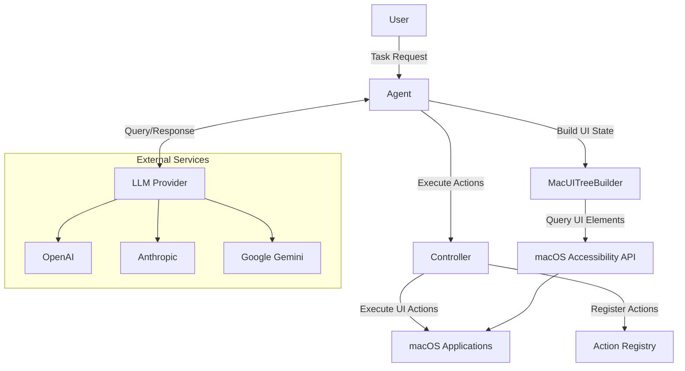

Sources: [mlx_use/agent/service.py:54-92](), [mlx_use/controller/service.py:28-36](), [mlx_use/mac/tree.py:45-53](), [README.md:19-20]()

## Core Components

### Agent System

The Agent is the central orchestrator responsible for understanding user tasks, querying UI state, making decisions through LLMs, and instructing the Controller to execute actions. It maintains state and history while managing conversation flow with the language model.

Key responsibilities:
- Task interpretation and planning
- Coordinating UI state extraction
- Interacting with LLM providers
- History tracking and error handling
- Implementing retry mechanisms

Sources: [mlx_use/agent/service.py:54-149]()

### Controller System

The Controller handles the execution of actions on macOS applications. It provides a registry of available actions and delegates execution to specialized handlers for each action type.

Key responsibilities:
- Registering available actions (click, type, scroll, etc.)
- Validating action parameters
- Executing actions on UI elements
- Handling action errors and reporting results

Sources: [mlx_use/controller/service.py:28-73]()

### MacOS UI Tree System

The MacUITreeBuilder builds a hierarchical representation of the macOS UI using the Accessibility API. It identifies interactive elements and makes them available for interaction.

Key responsibilities:
- Querying the macOS Accessibility API
- Building a tree structure of UI elements
- Identifying interactive elements
- Caching elements for future interaction

Sources: [mlx_use/mac/tree.py:45-53](), [mlx_use/mac/tree.py:258-353]()

### LLM Integration

The system integrates with various LLM providers (OpenAI, Anthropic, Google) to provide the intelligence for understanding tasks and determining actions.

Key responsibilities:
- Formatting prompts with UI state
- Handling LLM responses
- Parsing structured actions
- Managing API rate limits and errors

Sources: [mlx_use/agent/service.py:310-328]()

## Component Interaction Model

### Code-Level Component Diagram

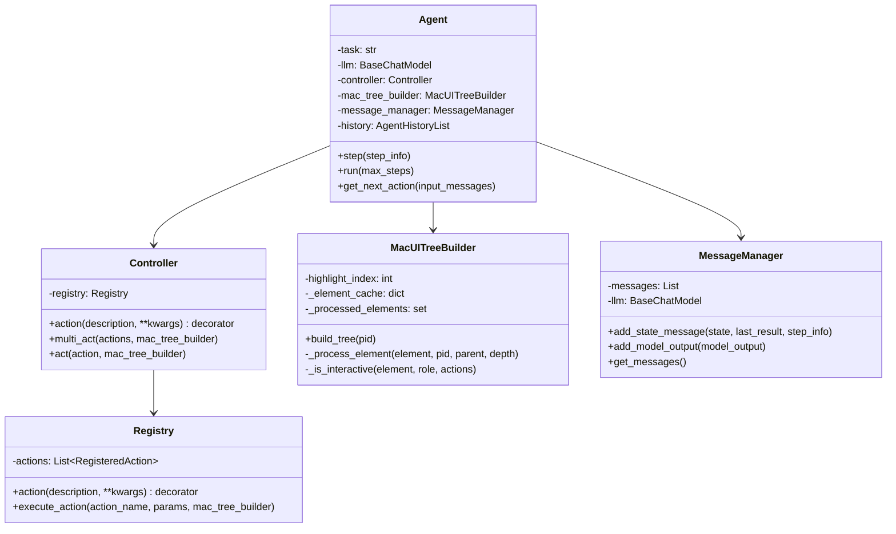

Sources: [mlx_use/agent/service.py:54-149](), [mlx_use/controller/service.py:28-36](), [mlx_use/mac/tree.py:45-53]()

## Execution Flow

The following sequence diagram illustrates the execution flow for a single step in the agent's operation:

### Task Execution Sequence

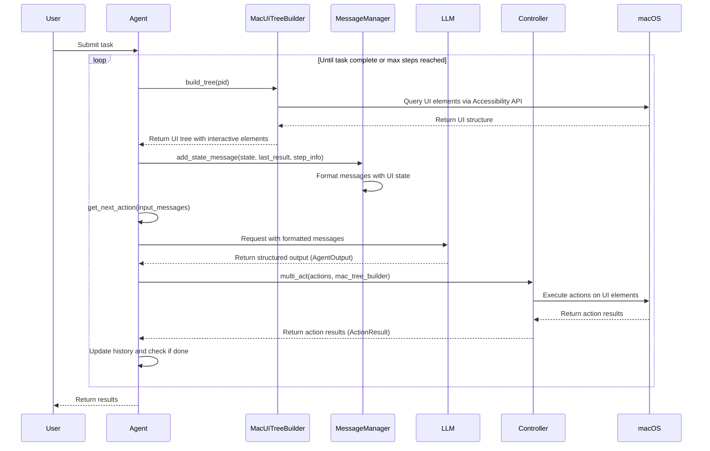

Sources: [mlx_use/agent/service.py:192-261](), [mlx_use/agent/service.py:402-442]()

## Action System Architecture

The Action System defines how the agent interacts with macOS through a registry of available actions.

### Action Registry and Models

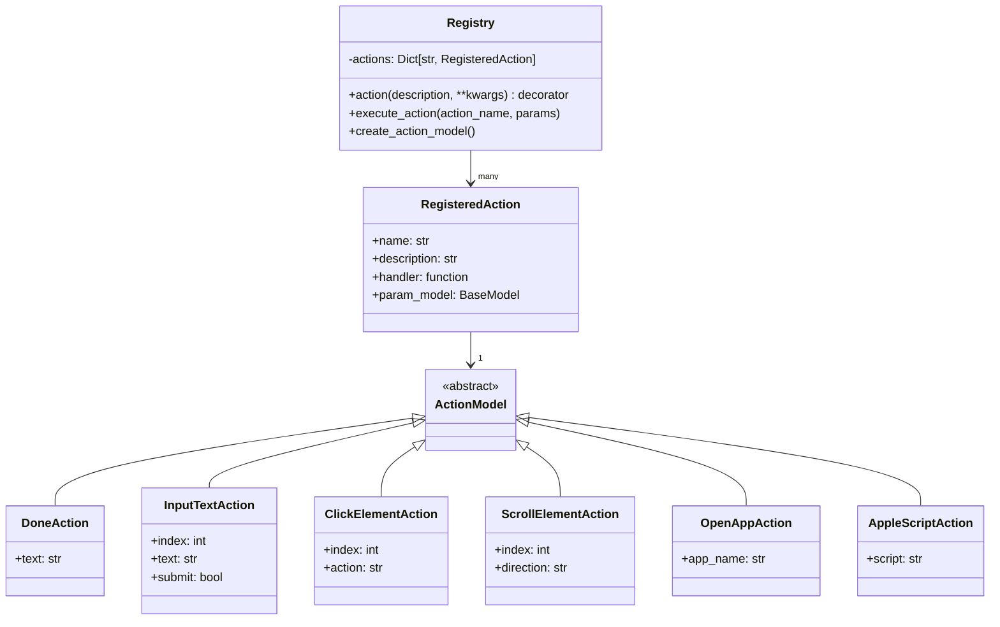

Sources: [mlx_use/controller/service.py:38-265]()

### Core Actions Table

| Action Name | Description | Parameters | Implementation |
|-------------|-------------|------------|----------------|
| `done` | Complete task with text for the user | `text: str` | [mlx_use/controller/service.py:40-44]() |
| `input_text` | Input text into an element | `index: int, text: str, submit: bool` | [mlx_use/controller/service.py:46-73]() |
| `click_element` | Click element and choose action | `index: int, action: str` | [mlx_use/controller/service.py:75-109]() |
| `right_click_element` | Right click element | `index: int` | [mlx_use/controller/service.py:111-138]() |
| `scroll_element` | Scroll element | `index: int, direction: str` | [mlx_use/controller/service.py:140-167]() |
| `open_app` | Open a mac app | `app_name: str` | [mlx_use/controller/service.py:169-222]() |
| `run_apple_script` | Run an AppleScript | `script: str` | [mlx_use/controller/service.py:223-265]() |

Sources: [mlx_use/controller/service.py:38-265]()

## MacOS UI Tree Architecture

The MacUITreeBuilder is responsible for creating a structured representation of the macOS UI using the Accessibility API.

### UI Tree Building Process

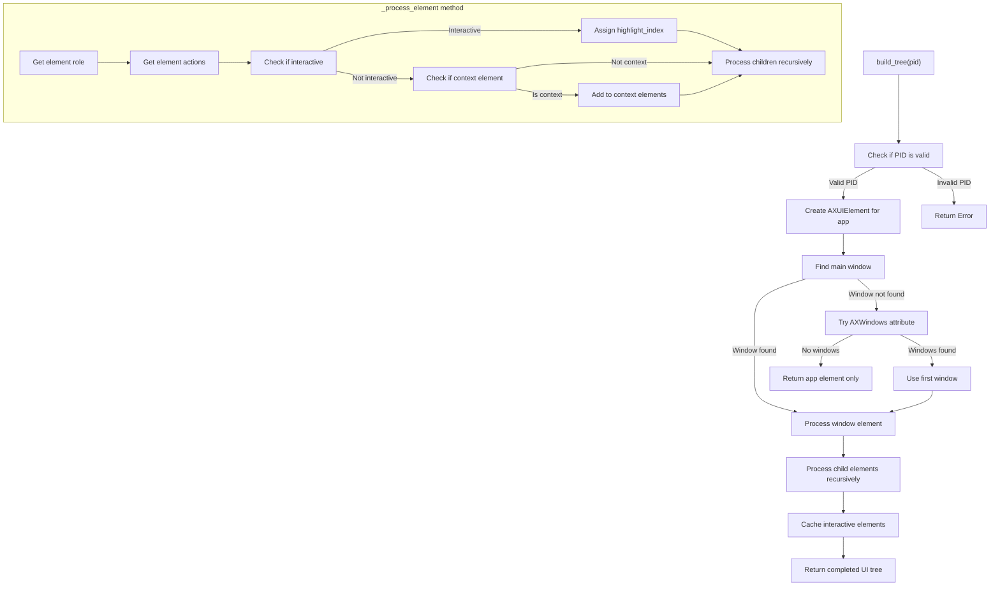

Sources: [mlx_use/mac/tree.py:128-227](), [mlx_use/mac/tree.py:258-353]()

## Dependencies and Integration

macOS-use relies on several key dependencies for functionality:

1. **Python Libraries:**
   - `langchain` ecosystem for LLM integration
   - `pyobjc` and `pycocoa` for macOS Accessibility API interactions
   - `gradio` for web interface

2. **External Services:**
   - LLM Providers (OpenAI, Anthropic, Google)

3. **macOS System Level:**
   - Accessibility API permissions (must be enabled by user)

Sources: [pyproject.toml:15-35](), [README.md:25-65]()

## Design Principles

The macOS-use architecture adheres to several key design principles:

1. **Modularity**: Components are loosely coupled to allow for independent development and testing.

2. **Extensibility**: The action registry pattern allows for easy addition of new actions without modifying core code.

3. **Error Resilience**: Robust error handling and retry mechanisms at multiple levels.

4. **Provider Agnosticism**: Support for multiple LLM providers without changing core functionality.

5. **Transparency**: Comprehensive history tracking and logging for debugging and audit purposes.

Sources: [mlx_use/agent/service.py:54-149](), [mlx_use/controller/service.py:28-36](), [mlx_use/mac/tree.py:45-53]()

---

# Page: Agent System

# Agent System

<details>
<summary>Relevant source files</summary>

The following files were used as context for generating this wiki page:

- [mlx_use/agent/message_manager/service.py](mlx_use/agent/message_manager/service.py)
- [mlx_use/agent/prompts.py](mlx_use/agent/prompts.py)
- [mlx_use/agent/service.py](mlx_use/agent/service.py)
- [mlx_use/mac/element.py](mlx_use/mac/element.py)

</details>


The Agent System forms the core intelligence layer of the macOS-use framework. It coordinates between Language Learning Models (LLMs) for decision-making and the Controller for executing actions on macOS applications. This document covers the architecture, components, and operational flow of the Agent System. For information about the Controller System that executes the agent's decisions, see [Controller System](#2.2).

## Agent System Overview

The Agent System processes user tasks, manages conversations with LLMs, executes actions through the Controller, and tracks the progress of task completion. It serves as the central orchestrator for automating macOS interactions, maintaining state across multiple steps, and handling errors gracefully.

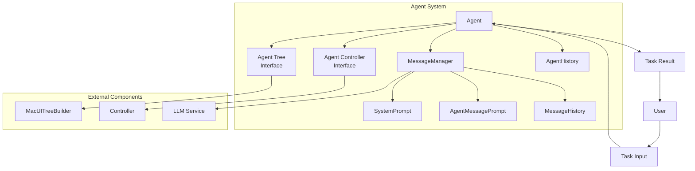

Sources: [mlx_use/agent/service.py:54-491](), [mlx_use/agent/message_manager/service.py:25-236]()

## Core Components

The Agent System consists of several key components working together:

| Component | Purpose | Key Functionality |
|-----------|---------|-------------------|
| Agent | Main orchestrator | Task execution, step management, error handling |
| MessageManager | LLM interaction | Message formatting, conversation history, token management |
| SystemPrompt | Initial guidance | Provides instructions and constraints to LLM |
| AgentMessagePrompt | State communication | Formats current UI state and action results for LLM |
| AgentHistory | Record keeping | Maintains history of actions, results, and states |

Sources: [mlx_use/agent/service.py:54-491](), [mlx_use/agent/message_manager/service.py:25-236](), [mlx_use/agent/prompts.py:6-175]()

## Agent Class Architecture

The `Agent` class is the main entry point and orchestrator of the Agent System. It manages the overall task execution flow and integrates with other components.

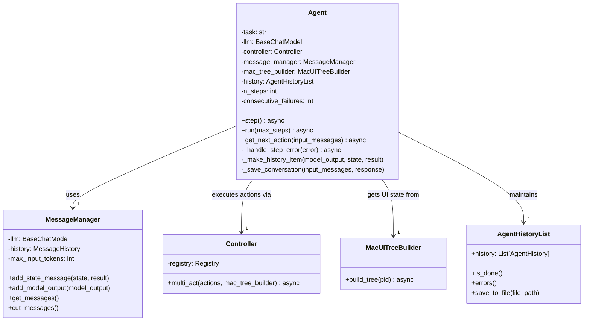

Sources: [mlx_use/agent/service.py:54-491]()

## Agent Execution Flow

The Agent operates in a step-by-step execution model to achieve the user's task:

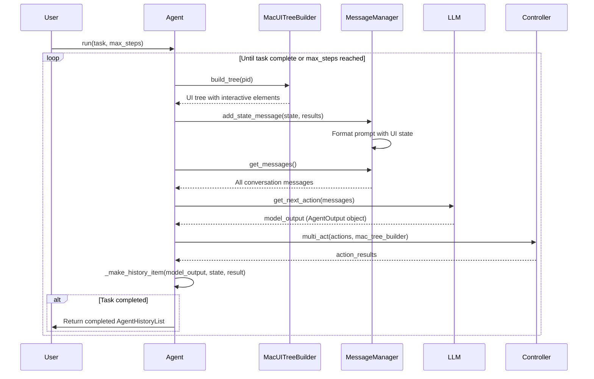

Sources: [mlx_use/agent/service.py:402-442](), [mlx_use/agent/service.py:193-261]()

## Message Management

The MessageManager handles all communication with the LLM, including formatting prompts, managing token limits, and maintaining conversation history.

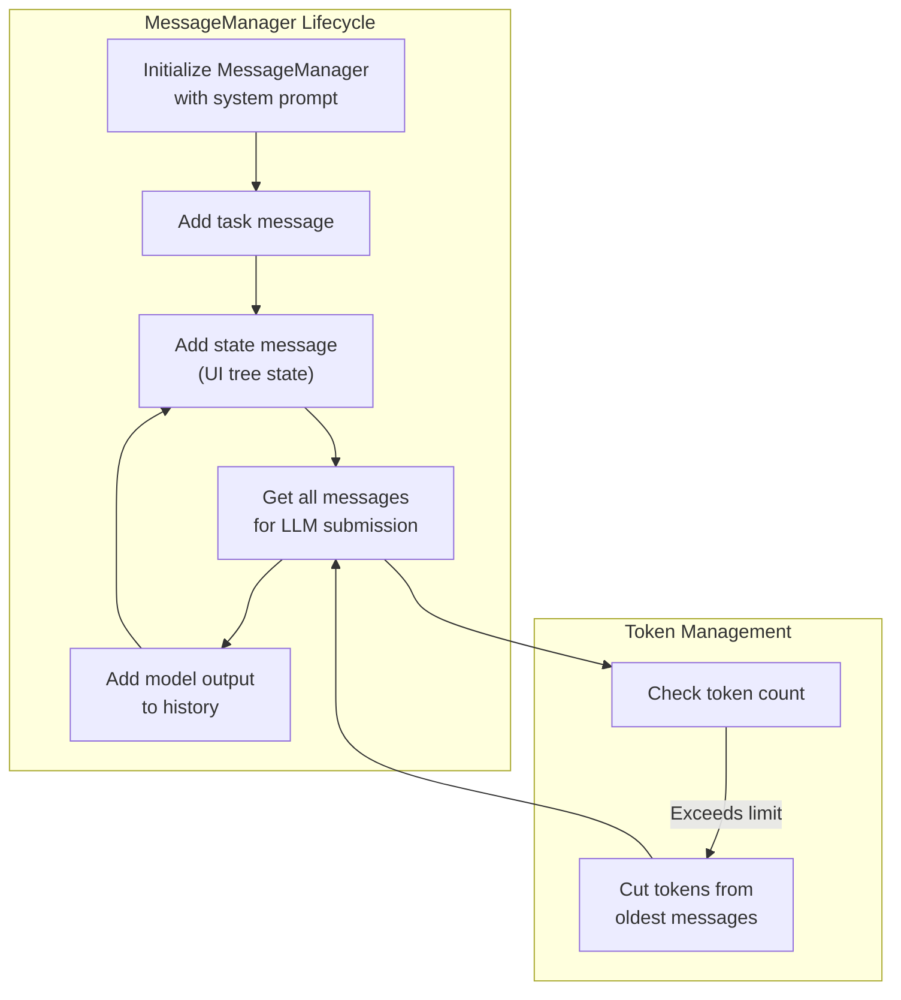

Sources: [mlx_use/agent/message_manager/service.py:25-236]()

## Prompt System

The Agent System uses a structured prompt system to guide the LLM's understanding and responses:

### SystemPrompt

The `SystemPrompt` class provides the initial instructions to the LLM, including:

1. Response format requirements (JSON structure)
2. Available actions and their parameters
3. Rules for interacting with macOS applications
4. Guidelines for task completion and verification
5. Error handling strategies

### AgentMessagePrompt

The `AgentMessagePrompt` class formats each state update, including:

1. Current UI state (interactive elements from MacUITreeBuilder)
2. Results from previous actions
3. Any errors that occurred
4. Step information for progress tracking

Sources: [mlx_use/agent/prompts.py:6-95](), [mlx_use/agent/prompts.py:133-175]()

## MacOS UI Representation

The Agent system interprets the macOS UI through a structured representation that distinguishes between interactive and context elements:

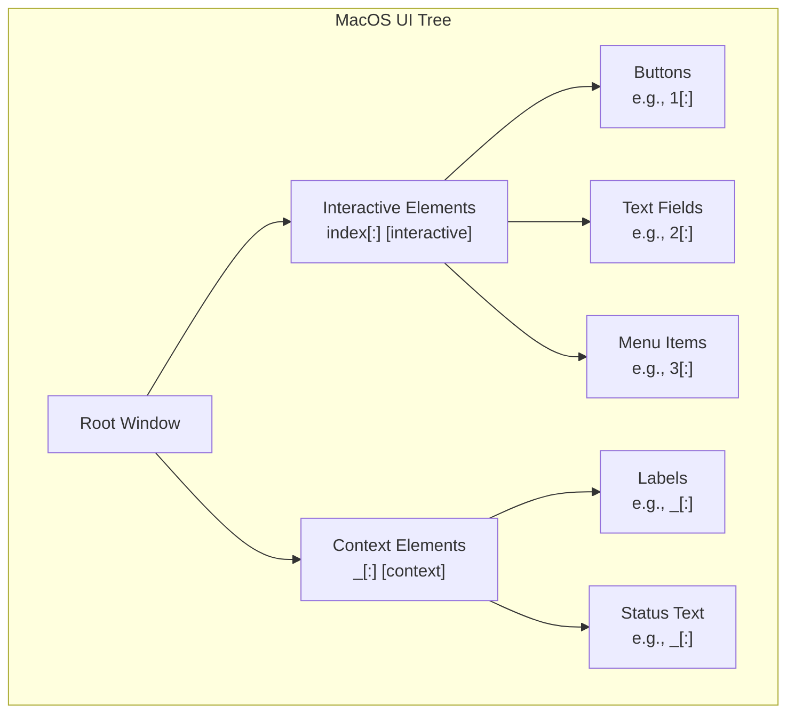

Sources: [mlx_use/mac/element.py:77-112](), [mlx_use/agent/prompts.py:97-107]()

## Agent Error Handling

The Agent includes robust error handling to manage various failure scenarios:

1. **Validation Errors**: When LLM responses don't match expected format
2. **Rate Limit Errors**: When LLM provider enforces rate limits
3. **Action Execution Errors**: When actions on macOS fail
4. **Token Limit Errors**: When conversation exceeds token limits

The system tracks consecutive failures and can implement strategies like:
- Cutting tokens from history to stay within limits
- Adding guidance hints for format errors
- Backing off during rate limit errors
- Stopping after maximum failures threshold

Sources: [mlx_use/agent/service.py:262-288](), [mlx_use/agent/service.py:444-449]()

## Agent History Management

The Agent maintains a comprehensive history of its execution:

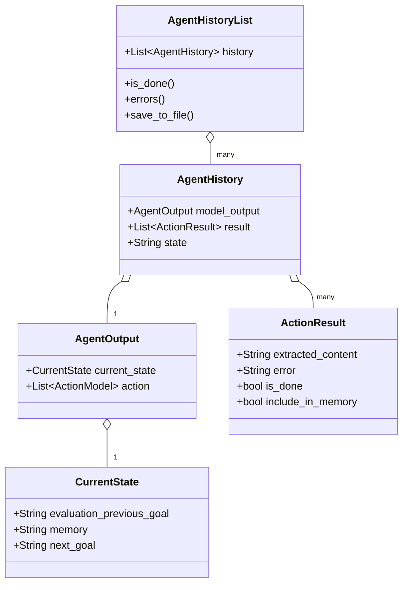

Sources: [mlx_use/agent/service.py:290-307](), [mlx_use/agent/views.py]() (referenced but not directly quoted)

## Integration with External Components

The Agent System interfaces with several external components:

1. **LLM Providers**: Through the LLM parameter (supporting OpenAI, Anthropic, and Google)
2. **MacUITreeBuilder**: To gather UI state information via macOS Accessibility API
3. **Controller**: To execute actions on macOS applications
4. **Telemetry**: To record agent performance and error metrics

The system adapts based on the LLM provider being used, adjusting features like tool calling methods and token handling strategies.

Sources: [mlx_use/agent/service.py:166-181]()

## Usage Example

The following demonstrates how the Agent is typically integrated and used:

```python
# Example usage (does not appear directly in codebase but inferred)
from mlx_use.agent.service import Agent
from mlx_use.controller.service import Controller
from some_llm_provider import ChatModel

# Initialize components
llm = ChatModel(api_key="...")
controller = Controller()

# Create and run agent
agent = Agent(
    task="Calculate 2+2 using the Calculator app",
    llm=llm,
    controller=controller,
    max_steps=10
)

# Run the agent asynchronously
import asyncio
history = asyncio.run(agent.run())

# Get the final result
final_result = history.get_final_result()
```

---

# Page: Controller System

# Controller System

<details>
<summary>Relevant source files</summary>

The following files were used as context for generating this wiki page:

- [mlx_use/controller/service.py](mlx_use/controller/service.py)
- [mlx_use/controller/views.py](mlx_use/controller/views.py)
- [mlx_use/mac/actions.py](mlx_use/mac/actions.py)

</details>


The Controller System acts as the bridge between the Agent's decision-making capabilities and the concrete interactions with macOS applications. It provides a modular framework for executing actions like clicking UI elements, inputting text, scrolling, opening applications, and running AppleScript.

For information about how the Agent determines which actions to take, see [Agent System](#2.1). For details on how the system identifies UI elements to interact with, see [MacOS UI Tree System](#2.3).

## 1. Overview

The Controller System consists of several key components:

1. **Controller**: The central class that manages action execution
2. **Registry**: A service that maintains a collection of registered actions
3. **Action Models**: Pydantic models that define the parameters for each type of action
4. **Action Implementations**: The actual functions that interact with macOS UI elements

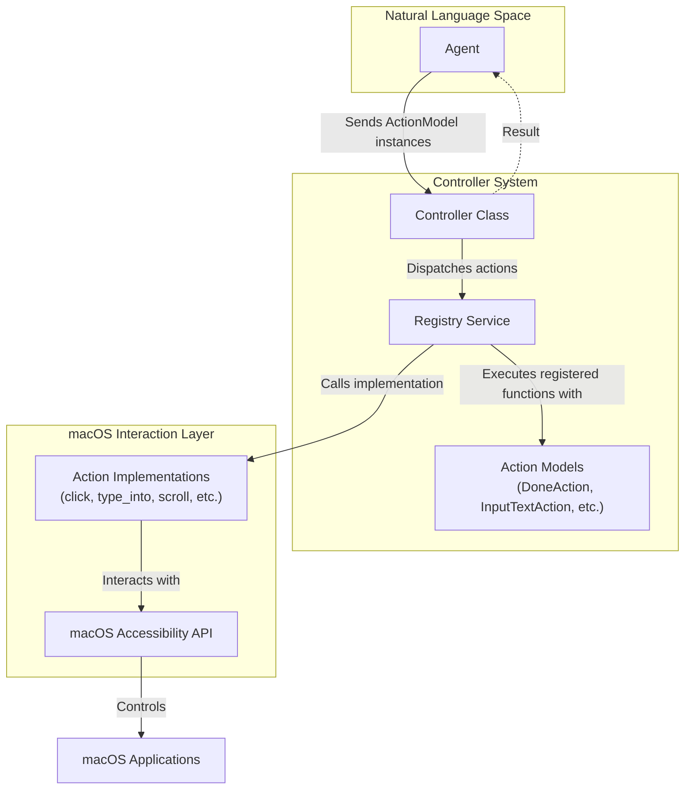

Sources: [mlx_use/controller/service.py:28-311](). [mlx_use/controller/views.py:1-32]().

## 2. Controller Architecture

The Controller acts as the orchestrator of UI interactions. It maintains a registry of available actions and provides methods to execute these actions on macOS applications.

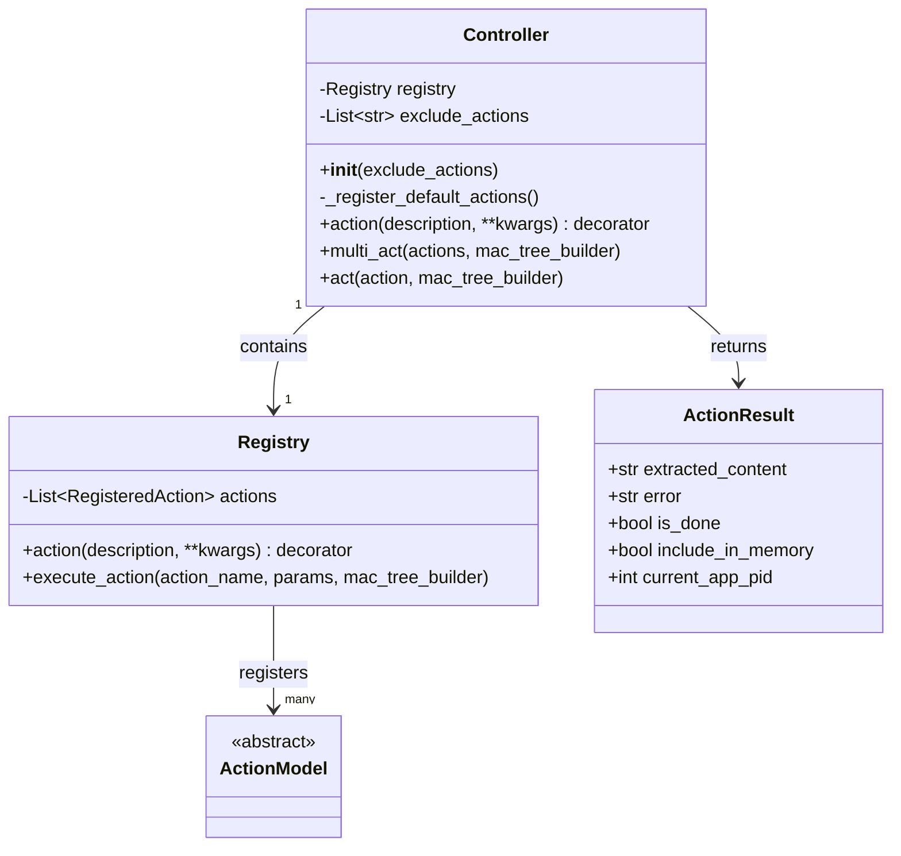

The Controller's main responsibilities are:

1. Initializing and maintaining the action registry
2. Registering default system actions
3. Providing a decorator for registering custom actions
4. Executing single or multiple actions
5. Handling action results and errors

Sources: [mlx_use/controller/service.py:28-35](). [mlx_use/controller/service.py:267-309]().

## 3. Action Registry

The Registry maintains a collection of registered actions and provides methods to execute them. Actions are registered with descriptive text that helps the LLM understand when and how to use them.

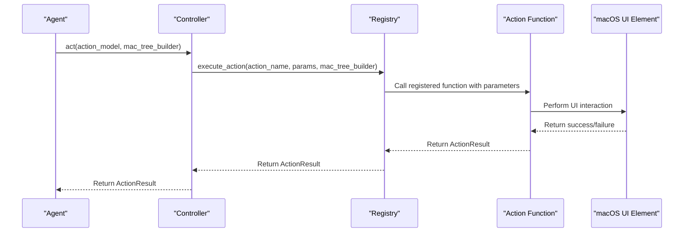

The Registry is initialized by the Controller and actions are registered using a decorator pattern:

```python
@registry.action(
    'Description of what the action does',
    param_model=ActionParamModel,
    requires_mac_builder=Boolean
)
async def action_function(param1, param2, ...):
    # Implementation
    return ActionResult(...)
```

Sources: [mlx_use/controller/service.py:37-265](). [mlx_use/controller/service.py:267-272]().

## 4. Default Registered Actions

The Controller registers several default actions during initialization:

| Action Name | Description | Parameters | Purpose |
|-------------|-------------|------------|---------|
| `done` | Complete task with text for the user | text (str) | Signals task completion |
| `input_text` | Input text | index (int), text (str), submit (bool) | Types text into UI elements |
| `click_element` | Click element and choose action | index (int), action (str) | Clicks on UI elements |
| `right_click_element` | Right click element | index (int) | Right-clicks on UI elements |
| `scroll_element` | Scroll element | index (int), direction (str) | Scrolls UI elements |
| `open_app` | Open a mac app | app_name (str) | Launches macOS applications |
| `run_apple_script` | Run AppleScript | script (str) | Executes AppleScript code |

The `index` parameter in many actions refers to the index of a UI element in the MacUITreeBuilder's element cache.

Sources: [mlx_use/controller/service.py:40-265](). [mlx_use/controller/views.py:8-31]().

## 5. Action Models

Action models are Pydantic models that define the parameters for each type of action:

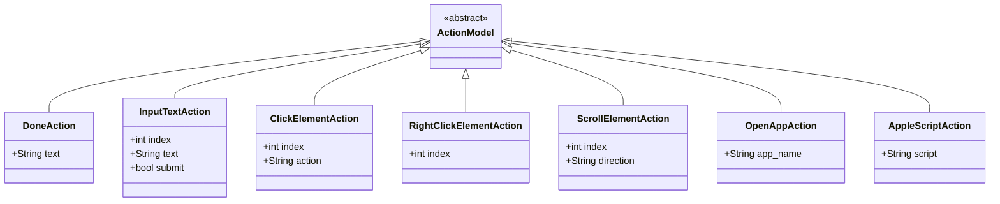

These models ensure that the parameters for each action are properly validated and structured.

Sources: [mlx_use/controller/views.py:1-32]().

## 6. Action Execution Flow

### 6.1 Single Action Execution

The `act` method executes a single action, dispatching it to the registry and handling any errors:

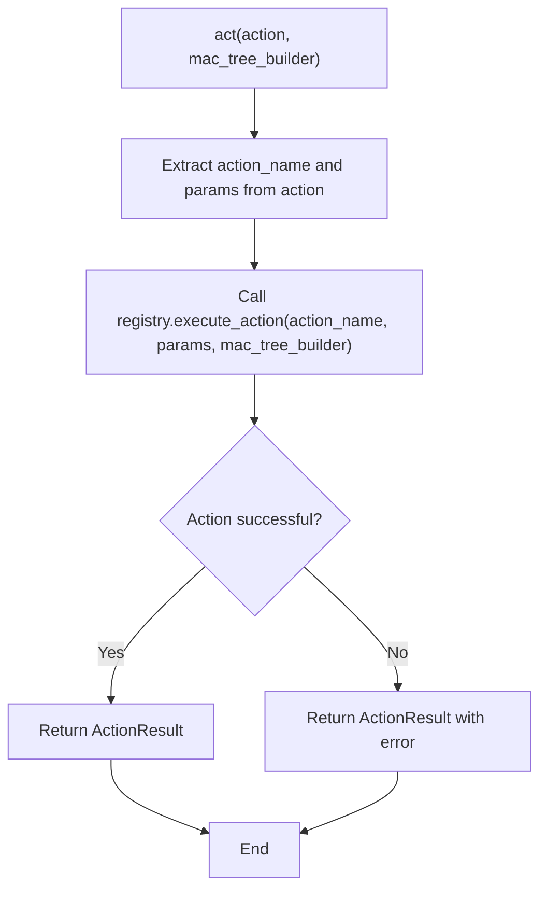

Sources: [mlx_use/controller/service.py:290-309]().

### 6.2 Multiple Action Execution

The `multi_act` method executes multiple actions sequentially and stops if an action completes the task, encounters an error, or reaches the end of the action list:

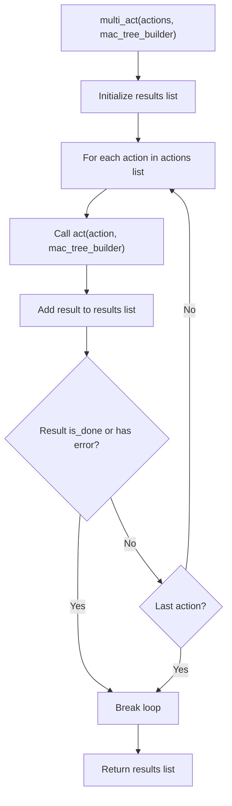

Sources: [mlx_use/controller/service.py:274-288]().

## 7. Core Mac UI Interaction Implementations

### 7.1 Click Operation

The `click` function handles clicking on UI elements:

1. Checks if the element is available and enabled
2. Verifies the element supports the requested action
3. Performs the action using macOS Accessibility API

Available click actions include:
- `AXPress` (standard click)
- `AXClick` (alternative click)
- `AXOpen` (open operation)
- `AXConfirm` (confirm/submit)
- `AXShowMenu` (show context menu)

Sources: [mlx_use/mac/actions.py:43-60](). [mlx_use/controller/service.py:75-109]().

### 7.2 Text Input Operation

The `type_into` function handles typing text into UI elements:

1. Checks if the element is available and enabled
2. Sets the element's value attribute
3. Optionally submits the form if requested

Sources: [mlx_use/mac/actions.py:62-99](). [mlx_use/controller/service.py:46-73]().

### 7.3 Right-Click Operation

The `right_click` function handles right-clicking on UI elements:

1. Checks if the element is available and enabled
2. Attempts to use `AXShowMenu` action
3. Falls back to regular click if `AXShowMenu` is not supported

Sources: [mlx_use/mac/actions.py:101-117](). [mlx_use/controller/service.py:111-138]().

### 7.4 Scroll Operation

The `scroll` function handles scrolling UI elements:

1. Maps the direction to the appropriate macOS action
2. Checks if the element supports the scrolling action
3. Performs the scroll action

Available scroll directions:
- up (`AXScrollUpByPage`)
- down (`AXScrollDownByPage`)
- left (`AXScrollLeftByPage`)
- right (`AXScrollRightByPage`)

Sources: [mlx_use/mac/actions.py:119-140](). [mlx_use/controller/service.py:140-167]().

### 7.5 Open App Operation

The `open_app` action handles launching macOS applications:

1. Attempts to launch the app by name
2. Tries lowercase name if the initial attempt fails
3. Identifies the process ID of the launched application
4. Returns the PID for further interactions

Sources: [mlx_use/controller/service.py:169-221]().

### 7.6 AppleScript Operation

The `run_apple_script` action executes AppleScript code:

1. Wraps the provided script with error handling
2. Executes the script using the `osascript` command
3. Processes the result and captures any errors

Sources: [mlx_use/controller/service.py:223-265]().

## 8. Extending the Controller with Custom Actions

Developers can extend the Controller with custom actions using the `action` decorator:

```python
@controller.action(
    'Description of what the action does',
    param_model=CustomActionModel,
    requires_mac_builder=True/False
)
async def custom_action(param1, param2, mac_tree_builder=None):
    # Implementation
    return ActionResult(extracted_content="Success message")
```

The `action` decorator registers the function with the Registry and sets up the necessary wiring to make it available to the Agent.

Sources: [mlx_use/controller/service.py:267-272]().

## 9. Action Error Handling

The Controller implements robust error handling at multiple levels:

1. Each action implementation has try-except blocks to catch and report errors
2. Action results include an `error` field that indicates if the action failed
3. The `act` method catches and reports any exceptions during action execution
4. The `multi_act` method stops execution when it encounters an error

This multi-layered approach ensures that errors are properly captured and reported to the Agent.

Sources: [mlx_use/controller/service.py:290-309](). [mlx_use/mac/actions.py:19-41]().

---

# Page: MacOS UI Tree System

# MacOS UI Tree System

<details>
<summary>Relevant source files</summary>

The following files were used as context for generating this wiki page:

- [mlx_use/mac/tree.py](mlx_use/mac/tree.py)

</details>


## Purpose and Scope

The MacOS UI Tree System is a core component of the `macOS-use` repository that builds and manages an accessible representation of macOS application user interfaces. This system serves as the "eyes" of the automation framework, allowing the agent to understand what is displayed on screen and what elements can be interacted with. It leverages the macOS Accessibility API to create a hierarchical tree of UI elements that can be traversed, analyzed, and manipulated.

For information about how actions are executed on these UI elements, see [Controller System](#2.2).

## System Overview

The MacOS UI Tree System centers around the `MacUITreeBuilder` class, which scans applications to construct a structured representation of their interface elements. This representation enables the agent to "see" the application's state and identify interactive elements like buttons, text fields, and menus.

```mermaid
flowchart TD
    Agent["Agent"] --> MacUITreeBuilder["MacUITreeBuilder"]
    MacUITreeBuilder --> AXUIElement["macOS AXUIElement API"]
    AXUIElement --> MacApps["macOS Applications"]
    
    MacUITreeBuilder --> BuildTree["build_tree()"]
    BuildTree --> ElementProcessing["_process_element()"]
    
    MacUITreeBuilder --> ElementCache["_element_cache"]
    MacUITreeBuilder --> InteractiveChecks["_is_interactive()"]
    MacUITreeBuilder --> AttributeGetters["_get_attribute()"]
    
    ElementProcessing --> MacElementNode["MacElementNode"]
    MacElementNode --> ElementAttributes["Attributes\n- role\n- title\n- value\n- position\n- etc."]
    MacElementNode --> ElementProperties["Properties\n- is_interactive\n- highlight_index\n- children"]
```

Sources: [mlx_use/mac/tree.py:44-353]()

## Key Components

### MacUITreeBuilder

The `MacUITreeBuilder` is the primary class responsible for discovering and organizing UI elements from macOS applications. It tracks interactive elements with a highlighting system and maintains a cache of elements for quick access.

#### Important Attributes

| Attribute | Description |
|-----------|-------------|
| `highlight_index` | Sequential index assigned to interactive elements |
| `_element_cache` | Dictionary mapping indexes to element nodes |
| `_processed_elements` | Set to prevent processing the same element twice |
| `max_depth` | Maximum recursion depth (30 by default) |
| `max_children` | Maximum children per element (250 by default) |
| `INTERACTIVE_ACTIONS` | Set of actions that indicate an element is interactive |
| `SCROLL_ACTIONS` | Set of actions related to scrolling capabilities |

Sources: [mlx_use/mac/tree.py:45-73]()

### MacElementNode

Each UI element is represented as a `MacElementNode` which stores its properties, attributes, and relationships. This creates a traversable tree structure that mirrors the application's UI hierarchy.

```mermaid
classDiagram
    class MacElementNode {
        +string role
        +string identifier
        +dict attributes
        +bool is_visible
        +bool is_interactive
        +int highlight_index
        +MacElementNode parent
        +List~MacElementNode~ children
        +int app_pid
        +AXUIElement _element
    }
    
    MacElementNode "1" --> "0..*" MacElementNode: children
```

Sources: [mlx_use/mac/tree.py:146-156](), [mlx_use/mac/element.py]() (referenced but not shown)

## Tree Building Process

The tree building process starts from an application window and recursively discovers all UI elements within it, creating a hierarchical structure of `MacElementNode` objects.

```mermaid
sequenceDiagram
    participant Agent
    participant MacUITreeBuilder
    participant AccessibilityAPI as "macOS Accessibility API"
    participant Application
    
    Agent->>MacUITreeBuilder: build_tree(pid)
    MacUITreeBuilder->>MacUITreeBuilder: Reset state
    MacUITreeBuilder->>AccessibilityAPI: AXUIElementCreateApplication(pid)
    AccessibilityAPI->>Application: Connect to application
    Application-->>AccessibilityAPI: Return app reference
    AccessibilityAPI-->>MacUITreeBuilder: Return app element
    
    MacUITreeBuilder->>AccessibilityAPI: Get main window
    AccessibilityAPI-->>MacUITreeBuilder: Return window element
    
    loop For each element
        MacUITreeBuilder->>MacUITreeBuilder: _process_element()
        MacUITreeBuilder->>AccessibilityAPI: Get attributes and actions
        AccessibilityAPI-->>MacUITreeBuilder: Return element data
        MacUITreeBuilder->>MacUITreeBuilder: Create MacElementNode
        MacUITreeBuilder->>MacUITreeBuilder: Check if interactive
        
        alt Element is interactive
            MacUITreeBuilder->>MacUITreeBuilder: Assign highlight_index
            MacUITreeBuilder->>MacUITreeBuilder: Add to element cache
        end
        
        MacUITreeBuilder->>AccessibilityAPI: Get children
        AccessibilityAPI-->>MacUITreeBuilder: Return child elements
        
        loop For each child (recursive)
            MacUITreeBuilder->>MacUITreeBuilder: _process_element(child)
        end
    end
    
    MacUITreeBuilder-->>Agent: Return UI tree root
```

Sources: [mlx_use/mac/tree.py:258-353](), [mlx_use/mac/tree.py:128-227]()

## Element Processing

The heart of the tree building system is the element processing logic, which determines what information to collect about each UI element and how to identify interactive elements.

### Element Attributes Collection

For each element, the system collects various attributes from the macOS Accessibility API:

| Attribute | Description | API Constant |
|-----------|-------------|--------------|
| Role | The element's type (button, text field, etc.) | `kAXRoleAttribute` |
| Title | Displayed text label | `kAXTitleAttribute` |
| Value | Current value (for inputs, sliders, etc.) | `kAXValueAttribute` |
| Description | Accessibility description | `kAXDescriptionAttribute` |
| Enabled | Whether the element is enabled | `'AXEnabled'` |
| Position | Screen coordinates | `'AXPosition'` |
| Size | Element dimensions | `'AXSize'` |
| Subrole | Additional role information | `'AXSubrole'` |

Sources: [mlx_use/mac/tree.py:160-186]()

### Interactive Element Detection

A critical function of the UI Tree System is identifying which elements are interactive. This is determined by examining the element's role and available actions.

```mermaid
flowchart TD
    StartCheck["_is_interactive()"] --> HasActions{"Has actions?"}
    HasActions -->|No| NotInteractive["Not Interactive"]
    HasActions -->|Yes| CheckActions{"Has interactive\nor scroll actions?"}
    
    CheckActions -->|No| SpecialCases{"Special cases?"}
    CheckActions -->|Yes| Interactive["Interactive"]
    
    SpecialCases -->|"Text field with\nAXSetValue"| CheckEnabled{"Enabled?"}
    SpecialCases -->|"Button/Link with\nAXPress"| CheckEnabled
    SpecialCases -->|Other| NotInteractive
    
    CheckEnabled -->|Yes| Interactive
    CheckEnabled -->|No| NotInteractive
```

The system considers these key action types:

| Action Type | Description | Used For |
|-------------|-------------|----------|
| `AXPress` | Basic click action | Buttons, links, checkboxes |
| `AXShowMenu` | Opens a menu | Dropdown buttons, context menus |
| `AXIncrement`/`AXDecrement` | Value adjustment | Spinners, steppers |
| `AXConfirm`/`AXCancel` | Dialog actions | Confirmation dialogs |
| `AXSetValue` | Value modification | Text fields, sliders |
| Scroll actions | Page navigation | Scrollable areas |

Sources: [mlx_use/mac/tree.py:56-73](), [mlx_use/mac/tree.py:107-126]()

## Integration with Accessibility API

The UI Tree System interacts extensively with the macOS Accessibility API to query application structures.

### Key Accessibility API Interactions

| Method | macOS API Used | Purpose |
|--------|---------------|----------|
| `build_tree` | `AXUIElementCreateApplication` | Create reference to application |
| `_get_attribute` | `AXUIElementCopyAttributeValue` | Retrieve element attributes |
| `_get_actions` | `AXUIElementCopyActionNames` | Get available actions for element |

Sources: [mlx_use/mac/tree.py:79-93](), [mlx_use/mac/tree.py:95-105]()

### Error Handling

The system includes robust error handling for accessibility API interactions, addressing common issues:

1. Accessibility permissions not granted
2. Application no longer running
3. Maximum recursion depth or children limits reached
4. Attributes not supported by elements
5. Window identification failures with fallback mechanisms

```mermaid
flowchart TD
    Start["build_tree()"] --> CheckPID{"PID available?"}
    CheckPID -->|No| Error1["Error: No app open"]
    CheckPID -->|Yes| VerifyProcess{"Process running?"}
    
    VerifyProcess -->|No| Error2["Error: Process ended"]
    VerifyProcess -->|Yes| SetupObserver{"Setup observer"}
    
    SetupObserver -->|Fail| Error3["Error: Observer setup failed"]
    SetupObserver -->|Success| CreateAppElement["Create AXUIElement"]
    
    CreateAppElement --> TestAccess{"Test accessibility"}
    TestAccess -->|Fail| Error4["Error: Accessibility disabled"]
    TestAccess -->|Success| GetMainWindow{"Get main window"}
    
    GetMainWindow -->|Success| BuildTree["Process window elements"]
    GetMainWindow -->|Fail| TryWindows{"Try fallback: AXWindows"}
    
    TryWindows -->|Success| BuildTree
    TryWindows -->|Fail| Error5["Error: No windows found"]
    
    BuildTree --> Return["Return UI tree"]
```

Sources: [mlx_use/mac/tree.py:258-353]()

## Element Caching and Management

The UI Tree System maintains an element cache to enable controller actions to reference UI elements by index.

### Highlighting System

As the tree is built, each interactive element is assigned a sequential `highlight_index` and stored in the `_element_cache` dictionary. This allows the Controller to reference elements by their index when executing actions.

```mermaid
flowchart LR
    subgraph "MacUITreeBuilder"
        ProcessElement["_process_element()"] --> IsInteractive{"is_interactive?"}
        IsInteractive -->|Yes| AssignIndex["Assign highlight_index"]
        AssignIndex --> AddToCache["Add to _element_cache"]
        IsInteractive -->|No| IsContext{"is context element?"}
        IsContext -->|Yes| AddAsContext["Add as context element"]
        IsContext -->|No| SkipCache["Skip caching"]
    end
    
    subgraph "Later Use"
        Controller["Controller"] --> LookupByIndex["Look up by index"]
        LookupByIndex --> ElementCache["_element_cache"]
        ElementCache --> PerformAction["Perform action on element"]
    end
```

Sources: [mlx_use/mac/tree.py:196-203]()

### State Management

The system includes methods to manage its state:

| Method | Purpose |
|--------|---------|
| `cleanup()` | Full resource release between sessions |
| `reset_state()` | Reset indexes and caches between steps |

Sources: [mlx_use/mac/tree.py:229-256]()

## Limitations and Boundaries

The MacUITreeBuilder has built-in limits to prevent excessive processing:

1. Maximum recursion depth of 30 levels
2. Maximum of 250 children per element
3. Tracking of already processed elements to prevent cycles

These limits help maintain performance while still providing comprehensive UI coverage for most applications.

Sources: [mlx_use/mac/tree.py:51-52](), [mlx_use/mac/tree.py:209-221]()

## Integration with Agent System

The UI Tree System provides the visual understanding component that enables the agent to make informed decisions about what actions to take.

```mermaid
flowchart LR
    subgraph "Agent Loop"
        AgentStart["Agent receives task"]
        BuildUITree["Build UI tree"]
        AnalyzeUI["Analyze UI state"]
        DetermineAction["Determine action"]
        ExecuteAction["Execute action"]
        AgentEnd["Check if task complete"]
        
        AgentStart --> BuildUITree
        BuildUITree --> AnalyzeUI
        AnalyzeUI --> DetermineAction
        DetermineAction --> ExecuteAction
        ExecuteAction --> AgentEnd
        AgentEnd -->|Not complete| BuildUITree
    end
    
    subgraph "MacUITreeBuilder"
        BuildUITree --> MacUITreeBuilder["MacUITreeBuilder.build_tree()"]
        MacUITreeBuilder --> MacElementNode["Creates tree of\nMacElementNodes"]
    end
    
    subgraph "Controller"
        ExecuteAction --> ControllerAction["Controller.act()"]
        ControllerAction --> ElementLookup["Look up by highlight_index"]
    end
```

Sources: [mlx_use/mac/tree.py:258-353]()

## Summary

The MacOS UI Tree System is the foundation of the macOS automation capabilities, providing a structured representation of application interfaces that enables intelligent interaction. By leveraging the macOS Accessibility API, it creates a navigable tree of UI elements with rich attributes and identifies interactive components that can be manipulated by the agent system.

---

# Page: LLM Integration

# LLM Integration

<details>
<summary>Relevant source files</summary>

The following files were used as context for generating this wiki page:

- [examples/try.py](examples/try.py)
- [gradio_app/src/models/llm_models.py](gradio_app/src/models/llm_models.py)
- [mlx_use/agent/prompts.py](mlx_use/agent/prompts.py)

</details>


This document explains how the macOS-use system integrates with Large Language Model (LLM) providers to power its AI decision-making capabilities. The LLM integration component serves as the intelligence layer, enabling the agent to interpret UI states and determine appropriate actions to complete user tasks.

For information about how the Agent system uses these LLMs, see [Agent System](#2.1). For configuration details on API keys, see [API Keys and Environment Variables](#5.1).

## Architecture Overview

The LLM integration component bridges the Agent system with external LLM providers through a standardized interface, allowing multiple AI models to be used interchangeably.

```mermaid
graph TD
    subgraph "macOS-use System"
        Agent["Agent"]
        MessageManager["MessageManager"]
    end
    
    subgraph "LLM Integration"
        LLMInterface["LLM Provider Interface"]
        ProviderAdapters["LangChain Adapters"]
    end
    
    subgraph "External LLM Providers"
        OpenAI["OpenAI API"]
        Anthropic["Anthropic API"]
        Google["Google Gemini API"]
    end
    
    Agent --> MessageManager
    MessageManager --> LLMInterface
    LLMInterface --> ProviderAdapters
    ProviderAdapters --> OpenAI
    ProviderAdapters --> Anthropic
    ProviderAdapters --> Google
    
    class Agent,MessageManager,LLMInterface,ProviderAdapters,OpenAI,Anthropic,Google node
```

Sources: [examples/try.py:4-6](), [examples/try.py:22-29](), [gradio_app/src/models/llm_models.py:15-27]()

## Supported LLM Providers and Models

The system uses LangChain's provider-specific adapters to connect to different LLM services:

| Provider  | Client Class         | Default Models                              |
|-----------|----------------------|--------------------------------------------|
| OpenAI    | `ChatOpenAI`         | gpt-4o, o3-mini                            |
| Anthropic | `ChatAnthropic`      | claude-3-5-sonnet-20240620, claude-3-7-sonnet-20250219 |
| Google    | `ChatGoogleGenerativeAI` | gemini-1.5-flash-002, gemini-2.0-flash-exp |

The available models are defined in the LLM_MODELS dictionary:

```python
LLM_MODELS = {
    "OpenAI": ["gpt-4o", "o3-mini"],
    "Anthropic": ["claude-3-5-sonnet-20240620", "claude-3-7-sonnet-20250219"],
    "Google": ["gemini-1.5-flash-002", "gemini-2.0-flash-exp"],
    "alibaba": ["qwen-2.5-72b-instruct"]
}
```

Sources: [gradio_app/src/models/llm_models.py:8-13]()

## LLM Initialization Flow

The system follows a consistent pattern for initializing LLM clients across the codebase:

```mermaid
sequenceDiagram
    participant App as "Application"
    participant LLMFactory as "get_llm Function"
    participant LangChain as "LangChain Adapters"
    participant LLMAPIs as "LLM Provider APIs"
    
    App->>LLMFactory: get_llm(provider, model, api_key)
    alt provider == "OpenAI"
        LLMFactory->>LangChain: ChatOpenAI(model, api_key)
    else provider == "Anthropic"
        LLMFactory->>LangChain: ChatAnthropic(model, api_key)
    else provider == "Google"
        LLMFactory->>LangChain: ChatGoogleGenerativeAI(model, api_key)
    else
        LLMFactory-->>App: ValueError("Unsupported provider")
    end
    LangChain->>LLMAPIs: Initialize connection
    LLMAPIs-->>LangChain: Return client
    LangChain-->>LLMFactory: Return configured client
    LLMFactory-->>App: Return LLM instance
```

The `get_llm` function creates the appropriate LangChain client based on the provider name:

```python
def get_llm(provider: str, model: str, api_key: str) -> Optional[object]:
    """Initialize LLM based on provider"""
    try:
        if provider == "OpenAI":
            return ChatOpenAI(model=model, api_key=SecretStr(api_key))
        elif provider == "Anthropic":
            return ChatAnthropic(model=model, api_key=SecretStr(api_key))
        elif provider == "Google":
            return ChatGoogleGenerativeAI(model=model, api_key=SecretStr(api_key))
        else:
            raise ValueError(f"Unsupported provider: {provider}")
    except Exception as e:
        raise ValueError(f"Failed to initialize {provider} LLM: {str(e)}")
```

Sources: [gradio_app/src/models/llm_models.py:15-27](), [examples/try.py:18-31]()

## LLM Selection Logic

The system uses a fallback mechanism to select an available LLM provider based on which API keys are configured:

```mermaid
flowchart TD
    Start["Start LLM Selection"]
    CheckGoogle["Check for GEMINI_API_KEY"]
    CheckOpenAI["Check for OPENAI_API_KEY"]
    CheckAnthropic["Check for ANTHROPIC_API_KEY"]
    SetGoogle["Initialize Google LLM"]
    SetOpenAI["Initialize OpenAI LLM"]
    SetAnthropic["Initialize Anthropic LLM"]
    Error["Raise Error: No API keys found"]
    
    Start --> CheckGoogle
    CheckGoogle -->|Key exists| SetGoogle
    CheckGoogle -->|No key| CheckOpenAI
    CheckOpenAI -->|Key exists| SetOpenAI
    CheckOpenAI -->|No key| CheckAnthropic
    CheckAnthropic -->|Key exists| SetAnthropic
    CheckAnthropic -->|No key| Error
    
    SetGoogle --> End
    SetOpenAI --> End
    SetAnthropic --> End
    
    End["Return initialized LLM"]
```

This selection logic is demonstrated in the `try.py` example script:

```python
# Try to set LLM based on available API keys
llm = None
if os.getenv('GEMINI_API_KEY'):
    llm = set_llm('google')
elif os.getenv('OPENAI_API_KEY'):
    llm = set_llm('OAI')
elif os.getenv('ANTHROPIC_API_KEY'):
    llm = set_llm('anthropic')

if not llm:
    raise ValueError("No API keys found. Please set at least one of GEMINI_API_KEY, OPENAI_API_KEY, or ANTHROPIC_API_KEY in your .env file")
```

Sources: [examples/try.py:33-43]()

## Prompt System

The LLM integration uses a sophisticated prompt structure to guide the model's behavior. The prompting system consists of two main components:

### System Prompt

The `SystemPrompt` class constructs a detailed instruction set for the LLM that defines:

- Response format requirements (JSON structure)
- Action execution rules and constraints
- App handling instructions
- Element interaction guidelines
- Task completion criteria
- Navigation and error handling strategies
- AppleScript support

```mermaid
classDiagram
    class SystemPrompt {
        -default_action_description: str
        -current_date: datetime
        -max_actions_per_step: int
        +important_rules() str
        +input_format() str
        +get_system_message() SystemMessage
    }
    
    class SystemMessage {
        +content: str
    }
    
    SystemPrompt --> SystemMessage: creates
```

The `get_system_message()` method combines all instructions into a comprehensive prompt for the LLM.

Sources: [mlx_use/agent/prompts.py:6-131]()

### Agent Message Prompt

The `AgentMessagePrompt` class creates contextual prompts that capture the current state of the system:

```mermaid
classDiagram
    class AgentMessagePrompt {
        -state: str
        -result: Optional[List[ActionResult]]
        -max_error_length: int
        -include_attributes: list[str]
        -step_info: Optional[AgentStepInfo]
        +get_user_message() HumanMessage
    }
    
    class HumanMessage {
        +content: str
    }
    
    class ActionResult {
        +extracted_content: str
        +error: str
    }
    
    class AgentStepInfo {
        +step_number: int
        +max_steps: int
    }
    
    AgentMessagePrompt --> HumanMessage: creates
    AgentMessagePrompt --> ActionResult: uses
    AgentMessagePrompt --> AgentStepInfo: uses
```

The `get_user_message()` method formats the current UI state, previous action results, and any errors into a message for the LLM.

Sources: [mlx_use/agent/prompts.py:133-175]()

## Agent-LLM Interaction

The Agent uses the LLM for decision-making by:

1. Collecting the current UI state via the MacUITreeBuilder
2. Formatting the state using the prompt system
3. Sending the formatted prompt to the LLM provider
4. Parsing the LLM's JSON response into executable actions
5. Executing the actions via the Controller

```mermaid
sequenceDiagram
    participant Agent
    participant MessageManager
    participant LLM
    participant Controller
    
    Agent->>MessageManager: Format prompt with current state
    MessageManager->>LLM: Send formatted prompt
    LLM-->>MessageManager: Return JSON response
    MessageManager-->>Agent: Return parsed actions
    Agent->>Controller: Execute actions
    Controller-->>Agent: Return action results
```

Sources: [mlx_use/agent/prompts.py:133-175](), [examples/try.py:50-71]()

## API Key Configuration

For the LLM integration to function, at least one of the following environment variables must be set:

| Provider  | Environment Variable | Purpose |
|-----------|---------------------|---------|
| OpenAI    | OPENAI_API_KEY      | Authentication for OpenAI API |
| Anthropic | ANTHROPIC_API_KEY   | Authentication for Anthropic API |
| Google    | GEMINI_API_KEY      | Authentication for Google Gemini API |

The system checks for these API keys when initializing and will raise an error if none are found.

Sources: [examples/try.py:33-43]()

## Best Practices

When working with the LLM integration:

1. **Provider Selection**:
   - OpenAI models excel at general purpose tasks and code generation
   - Anthropic Claude models handle complex reasoning with longer context
   - Google Gemini models offer competitive pricing for many tasks

2. **Model Performance vs. Cost**:
   - Larger models provide better results but cost more
   - Consider using smaller models for simple tasks to reduce costs

3. **Fallback Mechanism**:
   - Implement multiple provider options to handle API outages
   - The system's built-in fallback mechanism helps ensure reliability

4. **API Key Security**:
   - Always use environment variables or the `SecretStr` type to protect API keys
   - Never hardcode API keys in your application code

Sources: [examples/try.py:18-43](), [gradio_app/src/models/llm_models.py:15-27]()

---

# Page: User Interfaces

# User Interfaces

<details>
<summary>Relevant source files</summary>

The following files were used as context for generating this wiki page:

- [README.md](README.md)
- [examples/try.py](examples/try.py)
- [gradio_app/app.py](gradio_app/app.py)
- [gradio_app/src/models/llm_models.py](gradio_app/src/models/llm_models.py)
- [pyproject.toml](pyproject.toml)

</details>


## Purpose and Scope

This document provides a comprehensive overview of the user interfaces available in the macOS-use system. It covers the two primary interface options: the Command Line Interface (CLI) and the Gradio Web Interface. Each interface allows users to interact with the system in different ways, enabling AI agents to control macOS applications.

For details about the underlying Agent System that powers these interfaces, see [Agent System](#2.1). For information about the Controller System that executes actions on macOS, see [Controller System](#2.2).

## Overview of Available Interfaces

macOS-use provides two distinct user interfaces, each serving different use cases and user preferences:

```mermaid
flowchart TD
    User(("User"))
    User --> CLI["Command Line Interface"]
    User --> Gradio["Gradio Web Interface"]
    
    CLI --> Examples["Example Scripts"]
    CLI --> Controller["Controller"]
    
    Gradio --> AgentTab["Agent Tab"]
    Gradio --> AutomationsTab["Automations Tab"]
    Gradio --> ConfigTab["Configuration Tab"]
    
    AgentTab --> Controller
    AutomationsTab --> Controller
    
    Controller --> MacOSApps["macOS Applications"]
    
    subgraph "Core System"
        Controller
    end
```

Sources: [README.md:19-20](), [gradio_app/app.py:17-33]()

## Command Line Interface

The CLI provides a straightforward, script-based approach to interact with the macOS-use system. It is ideal for developers who prefer terminal-based workflows or need to integrate macOS-use into existing scripts.

### Structure and Components

```mermaid
sequenceDiagram
    participant User
    participant Script["Example Script"]
    participant LLM["LLM Service"]
    participant Agent
    participant Controller
    participant macOS

    User->>Script: Run script with task
    Script->>Script: Initialize LLM
    Script->>Script: Initialize Controller
    Script->>Agent: Create Agent(task, llm, controller)
    Agent->>Agent: Initialize
    User->>Agent: agent.run(max_steps)
    
    loop Until task complete or max steps reached
        Agent->>Controller: Execute action
        Controller->>macOS: Perform system action
        macOS-->>Controller: Return result
        Controller-->>Agent: Return outcome
        Agent->>LLM: Request next action
        LLM-->>Agent: Provide next action
    end
    
    Agent-->>User: Return final result
```

Sources: [examples/try.py:48-73]()

### Example Scripts

The repository includes several example scripts in the `examples` directory that demonstrate different use cases:

| Script Name | Purpose | Command |
|-------------|---------|---------|
| try.py | Basic interaction with system | `python examples/try.py` |
| calculate.py | Calculate using macOS calculator | `python examples/calculate.py` |
| login_to_auth0.py | Automate web login process | `python examples/login_to_auth0.py` |
| check_time_online.py | Search for information online | `python examples/check_time_online.py` |
| excel.py | Manipulate data in spreadsheets | `python examples/excel.py` |

Sources: [README.md:70-82](), [README.md:92-95](), [README.md:104-107]()

### Example Usage

The standard pattern for CLI usage involves:

1. Setting up the LLM provider
2. Creating a controller
3. Initializing an agent with a task
4. Running the agent

```mermaid
flowchart TD
    A["Import Dependencies"] --> B["Set Up LLM Provider"]
    B --> C["Create Controller"]
    C --> D["Initialize Agent with Task"]
    D --> E["Run Agent with max_steps"]
    E --> F["Process Results"]
```

A typical example script follows this pattern, as seen in `try.py`:

1. Import required modules and set up environment
2. Configure the LLM based on available API keys
3. Create a controller instance
4. Initialize and run the agent with a specific task
5. Process the results

Sources: [examples/try.py:1-74]()

## Gradio Web Interface

The Gradio web interface provides a more visual and user-friendly way to interact with macOS-use. It offers a browser-based GUI with multiple tabs for different functionalities.

### Architecture and Components

The Gradio interface is structured as a multi-tab application with specialized functionality in each tab:

```mermaid
classDiagram
    class MacOSUseGradioApp {
        +run_agent()
        +add_automation()
        +add_agent_to_automation()
        +remove_agent_from_automation()
        +get_automation_agents()
        +run_automation()
        +stop_agent()
        +update_llm_preferences()
    }
    
    class GradioInterface {
        +Agent Tab
        +Automations Tab
        +Configuration Tab
    }
    
    class AgentTab {
        +task_input
        +refine_prompt_btn
        +share_prompt
        +max_steps
        +max_actions
        +run_button
        +stop_button
        +result_output
        +terminal_output
    }
    
    class AutomationsTab {
        +automation_name
        +automation_description
        +add_automation_btn
        +automation_list
        +agent_prompt
        +add_agent_btn
        +remove_agent_btn
        +run_automation_btn
        +agents_list
        +automation_output
    }
    
    class ConfigTab {
        +llm_provider
        +llm_model
        +api_key
        +share_terminal_cfg
    }
    
    GradioInterface *-- AgentTab
    GradioInterface *-- AutomationsTab
    GradioInterface *-- ConfigTab
    GradioInterface -- MacOSUseGradioApp
```

Sources: [gradio_app/app.py:17-33](), [gradio_app/app.py:274-290]()

### Agent Tab

The Agent tab is the primary interface for running individual tasks:

```mermaid
flowchart TD
    subgraph "Agent Tab"
        A["Task Input"] --> B["Refine Prompt Button"]
        B --> C["Run Button"]
        D["Configuration Options"]
        D --> E["Max Steps"]
        D --> F["Max Actions"]
        D --> G["Share Prompt Toggle"]
        C --> H["Task Execution"]
        H --> I["Terminal Output"]
        H --> J["Result Output"]
        K["Stop Button"] --> H
    end
```

Key components:
- Task input field for entering the task description
- Refine prompt button that uses the LLM to improve the task description
- Run button to execute the task
- Stop button to terminate execution
- Terminal output showing detailed execution logs
- Result output displaying the final outcome

Sources: [gradio_app/app.py:22-26](), [gradio_app/app.py:190-223]()

### Automations Tab

The Automations tab allows creating and managing sequences of agents to perform complex workflows:

```mermaid
flowchart TD
    A["Create Automation"] --> B["Name & Description"]
    B --> C["Add to Automation List"]
    C --> D["Add Agent to Automation"]
    D --> E["Agent Prompt"]
    E --> F["Add to Agents List"]
    F --> G["Run Automation"]
    F --> H["Remove Agent"]
    H --> F
```

Key components:
- Automation name and description fields
- Button to add a new automation
- List of existing automations
- Agent prompt field for adding agents to an automation
- List of agents in the selected automation
- Buttons to add and remove agents
- Button to run the selected automation

Sources: [gradio_app/app.py:27-31](), [gradio_app/app.py:149-168]()

### Configuration Tab

The Configuration tab provides options for configuring the system:

```mermaid
flowchart TD
    A["LLM Provider Selection"] --> B["Update Provider"]
    B --> C["LLM Model Selection"]
    C --> D["Update Model"]
    E["API Key Input"] --> F["Save API Key"]
    G["Telemetry Settings"] --> H["Update Share Terminal"]
```

Key components:
- LLM provider selection (OpenAI, Anthropic, Google)
- LLM model selection based on the selected provider
- API key input field
- Telemetry settings for controlling data sharing

Sources: [gradio_app/app.py:33-35](), [gradio_app/app.py:247-257](), [gradio_app/src/models/llm_models.py:8-13]()

### Interface Lifecycle

The Gradio interface follows this lifecycle:

```mermaid
sequenceDiagram
    participant User
    participant GradioUI
    participant MacOSUseGradioApp
    participant Agent
    participant Controller
    participant macOS

    User->>GradioUI: Open interface
    GradioUI->>MacOSUseGradioApp: Initialize app
    
    alt Agent Tab
        User->>GradioUI: Enter task
        User->>GradioUI: Click Refine Prompt
        GradioUI->>MacOSUseGradioApp: refine_prompt()
        MacOSUseGradioApp-->>GradioUI: Return refined prompt
        User->>GradioUI: Click Run
        GradioUI->>MacOSUseGradioApp: run_agent()
        MacOSUseGradioApp->>Agent: Initialize and run
        
        loop Until complete
            Agent->>Controller: Execute action
            Controller->>macOS: Perform action
            macOS-->>Controller: Return result
            Controller-->>Agent: Return outcome
            Agent-->>MacOSUseGradioApp: Update status
            MacOSUseGradioApp-->>GradioUI: Update terminal output
        end
        
        Agent-->>MacOSUseGradioApp: Return final result
        MacOSUseGradioApp-->>GradioUI: Update result output
    else Automations Tab
        User->>GradioUI: Create automation
        GradioUI->>MacOSUseGradioApp: add_automation()
        User->>GradioUI: Add agents
        GradioUI->>MacOSUseGradioApp: add_agent_to_automation()
        User->>GradioUI: Click Run Automation
        GradioUI->>MacOSUseGradioApp: run_automation()
        MacOSUseGradioApp-->>GradioUI: Return results
    else Configuration Tab
        User->>GradioUI: Change provider
        GradioUI->>MacOSUseGradioApp: update_llm_preferences()
        User->>GradioUI: Update settings
        GradioUI->>MacOSUseGradioApp: save preferences
    end
```

Sources: [gradio_app/app.py:190-233](), [gradio_app/app.py:149-188](), [gradio_app/app.py:234-257]()

## LLM Integration

Both interfaces integrate with various LLM providers to power the AI capabilities:

```mermaid
flowchart TD
    A["User Interface"] --> B["LLM Provider Selection"]
    B --> C{"Provider"}
    C -->|"OpenAI"| D["gpt-4o / o3-mini"]
    C -->|"Anthropic"| E["claude-3-5-sonnet / claude-3-7-sonnet"]
    C -->|"Google"| F["gemini-1.5-flash / gemini-2.0-flash"]
    C -->|"Alibaba"| G["qwen-2.5-72b-instruct"]
```

The system supports multiple LLM providers:
- OpenAI: gpt-4o, o3-mini
- Anthropic: claude-3-5-sonnet-20240620, claude-3-7-sonnet-20250219
- Google: gemini-1.5-flash-002, gemini-2.0-flash-exp
- Alibaba: qwen-2.5-72b-instruct

Sources: [gradio_app/src/models/llm_models.py:8-13](), [examples/try.py:22-29]()

## Installation and Setup

To use either interface, you need to:

1. Install the package: `pip install mlx-use` or clone the repository
2. Set up API keys for at least one LLM provider
3. Configure environment variables

For CLI usage, run the example scripts directly. For the Gradio interface, the server can be launched with:

```bash
# From the repository root
python -m gradio_app.app
```

Sources: [README.md:25-65](), [pyproject.toml:1-36]()

## Comparison of Interfaces

| Feature | CLI | Gradio Web Interface |
|---------|-----|----------------------|
| Complexity | Simple | Advanced |
| User Experience | Terminal-based | Visual, browser-based |
| Ideal For | Quick tasks, scripting, automation | Complex workflows, visual monitoring |
| Customizability | High (modify scripts) | Medium (use UI controls) |
| Learning Curve | Steeper (requires coding) | Gentler (GUI-based) |
| Integration | Easy to integrate with scripts | Standalone application |

Sources: [README.md:19-20](), [gradio_app/app.py:17-33](), [examples/try.py:1-74]()

## Best Practices

1. **For CLI Usage**:
   - Store API keys in environment variables or .env file
   - Create reusable scripts for common tasks
   - Define appropriate limits for max_steps and max_actions

2. **For Gradio Interface**:
   - Configure LLM provider and model before running tasks
   - Use the "Refine Prompt" feature to improve task descriptions
   - Create automations for recurring complex workflows
   - Monitor the terminal output for detailed execution progress

Sources: [examples/try.py:18-41](), [gradio_app/app.py:96-146]()

---

# Page: Command Line Interface

# Command Line Interface

<details>
<summary>Relevant source files</summary>

The following files were used as context for generating this wiki page:

- [examples/calculate.py](examples/calculate.py)
- [examples/check_time_online.py](examples/check_time_online.py)
- [examples/login_to_auth0.py](examples/login_to_auth0.py)
- [examples/try.py](examples/try.py)
- [gradio_app/src/models/llm_models.py](gradio_app/src/models/llm_models.py)

</details>


This document explains how to use the macOS-use system via its command line interface (CLI). The CLI provides a straightforward way to run AI-powered macOS automation tasks through Python scripts. For information about the web-based interface, see [Gradio Web Interface](#3.2).

## Overview

The command line interface consists of Python example scripts that demonstrate various capabilities of the system. These scripts follow a common pattern for initializing LLM providers, setting up the controller, creating agents, and executing automation tasks.

```mermaid
flowchart TD
    A["CLI Script"] --> B["Set up LLM"]
    B --> C["Create Controller"]
    C --> D["Define Task"]
    D --> E["Initialize Agent"]
    E --> F["Run Agent"]
    
    G["Environment Variables"] -.-> B
    H["Command Line Arguments"] -.-> A
```

Sources: [examples/try.py:1-74]()

## Script Structure and Components

All CLI scripts follow a similar structure with these key components:

1. **Imports**: Required libraries and the macOS-use components
2. **LLM Setup**: Initializing the appropriate language model provider
3. **Controller Creation**: Setting up the system that will execute actions
4. **Task Definition**: Specifying what the agent should accomplish
5. **Agent Initialization**: Creating an agent with the necessary parameters
6. **Execution**: Running the agent asynchronously

```mermaid
classDiagram
    class "CLI Script" {
        +set_llm()
        +Controller controller
        +Agent agent
        +main() async
    }
    
    class "Agent" {
        +String task
        +LLM llm
        +Controller controller
        +boolean use_vision
        +int max_actions_per_step
        +int max_failures
        +run(max_steps)
    }
    
    class "Controller" {
        +execute_actions()
    }
    
    class "LLM Provider" {
        +ChatOpenAI
        +ChatAnthropic
        +ChatGoogleGenerativeAI
    }
    
    "CLI Script" --> "Agent": creates
    "CLI Script" --> "Controller": creates
    "CLI Script" --> "LLM Provider": initializes
    "Agent" --> "Controller": uses
    "Agent" --> "LLM Provider": uses
```

Sources: [examples/try.py:1-74](), [examples/calculate.py:1-53]()

## Setting Up LLM Providers

Before running any script, you need to set up at least one LLM provider by configuring the appropriate API key in your environment variables. The system supports multiple providers:

| Provider   | Environment Variable | Default Models                       |
|------------|----------------------|-------------------------------------|
| OpenAI     | OPENAI_API_KEY       | gpt-4o, o3-mini                     |
| Anthropic  | ANTHROPIC_API_KEY    | claude-3-5-sonnet, claude-3-7-sonnet|
| Google     | GEMINI_API_KEY       | gemini-1.5-flash, gemini-2.0-flash  |

A typical LLM setup function looks like this:

```mermaid
flowchart TD
    A["set_llm(provider)"] --> B{"Check provider"}
    B -->|"OAI"| C["Return ChatOpenAI"]
    B -->|"google"| D["Return ChatGoogleGenerativeAI"]
    B -->|"anthropic"| E["Return ChatAnthropic"]
    B -->|"Invalid"| F["Return None/Error"]
```

Sources: [examples/try.py:18-31](), [gradio_app/src/models/llm_models.py:8-27]()

## Creating and Running an Agent

The Agent class is the core component that executes tasks. When initializing an Agent, you need to provide several parameters:

| Parameter            | Description                                                | Typical Values |
|----------------------|------------------------------------------------------------|----------------|
| task                 | The instruction for the agent to execute                   | String         |
| llm                  | The LLM provider instance                                  | LLM object     |
| controller           | The Controller instance for executing actions              | Controller     |
| use_vision           | Whether to use visual information                          | False          |
| max_actions_per_step | Maximum number of actions per step                         | 1-10           |
| max_failures         | Maximum number of allowed failures before stopping         | 5-10           |

To run the agent, call its `run()` method with the `max_steps` parameter, which limits the total number of interaction steps:

```mermaid
sequenceDiagram
    participant User
    participant Script
    participant Agent
    participant LLM
    participant Controller
    participant macOS

    User->>Script: Run script
    Script->>Script: Set up LLM
    Script->>Script: Create Controller
    Script->>Agent: Initialize(task, llm, controller)
    Script->>Agent: run(max_steps=25)
    loop Until complete or max_steps reached
        Agent->>LLM: Request next action
        LLM->>Agent: Return action
        Agent->>Controller: Execute action
        Controller->>macOS: Perform UI interaction
        macOS->>Controller: Return result
        Controller->>Agent: Return action result
    end
    Agent->>Script: Return final result
    Script->>User: Display result
```

Sources: [examples/try.py:48-71](), [examples/calculate.py:39-49]()

## Example Scripts

The repository includes several example scripts demonstrating different use cases:

### 1. Basic Agent Interaction (try.py)

The most basic example that:
1. Greets the user
2. Takes a task input from the command line
3. Executes the provided task

Sources: [examples/try.py:1-74]()

### 2. Calculation (calculate.py)

Demonstrates using the agent to perform a simple calculation (5 × 4):

```
task = 'calculate how much is 5 X 4 and return the result, then call done.'
```

Sources: [examples/calculate.py:1-53]()

### 3. Web Information Retrieval (check_time_online.py)

Shows how to retrieve information from the web:

```
task = 'Can you check online what hour is Shabbat in israel this week? call done when you finish.'
```

Sources: [examples/check_time_online.py:1-54]()

### 4. Web Authentication (login_to_auth0.py)

Demonstrates a more complex web interaction involving authentication:

```
task = 'Go to auth0.com, sign in with google auth, choose ofiroz91@gmail.com account, login to the website and call done when you finish'
```

Sources: [examples/login_to_auth0.py:1-54]()

## Running the CLI Scripts

To run any of the example scripts:

1. Ensure you have set up at least one LLM provider API key in your environment
2. Navigate to the repository root directory
3. Run the script using Python:

```
python examples/try.py
```

The script will:
1. Initialize the appropriate LLM based on available API keys
2. Create a Controller instance
3. Set up an Agent with the specified task
4. Execute the task and display the results

Sources: [examples/try.py:1-74]()

## Creating Custom Scripts

To create your own custom CLI script:

1. Copy one of the example scripts as a starting template
2. Modify the `task` variable with your specific instructions
3. Adjust the agent parameters as needed:
   - Increase `max_actions_per_step` for more complex tasks
   - Increase `max_failures` for tasks that might encounter more errors
   - Set `use_vision=True` if visual understanding is required
   - Adjust `max_steps` based on expected task length

Example template:

```python
# Import necessary libraries
import os
import sys
sys.path.append(os.path.dirname(os.path.dirname(os.path.abspath(__file__))))
import asyncio
from mlx_use import Agent
from pydantic import SecretStr
from mlx_use.controller.service import Controller
from langchain_openai import ChatOpenAI

# Set up LLM
llm = ChatOpenAI(model='gpt-4o', api_key=SecretStr(os.getenv('OPENAI_API_KEY')))

# Create controller
controller = Controller()

# Define your task
task = 'Your custom task instructions here'

# Create agent
agent = Agent(
    task=task,
    llm=llm,
    controller=controller,
    use_vision=False,
    max_actions_per_step=5,
    max_failures=5
)

# Run agent
async def main():
    await agent.run(max_steps=25)

asyncio.run(main())
```

Sources: [examples/try.py:1-74](), [examples/calculate.py:1-53]()

## CLI Script Parameter Reference

When creating your own scripts, consider these common parameters:

| Component | Parameter | Description | Default/Recommendation |
|-----------|-----------|-------------|------------------------|
| Agent | task | The instruction to execute | Required, no default |
| Agent | llm | LLM provider instance | Required, no default |
| Agent | controller | Controller instance | Required, no default |
| Agent | use_vision | Use visual understanding | False |
| Agent | max_actions_per_step | Actions per iteration | 1-5 typical |
| Agent | max_failures | Failures before stopping | 5-10 typical |
| Agent.run() | max_steps | Maximum iterations | 25 typical |
| LLM | model | Model identifier | Provider-specific |
| LLM | api_key | API key for provider | From environment variable |

Sources: [examples/try.py:48-71](), [examples/calculate.py:39-49](), [examples/check_time_online.py:40-47](), [examples/login_to_auth0.py:39-46]()

## Troubleshooting

Common issues when running CLI scripts:

1. **Missing API Keys**: Ensure you have set at least one LLM provider's API key in your environment variables.

2. **ImportError**: Make sure you're running the script from the repository root or that the repository root is in your Python path.

3. **Maximum Steps Reached**: If your task doesn't complete, try increasing the `max_steps` parameter in the `agent.run()` call.

4. **Too Many Failures**: For complex or error-prone tasks, increase the `max_failures` parameter when initializing the Agent.

5. **Slow or Unresponsive Actions**: The default model might be having trouble with your task. Try a more advanced model or a different provider.

Sources: [examples/try.py:33-43]()

---

# Page: Gradio Web Interface

# Gradio Web Interface

<details>
<summary>Relevant source files</summary>

The following files were used as context for generating this wiki page:

- [gradio_app/app.py](gradio_app/app.py)
- [gradio_app/src/models/app.py](gradio_app/src/models/app.py)
- [gradio_app/src/ui/interface.py](gradio_app/src/ui/interface.py)

</details>


This document details the web-based user interface implemented using the Gradio framework in the macOS-use project. The Gradio interface provides a user-friendly way to interact with the macOS-use system, run AI agents, create automation flows, and configure system settings. For information about using the command line interface, see [Command Line Interface](#3.1).

## Overview

The macOS-use Gradio web interface offers a browser-based method to control macOS applications using AI agents without requiring programming knowledge. It consists of three main tabs:

1. **Agent Tab**: Run single tasks with an AI agent
2. **Automations Tab**: Create and run sequences of agents
3. **Configuration Tab**: Manage LLM providers, models, and sharing settings

```mermaid
flowchart TD
    User["User"] --> GradioWeb["Gradio Web Interface"]
    GradioWeb --> MacOSUseGradioApp["MacOSUseGradioApp Class"]
    MacOSUseGradioApp --> Agent["Agent System"]
    MacOSUseGradioApp --> LLM["LLM Integration"]
    MacOSUseGradioApp --> Controller["Controller System"]
    Controller --> MacOS["macOS Applications"]
```

Sources: [gradio_app/app.py:17-259](), [gradio_app/src/models/app.py:23-571]()

## Interface Architecture

The Gradio interface is created using the `create_interface()` function, which sets up the three main tabs and their components. The interface communicates with the backend through the `MacOSUseGradioApp` class, which manages agent execution, LLM integration, and system state.

```mermaid
classDiagram
    class "create_interface()" {
        +Create Gradio UI components
        +Set up event handlers
        +Return Gradio demo object
    }
    
    class "MacOSUseGradioApp" {
        -agent
        -controller
        -is_running
        -preferences
        +run_agent()
        +stop_agent()
        +run_automation()
        +add_automation()
        +update_llm_preferences()
    }
    
    class "create_agent_tab()" {
        +Create Agent tab components
        +Return list of components
    }
    
    class "create_automations_tab()" {
        +Create Automations tab components
        +Return list of components
    }
    
    class "create_configuration_tab()" {
        +Create Configuration tab components
        +Return list of components
    }
    
    "create_interface()" --> "create_agent_tab()"
    "create_interface()" --> "create_automations_tab()"
    "create_interface()" --> "create_configuration_tab()"
    "create_interface()" --> "MacOSUseGradioApp"
```

Sources: [gradio_app/app.py:17-259](), [gradio_app/src/ui/interface.py:4-296]()

## Tab Components

### Agent Tab

The Agent tab allows users to run individual tasks using the AI agent.

```mermaid
flowchart TD
    AgentTab["Agent Tab"]
    AgentTab --> Examples["Example Categories"]
    AgentTab --> TaskInput["Task Input"]
    AgentTab --> SharePrompt["Share Prompt Checkbox"]
    AgentTab --> RunConfiguration["Run Configuration"]
    AgentTab --> ResultOutput["Result Output"]
    AgentTab --> TerminalOutput["Terminal Output"]
    
    Examples --> QuickTasks["Quick Tasks"]
    Examples --> MultiStepTasks["Multi-Step Tasks"]
    Examples --> AdvancedWorkflows["Advanced Workflows"]
    
    RunConfiguration --> MaxSteps["Max Steps Slider"]
    RunConfiguration --> MaxActions["Max Actions Slider"]
    RunConfiguration --> RunButton["Run Button"]
    RunConfiguration --> StopButton["Stop Button"]
    RunConfiguration --> RefinePromptButton["Refine Prompt Button"]
```

Sources: [gradio_app/src/ui/interface.py:4-204]()

### Automations Tab

The Automations tab enables creating and running sequences of agents.

```mermaid
flowchart TD
    AutomationsTab["Automations Tab"]
    AutomationsTab --> AutomationCreation["Automation Creation"]
    AutomationsTab --> AgentManagement["Agent Management"]
    AutomationsTab --> RunAutomation["Run Automation"]
    
    AutomationCreation --> AutomationName["Automation Name Input"]
    AutomationCreation --> AutomationDescription["Automation Description Input"]
    AutomationCreation --> AddAutomationButton["Add Automation Button"]
    AutomationCreation --> AutomationList["Automation Dropdown"]
    
    AgentManagement --> AgentPrompt["Agent Prompt Input"]
    AgentManagement --> AddAgentButton["Add Agent Button"]
    AgentManagement --> RemoveAgentButton["Remove Agent Button"]
    AgentManagement --> AgentsList["Agents List Display"]
    
    RunAutomation --> RunAutomationButton["Run Automation Button"]
    RunAutomation --> AutomationOutput["Automation Output"]
```

Sources: [gradio_app/src/ui/interface.py:206-258]()

### Configuration Tab

The Configuration tab manages system settings and LLM provider configuration.

```mermaid
flowchart TD
    ConfigTab["Configuration Tab"]
    ConfigTab --> LLMSettings["LLM Settings"]
    ConfigTab --> SharingSettings["Sharing Settings"]
    
    LLMSettings --> LLMProvider["LLM Provider Dropdown"]
    LLMSettings --> LLMModel["LLM Model Dropdown"]
    LLMSettings --> APIKey["API Key Input"]
    
    SharingSettings --> ShareTerminal["Share Terminal Output Checkbox"]
```

Sources: [gradio_app/src/ui/interface.py:260-296]()

## Agent Execution Flow

When a user runs an agent from the Agent tab, the following sequence of events occurs:

```mermaid
sequenceDiagram
    participant User
    participant GradioUI as "Gradio UI"
    participant App as "MacOSUseGradioApp"
    participant Agent
    participant LLM
    participant Controller
    participant macOS
    
    User->>GradioUI: Enter task and click Run
    GradioUI->>App: run_agent_wrapper()
    App->>App: save_api_key_to_env()
    App->>App: _cleanup_state()
    
    App->>LLM: Initialize LLM with provider/model
    App->>Agent: Initialize Agent with task
    App->>App: Set is_running = True
    
    loop While agent running
        Agent->>Controller: Request UI actions
        Controller->>macOS: Execute actions
        macOS-->>Controller: Return results
        Controller-->>Agent: Return action results
        
        Agent->>LLM: Get next decision
        LLM-->>Agent: Return decision
        
        App->>GradioUI: Update terminal_output
        App->>GradioUI: Update result_output
    end
    
    App->>App: _cleanup_state()
    App-->>GradioUI: Final result & terminal output
    GradioUI-->>User: Display results
```

Sources: [gradio_app/app.py:86-96](), [gradio_app/src/models/app.py:399-571]()

## Running Automations

Automations allow sequencing multiple agent tasks:

```mermaid
flowchart LR
    User["User"]
    AutomationCreate["Create Automation"]
    AddAgents["Add Agents to Flow"]
    RunAutomation["Run Automation"]
    
    subgraph "Automation Flow"
        Agent1["Agent 1"]-->Agent2["Agent 2"]
        Agent2-->Agent3["Agent 3"]
    end
    
    User-->AutomationCreate
    User-->AddAgents
    User-->RunAutomation
    RunAutomation-->Agent1
```

Sources: [gradio_app/src/models/app.py:264-364]()

## Key Components and Their Interactions

The table below shows the main components of the Gradio interface and their responsibilities:

| Component | File | Responsibility |
|-----------|------|----------------|
| `create_interface()` | gradio_app/app.py | Creates the Gradio UI and sets up event handlers |
| `main()` | gradio_app/app.py | Entry point that launches the Gradio server |
| `MacOSUseGradioApp` | gradio_app/src/models/app.py | Backend class that manages agent execution and state |
| `create_agent_tab()` | gradio_app/src/ui/interface.py | Creates the Agent tab components |
| `create_automations_tab()` | gradio_app/src/ui/interface.py | Creates the Automations tab components |
| `create_configuration_tab()` | gradio_app/src/ui/interface.py | Creates the Configuration tab components |

Sources: [gradio_app/app.py:17-259](), [gradio_app/src/models/app.py:23-571](), [gradio_app/src/ui/interface.py:4-296]()

## Starting the Gradio Interface

The `main()` function in the app.py file is responsible for initializing and launching the Gradio interface:

1. Creates an instance of `MacOSUseGradioApp`
2. Creates the Gradio interface with `create_interface()`
3. Launches the Gradio server on the specified port (default: 7860)
4. Falls back to alternative port if the specified port is unavailable

Sources: [gradio_app/app.py:274-304]()

## Example Usage

To use the Gradio interface effectively:

1. **In the Agent Tab:**
   - Select an example prompt or write your own
   - Configure max steps and actions per step if needed
   - Click "Run" to execute the agent
   - View results in the Result and Terminal Output sections

2. **In the Automations Tab:**
   - Create a new automation with a name and description
   - Add agent prompts to the automation flow
   - Select the automation from the dropdown and click "Run Automation"

3. **In the Configuration Tab:**
   - Select your preferred LLM provider and model
   - Enter your API key for the selected provider
   - Configure sharing preferences

Sources: [gradio_app/src/ui/interface.py:4-296]()

## Event Handling System

The Gradio interface uses a comprehensive event handling system to connect UI actions to backend functionality:

```mermaid
flowchart TD
    UIEvent["UI Event (e.g., Button Click)"]
    GradioEvent["Gradio Event Handler"]
    AppMethod["MacOSUseGradioApp Method"]
    UIUpdate["UI Component Update"]
    
    UIEvent-->GradioEvent
    GradioEvent-->AppMethod
    AppMethod-->UIUpdate
```

Key event handlers include:
- Run button click → `run_agent_wrapper()`
- Stop button click → `stop_agent()`
- LLM provider change → `update_provider()`
- Add automation button click → `add_automation_and_clear()`

Sources: [gradio_app/app.py:148-257]()

## Interface Customization

The Gradio interface includes custom CSS and styling to enhance the user experience, particularly for the scrollable example containers in the Agent tab:

```
.scrollable-container {
    height: 400px;
    overflow-y: auto;
    padding-right: 10px;
    margin-top: 10px;
}
```

The interface also includes responsive design elements that adapt to user actions, such as disabling the Run button while an agent is running and enabling the Stop button.

Sources: [gradio_app/src/ui/interface.py:138-162]()

---

# Page: Automation Flows

# Automation Flows

<details>
<summary>Relevant source files</summary>

The following files were used as context for generating this wiki page:

- [gradio_app/app.py](gradio_app/app.py)
- [gradio_app/src/config/example_prompts.py](gradio_app/src/config/example_prompts.py)
- [gradio_app/src/models/app.py](gradio_app/src/models/app.py)

</details>


This document details the Automation Flows feature in the macOS-use system. Automation Flows allow users to create sequences of agents that execute in order, enabling complex multi-step tasks to be performed across macOS applications. For information about basic agent interactions, see [Agent System](#2.1), and for details on using the Gradio interface, see [Gradio Web Interface](#3.2).

## 1. Overview of Automation Flows

Automation Flows provide a way to organize and execute multiple agents in sequence. Each agent in a flow performs a specific task, with the combined sequence accomplishing complex workflows that would be difficult to describe in a single prompt.

### Automation Flow Architecture

```mermaid
graph TD
    User["User"] --> AutomationTab["Automations Tab"]
    AutomationTab --> CreateAutomation["Create Automation"]
    AutomationTab --> AddAgents["Add Agents to Flow"]
    AutomationTab --> RunAutomation["Run Automation"]
    
    CreateAutomation --> Automation["Automation"]
    
    Automation --> Agent1["Agent 1: First Task"]
    Automation --> Agent2["Agent 2: Second Task"]
    Automation --> Agent3["Agent 3: Third Task"]
    
    Agent1 --> Action1["macOS Actions"]
    Agent2 --> Action2["macOS Actions"]
    Agent3 --> Action3["macOS Actions"]
```

Sources: [gradio_app/app.py:27-31](), [gradio_app/src/models/app.py:110-158]()

## 2. Creating and Managing Automation Flows

### 2.1 Creating a New Automation

To create a new automation flow:

1. Navigate to the "Automations" tab in the Gradio interface
2. Enter a name for your automation in the "Automation Name" field
3. Optionally, enter a description in the "Description" field
4. Click the "Add Automation" button

This creates an empty automation flow that you can then populate with agents.

```mermaid
sequenceDiagram
    participant User
    participant GradioUI as "Gradio Interface"
    participant AppModel as "MacOSUseGradioApp"
    
    User->>GradioUI: Enter automation name & description
    User->>GradioUI: Click "Add Automation"
    GradioUI->>AppModel: add_automation(name, description)
    Note right of AppModel: Stores in automations dictionary
    AppModel-->>GradioUI: Return updated automation list
    GradioUI-->>User: Display automation in list
```

Sources: [gradio_app/app.py:41-47](), [gradio_app/src/models/app.py:110-119]()

### 2.2 Adding Agents to an Automation

Each automation flow consists of one or more agents that execute in sequence. To add agents to an automation:

1. Select the automation from the dropdown list
2. Enter the prompt for the agent in the "Agent Prompt" field
3. Click the "Add Agent" button

You can add multiple agents to create a sequence of actions.

#### Agent Configuration

Each agent in the automation has the following properties:

| Property | Default | Description |
|----------|---------|-------------|
| Prompt | (Required) | The instruction for the agent to perform |
| Max Steps | 25 | Maximum number of reasoning steps the agent can take |
| Max Actions | 1 | Maximum number of actions per step the agent can perform |

Sources: [gradio_app/app.py:49-54](), [gradio_app/src/models/app.py:121-137]()

### 2.3 Removing Agents from an Automation

To remove an agent from an automation:

1. Select the automation from the dropdown list
2. Select the agent to remove from the agents list
3. Click the "Remove Agent" button

The agent will be removed from the automation sequence.

Sources: [gradio_app/app.py:56-64](), [gradio_app/src/models/app.py:139-151]()

## 3. Running Automation Flows

### 3.1 Execution Process

When you run an automation flow, each agent in the sequence is executed one after another. The execution process follows these steps:

1. Select the automation from the dropdown list
2. Configure the LLM provider, model, and API key in the "Configuration" tab
3. Click the "Run Automation" button

```mermaid
sequenceDiagram
    participant User
    participant GradioUI as "Gradio Interface"
    participant AppInstance as "MacOSUseGradioApp"
    participant LLM as "LLM Provider"
    participant Agent
    participant Controller
    participant macOS
    
    User->>GradioUI: Select automation
    User->>GradioUI: Click "Run Automation"
    GradioUI->>AppInstance: run_automation(name, provider, model, api_key)
    
    loop For each agent in automation
        AppInstance->>LLM: Initialize LLM connection
        AppInstance->>Agent: Create agent with prompt
        
        loop Until agent completes or max steps reached
            Agent->>Controller: Execute action
            Controller->>macOS: Perform system action
            macOS-->>Controller: Return result
            Controller-->>Agent: Return action result
            Agent->>LLM: Request next action
            LLM-->>Agent: Provide next action
            AppInstance-->>GradioUI: Update progress display
        end
        
        Agent-->>AppInstance: Return completion status
    end
    
    AppInstance-->>GradioUI: Return final results
    GradioUI-->>User: Display results
```

Sources: [gradio_app/app.py:173-188](), [gradio_app/src/models/app.py:264-363]()

### 3.2 Monitoring Progress

As the automation executes, you can monitor its progress in the output display area. The display shows:

1. Which agent is currently running (e.g., "Running agent 1/3")
2. The terminal output of the current agent
3. Any results or errors that occur during execution

When an agent completes successfully, the automation moves to the next agent in the sequence. If an agent encounters an error, the automation stops and displays the error message.

Sources: [gradio_app/src/models/app.py:320-324](), [gradio_app/src/models/app.py:337-341]()

## 4. Internal Data Structure

### 4.1 Automation Storage

Automations are stored in the `automations` dictionary in the `MacOSUseGradioApp` class:

```mermaid
classDiagram
    class MacOSUseGradioApp {
        +Dict automations
        +add_automation(name, description)
        +add_agent_to_automation(name, prompt, position)
        +remove_agent_from_automation(name, index)
        +get_automation_agents(name)
        +run_automation(name, provider, model, key)
    }
    
    class Automation {
        +String description
        +List~Agent~ agents
    }
    
    class Agent {
        +String prompt
        +int max_steps
        +int max_actions
    }
    
    MacOSUseGradioApp "1" --> "*" Automation: contains
    Automation "1" --> "*" Agent: contains
```

The structure of an automation in the dictionary is:

```
{
  "automation_name": {
    "description": "Automation description",
    "agents": [
      {
        "prompt": "First agent prompt",
        "max_steps": 25,
        "max_actions": 1
      },
      {
        "prompt": "Second agent prompt",
        "max_steps": 25,
        "max_actions": 1
      }
    ]
  }
}
```

Sources: [gradio_app/src/models/app.py:110-119](), [gradio_app/src/models/app.py:121-137]()

## 5. Example Use Cases

Automation Flows are particularly useful for complex tasks that involve multiple discrete steps across different applications. Some example use cases include:

### 5.1 Data Processing Workflow

Create an automation to:
1. Open a specific application to extract data
2. Process that data in another application
3. Save the results to a designated location

### 5.2 Regular System Maintenance

Create an automation to:
1. Check system status using System Information
2. Clean up temporary files
3. Generate a report of the actions taken

### 5.3 Multi-Application Tasks

Create an automation to:
1. Look up information in a web browser
2. Format and organize it in a document
3. Send the document via email or messaging

## 6. Best Practices

### 6.1 Agent Prompt Design

For effective automation flows:

- Make each agent's prompt focused on a single task or objective
- Be explicit about what state the system should be in when the agent completes
- Consider including "recovery" steps in case a previous agent leaves the system in an unexpected state

### 6.2 Debugging Automation Flows

When debugging automation flows:

1. Run agents individually first to ensure each step works correctly
2. Add explicit verification steps in agent prompts (e.g., "confirm that file X exists before proceeding")
3. Use the terminal output to identify which agent and which step encountered an error

Sources: [gradio_app/src/models/app.py:285-363]()

## 7. Technical Implementation

The Automation Flows feature is implemented through the following key components:

1. The `add_automation`, `add_agent_to_automation`, and `remove_agent_from_automation` methods in `MacOSUseGradioApp` handle creating and managing automations.

2. The `run_automation` method executes each agent in sequence, creating a new Agent instance for each step.

3. The Gradio interface in `create_automations_tab` provides the UI components for interacting with automation flows.

Sources: [gradio_app/app.py:27-31](), [gradio_app/src/models/app.py:110-158](), [gradio_app/src/models/app.py:264-363]()

---

# Page: Example Use Cases

# Example Use Cases

<details>
<summary>Relevant source files</summary>

The following files were used as context for generating this wiki page:

- [README.md](README.md)
- [pyproject.toml](pyproject.toml)
- [static/calc-5-X-4.gif](static/calc-5-X-4.gif)

</details>


This page provides an overview of practical applications and examples demonstrating how macOS-use can automate tasks across macOS applications. It showcases the system's capabilities through concrete examples that range from simple calculator operations to more complex web interactions and data manipulation tasks.

For information about the underlying system architecture, see [System Architecture](#2). For details on how to set up the system, see [Setup and Configuration](#5).

## Basic Examples

The macOS-use repository includes several basic examples that demonstrate core functionality and serve as starting points for new users.

### Simple Calculator Example

One of the simplest yet effective demonstrations is automating calculator operations. The system can:
1. Open the Calculator app
2. Input numbers and operations
3. Extract the result
4. Complete the task

```mermaid
sequenceDiagram
    participant User
    participant Agent as "Agent"
    participant Controller as "Controller"
    participant Calculator as "Calculator App"
    
    User->>Agent: "Calculate 5 X 4"
    Agent->>Controller: execute_action("OpenAppAction", {"app_name": "Calculator"})
    Controller->>Calculator: Open app
    Calculator-->>Agent: UI tree with calculator elements
    
    Agent->>Controller: execute_action("ClickElementAction", {"index": X, "action": "Press"})
    Controller->>Calculator: Click "5"
    
    Agent->>Controller: execute_action("ClickElementAction", {"index": Y, "action": "Press"})
    Controller->>Calculator: Click "×"
    
    Agent->>Controller: execute_action("ClickElementAction", {"index": Z, "action": "Press"})
    Controller->>Calculator: Click "4"
    
    Agent->>Controller: execute_action("ClickElementAction", {"index": W, "action": "Press"})
    Controller->>Calculator: Click "="
    
    Calculator-->>Agent: UI tree with result "20"
    Agent-->>User: "The result is 20"
```

Sources: [README.md:78-88](), [examples/calculate.py]()

### First-time User Example

The repository includes a simple example (`try.py`) designed for first-time users to verify system functionality:

```mermaid
flowchart TD
    Start["Run try.py"] --> Prompt["Prompt: e.g., 'open the calculator app'"]
    Prompt --> AgentProcess["Agent processes command"]
    AgentProcess --> UITree["Builds UI tree"]
    UITree --> ActionSelection["Selects appropriate action"]
    ActionSelection --> Execution["Executes action via Controller"]
    Execution --> Result["Performs requested task"]
    Result --> Done["Returns completion status"]
```

To run this example:
```
python examples/try.py
```

This example is ideal for confirming that the system has been set up correctly and can successfully interact with macOS applications.

Sources: [README.md:61-73]()

## Web and App Automation Examples

macOS-use excels at automating web interactions and application workflows, enabling complex sequences of actions to be performed with simple natural language instructions.

### Web Login Automation

A powerful demonstration of the system's capabilities is automating login processes. The `login_to_auth0.py` example shows how the system can:

1. Navigate to a website
2. Identify and click authentication options
3. Complete the login process using stored credentials
4. Navigate through multi-step authentication flows

```mermaid
sequenceDiagram
    participant User
    participant Agent as "Agent"
    participant Controller as "Controller"
    participant Browser as "Web Browser"
    participant Website as "Auth0 Website"
    participant Google as "Google Authentication"
    
    User->>Agent: "Log into Auth0 with Google account"
    Agent->>Controller: execute_action("OpenAppAction", {"app_name": "Safari/Chrome"})
    Controller->>Browser: Open browser
    
    Agent->>Controller: execute_action("InputTextAction", {"index": X, "text": "auth0.com"})
    Controller->>Browser: Input URL
    Browser->>Website: Navigate to auth0.com
    
    Agent->>Controller: execute_action("ClickElementAction", {"index": Y, "action": "Press"})
    Controller->>Website: Click "Sign in with Google"
    Website->>Google: Redirect to Google auth
    
    Agent->>Controller: execute_action("ClickElementAction", {"index": Z, "action": "Press"})
    Controller->>Google: Select account
    Google->>Website: Complete authentication
    
    Website-->>Agent: UI tree with logged-in state
    Agent-->>User: "Successfully logged in to Auth0"
```

**Note:** This example demonstrates the system's power but also highlights important security considerations, as the agent can access and use stored credentials.

Sources: [README.md:91-100]()

### Online Information Retrieval

The `check_time_online.py` example demonstrates how the system can search for specific information online:

```mermaid
flowchart TD
    Start["Run check_time_online.py"] --> Prompt["Prompt: Check Shabbat time in Israel"]
    Prompt --> Browser["Open web browser"]
    Browser --> Search["Search for information"]
    Search --> Navigate["Navigate search results"]
    Navigate --> Extract["Extract relevant information"]
    Extract --> Return["Return found information"]
```

This example shows how the agent can:
1. Understand information-seeking tasks
2. Navigate to appropriate resources
3. Extract specific information from web pages
4. Summarize findings for the user

Sources: [README.md:103-112]()

## Data Manipulation Examples

macOS-use can automate data entry and manipulation tasks across various applications, including spreadsheet applications like Excel.

### Excel Automation

The system can interact with Excel or other spreadsheet applications to:
- Enter data systematically
- Apply formatting
- Execute formulas
- Extract and process information

```mermaid
flowchart TD
    Start["Run excel.py"] --> Open["Open Excel application"]
    Open --> Navigation["Navigate spreadsheet interface"]
    Navigation --> DataEntry["Enter data in cells"]
    DataEntry --> Formula["Apply formulas/functions"]
    Formula --> Format["Format data as needed"]
    Format --> Save["Save completed work"]
    Save --> Complete["Return completion status"]
```

This example demonstrates how macOS-use can automate repetitive data tasks that would normally require manual interaction with spreadsheet applications.

Sources: [README.md:115]()

## Integration Patterns

The following diagram illustrates how example use cases integrate with the core system components:

```mermaid
classDiagram
    class ExampleScript {
        +main()
        +create_agent()
        +set_task()
        +handle_result()
    }
    
    class Agent {
        +execute(task)
        +plan_actions()
        +observe_state()
        +perform_actions()
    }
    
    class Controller {
        +act(action, mac_tree_builder)
        +multi_act(actions, mac_tree_builder)
    }
    
    class MacUITreeBuilder {
        +build_tree(app_name)
        +highlight_elements()
    }
    
    class ActionRegistry {
        +OpenAppAction
        +ClickElementAction
        +InputTextAction
        +ScrollElementAction
        +DoneAction
    }
    
    ExampleScript --> Agent: creates and configures
    Agent --> Controller: uses to perform actions
    Controller --> MacUITreeBuilder: uses to identify UI elements
    Controller --> ActionRegistry: executes registered actions
```

The example scripts (`try.py`, `calculate.py`, `login_to_auth0.py`, `check_time_online.py`, `excel.py`) all follow a similar pattern, creating an agent instance, setting a task, and then letting the agent autonomously interact with macOS applications to complete the specified task.

Sources: [README.md]()

## Common Use Case Patterns

Based on the provided examples, several common patterns emerge that demonstrate effective use of the macOS-use system:

| Use Case Category | Description | Example | Key Components |
|-------------------|-------------|---------|----------------|
| App Interaction | Opening and interacting with native macOS applications | Calculator example | OpenAppAction, ClickElementAction |
| Web Navigation | Browsing websites and extracting information | Check time online example | InputTextAction, ClickElementAction, ScrollElementAction |
| Authentication | Logging into services across websites | Auth0 login example | Complex sequences of ClickElementAction and InputTextAction |
| Data Processing | Manipulating data in productivity applications | Excel example | Targeted element interactions based on UI tree structure |

Each use case leverages the system's ability to:
1. Understand natural language instructions
2. Build a representation of the current UI state
3. Select appropriate actions based on the task and UI state
4. Execute actions that simulate human interaction
5. Observe results and adjust subsequent actions accordingly

Sources: [README.md]()

## Getting Started with Examples

To run any of the provided examples:

1. Ensure you have set up the environment and API keys as described in [Setup and Configuration](#5)
2. Navigate to the repository root directory
3. Run the desired example script:
   ```
   python examples/try.py
   # or
   python examples/calculate.py
   # or
   python examples/login_to_auth0.py
   # or
   python examples/check_time_online.py
   ```

Each example is designed to demonstrate specific capabilities of the system and can serve as a template for creating your own custom automation scripts.

Sources: [README.md:25-65]()

---

# Page: Basic Usage Examples

# Basic Usage Examples

<details>
<summary>Relevant source files</summary>

The following files were used as context for generating this wiki page:

- [examples/basic_agent.py](examples/basic_agent.py)
- [examples/lunch_notes.py](examples/lunch_notes.py)
- [examples/try.py](examples/try.py)
- [gradio_app/src/models/llm_models.py](gradio_app/src/models/llm_models.py)
- [static/mlx-use-logo-dark.jpg](static/mlx-use-logo-dark.jpg)
- [static/mlx-use-logo.jpg](static/mlx-use-logo.jpg)

</details>


This document provides practical examples for using the macOS-use system to automate tasks on macOS. It demonstrates basic interaction patterns through sample scripts and explains the core concepts needed to get started with the system. For more complex automation scenarios, see [Web and App Automation](#4.2) and [Data Manipulation Examples](#4.3).

## Prerequisites

Before running the examples, you need to:

1. Set up at least one LLM provider API key as an environment variable:
   - `OPENAI_API_KEY` for OpenAI models
   - `ANTHROPIC_API_KEY` for Anthropic models
   - `GEMINI_API_KEY` for Google's Gemini models

2. Ensure macOS accessibility permissions are granted to your terminal or Python environment

```mermaid
flowchart TD
    A["Prerequisites"] --> B["Set API Keys"]
    A --> C["Grant Accessibility Permissions"]
    
    B --> D["OPENAI_API_KEY"]
    B --> E["ANTHROPIC_API_KEY"]
    B --> F["GEMINI_API_KEY"]
    
    C --> G["System Preferences > Privacy & Security > Accessibility"]
    G --> H["Add Terminal/IDE to allowed apps"]
```

Sources: [examples/try.py:17-43](), [gradio_app/src/models/llm_models.py:8-13]()

## Basic Example: Running a Simple Task

The simplest way to use macOS-use is through the `try.py` example script, which:
1. Sets up an LLM based on available API keys
2. Creates a Controller for executing actions
3. Runs a greeting agent
4. Takes a user-defined task as input
5. Executes the task using a new agent

### Running the Script

```bash
python examples/try.py
```

### Execution Flow

```mermaid
sequenceDiagram
    participant User
    participant Script as "try.py"
    participant Agent as "Agent Class"
    participant LLM as "LLM Provider"
    participant Controller
    participant macOS
    
    User->>Script: Run script
    Script->>LLM: Initialize with API key
    Script->>Controller: Create controller
    Script->>Agent: Create greeting agent
    Agent->>macOS: Execute greeting
    Agent->>User: Display greeting
    User->>Script: Input task
    Script->>Agent: Create task agent
    
    loop Until task complete or max steps reached
        Agent->>macOS: Build UI tree
        Agent->>LLM: Send UI state + history
        LLM->>Agent: Return action decision
        Agent->>Controller: Execute action
        Controller->>macOS: Perform action
        macOS->>Controller: Return result
        Controller->>Agent: Return result
    end
    
    Agent->>User: Return final result
```

Sources: [examples/try.py:47-74]()

### Code Structure

The basic example initializes an LLM provider based on available API keys:

```python
# Example LLM initialization
if os.getenv('GEMINI_API_KEY'):
    llm = set_llm('google')
elif os.getenv('OPENAI_API_KEY'):
    llm = set_llm('OAI')
elif os.getenv('ANTHROPIC_API_KEY'):
    llm = set_llm('anthropic')
```

Then creates two agents:
1. A greeting agent that says hello:
```python
agent_greeting = Agent(
    task='Say "Hi there $whoami, What can I do for you today?"',
    llm=llm,
    controller=controller,
    use_vision=False,
    max_actions_per_step=1,
    max_failures=5
)
```

2. A task agent that executes the user-defined task:
```python
agent_task = Agent(
    task=task,
    llm=llm,
    controller=controller,
    use_vision=False,
    max_actions_per_step=4,
    max_failures=5
)
```

Sources: [examples/try.py:34-74]()

## Predefined Task Example

The `lunch_notes.py` example demonstrates how to automate a specific predefined task - creating a folder in the Notes app:

```mermaid
flowchart TD
    A["lunch_notes.py"] --> B["Initialize LLM"]
    A --> C["Create Controller"]
    A --> D["Define Task"]
    D --> E["'open the notes app and create a new folder called Lunch'"]
    A --> F["Create Agent"]
    F --> G["Run Agent"]
    
    G --> H["Agent.run()"]
    H --> I["Max 25 steps"]
    
    subgraph "Agent Execution"
        J["Open Notes App"] --> K["Find UI Elements"]
        K --> L["Locate 'New Folder' Button"]
        L --> M["Click Button"]
        M --> N["Enter 'Lunch' as Folder Name"]
        N --> O["Confirm Creation"]
    end
```

Sources: [examples/lunch_notes.py:1-52]()

### Key Components

1. **LLM Provider Setup**: The script selects and initializes an LLM provider
2. **Controller Creation**: Creates a `Controller` instance to handle actions
3. **Task Definition**: Specifies the exact task as a string
4. **Agent Configuration**: Creates an agent with the task and controller
5. **Execution**: Runs the agent for up to 25 steps

```python
# Define a specific task
task = 'open the notes app and create a new folder called "Lunch"'

# Create and run the agent
agent = Agent(
    task=task,
    llm=llm,
    controller=controller,
    use_vision=False,
    max_actions_per_step=5,
)

await agent.run(max_steps=25)
```

Sources: [examples/lunch_notes.py:36-49]()

## Agent Configuration Parameters

When creating an `Agent`, several parameters control its behavior:

| Parameter | Description | Example Value |
|-----------|-------------|--------------|
| `task` | The task description for the agent to execute | `"open the notes app and create a folder"` |
| `llm` | The language model provider instance | `ChatOpenAI(model='gpt-4o')` |
| `controller` | The controller instance for executing actions | `Controller()` |
| `use_vision` | Whether to use vision capabilities | `False` |
| `max_actions_per_step` | Maximum actions per decision cycle | `5` |
| `max_failures` | Maximum allowed consecutive failures | `5` |

Sources: [examples/try.py:50-57](), [examples/try.py:62-69](), [examples/lunch_notes.py:39-45]()

## Low-Level Example: Direct UI Interaction

The `basic_agent.py` script demonstrates a more advanced approach with direct UI interaction, state management, and explicit handling of the macOS accessibility API:

```mermaid
classDiagram
    class FolderCreationState {
        -boolean new_folder_clicked
        -boolean folder_name_entered
        -string last_action
        +get_context(ui_tree_string)
        +update(action_name, success, element_info)
    }
    
    class main {
        +launch_app()
        +build_ui_tree()
        +get_llm_decision()
        +execute_action()
        +check_goal_achieved()
    }
    
    class MacUITreeBuilder {
        +build_tree()
        +_element_cache
        +cleanup()
    }
    
    main --> FolderCreationState: uses
    main --> MacUITreeBuilder: uses
```

Sources: [examples/basic_agent.py:49-250]()

### Key Components

1. **State Management**: Uses a custom `FolderCreationState` class to track progress
2. **Direct UI Interaction**: Directly uses `MacUITreeBuilder` instead of the `Controller` abstraction
3. **App Launch and Detection**: Explicitly launches and identifies the Notes app
4. **UI Tree Building**: Builds the UI tree directly and processes it
5. **LLM Prompting**: Constructs detailed prompts with explicit instructions
6. **Action Execution**: Directly executes click and type actions on UI elements

```python
# Example of state management in basic_agent.py
class FolderCreationState:
    def __init__(self):
        self.new_folder_clicked = False
        self.folder_name_entered = False
        self.last_action = None

    def get_context(self, ui_tree_string: str) -> str:
        if not self.new_folder_clicked:
            return "Find and click the 'New Folder' button."
        elif not self.folder_name_entered:
            return "The 'New Folder' button has been clicked. Look for the newly appeared text field to type the folder name."
        else:
            return 'Folder name has been entered.'
```

Sources: [examples/basic_agent.py:49-72]()

### Execution Flow

```mermaid
flowchart TD
    A["main()"] --> B["Launch Notes App"]
    B --> C["Wait for App Ready"]
    C --> D["Create MacUITreeBuilder"]
    
    D --> E["Start Interaction Loop"]
    
    subgraph "Interaction Loop"
        F["Build UI Tree"] --> G["Get State Context"]
        G --> H["Create LLM Prompt"]
        H --> I["Get LLM Decision"]
        I --> J["Parse Action JSON"]
        J --> K["Execute Action"]
        K --> L["Update State"]
        L --> M["Check Goal Achieved"]
        M -->|"Not Achieved"| F
        M -->|"Achieved"| N["Exit Loop"]
    end
    
    N --> O["Cleanup"]
```

Sources: [examples/basic_agent.py:75-248]()

## Common Usage Patterns

Based on the examples, here are the common patterns for using macOS-use:

1. **Simple Agent Pattern**:
   - Initialize an LLM
   - Create a Controller
   - Create an Agent with task and controller
   - Run the agent with a maximum number of steps

2. **Low-Level Interaction Pattern**:
   - Initialize an LLM
   - Create a MacUITreeBuilder
   - Build the UI tree
   - Get LLM decisions based on the UI state
   - Execute actions directly
   - Maintain state manually

```mermaid
flowchart LR
    subgraph "Simple Pattern"
        A1["Initialize LLM"] --> B1["Create Controller"]
        B1 --> C1["Create Agent"]
        C1 --> D1["agent.run()"]
    end
    
    subgraph "Low-Level Pattern"
        A2["Initialize LLM"] --> B2["Create MacUITreeBuilder"]
        B2 --> C2["Build UI Tree"]
        C2 --> D2["Get LLM Decision"]
        D2 --> E2["Execute Action"]
        E2 --> F2["Update State"]
        F2 --> C2
    end
```

Sources: [examples/try.py:1-74](), [examples/lunch_notes.py:1-52](), [examples/basic_agent.py:1-250]()

## Supported LLM Models

macOS-use supports multiple LLM providers and models:

| Provider | Models |
|----------|--------|
| OpenAI | gpt-4o, o3-mini |
| Anthropic | claude-3-5-sonnet-20240620, claude-3-7-sonnet-20250219 |
| Google | gemini-1.5-flash-002, gemini-2.0-flash-exp |
| Alibaba | qwen-2.5-72b-instruct |

Sources: [gradio_app/src/models/llm_models.py:8-13]()

## Summary

The basic usage examples demonstrate different ways to use macOS-use:

1. **User-driven tasks** via `try.py` - for ad-hoc automation
2. **Predefined tasks** via `lunch_notes.py` - for specific, repeatable automation
3. **Direct UI interaction** via `basic_agent.py` - for fine-grained control

The choice of approach depends on the level of abstraction and control needed for your automation tasks. For most users, the simplest approach using the `Agent` abstraction will be sufficient.

Sources: [examples/try.py:1-74](), [examples/lunch_notes.py:1-52](), [examples/basic_agent.py:1-250]()

---

# Page: Web and App Automation

# Web and App Automation

<details>
<summary>Relevant source files</summary>

The following files were used as context for generating this wiki page:

- [examples/calculate.py](examples/calculate.py)
- [examples/check_time_online.py](examples/check_time_online.py)
- [examples/login_to_auth0.py](examples/login_to_auth0.py)

</details>


## Purpose and Scope

This document explains how the macOS-use system automates interactions with web browsers and native macOS applications. It covers the core mechanisms for UI element identification, interaction patterns, and provides practical examples for common automation tasks. For information about data manipulation automation, see [Data Manipulation Examples](#4.3).

## Core Automation Architecture

The macOS-use system enables web and application automation through a layered architecture that connects natural language instructions to concrete UI interactions.

```mermaid
flowchart TD
    User["User"] -->|"Issues task"| Agent["Agent"]
    Agent -->|"Analyzes UI"| MacUITreeBuilder["MacUITreeBuilder"]
    Agent -->|"Requests actions"| Controller["Controller"]
    MacUITreeBuilder -->|"Builds element tree"| AccessibilityAPI["macOS Accessibility API"]
    AccessibilityAPI -->|"Returns UI structure"| MacUITreeBuilder
    Controller -->|"Executes actions"| Registry["Action Registry"]
    Registry -->|"Performs"| UIActions["UI Actions:
    - ClickElementAction
    - InputTextAction
    - ScrollElementAction
    - OpenAppAction
    - AppleScriptAction"]
    UIActions -->|"Interact with"| Applications["Web browsers & 
    macOS applications"]
```

Sources: [examples/check_time_online.py:33-46](), [examples/login_to_auth0.py:33-46]()

## Automation Workflow

The process of automating web and application tasks follows a consistent pattern of perception, decision-making, and action:

```mermaid
sequenceDiagram
    participant User
    participant Agent
    participant MacUITreeBuilder as "MacUITreeBuilder"
    participant LLM as "LLM (OpenAI/Google/Anthropic)"
    participant Controller
    participant Application as "Browser/Application"
    
    User->>Agent: Submit task (e.g., "Check time online")
    
    loop Until task completion
        Agent->>MacUITreeBuilder: Request UI tree
        MacUITreeBuilder->>Application: Query UI elements
        Application-->>MacUITreeBuilder: Return current UI state
        MacUITreeBuilder-->>Agent: Provide UI tree
        
        Agent->>LLM: Send UI state & task context
        LLM-->>Agent: Determine next action
        
        Agent->>Controller: Request action execution
        Controller->>Application: Perform action (click, type, etc.)
        Application-->>Controller: Action result
        Controller-->>Agent: Action feedback
        
        Agent->>Agent: Evaluate progress
    end
    
    Agent-->>User: Return task results
```

Sources: [examples/login_to_auth0.py:39-50](), [examples/check_time_online.py:40-51]()

## Web Automation Examples

The system can automate various web-based tasks by controlling browsers and interacting with web content. Below are key examples:

### Example 1: Checking Time Information Online

This example demonstrates how the system searches for specific time information on the web:

```
Task: "Check online what hour is Shabbat in Israel this week? call done when you finish."
```

The agent performs the following actions:
1. Opens a browser
2. Navigates to a search engine
3. Searches for Shabbat times in Israel
4. Extracts the relevant information
5. Reports the findings

Sources: [examples/check_time_online.py:37-47]()

### Example 2: Web Authentication

This example shows how the system can handle complex authentication flows:

```
Task: "Go to auth0.com, sign in with google auth, choose ofiroz91@gmail.com account, login to the website and call done when you finish"
```

The agent performs these actions:
1. Opens a browser
2. Navigates to auth0.com
3. Locates and clicks the sign-in button
4. Selects Google authentication
5. Chooses the specified account
6. Completes the authentication flow

Sources: [examples/login_to_auth0.py:36-46]()

## Application Automation Example

In addition to web automation, the system can interact with native macOS applications:

### Calculator Example

```
Task: "calculate how much is 5 X 4 and return the result, then call done."
```

The agent performs these steps:
1. Opens the Calculator app
2. Inputs the first number (5)
3. Selects the multiplication operation
4. Inputs the second number (4)
5. Gets the result (20)
6. Reports the answer

Sources: [examples/calculate.py:36-45]()

## Core Components for Web and App Automation

The table below describes the key components involved in web and app automation:

| Component | Role in Automation | Key Features |
|-----------|-------------------|--------------|
| **Agent** | Coordinates the automation flow | - Processes the high-level task<br>- Maintains state and history<br>- Manages conversation with LLM<br>- Determines when task is complete |
| **MacUITreeBuilder** | Perceives application UI | - Queries macOS Accessibility API<br>- Creates hierarchical representation of UI<br>- Identifies interactive elements<br>- Assigns indices to elements for reference |
| **Controller** | Executes actions on applications | - Maps high-level intentions to concrete actions<br>- Performs clicks, typing, scrolling<br>- Opens applications<br>- Executes custom AppleScripts when needed |
| **LLM Provider** | Provides intelligence | - Interprets UI state<br>- Decides next actions<br>- Extracts relevant information<br>- Handles error recovery |

Sources: [examples/check_time_online.py:13-15](), [examples/login_to_auth0.py:12-14](), [examples/calculate.py:13-15]()

## Automation Action Types

The system supports various types of actions to interact with web browsers and applications:

```mermaid
classDiagram
    class ActionModel {
        <<abstract>>
    }
    
    class WebBrowserActions {
        NavigateToURL(url)
        FillForm(fields)
        SubmitForm()
        ClickLink(text)
        ExtractData(selector)
    }
    
    class ApplicationActions {
        OpenApp(app_name)
        ClickButton(label)
        InputText(field, text)
        ReadOutput(field)
    }
    
    class CommonActions {
        ClickElementAction(index, action)
        InputTextAction(index, text, submit)
        ScrollElementAction(index, direction)
        AppleScriptAction(script)
        DoneAction(text)
    }
    
    ActionModel <|-- WebBrowserActions
    ActionModel <|-- ApplicationActions
    ActionModel <|-- CommonActions
```

Sources: [examples/check_time_online.py:33-34](), [examples/login_to_auth0.py:33-34](), [examples/calculate.py:33-34]()

## Automation Configuration

When implementing web and app automation, several parameters can be configured to optimize performance:

| Parameter | Purpose | Example Value |
|-----------|---------|--------------|
| `max_actions_per_step` | Maximum number of actions in a single step | 5-10 |
| `max_failures` | Number of action failures before task abortion | 5-10 |
| `max_steps` | Total number of steps permitted for task completion | 25 |
| `use_vision` | Whether to use visual analysis in addition to accessibility tree | `False` |
| `llm` | Language model provider to use | ChatOpenAI or ChatGoogleGenerativeAI |

Sources: [examples/check_time_online.py:40-46](), [examples/login_to_auth0.py:39-45](), [examples/calculate.py:39-45]()

## Implementation Pattern

All automation examples follow a similar implementation pattern, illustrated below:

```mermaid
flowchart LR
    A["Set up LLM provider"] --> B["Create Controller"]
    B --> C["Define task"]
    C --> D["Initialize Agent"]
    D --> E["Run agent with max_steps"]
```

The code typically includes:
1. Setting up the LLM provider (OpenAI, Google, or Anthropic)
2. Creating a Controller instance
3. Defining the task as a clear text instruction
4. Initializing the Agent with appropriate parameters
5. Running the agent with a maximum step limit

Sources: [examples/check_time_online.py:17-53](), [examples/login_to_auth0.py:17-53](), [examples/calculate.py:17-52]()

## Best Practices for Web and App Automation

- **Clear Task Definition**: Provide specific, unambiguous instructions
- **Error Handling**: Set appropriate `max_failures` to handle unexpected UI changes
- **Step Limitation**: Use `max_steps` to prevent infinite loops
- **Action Granularity**: Adjust `max_actions_per_step` based on task complexity
- **Authentication**: For login tasks, ensure higher failure tolerance
- **Task Completion**: Always include "call done when finished" in your task description

These practices help ensure reliable automation of web and application tasks while avoiding common pitfalls.

---

# Page: Data Manipulation Examples

# Data Manipulation Examples

<details>
<summary>Relevant source files</summary>

The following files were used as context for generating this wiki page:

- [examples/excel.py](examples/excel.py)
- [static/calc-5-X-4.gif](static/calc-5-X-4.gif)

</details>


This page documents how the macOS-use system can be used for data manipulation tasks, demonstrating practical examples of working with structured data in applications like Excel. For related information about web and application automation, see [Web and App Automation](#4.2).

## Overview of Data Manipulation Capabilities

The macOS-use system enables interaction with data-centric applications through the Agent and Controller systems. These interactions can involve:

- Reading data from spreadsheets and tables
- Applying conditional filtering to datasets
- Performing calculations on filtered data
- Extracting specific information based on dynamic criteria

```mermaid
graph TD
    User["User"] --> |"Defines Task"| Task["Data Manipulation Task"]
    Task --> Agent["Agent"]
    Agent --> |"Plans Actions"| DataAnalysis["Analyze Data Requirements"]
    DataAnalysis --> AppInteraction["Application Interaction"]
    AppInteraction --> |"Open App"| OpenApp["Open Target Application"]
    OpenApp --> |"Navigate"| FindData["Locate Data"]
    FindData --> ReadData["Read Data Values"]
    ReadData --> ProcessData["Process Data"]
    ProcessData --> |"Apply Conditions"| FilterData["Filter Data"]
    FilterData --> |"Perform Calculations"| Calculate["Calculate Results"]
    Calculate --> |"Output"| Result["Result"]
    Result --> |"Return to"| User
```

Sources: [examples/excel.py:41-45]()

## Excel Data Processing Example

The repository includes a detailed example showing how to use the macOS-use system to perform complex data analysis in an Excel spreadsheet.

### Task Description

The example demonstrates the following task:

```
Open up the Excel file called demo and add up all the numbers in column C, 
but only include them in the sum if the corresponding row in column B contains 'NY' 
AND the corresponding row in column A matches whatever value is in cell A2.
```

This task showcases several key capabilities:
1. Opening a specific file in Excel
2. Reading values from specific cells (cell A2 for comparison)
3. Applying multiple conditional filters (column B = 'NY' AND column A = value in A2)
4. Performing mathematical operations (summation of filtered values)

Sources: [examples/excel.py:42-45]()

### Implementation Components

The Excel example demonstrates the integration of several system components:

```mermaid
graph TD
    subgraph "Excel Example Components"
        Task["Excel Analysis Task"] --> Agent["Agent"]
        Agent --> Controller["Controller"]
        
        Agent --> |"Configures"| AgentParams["Agent Parameters"]
        AgentParams --> MaxActions["max_actions_per_step=5"]
        AgentParams --> MaxFailures["max_failures=5"]
        AgentParams --> Vision["use_vision=False"]
        
        Agent --> |"Uses"| LLM["LLM Provider"]
        LLM --> |"Could be"| OpenAI["ChatOpenAI (gpt-4o)"]
        LLM --> |"Could be"| Gemini["ChatGoogleGenerativeAI (gemini-2.0)"]
        
        Controller --> |"Executes"| ExcelOps["Excel Operations"]
        ExcelOps --> OpenExcel["Open Excel App"]
        ExcelOps --> OpenFile["Open 'demo' File"]
        ExcelOps --> ReadCells["Read Cell Values"]
        ExcelOps --> EvaluateConditions["Evaluate Conditions"]
        ExcelOps --> CalculateSum["Calculate Sum"]
    end
```

Sources: [examples/excel.py:38-53]()

### Execution Flow

The detailed process flow for the Excel example shows how the system components interact:

```mermaid
sequenceDiagram
    participant User
    participant Agent
    participant Controller
    participant MacUITree as "MacUITreeBuilder"
    participant Excel

    User->>Agent: Submit Excel analysis task
    Agent->>Controller: Request to open Excel
    Controller->>Excel: Open application
    Excel-->>MacUITree: UI structure
    MacUITree-->>Agent: Excel UI representation
    
    Agent->>Controller: Open "demo" file
    Controller->>Excel: Navigate to file open dialog
    Controller->>Excel: Enter filename and confirm
    
    Agent->>Controller: Read value in cell A2
    Controller->>Excel: Navigate to A2
    Excel-->>Controller: Return A2 value
    Controller-->>Agent: A2 value
    
    loop For each relevant row
        Agent->>Controller: Read values (columns A, B, C)
        Controller->>Excel: Navigate to cells
        Excel-->>Controller: Return cell values
        Controller-->>Agent: Cell values
        
        Note over Agent: Check if column B contains "NY" AND column A matches A2 value
        
        alt Conditions met
            Agent->>Agent: Add column C value to sum
        else Conditions not met
            Agent->>Agent: Skip row
        end
    end
    
    Agent-->>User: Return final sum
```

Sources: [examples/excel.py:57-63]()

## System Architecture Integration

The data manipulation examples leverage key components of the macOS-use architecture:

```mermaid
graph TD
    subgraph "Data Manipulation System Integration"
        Task["Data Manipulation Task"] --> Agent["Agent"]
        Agent --> Controller["Controller"]
        Controller --> Registry["Action Registry"]
        
        Registry --> ActionModels["Action Models"]
        ActionModels --> OpenAppAction["OpenAppAction"]
        ActionModels --> ClickElementAction["ClickElementAction"]
        ActionModels --> InputTextAction["InputTextAction"]
        ActionModels --> ScrollElementAction["ScrollElementAction"]
        
        Controller --> MacUITreeBuilder["MacUITreeBuilder"]
        MacUITreeBuilder --> AccessibilityAPI["macOS Accessibility API"]
        AccessibilityAPI --> ExcelApp["Excel Application"]
        
        Agent --> MessageManager["MessageManager"]
        MessageManager --> LLMProvider["LLM Provider"]
    end
```

Sources: [examples/excel.py:13-15](), [examples/excel.py:18-41]()

## Excel Example Code Structure

The Excel example script demonstrates a complete implementation:

1. **LLM Configuration**:
   - Sets up either OpenAI or Google Gemini as the LLM provider
   - Retrieves API keys from environment variables

2. **Controller Initialization**:
   - Creates a Controller instance to manage interactions with macOS

3. **Task Definition**:
   - Defines the Excel data manipulation task as a natural language string

4. **Agent Configuration**:
   - Initializes an Agent with task, LLM, controller, and execution parameters
   - Sets parameters like `max_actions_per_step=5` and `max_failures=5`

5. **Execution**:
   - Runs the agent asynchronously with `max_steps=10`

Sources: [examples/excel.py:17-63]()

## Best Practices for Data Manipulation Tasks

When creating data manipulation tasks with macOS-use:

| Best Practice | Description |
|---------------|-------------|
| **Clear Task Definition** | Specify exactly what data to process and what operations to perform |
| **Condition Specificity** | Be explicit about all filtering conditions and how they combine |
| **Parameter Settings** | Adjust `max_actions_per_step` and `max_steps` based on task complexity |
| **Error Handling** | Set appropriate `max_failures` to handle potential interaction issues |
| **LLM Selection** | Choose an appropriate LLM based on the complexity of data analysis |

Sources: [examples/excel.py:46-53]()

## Potential Data Manipulation Applications

The architecture demonstrated in the Excel example can be extended to other data manipulation scenarios:

1. **Database Operations**: Querying, filtering, and exporting data
2. **Form Filling**: Populating forms with data from other sources
3. **Data Extraction**: Pulling specific information from documents
4. **Report Generation**: Creating summaries based on data analysis
5. **Data Cleanup**: Identifying and correcting inconsistencies

```mermaid
graph TD
    subgraph "Natural Language to Code Entity Bridge"
        NLTask["Natural Language Task"] --> Agent["Agent.run()"]
        Agent --> TaskBreakdown["Task Interpretation"]
        
        TaskBreakdown --> DataOps["Data Operations"]
        
        DataOps --> OpenFile["Open File"]
        DataOps --> ReadCell["Read Cell"]
        DataOps --> Compare["Compare Values"]
        DataOps --> Calculate["Calculate"]
        
        OpenFile --> Controller_OpenApp["controller.execute_action('open_app')"]
        ReadCell --> Controller_Read["controller.execute_action('click_element')"]
        Compare --> AgentLogic["Agent.history.append()"]
        Calculate --> AgentProcessing["Agent._process_action_result()"]
        
        Controller_OpenApp --> Registry["Registry.execute_action()"]
        Controller_Read --> Registry
        
        Registry --> MacOSAccess["macOS Accessibility API"]
        MacOSAccess --> DataApplication["Data Application (Excel)"]
    end
```

Sources: [examples/excel.py:42-63]()

## Example Script Overview

The example script in the repository (`excel.py`) provides a complete implementation that can be used as a template for creating other data manipulation tasks. The script:

1. Imports necessary libraries, including LLM providers
2. Sets up the LLM with appropriate API keys
3. Initializes the Controller
4. Defines the data manipulation task
5. Configures and runs the Agent

This pattern can be adapted for a wide range of data manipulation scenarios across different applications and data types.

Sources: [examples/excel.py:1-63]()

---

# Page: Setup and Configuration

# Setup and Configuration

<details>
<summary>Relevant source files</summary>

The following files were used as context for generating this wiki page:

- [.env.example](.env.example)
- [README.md](README.md)
- [pyproject.toml](pyproject.toml)

</details>


This document provides comprehensive instructions for setting up and configuring the macOS-use system on your machine. It covers installation methods, environment setup, API key configuration, and system configuration options. For more specific information about API keys and environment variables, see [API Keys and Environment Variables](#5.1). For telemetry and logging configuration details, see [Telemetry and Logging](#5.2).

## Prerequisites

Before installing macOS-use, ensure your system meets the following requirements:

- **Python**: Python 3.11 or higher
- **Operating System**: macOS (the system is specifically designed for macOS)
- **Permissions**: Accessibility permissions must be granted to allow control of macOS applications

## Installation Methods

macOS-use can be installed using either pip or by cloning the GitHub repository.

### Installation via pip

The simplest way to install macOS-use is through pip:

```bash
pip install mlx-use
```

Sources: [pyproject.toml:1-4](), [README.md:25-29]()

### Installation from GitHub

For development or to access the latest updates:

1. Clone the repository:
```bash
git clone https://github.com/browser-use/macOS-use.git && cd macOS-use
```

2. Set up the environment (recommended with uv):
```bash
brew install uv && uv venv && source .venv/bin/activate
```

3. Install locally:
```bash
uv pip install --editable .
```

Sources: [README.md:32-65]()

## Environment Setup

macOS-use requires configuration through environment variables, particularly API keys for language model providers.

### Setting Up Environment Variables

1. Create an environment file by copying the example:
```bash
cp .env.example .env
```

2. Open the file to edit:
```bash
open ./.env
```

3. Add your API keys for at least one of the supported providers:
   - OpenAI
   - Anthropic
   - Google Gemini
   - DeepSeek (coming soon)

Sources: [README.md:40-51](), [.env.example:1-4]()

## Configuration Options

macOS-use provides several configuration options through environment variables.

### API Keys Configuration

At least one API key must be configured for macOS-use to function. The system supports multiple LLM providers:

```
OPENAI_API_KEY=your_openai_key_here
ANTHROPIC_API_KEY=your_anthropic_key_here
GEMINI_API_KEY=your_gemini_key_here
DEEPSEEK_API_KEY=your_deepseek_key_here
```

Note: While all providers are supported, OpenAI and Anthropic currently provide the most reliable performance.

Sources: [.env.example:1-4](), [README.md:40-42]()

### Telemetry and Logging

Control the system's telemetry and logging behavior:

```
# Set to false to disable anonymized telemetry
ANONYMIZED_TELEMETRY=false

# LogLevel: Set to debug for verbose logging, result for results only, or info for standard
BROWSER_USE_LOGGING_LEVEL=info
```

Available log levels:
- `result`: Shows only final results
- `info`: Default level with standard operational messages
- `debug`: Verbose logging for troubleshooting

Sources: [.env.example:7-11]()

## Configuration Flow

The diagram below illustrates the configuration flow from installation to system operation:

```mermaid
flowchart TD
    subgraph "Installation"
        A["Install via pip"] --> C
        B["Install from GitHub"] --> C
        C["Setup Environment"]
    end
    
    subgraph "Configuration"
        C --> D["Copy .env.example to .env"]
        D --> E["Configure API Keys"]
        E --> F["Configure Telemetry & Logging"]
    end
    
    subgraph "Verification"
        F --> G["Run Example Script"]
        G --> H["Verify System Operation"]
    end
```

Sources: [README.md:21-73](), [.env.example:1-11]()

## System Configuration Architecture

The following diagram shows how configuration settings relate to the macOS-use system components:

```mermaid
graph TD
    subgraph "Configuration Files"
        EnvFile[".env File"] --> APIKeys["API Keys"]
        EnvFile --> TelemetrySettings["Telemetry Settings"]
        EnvFile --> LoggingSettings["Logging Settings"]
    end
    
    subgraph "External Services"
        APIKeys --> OpenAI["OpenAI API"]
        APIKeys --> Anthropic["Anthropic API"]
        APIKeys --> Gemini["Google Gemini API"]
        APIKeys --> DeepSeek["DeepSeek API"]
    end
    
    subgraph "System Components"
        MessageManager["MessageManager"] --> LLMProvider["LLM Provider"]
        LLMProvider --> OpenAI
        LLMProvider --> Anthropic
        LLMProvider --> Gemini
        LLMProvider --> DeepSeek
        
        LoggingSettings --> LoggingSystem["Logging System"]
        TelemetrySettings --> TelemetrySystem["Telemetry Collection"]
    end
```

Sources: [.env.example:1-11]()

## Dependency Architecture

macOS-use relies on several libraries to function properly. The core dependencies are defined in the project configuration:

```mermaid
graph TD
    subgraph "Core Dependencies"
        macOSUse["macOS-use"] --> LangChain["LangChain Core"]
        macOSUse --> LangChainProviders["LangChain Providers"]
        macOSUse --> Pydantic["Pydantic"]
        macOSUse --> DotEnv["python-dotenv"]
        macOSUse --> PyObjC["PyObjC"]
        macOSUse --> PyCocoa["PyCocoa"]
        macOSUse --> Gradio["Gradio"]
        macOSUse --> Posthog["PostHog"]
    end
    
    subgraph "LangChain Providers"
        LangChainProviders --> OpenAILib["langchain-openai"]
        LangChainProviders --> AnthropicLib["langchain-anthropic"]
        LangChainProviders --> GoogleLib["langchain-google-genai"]
        LangChainProviders --> FireworksLib["langchain-fireworks"]
        LangChainProviders --> OllamaLib["langchain-ollama"]
    end
    
    subgraph "macOS Integration"
        PyObjC --> macOSAccessibility["macOS Accessibility API"]
        PyCocoa --> macOSUX["macOS UX Integration"]
    end
```

Sources: [pyproject.toml:15-35]()

## Verifying Installation

After installation and configuration, verify that the system is working correctly by running one of the example scripts:

```bash
python examples/try.py
```

Try prompting it with a simple command:
```bash
open the calculator app
```

Successful execution of this command indicates that macOS-use is properly installed and configured.

Sources: [README.md:63-72]()

## Common Configuration Issues

| Issue | Possible Cause | Solution |
|-------|---------------|----------|
| API connection error | Missing or invalid API key | Check `.env` file for correct API keys |
| Permission error | Missing accessibility permissions | Go to System Preferences → Security & Privacy → Accessibility and allow your Terminal app |
| Missing dependencies | Incomplete installation | Reinstall using `pip install mlx-use` or check GitHub installation steps |
| Logging not working | Incorrect log level | Set `BROWSER_USE_LOGGING_LEVEL` to debug, info, or result as needed |
| LLM not responding | API rate limits or service down | Try using a different LLM provider |

Sources: [README.md:144-152](), [.env.example:1-11]()

## Next Steps

After setting up and configuring macOS-use, explore the example scripts to understand the system's capabilities:

- Basic usage: `examples/try.py`
- Calculator example: `examples/calculate.py`
- Web authentication: `examples/login_to_auth0.py`
- Web search: `examples/check_time_online.py`

For more detailed information on using these examples, see [Basic Usage Examples](#4.1) and [Web and App Automation](#4.2).

Sources: [README.md:74-111]()

---

# Page: API Keys and Environment Variables

# API Keys and Environment Variables

<details>
<summary>Relevant source files</summary>

The following files were used as context for generating this wiki page:

- [.env.example](.env.example)
- [README.md](README.md)
- [examples/try.py](examples/try.py)
- [gradio_app/src/models/llm_models.py](gradio_app/src/models/llm_models.py)
- [pyproject.toml](pyproject.toml)

</details>


This page documents how to set up and manage API keys for LLM providers and configure environment variables required by the macOS-use system. For information about telemetry and logging configuration, see [Telemetry and Logging](#5.2).

## Overview

macOS-use requires at least one LLM provider API key to function. The system supports multiple providers, with different capabilities and cost structures. Environment variables are used to configure both API keys and system behavior.

```mermaid
flowchart TD
    subgraph "Environment Variables"
        API_KEYS["API Keys"]
        CONFIG["System Configuration"]
    end
    
    subgraph "API_KEYS"
        OPENAI["OPENAI_API_KEY"]
        ANTHROPIC["ANTHROPIC_API_KEY"]
        GEMINI["GEMINI_API_KEY"]
        DEEPSEEK["DEEPSEEK_API_KEY"]
    end
    
    subgraph "CONFIG"
        TELEMETRY["ANONYMIZED_TELEMETRY"]
        LOGGING["BROWSER_USE_LOGGING_LEVEL"]
    end
    
    API_KEYS --> LLM["LLM Provider Selection"]
    CONFIG --> SYSTEM["System Behavior"]
    
    LLM --> AGENT["Agent System"]
    SYSTEM --> AGENT
```

Sources: [.env.example:1-12](), [README.md:40-42](), [examples/try.py:18-43]()

## Supported LLM Providers and Models

macOS-use supports multiple LLM providers. You must configure at least one provider's API key for the system to function.

| Provider | Environment Variable | Supported Models | Recommendation |
|----------|---------------------|------------------|----------------|
| OpenAI | OPENAI_API_KEY | gpt-4o, o3-mini | Recommended for best reliability |
| Anthropic | ANTHROPIC_API_KEY | claude-3-5-sonnet-20240620, claude-3-7-sonnet-20250219 | Highly reliable |
| Google | GEMINI_API_KEY | gemini-1.5-flash-002, gemini-2.0-flash-exp | Free tier available but less reliable |
| Alibaba (future) | DEEPSEEK_API_KEY | qwen-2.5-72b-instruct | Not fully implemented yet |

```mermaid
classDiagram
    class ChatLLM {
        <<Interface>>
        +model: string
        +api_key: SecretStr
    }
    
    class ChatOpenAI {
        +model: string
        +api_key: SecretStr
    }
    
    class ChatAnthropic {
        +model: string
        +api_key: SecretStr
    }
    
    class ChatGoogleGenerativeAI {
        +model: string
        +api_key: SecretStr
    }
    
    ChatLLM <|-- ChatOpenAI
    ChatLLM <|-- ChatAnthropic
    ChatLLM <|-- ChatGoogleGenerativeAI
    
    note for ChatOpenAI "Environment: OPENAI_API_KEY\nModels: gpt-4o, o3-mini"
    note for ChatAnthropic "Environment: ANTHROPIC_API_KEY\nModels: claude-3-5-sonnet-20240620, claude-3-7-sonnet-20250219"
    note for ChatGoogleGenerativeAI "Environment: GEMINI_API_KEY\nModels: gemini-1.5-flash-002, gemini-2.0-flash-exp"
```

Sources: [gradio_app/src/models/llm_models.py:1-27](), [examples/try.py:4-6](), [examples/try.py:18-43]()

## Setting Up Your Environment

### Initial Setup

1. Copy the example environment file to create your own:

```bash
cp .env.example .env
```

2. Open the .env file to edit it:

```bash
open ./.env
```

3. Add at least one API key from your preferred provider

### API Key Acquisition

To obtain API keys for the supported providers:

- **OpenAI**: Visit [OpenAI Platform](https://platform.openai.com/docs/quickstart)
- **Anthropic**: Visit [Anthropic Documentation](https://docs.anthropic.com/en/api/admin-api/apikeys/get-api-key)
- **Google Gemini**: Visit [Google AI](https://ai.google.dev/gemini-api/docs/api-key)

```mermaid
flowchart TD
    START["Start"] --> CP["1. cp .env.example .env"]
    CP --> OPEN["2. open ./.env"]
    OPEN --> ADD["3. Add API key(s)"]
    ADD --> CHOOSE{"Which provider?"}
    
    CHOOSE --> OPENAI["OpenAI"]
    CHOOSE --> ANTHROPIC["Anthropic"]
    CHOOSE --> GEMINI["Google Gemini"]
    
    OPENAI --> GET_OAI["Get key from\nplatform.openai.com"]
    ANTHROPIC --> GET_ANT["Get key from\ndocs.anthropic.com"]
    GEMINI --> GET_GEM["Get key from\nai.google.dev"]
    
    GET_OAI --> ENV["Add to .env file"]
    GET_ANT --> ENV
    GET_GEM --> ENV
    
    ENV --> DONE["Environment Ready"]
```

Sources: [README.md:46-51](), [.env.example:1-12]()

## Provider Selection and Fallback Logic

When initializing the system, macOS-use will attempt to use available API keys in this order:

1. Google Gemini (if GEMINI_API_KEY is set)
2. OpenAI (if OPENAI_API_KEY is set)
3. Anthropic (if ANTHROPIC_API_KEY is set)

If no valid API key is found, the system will raise an error. This behavior is implemented in the `try.py` example and should be followed in your applications.

```mermaid
flowchart TD
    START["Initialize LLM"] --> CHECK_GEMINI{"GEMINI_API_KEY\nset?"}
    CHECK_GEMINI -->|Yes| USE_GEMINI["Use Google Gemini"]
    CHECK_GEMINI -->|No| CHECK_OPENAI{"OPENAI_API_KEY\nset?"}
    
    CHECK_OPENAI -->|Yes| USE_OPENAI["Use OpenAI"]
    CHECK_OPENAI -->|No| CHECK_ANTHROPIC{"ANTHROPIC_API_KEY\nset?"}
    
    CHECK_ANTHROPIC -->|Yes| USE_ANTHROPIC["Use Anthropic"]
    CHECK_ANTHROPIC -->|No| ERROR["Raise Error:\nNo API keys found"]
    
    USE_GEMINI --> AGENT["Initialize Agent"]
    USE_OPENAI --> AGENT
    USE_ANTHROPIC --> AGENT
```

Sources: [examples/try.py:33-43]()

## Additional Configuration Options

Besides API keys, the .env file can include the following configuration options:

| Variable | Purpose | Default | Valid Values |
|----------|---------|---------|-------------|
| ANONYMIZED_TELEMETRY | Controls whether anonymous usage data is collected | false | true/false |
| BROWSER_USE_LOGGING_LEVEL | Sets the verbosity of system logs | info | result/debug/info |

These settings affect system behavior but are not required for basic operation. For more details on telemetry and logging configuration, see [Telemetry and Logging](#5.2).

Sources: [.env.example:7-11]()

## Example Implementation

The `set_llm` function from the example applications demonstrates how to properly initialize LLM providers based on environment variables:

```python
def set_llm(llm_provider:str = None):
    if not llm_provider:
        raise ValueError("No llm provider was set")
    
    if llm_provider == "OAI" and os.getenv('OPENAI_API_KEY'):
        return ChatOpenAI(model='gpt-4', api_key=SecretStr(os.getenv('OPENAI_API_KEY')))
    
    if llm_provider == "google" and os.getenv('GEMINI_API_KEY'):
        return ChatGoogleGenerativeAI(model='gemini-2.0-flash-exp', api_key=SecretStr(os.getenv('GEMINI_API_KEY')))
    
    if llm_provider == "anthropic" and os.getenv('ANTHROPIC_API_KEY'):
        return ChatAnthropic(model='claude-3-sonnet-20240229', api_key=SecretStr(os.getenv('ANTHROPIC_API_KEY')))
    
    return None
```

Sources: [examples/try.py:18-31]()

The Agent initialization then uses this LLM provider in its constructor:

```python
agent = Agent(
    task=task,
    llm=llm,
    controller=controller,
    use_vision=False,
    max_actions_per_step=4,
    max_failures=5
)
```

Sources: [examples/try.py:62-69]()

## Troubleshooting

If you encounter errors related to API keys or environment variables, check the following:

1. Ensure your .env file exists and contains at least one valid API key
2. Verify that your API keys are correct and have not expired
3. Check that you have sufficient quota/credits with your LLM provider
4. For OpenAI users, ensure your account has been properly set up for API access

If you're using the application through a custom script, make sure the environment is properly loaded before the application starts.

Sources: [examples/try.py:42-43]()

---

# Page: Telemetry and Logging

# Telemetry and Logging

<details>
<summary>Relevant source files</summary>

The following files were used as context for generating this wiki page:

- [.env.example](.env.example)
- [gradio_app/src/services/google_form.py](gradio_app/src/services/google_form.py)
- [mlx_use/agent/service.py](mlx_use/agent/service.py)

</details>


This page documents the telemetry collection and logging capabilities of the macOS-use system. It explains how telemetry data is collected, what information is included, how to configure privacy settings, and how the logging system works.

## Overview

The macOS-use system includes instrumentation for collecting anonymized usage data and configurable logging to help with debugging and understanding system behavior. This document covers:

- Telemetry events captured during agent execution
- Privacy controls for opting out of telemetry
- Logging configuration options
- How telemetry data flows through the system

Sources: [mlx_use/agent/service.py:108-110](), [.env.example:7-11]()

## Telemetry System

### Telemetry Architecture

The telemetry system captures events at key points during the agent's execution cycle, providing insights into how the system is being used while maintaining user privacy.

```mermaid
flowchart TD
    subgraph "Telemetry Data Flow"
        Agent["Agent Class"] --> |"captures"| TelEvents["Telemetry Events"]
        TelEvents --> |"processed by"| PTel["ProductTelemetry"]
        PTel --> |"controlled by"| EnvVar["ANONYMIZED_TELEMETRY Env Var"]
        
        TelEvents --> AgentRun["AgentRunTelemetryEvent"]
        TelEvents --> AgentStep["AgentStepTelemetryEvent"]
        TelEvents --> AgentEnd["AgentEndTelemetryEvent"]
    end
```

Sources: [mlx_use/agent/service.py:40-45](), [mlx_use/agent/service.py:108-110]()

### Telemetry Events

The system captures three primary types of telemetry events:

| Event Type | Captured At | Information Included |
|------------|-------------|----------------------|
| `AgentRunTelemetryEvent` | Start of agent run | Agent ID, task description, model name, library used, system version |
| `AgentStepTelemetryEvent` | Each agent step | Agent ID, step number, actions performed, errors encountered |
| `AgentEndTelemetryEvent` | End of agent run | Agent ID, success status, total steps, errors summary |

Each event is associated with a unique agent ID (UUID) that allows for correlating events while preserving anonymity.

Sources: [mlx_use/agent/service.py:247-255](), [mlx_use/agent/service.py:389-399](), [mlx_use/agent/service.py:434-442]()

### Configuration and Privacy Controls

Users can opt out of telemetry collection by setting the `ANONYMIZED_TELEMETRY` environment variable to `false` in their `.env` file:

```
# Set to false to disable anonymized telemetry
ANONYMIZED_TELEMETRY=false
```

This setting is respected by the `ProductTelemetry` service, which will not capture or transmit data when telemetry is disabled.

Sources: [.env.example:7-8]()

## Logging System

### Logging Configuration

Logging in macOS-use is built on Python's standard logging module. The system provides configurable logging levels through environment variables.

```mermaid
flowchart LR
    subgraph "Logging Configuration"
        EnvVar["BROWSER_USE_LOGGING_LEVEL"] --> |"controls"| LogLevel["System Logging Level"]
        LogLevel --> |"affects"| Logger["System Loggers"]
        
        EnvVar --> ResultLevel["result"]
        EnvVar --> InfoLevel["info"]
        EnvVar --> DebugLevel["debug"]
    end
    
    subgraph "Agent Components Using Logging"
        Logger --> AgentLog["Agent Class Logger"]
        Logger --> ControllerLog["Controller Logger"]
        Logger --> UITreeLog["MacUITreeBuilder Logger"]
    end
```

Sources: [mlx_use/agent/service.py:7-11](), [.env.example:10-11]()

### Log Levels

macOS-use supports the following logging levels:

| Level | Description | Use Case |
|-------|-------------|----------|
| `result` | Minimal logging, showing only final results | Production use with minimal verbosity |
| `info` | Standard logging level with key operational information | Normal operation and monitoring |
| `debug` | Verbose logging with detailed information | Troubleshooting and development |

Set the desired level in your `.env` file:

```
# LogLevel: Set to debug to enable verbose logging, set to result to get results only
BROWSER_USE_LOGGING_LEVEL=info
```

Sources: [.env.example:10-11]()

### Key Logging Points

The system logs various events during execution:

1. Step execution: `"📍 Step {step_number}"` 
2. Evaluation of previous goal: Success/failure indicators with emojis
3. Agent actions: Details about each action being performed
4. Error states: Detailed error information with stack traces in debug mode

The `Agent` class, as the central coordinator, produces the majority of log entries.

Sources: [mlx_use/agent/service.py:196-197](), [mlx_use/agent/service.py:330-344]()

## Telemetry Data Collection Points

The telemetry system is integrated at key points in the agent execution flow to capture meaningful data about system usage and performance.

```mermaid
sequenceDiagram
    participant User
    participant Agent
    participant TelemetryService as "ProductTelemetry"
    
    User->>Agent: run(task)
    
    Note over Agent,TelemetryService: Capture Run Event
    Agent->>TelemetryService: capture(AgentRunTelemetryEvent)
    
    loop Each Step
        Agent->>Agent: step()
        Note over Agent,TelemetryService: Capture Step Event
        Agent->>TelemetryService: capture(AgentStepTelemetryEvent)
    end
    
    Note over Agent,TelemetryService: Capture End Event
    Agent->>TelemetryService: capture(AgentEndTelemetryEvent)
    
    Agent-->>User: Return results
```

Sources: [mlx_use/agent/service.py:389-399](), [mlx_use/agent/service.py:247-255](), [mlx_use/agent/service.py:434-442]()

### Agent Steps and Telemetry

Each agent step captures detailed information about what actions were performed and any errors that occurred. The step telemetry provides insights into:

1. The specific actions executed (e.g., clicking elements, typing text)
2. Consecutive failure counts for error analysis
3. Step-specific errors encountered

Sources: [mlx_use/agent/service.py:247-255]()

### Run Completion Telemetry

At the end of a run, the system captures a summary of the entire execution, including:

1. Overall success/failure status
2. Total number of steps executed
3. Whether the maximum step limit was reached
4. A summary of errors encountered

This information helps in analyzing the effectiveness of the system for different tasks.

Sources: [mlx_use/agent/service.py:434-442]()

## Google Form Integration

The system includes an optional integration for sending prompt data to a Google Form, which serves as an additional telemetry collection mechanism focused specifically on the prompts used.

```mermaid
flowchart TD
    subgraph "Google Form Integration"
        User["User Input"] --> |"submits"| Prompt["Prompt Text"]
        Prompt --> |"captured by"| FormSender["send_prompt_to_google_sheet()"]
        TermOut["Terminal Output"] --> |"optional"| FormSender
        FormSender --> |"sends to"| GoogleForm["Google Form Endpoint"]
        GoogleForm --> |"stores in"| Sheet["Google Sheet"]
    end
```

### Form Submission Process

The Google Form integration:

1. Takes prompt text and optional terminal output
2. Formats the data for submission
3. Sends it to a Google Form endpoint
4. Logs the success or failure of the submission

This integration can be used to collect examples of effective prompts for system improvement.

Sources: [gradio_app/src/services/google_form.py:1-36]()

### Data Limitations

To prevent issues with form submission, terminal output is limited to a reasonable maximum length (100,000 characters). Longer outputs are truncated with a notification in the logs.

Sources: [gradio_app/src/services/google_form.py:18-22]()

## Best Practices

### Configuring for Development

During development, it's recommended to:

1. Set `BROWSER_USE_LOGGING_LEVEL=debug` for maximum information
2. Leave telemetry enabled to help improve the system

### Configuring for Production

For production use:

1. Consider setting `BROWSER_USE_LOGGING_LEVEL=result` or `info` for better performance
2. Set `ANONYMIZED_TELEMETRY=false` if privacy is a concern

Sources: [.env.example:7-11]()

---

# Page: Advanced Topics

# Advanced Topics

<details>
<summary>Relevant source files</summary>

The following files were used as context for generating this wiki page:

- [README.md](README.md)
- [examples/print_app_tree.py](examples/print_app_tree.py)
- [mlx_use/agent/service.py](mlx_use/agent/service.py)
- [mlx_use/agent/views.py](mlx_use/agent/views.py)
- [mlx_use/controller/registry/service.py](mlx_use/controller/registry/service.py)
- [mlx_use/controller/registry/views.py](mlx_use/controller/registry/views.py)
- [pyproject.toml](pyproject.toml)

</details>


This page covers advanced usage patterns and development topics for the macOS-use system, focusing on extending the core functionality and contributing to the codebase. These topics are intended for developers who want to customize the system for specific needs or contribute to the project.

For basic usage of the system, please refer to [Overview](#1). For information on setting up the environment, see [Setup and Configuration](#5).

## Custom Action Registration

The macOS-use system provides a powerful mechanism for extending functionality through custom actions. The Registry system enables you to define new actions that can be performed by the agent.

### The Registry System Architecture

The Registry is the central component that manages all available actions in the system. It handles registration, validation, and execution of actions.

```mermaid
classDiagram
    class Registry {
        -ActionRegistry registry
        -ProductTelemetry telemetry
        -List~str~ exclude_actions
        -List~str~ arguments_to_ignore
        +action(description, param_model, requires_mac_builder) decorator
        +execute_action(action_name, params, mac_tree_builder)
        +create_action_model()
        +get_prompt_description()
        -_create_param_model(function)
    }
    
    class ActionRegistry {
        -Dict~str, RegisteredAction~ actions
        +get_prompt_description()
    }
    
    class RegisteredAction {
        +str name
        +str description
        +Callable function
        +Type~BaseModel~ param_model
        +bool requires_mac_builder
        +prompt_description()
    }
    
    class ActionModel {
        <<BaseModel>>
        +get_index()
        +set_index(index)
    }
    
    Registry --> ActionRegistry : contains
    ActionRegistry --> "many" RegisteredAction : stores
    RegisteredAction --> ActionModel : uses param_model
```

Sources: [mlx_use/controller/registry/service.py:20-142](), [mlx_use/controller/registry/views.py:6-71]()

### Creating Custom Actions

To create a custom action, you need to:

1. Define a function with the desired parameters
2. Decorate it with the `@registry.action` decorator
3. Implement the action logic

Here's the pattern for creating custom actions:

```mermaid
sequenceDiagram
    participant Developer
    participant Registry
    participant Controller
    participant Agent
    participant MacUITreeBuilder
    
    Developer->>Registry: Create function with parameters
    Developer->>Registry: Add @registry.action decorator
    Registry->>Registry: Generate param_model from function signature
    Registry->>Registry: Register action in registry.actions
    
    Agent->>Controller: Request action execution
    Controller->>Registry: Call execute_action(action_name, params)
    Registry->>Registry: Validate parameters with param_model
    Registry->>MacUITreeBuilder: Pass mac_tree_builder if required
    Registry->>Registry: Execute action function
    Registry-->>Controller: Return action result
    Controller-->>Agent: Return result
```

Sources: [mlx_use/controller/registry/service.py:45-85](), [mlx_use/controller/service.py]()

### Creating a Simple Custom Action

A custom action requires:

1. A clear description for the LLM to understand when to use it
2. Parameter validation using Pydantic models
3. Proper error handling

Example pattern for a custom action:

```
# Define function with proper type annotations
@registry.action(
    description="Description of what the action does",
    requires_mac_builder=True/False  # Whether the action needs UI access
)
async def my_custom_action(param1: str, param2: int, mac_tree_builder=None):
    # Implementation
    # If requires_mac_builder is True, mac_tree_builder will be injected
    return ActionResult(...)
```

When registering an action, the Registry automatically:
1. Creates a Pydantic model from the function signature
2. Wraps synchronous functions to make them asynchronous
3. Adds the action to the available actions list for the LLM

Sources: [mlx_use/controller/registry/service.py:45-85]()

## Advanced Agent Configuration

The Agent class provides numerous configuration options for fine-tuning behavior, performance, and capabilities.

### Agent Configuration Parameters

```mermaid
flowchart TD
    subgraph "Agent Configuration"
        A["Agent Constructor"] --> B["Core Parameters"]
        A --> C["LLM Integration"]
        A --> D["Control Parameters"]
        A --> E["Output & Error Handling"]
        A --> F["Performance & Limits"]
        A --> G["Callbacks & Telemetry"]
    
        B --> B1["task: str"]
        B --> B2["controller: Controller"]
        B --> B3["use_vision: bool"]
        
        C --> C1["llm: BaseChatModel"]
        C --> C2["tool_calling_method: str"]
        C --> C3["system_prompt_class: Type[SystemPrompt]"]
        
        D --> D1["max_failures: int"]
        D --> D2["retry_delay: int"]
        D --> D3["initial_actions: List[Dict]"]
        
        E --> E1["save_conversation_path: str"]
        E --> E2["generate_gif: bool | str"]
        E --> E3["validate_output: bool"]
        
        F --> F1["max_input_tokens: int"]
        F --> F2["max_actions_per_step: int"]
        F --> F3["include_attributes: list[str]"]
        
        G --> G1["register_new_step_callback: Callable"]
        G --> G2["register_done_callback: Callable"]
    end
```

Sources: [mlx_use/agent/service.py:54-147]()

### Advanced Agent Control

The Agent can be dynamically controlled during execution through several methods:

- **Pause and Resume**: Using the `_paused` flag to temporarily halt execution
- **Stop Execution**: Using the `_stopped` flag to terminate execution
- **Custom Step Logic**: Using the `step_info` parameter to inject custom step information

The agent also provides advanced control mechanisms:

1. **Error Handling and Retries**: Configure `max_failures` and `retry_delay` to control retry behavior
2. **Token Management**: Use `max_input_tokens` to manage context window size
3. **Action Limits**: Use `max_actions_per_step` to limit action execution per step
4. **Initial Actions**: Seed the agent with a set of actions to perform before the first step

Sources: [mlx_use/agent/service.py:402-462]()

### Agent Execution Flow

```mermaid
stateDiagram-v2
    [*] --> Initialize: Create Agent
    Initialize --> Configure: Set parameters
    Configure --> Run: Call run() method
    
    state Run {
        [*] --> LogAgentRun: Log start
        LogAgentRun --> ExecuteInitialActions: If initial_actions provided
        ExecuteInitialActions --> CheckConditions: Check control flags
        LogAgentRun --> CheckConditions: If no initial actions
        
        CheckConditions --> ExecuteStep: Conditions OK
        CheckConditions --> [*]: Task completed or stopped
        
        ExecuteStep --> BuildUITree: Build UI tree from app
        BuildUITree --> SendPrompt: Send state to LLM
        SendPrompt --> ExecuteActions: Execute actions from LLM
        ExecuteActions --> UpdateHistory: Update history with results
        UpdateHistory --> CheckCompletion: Check if task complete
        
        CheckCompletion --> CheckConditions: Not complete
        CheckCompletion --> [*]: Task complete
    }
    
    Run --> FinalizeTelemetry: Log completion
    FinalizeTelemetry --> [*]: Return history
```

Sources: [mlx_use/agent/service.py:402-442]()

## Advanced UI Tree Analysis

The MacUITreeBuilder is a powerful system for analyzing and manipulating the UI structure of macOS applications. Advanced usage involves understanding how to extract specific elements, navigate complex interfaces, and handle dynamic content.

### UI Tree Structure Analysis

```mermaid
flowchart TD
    subgraph "UI Tree Analysis Process"
        A["MacUITreeBuilder.build_tree()"] --> B["Create AXUIElement for app"]
        B --> C["Find main window"]
        C --> D["Process element recursively"]
        
        D --> E["Get element attributes"]
        E --> F["Create MacElementNode"]
        F --> G["Check if interactive"]
        G --> H["Assign highlight_index"]
        H --> I["Cache element"]
        G --> J["Process children"]
        J --> D
        
        I --> K["Return MacElementNode tree"]
    end
    
    subgraph "Advanced Analysis"
        L["get_clickable_elements_string()"] --> M["Filter interactive elements"]
        N["get_detailed_string()"] --> O["Include all attributes"]
        P["Access cached elements"]
    end
```

Sources: [examples/print_app_tree.py:16-88]()

### Exploring Application UI Structures

The `print_app_tree.py` example shows how to analyze the UI structure of macOS applications:

1. Launch an application by name
2. Find its PID and activate it
3. Build a UI tree representation
4. Explore both interactive elements and the full structure

This is particularly useful for:
- Developing custom actions for specific applications
- Troubleshooting interaction issues
- Understanding what elements the agent can interact with

To use this tool:

```
python examples/print_app_tree.py
```

Sources: [examples/print_app_tree.py:16-88]()

## Creating Custom System Prompts

The `system_prompt_class` parameter in the Agent constructor allows you to define custom system prompts that control agent behavior.

### System Prompt Structure

A custom system prompt class must:

1. Subclass the base SystemPrompt class
2. Define prompts for different aspects of the agent's behavior
3. Be passed to the Agent constructor

The MessageManager uses this class to construct prompts for the LLM. Key components include:

- Task instructions
- Available actions
- Context about MacOS applications
- Formatting instructions for output

### Custom Agent Output Models

For advanced usage, you can customize the agent's output model structure:

```mermaid
classDiagram
    class AgentOutput {
        +AgentBrain current_state
        +List~ActionModel~ action
        +type_with_custom_actions(Type~ActionModel~) Type~AgentOutput~
    }
    
    class AgentBrain {
        +str evaluation_previous_goal
        +str memory
        +str next_goal
    }
    
    class ActionModel {
        <<BaseModel>>
        +get_index()
        +set_index(index)
    }
    
    AgentOutput --> AgentBrain : contains
    AgentOutput --> "many" ActionModel : contains actions
    
    class CustomActionModel {
        +param1: str
        +param2: int
    }
    
    class ExtendedAgentOutput {
        +AgentBrain current_state
        +List~CustomActionModel~ action
    }
    
    ActionModel <|-- CustomActionModel : extends
    AgentOutput <|-- ExtendedAgentOutput : generated by\ntype_with_custom_actions()
```

Sources: [mlx_use/agent/views.py:39-58]()

## Telemetry and Debugging

The macOS-use system includes advanced telemetry capabilities for monitoring and debugging agent performance.

### Telemetry Events

The system captures several types of telemetry events:

1. **AgentRunTelemetryEvent**: Fired when the agent starts running
2. **AgentStepTelemetryEvent**: Fired for each step executed
3. **AgentEndTelemetryEvent**: Fired when the agent completes
4. **ControllerRegisteredFunctionsTelemetryEvent**: Shows registered actions

These events help with:
- Debugging complex automation flows
- Understanding agent decision-making
- Tracking errors and performance issues

### Conversation Debugging

The `save_conversation_path` parameter enables detailed logging of agent-LLM conversations:

```
agent = Agent(
    task="Your task",
    llm=your_llm,
    save_conversation_path="./debug/conversation"
)
```

This creates files for each step of the conversation, including:
- Full prompt context
- LLM response
- Parsed actions and results

Sources: [mlx_use/agent/service.py:345-382]()

## Contributing to macOS-use

The macOS-use project welcomes contributions from developers. Here are guidelines for contributing to the project:

### Project Structure

```mermaid
flowchart TD
    subgraph "Core Components"
        A["Agent System"] --> A1["agent/service.py: Agent class"]
        A --> A2["agent/views.py: Data models"]
        A --> A3["agent/prompts.py: System prompts"]
        
        B["Controller System"] --> B1["controller/service.py: Controller class"]
        B --> B2["controller/registry/service.py: Registry class"]
        B --> B3["controller/registry/views.py: Action models"]
        
        C["UI Integration"] --> C1["mac/tree.py: MacUITreeBuilder"]
    end
    
    subgraph "Entry Points"
        D["examples/*.py: Example scripts"]
        E["Gradio interface"]
    end
    
    subgraph "Development"
        F["pyproject.toml: Dependencies"]
        G["README.md: Documentation"]
    end
```

Sources: [pyproject.toml:1-60](), [README.md:153-156]()

### Development Environment

To set up a development environment:

1. Clone the repository
2. Create a virtual environment (uv recommended)
3. Install the development dependencies:

```
uv pip install --editable ".[dev]"
```

The development dependencies include:
- tokencost: For analyzing token usage
- hatch and build: For package management
- pytest and pytest-asyncio: For testing

Sources: [pyproject.toml:38-45](), [README.md:52-60]()

### Roadmap and Priorities

The project's current priorities include:

1. Refining agent prompting for reliability
2. Improving self-correction capabilities
3. Adding features for the agent to check app availability
4. Adding user input capability
5. Supporting local inference with small fine-tuned models
6. Adding iPhone/iPad support

Contributors are encouraged to focus on these areas when submitting pull requests.

Sources: [README.md:121-142]()

## Advanced API Usage Examples

For more complex automation scenarios, the macOS-use system can be extended beyond the provided examples. Here are some advanced usage patterns:

### Custom Control Flow

This pattern demonstrates how to implement custom control flow for complex automations:

```
# Custom step callback
def step_callback(state, model_output, step_number):
    # Log or analyze the step information
    # Can manipulate the agent's behavior based on results
    pass

# Custom completion callback
def done_callback(history):
    # Process the final results
    # E.g., save data, trigger next automation, etc.
    pass

agent = Agent(
    task="Complex task",
    llm=your_llm,
    register_new_step_callback=step_callback,
    register_done_callback=done_callback
)
```

### Parallel Agents

For complex workflows, multiple agents can work in parallel:

```mermaid
sequenceDiagram
    participant MainProcess
    participant AgentA
    participant AgentB
    participant MacOSSystem
    
    MainProcess->>AgentA: Create with task A
    MainProcess->>AgentB: Create with task B
    
    par Agent A execution
        AgentA->>MacOSSystem: Interact with app A
        MacOSSystem-->>AgentA: Return results
    and Agent B execution
        AgentB->>MacOSSystem: Interact with app B
        MacOSSystem-->>AgentB: Return results
    end
    
    AgentA-->>MainProcess: Return history A
    AgentB-->>MainProcess: Return history B
    MainProcess->>MainProcess: Combine results
```

This approach requires careful management of the macOS application focus, as only one application can have focus at a time.

Sources: [mlx_use/agent/service.py:132-134]()

## Conclusion

This page covered advanced topics for the macOS-use system, including custom action registration, advanced agent configuration, UI tree analysis, and contributing to the project. These concepts enable developers to extend the system's functionality and create complex automation solutions.

For more information on specific subsystems, refer to:
- [Custom Actions](#6.1) for detailed information on creating custom actions
- [Development and Contributing](#6.2) for guidelines on contributing to the project

---

# Page: Custom Actions

# Custom Actions

<details>
<summary>Relevant source files</summary>

The following files were used as context for generating this wiki page:

- [examples/print_app_tree.py](examples/print_app_tree.py)
- [mlx_use/agent/views.py](mlx_use/agent/views.py)
- [mlx_use/controller/registry/service.py](mlx_use/controller/registry/service.py)
- [mlx_use/controller/registry/views.py](mlx_use/controller/registry/views.py)
- [mlx_use/controller/service.py](mlx_use/controller/service.py)
- [mlx_use/controller/views.py](mlx_use/controller/views.py)
- [mlx_use/mac/actions.py](mlx_use/mac/actions.py)

</details>


## Purpose and Scope

This document explains how to extend the macOS-use system by creating custom actions. Custom actions allow you to add new functionality to control macOS applications beyond the default set of actions provided by the system. This page covers the action registration system, how to create and register custom actions, and the execution flow of these actions.

For information about the overall Controller System architecture, see [Controller System](#2.2).

## Action Registry System

The macOS-use system uses a registry pattern to manage actions that can be performed on macOS applications. Actions are registered with descriptions that help the LLM understand when to use them, along with parameter models that define their inputs.

### Registry Architecture

```mermaid
classDiagram
    class Controller {
        -Registry registry
        +_register_default_actions()
        +action(description, **kwargs) decorator
        +multi_act(actions, mac_tree_builder)
        +act(action, mac_tree_builder)
    }
    
    class Registry {
        -ActionRegistry registry
        -List~String~ exclude_actions
        +action(description, param_model, requires_mac_builder) decorator
        +execute_action(action_name, params, mac_tree_builder)
        +create_action_model()
    }
    
    class ActionRegistry {
        -Dict~String, RegisteredAction~ actions
        +get_prompt_description()
    }
    
    class RegisteredAction {
        +String name
        +String description
        +Callable function
        +Type~BaseModel~ param_model
        +Boolean requires_mac_builder
        +prompt_description()
    }
    
    class ActionModel {
        <<abstract>>
        +get_index()
        +set_index(index)
    }
    
    Controller --> Registry : uses
    Registry --> ActionRegistry : contains
    ActionRegistry --> "many" RegisteredAction : stores
    RegisteredAction --> ActionModel : uses
```

Sources:
- [mlx_use/controller/service.py:28-31]()
- [mlx_use/controller/registry/service.py:20-25]()
- [mlx_use/controller/registry/views.py:6-16]()
- [mlx_use/controller/registry/views.py:32-40]()
- [mlx_use/controller/registry/views.py:64-71]()

### Action Registration Flow

```mermaid
sequenceDiagram
    participant Developer
    participant Controller
    participant Registry
    participant ActionRegistry
    
    Developer->>Controller: Define custom action function
    Developer->>Controller: Call @controller.action decorator
    Controller->>Registry: Forward to registry.action
    
    Registry->>Registry: Create param model if not provided
    Registry->>Registry: Wrap sync function as async if needed
    Registry->>ActionRegistry: Register action with name, description, function
    
    Note over ActionRegistry: Store in actions dictionary
    
    Registry-->>Controller: Return decorated function
    Controller-->>Developer: Return decorated function
```

Sources:
- [mlx_use/controller/service.py:267-272]()
- [mlx_use/controller/registry/service.py:45-85]()

## Default Actions

The system comes with several built-in actions that provide core functionality for interacting with macOS applications:

| Action Name | Description | Purpose | Parameter Model |
|-------------|-------------|---------|----------------|
| `done` | Complete task with text for the user | Signals task completion | `DoneAction` |
| `input_text` | Input text | Types text into UI elements | `InputTextAction` |
| `click_element` | Click element and choose action | Clicks interactive UI elements | `ClickElementAction` |
| `right_click_element` | Right click element | Right-clicks UI elements | `RightClickElementAction` |
| `scroll_element` | Scroll element | Scrolls UI elements | `ScrollElementAction` |
| `open_app` | Open a mac app | Launches macOS applications | `OpenAppAction` |
| `run_apple_script` | Run a AppleScript | Executes AppleScript code | `AppleScriptAction` |

Sources:
- [mlx_use/controller/service.py:37-265]()
- [mlx_use/controller/views.py:8-31]()

## Creating Custom Actions

### Basic Custom Action Structure

To create a custom action, you define a function and decorate it with the `@controller.action` decorator:

```python
@controller.action(
    'Description of what the action does',
    param_model=YourParamModel,  # Optional - will be auto-generated if not provided
    requires_mac_builder=True     # Optional - if your action needs access to the UI tree
)
async def your_action_name(param1: type1, param2: type2, mac_tree_builder: MacUITreeBuilder = None):
    # Action implementation
    # ...
    return ActionResult(extracted_content='Success message')
```

### Custom Action Parameters

The `action` decorator accepts the following parameters:

1. `description` (str): A clear description of what the action does, which helps the LLM understand when to use it
2. `param_model` (Optional[Type[BaseModel]]): A Pydantic model defining the action's parameters
3. `requires_mac_builder` (bool): Set to `True` if the action needs access to the MacUITreeBuilder

If `param_model` is not provided, it will be automatically generated from the function's signature.

Sources:
- [mlx_use/controller/service.py:267-272]()
- [mlx_use/controller/registry/service.py:45-50]()

### Custom Action Models

Custom actions typically need a Pydantic model to define their parameters. These models should inherit from `BaseModel`:

```python
from pydantic import BaseModel

class YourCustomActionModel(BaseModel):
    param1: str
    param2: int
    param3: bool = False  # Optional parameter with default value
```

The model ensures proper validation of parameters and provides clear documentation of the action's requirements.

Sources:
- [mlx_use/controller/views.py:8-31]()
- [mlx_use/controller/registry/views.py:32-40]()

## Action Execution Flow

When an action is executed, the system follows a specific flow to validate parameters and invoke the function:

```mermaid
flowchart TD
    A["Agent calls Controller.act(action, mac_tree_builder)"] --> B["Controller extracts action_name and params"]
    B --> C["Controller calls Registry.execute_action()"]
    C --> D["Registry validates params using param_model"]
    D --> E["Registry checks if action requires mac_tree_builder"]
    
    E -->|"Yes"| F["Execute action with validated params and mac_tree_builder"]
    E -->|"No"| G["Execute action with validated params only"]
    
    F --> H["Return ActionResult"]
    G --> H
    
    subgraph "Error Handling"
        C -->|"Exception"| I["Catch exception"]
        I --> J["Return ActionResult with error"]
    end
```

Sources:
- [mlx_use/controller/service.py:290-309]()
- [mlx_use/controller/registry/service.py:87-117]()
- [mlx_use/agent/views.py:21-29]()

## Action Result Handling

Actions should return an `ActionResult` object, which has the following structure:

```python
class ActionResult:
    is_done: Optional[bool] = False  # Whether the task is complete
    extracted_content: Optional[str] = None  # Text output from the action
    error: Optional[str] = None  # Error message if the action failed
    include_in_memory: bool = False  # Whether to include in agent memory
    current_app_pid: Optional[int] = None  # PID of the app (for open_app)
```

The `extracted_content` field is especially important as it provides feedback to the agent and user about what happened.

Sources:
- [mlx_use/agent/views.py:21-29]()

## Examples of Custom Actions

### Example 1: Custom Action to Check System Information

```python
from mlx_use.agent.views import ActionResult
from pydantic import BaseModel
import subprocess

class SystemInfoAction(BaseModel):
    info_type: str  # e.g., "cpu", "memory", "disk"

@controller.action(
    'Get system information such as CPU, memory, or disk usage',
    param_model=SystemInfoAction
)
async def get_system_info(info_type: str):
    try:
        if info_type.lower() == "cpu":
            command = ["sysctl", "-n", "machdep.cpu.brand_string"]
        elif info_type.lower() == "memory":
            command = ["vm_stat"]
        elif info_type.lower() == "disk":
            command = ["df", "-h"]
        else:
            return ActionResult(
                extracted_content=f"Unknown info type: {info_type}",
                error=f"Unsupported info_type: {info_type}"
            )
            
        result = subprocess.run(command, capture_output=True, text=True)
        if result.returncode == 0:
            return ActionResult(extracted_content=result.stdout)
        else:
            return ActionResult(
                extracted_content=f"Command failed: {result.stderr}",
                error=result.stderr
            )
    except Exception as e:
        return ActionResult(
            extracted_content=f"Error getting system info: {str(e)}",
            error=str(e)
        )
```

### Example 2: Custom Action with Mac UI Tree Access

```python
from mlx_use.agent.views import ActionResult
from mlx_use.mac.tree import MacUITreeBuilder
from pydantic import BaseModel

class FindElementByTextAction(BaseModel):
    text: str
    partial_match: bool = True

@controller.action(
    'Find an element containing specific text',
    param_model=FindElementByTextAction,
    requires_mac_builder=True
)
async def find_element_by_text(text: str, partial_match: bool, mac_tree_builder: MacUITreeBuilder):
    try:
        # Search through all cached elements
        matching_elements = []
        for idx, element in mac_tree_builder._element_cache.items():
            element_text = element.value or element.title or ""
            
            if (partial_match and text.lower() in element_text.lower()) or \
               (not partial_match and text.lower() == element_text.lower()):
                matching_elements.append((idx, element))
        
        if matching_elements:
            result_text = "Found elements:\n"
            for idx, element in matching_elements:
                result_text += f"- Index {idx}: {element.role} - '{element.value or element.title}'\n"
            return ActionResult(extracted_content=result_text)
        else:
            return ActionResult(
                extracted_content=f"No elements found containing text '{text}'",
                error=f"No matching elements for '{text}'"
            )
    except Exception as e:
        return ActionResult(
            extracted_content=f"Error finding elements: {str(e)}",
            error=str(e)
        )
```

Sources:
- [mlx_use/controller/service.py:39-265]()
- [mlx_use/mac/actions.py:19-62]()

## Integration with Agent System

Custom actions are automatically integrated with the agent system once registered. The LLM will be provided with descriptions of all available actions (including your custom ones) and can choose the appropriate action based on the current task.

```mermaid
classDiagram
    class Agent {
        +run(task)
        -step()
        -generate_actions()
        -execute_actions()
    }
    
    class Controller {
        +action() decorator
        +act()
        +multi_act()
    }
    
    class Registry {
        +action() decorator
        +execute_action()
        +get_prompt_description()
    }
    
    class CustomActions {
        +your_custom_action_1()
        +your_custom_action_2()
    }
    
    class ActionModel {
        <<abstract>>
    }
    
    class YourCustomActionModel {
        +param1: type1
        +param2: type2
    }
    
    Agent --> Controller : uses
    Controller --> Registry : uses
    Controller --> CustomActions : registers
    CustomActions --> YourCustomActionModel : uses
    YourCustomActionModel --|> ActionModel : extends
```

Sources:
- [mlx_use/controller/service.py:267-272]()
- [mlx_use/agent/views.py:39-58]()

## Best Practices for Custom Actions

1. **Clear Descriptions**: Provide detailed descriptions of your actions to help the LLM understand when to use them.

2. **Proper Error Handling**: Always catch exceptions and return an `ActionResult` with appropriate error information.

3. **Meaningful Results**: Return useful information in the `extracted_content` field to give the agent context about what happened.

4. **Parameter Validation**: Use Pydantic models to define and validate your action parameters.

5. **Asynchronous Design**: Design your actions to work asynchronously to prevent blocking the main thread.

6. **UI Tree Handling**: If your action interacts with UI elements, set `requires_mac_builder=True` and handle element access properly.

Sources:
- [mlx_use/controller/service.py:39-265]()
- [mlx_use/agent/views.py:21-29]()

---

# Page: Development and Contributing

# Development and Contributing

<details>
<summary>Relevant source files</summary>

The following files were used as context for generating this wiki page:

- [.gitignore](.gitignore)
- [README.md](README.md)
- [pyproject.toml](pyproject.toml)

</details>


This document provides information for developers who want to contribute to the macOS-use project. It covers setting up a development environment, understanding the code structure, and following proper contribution guidelines. For information about extending the system with custom actions, see [Custom Actions](#6.1).

## Setting Up a Development Environment

To contribute to macOS-use, you'll need to set up a local development environment that allows you to make changes and test them effectively.

### Prerequisites

- macOS operating system
- Python 3.11 or higher
- Git
- An API key from one of the supported LLM providers (OpenAI, Anthropic, or Google Gemini)

### Installation for Development

1. Clone the repository:

```bash
git clone https://github.com/browser-use/macOS-use.git
cd macOS-use
```

2. Set up environment variables:

```bash
cp .env.example .env
```

Edit the `.env` file to include your API keys and other configuration options.

3. Create a virtual environment (recommended using `uv`):

```bash
brew install uv
uv venv
source .venv/bin/activate
```

4. Install the package in development mode with dev dependencies:

```bash
uv pip install --editable ".[dev]"
```

Sources: [README.md:33-38](), [README.md:45-58](), [pyproject.toml:38-45]()

## Project Structure

The project follows a modular architecture that separates concerns between UI interaction, agent logic, and external services integration.

```mermaid
graph TD
    subgraph "Repository Structure"
        direction TB
        root["macOS-use/"]
        root --> src["src/"]
        root --> examples["examples/"]
        root --> tests["tests/"]
        root --> gradio_app["gradio_app/"]
        
        src --> agent["agent/"]
        src --> controller["controller/"]
        src --> mac_ui["mac_ui/"]
        src --> llm["llm/"]
        src --> utils["utils/"]
        
        examples --> ex_basic["try.py"]
        examples --> ex_calc["calculate.py"]
        examples --> ex_auth["login_to_auth0.py"]
        examples --> ex_time["check_time_online.py"]
        examples --> ex_excel["excel.py"]
    end
```

### Key Components

The development architecture maps to the following key components that you might work with as a contributor:

```mermaid
classDiagram
    class "Agent" {
        Main agent logic
        Task coordination
        Memory management
    }
    
    class "Controller" {
        UI action execution
        Action registry management
        System interaction
    }
    
    class "MacUITreeBuilder" {
        UI element discovery
        Accessibility integration
        Element indexing
    }
    
    class "LLMProvider" {
        Integration with LLM services
        Prompt formatting
        Response parsing
    }
    
    class "Registry" {
        Action registration
        Action execution
        Parameter validation
    }
    
    class "GradioApp" {
        Web interface
        Configuration management
        Visualization
    }
    
    Agent --> Controller: uses
    Agent --> LLMProvider: communicates with
    Controller --> MacUITreeBuilder: uses
    Controller --> Registry: manages
    GradioApp --> Agent: creates
```

Sources: [README.md:21-65]()

## Contributing Guidelines

### Code Style and Formatting

The project uses [ruff](https://github.com/astral-sh/ruff) for code linting and formatting. The configuration can be found in `pyproject.toml`:

- Line length: 130 characters
- Single quotes for strings
- Tab indentation
- Selected rules: E (pycodestyle), F (pyflakes), I (isort)

To lint and format your code:

```bash
ruff check .
ruff format .
```

Sources: [pyproject.toml:47-55]()

### Testing

Tests are written using pytest. When contributing, ensure that:

1. New features include appropriate test coverage
2. Existing tests continue to pass with your changes
3. Async code is tested using pytest-asyncio

To run tests:

```bash
pytest
```

Sources: [pyproject.toml:41-44]()

## Development Workflow

The following diagram illustrates the recommended workflow for contributing to the project:

```mermaid
flowchart TD
    Issue["GitHub Issue"]
    Fork["Fork Repository"]
    Clone["Clone Locally"]
    Branch["Create Feature Branch"]
    Develop["Make Changes"]
    Test["Run Tests"]
    Lint["Lint and Format Code"]
    Commit["Commit Changes"]
    Push["Push to Fork"]
    PR["Create Pull Request"]
    Review["Code Review"]
    Merge["Merge to Main"]
    
    Issue --> Fork
    Fork --> Clone
    Clone --> Branch
    Branch --> Develop
    Develop --> Test
    Test -->|Fail| Develop
    Test -->|Pass| Lint
    Lint -->|Issues| Develop
    Lint -->|Clean| Commit
    Commit --> Push
    Push --> PR
    PR --> Review
    Review -->|Changes Requested| Develop
    Review -->|Approved| Merge
```

### Branching Strategy

1. Fork the repository to your own GitHub account
2. Clone your fork to your local machine
3. Create a feature branch with a descriptive name (e.g., `feature/add-new-action` or `fix/ui-tree-builder-bug`)
4. Make your changes on this branch
5. Submit a pull request when ready

### Tips for Local Development

1. **Use example scripts**: The `examples/` directory contains several scripts that can be used to test functionality:

```bash
python examples/try.py
```

2. **Iterative testing**: When developing new features, create small test scripts to validate your changes incrementally.

3. **Debug logging**: Add temporary debug logging to help troubleshoot issues during development.

Sources: [README.md:153-156]()

## Project Roadmap and Contribution Opportunities

The project has defined several goals that contributors can help with:

1. **Improving MacBook Support:**
   - Refining agent prompting
   - Improving self-correction mechanisms
   - Adding user input capabilities
   - Testing and reliability improvements

2. **Local Inference Support:**
   - Integration with mlx and mlx-vlm for local model execution
   - Fine-tuning smaller models for on-device inference

3. **Platform Expansion:**
   - Adding support for iPhone/iPad

If you're interested in contributing to these areas, check the existing issues or create a new one to discuss your approach before submitting code.

Sources: [README.md:121-142]()

## Submission Guidelines

When submitting a pull request:

1. Ensure all tests pass
2. Make sure your code follows the project's style guidelines
3. Add documentation for new features
4. Include a clear description of the changes and their purpose
5. Reference any related issues

For larger changes, consider opening an issue first to discuss the approach and design before implementation.

## Getting Help

If you need help with development or have questions:

- Join the project's [Discord](https://link.browser-use.com/discord)
- Reach out to project maintainers on X/Twitter ([@OfirOzeri](https://x.com/OfirOzeri), [@gregpr07](https://x.com/gregpr07), [@mamagnus00](https://x.com/mamagnus00))
- Open an issue with the "question" label on GitHub

Sources: [README.md:7-11](), [README.md:152-156]()