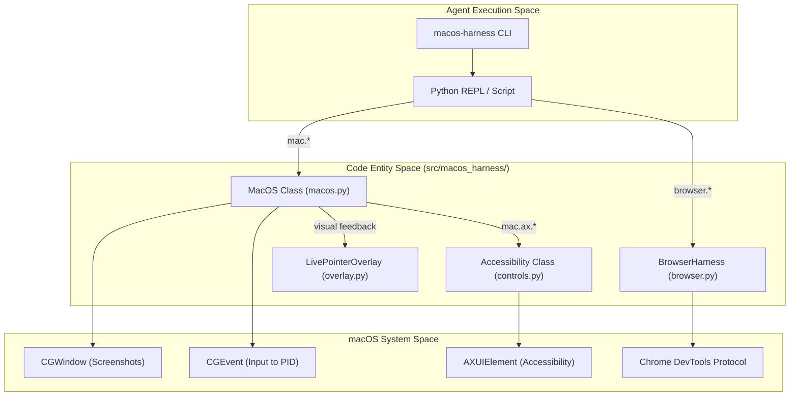

<!-- source: DeepWiki mcp.deepwiki.com · repo browser-use/macos-harness · page 1 Overview · fetched 2026-10-30 -->

# Overview

<details>
<summary>Relevant source files</summary>

The following files were used as context for generating this wiki page:

- [CONTRIBUTING.md](CONTRIBUTING.md)
- [README.md](README.md)
- [pyproject.toml](pyproject.toml)

</details>


macOS Harness is a high-level, "thin" automation framework designed to give LLM agents direct control over a macOS environment. Unlike traditional automation tools that rely on brittle app-specific recipes or heavy frameworks, macOS Harness provides a minimalist set of raw macOS primitives. This allows an agent to observe the screen, interact with windows via PID-targeted events, and write its own logic in standard Python mid-task.

The project is built on the philosophy that the agent should "write what is missing" [README.md:8-9](). By exposing native capabilities like `CoreGraphics` window capture and `Accessibility` (AX) trees, the harness enables control over both native and Electron-based applications without requiring the target app to be in the foreground.

## Core Design Philosophy

The codebase adheres to three non-negotiable invariants to ensure a non-intrusive user experience [CONTRIBUTING.md:12-13]():
1.  **No Physical Pointer Movement**: The system uses a virtual overlay to show intent rather than hijacking the hardware cursor.
2.  **No Window Activation**: Interaction occurs via background events; apps are not "raised" or brought to the front.
3.  **No User-Data Telemetry**: Telemetry is strictly limited to execution metadata and never includes screenshots, window titles, or private text.

For a deeper dive into these constraints and the "thin harness" approach, see **[Design Principles & Invariants](#1.2)**.

## System Architecture

The system operates as a persistent Python process that bridges high-level agent commands to low-level macOS frameworks. It provides a unified execution surface where `mac.*` (native), `browser.*` (web), and standard Python modules (like `Path` and `subprocess`) coexist.

### Code-to-System Mapping
The following diagram illustrates how the Python namespaces exposed to the agent map to specific macOS subsystems and code entities.

**Diagram: Namespace to Code Entity Mapping**

**Sources:** [README.md:57-74](), [src/macos_harness/macos.py:1-20](), [src/macos_harness/browser.py:1-15]()

## Major Subsystems

### 1. The Six-Verb Surface
The primary interface for agents consists of six core primitives defined in the `MacOS` class: `see`, `key`, `type`, `click`, `ax`, and `script` [README.md:34-52](). These allow for a "vision-first" workflow where the agent captures a window, identifies coordinates, and sends targeted input events.

### 2. Browser Integration
Through the `BrowserHarness` proxy, the system connects to a real, logged-in instance of Google Chrome using the Chrome DevTools Protocol (CDP) [README.md:80](). This allows the agent to switch seamlessly between native app automation and web-based tasks within the same process.

### 3. Visual Feedback (Overlay)
Since the harness does not move the physical cursor, it spawns a separate `LivePointerOverlay` process. This process renders a virtual, animated pointer using AppKit to show the user exactly where the agent is "clicking" without interrupting manual input [README.md:78]().

### 4. Telemetry & Privacy
The harness includes a privacy-safe telemetry module that uses PostHog. It is designed to be opt-out and explicitly excludes any sensitive data such as app names or screenshots [README.md:83-95]().

## Getting Started
To begin using the harness, it is recommended to use the `uv` package manager for installation and the `doctor` command to verify system permissions (Accessibility, Screen Recording, etc.).

```bash
# Verify environment and permissions
macos-harness doctor
```

For detailed setup instructions, including agent registration and permission handling, see **[Getting Started & Installation](#1.1)**.

## Project Structure
- **`src/macos_harness/`**: Contains the core logic for macOS interaction, browser bridging, and the CLI.
- **`skills/`**: Contains the `SKILL.md` file and agent definitions (e.g., OpenAI YAML) used to teach LLMs how to use the harness [pyproject.toml:50-51]().
- **`tests/`**: A comprehensive test suite covering both the macOS primitives and the telemetry safety guards.

**Sources:** [README.md:1-97](), [pyproject.toml:1-54](), [CONTRIBUTING.md:1-13]()

---

