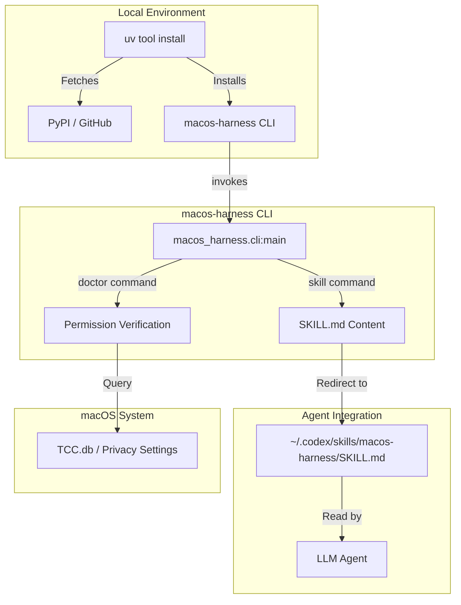
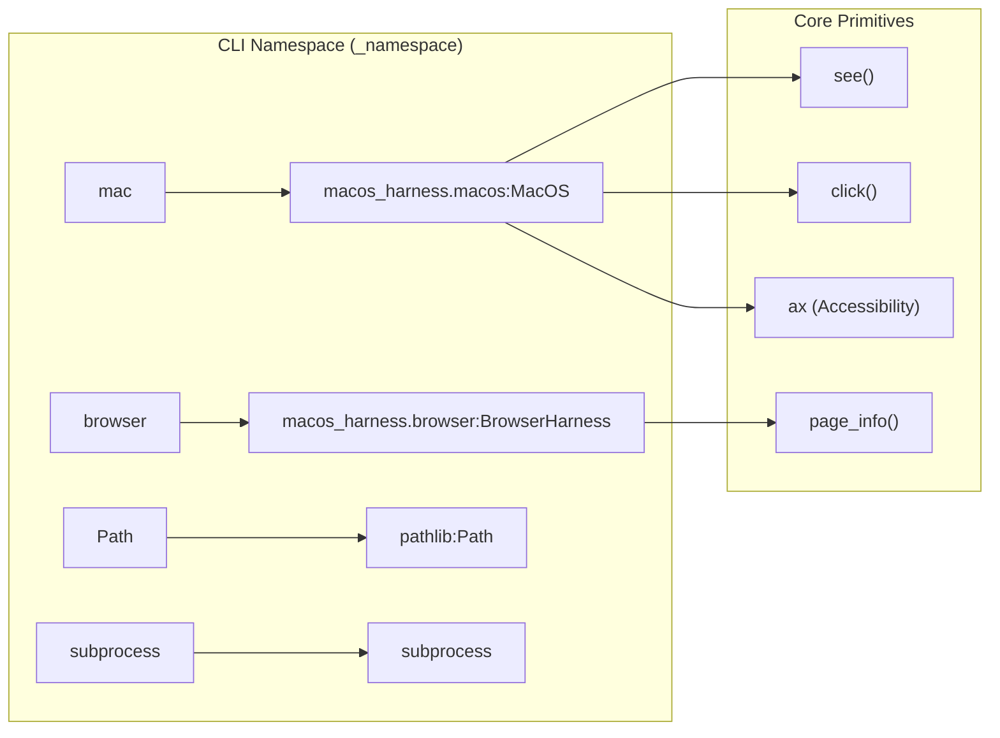

<!-- source: DeepWiki mcp.deepwiki.com · repo browser-use/macos-harness · page 1.1 Getting Started & Installation · fetched 2026-10-30 -->

# Getting Started & Installation

<details>
<summary>Relevant source files</summary>

The following files were used as context for generating this wiki page:

- [README.md](README.md)
- [install.md](install.md)
- [pyproject.toml](pyproject.toml)

</details>


The `macos-harness` is designed to be a "thin" interface between an LLM agent and the macOS operating system. It provides a persistent Python execution environment pre-populated with primitives for vision, input, and accessibility [README.md:57-82](). This page details the installation process, permission verification via the `doctor` command, and initial verification.

## Installation Paths

The harness supports two primary installation paths: **Agent-Assisted** (recommended for LLM workflows) and **Manual**.

### 1. Agent-Assisted Installation
You can delegate the entire setup to a capable agent (like Claude Code or Codex). The agent will handle dependency management, skill registration, and permission checks.

**Prompt for the Agent:**
```text
Install or upgrade macOS Harness from https://github.com/browser-use/macos-harness with uv using Python 3.12. Register the skill printed by `macos-harness skill`, then run `macos-harness doctor`. Explain any missing macOS permissions and ask before requesting them. Finally, verify the harness by capturing one already-running app without bringing it to the foreground.
```
[README.md:27-29](), [install.md:7-9]()

### 2. Manual Installation
For developers who prefer manual control, use `uv` to install the tool globally.

```bash
# Install the CLI tool
uv tool install --python 3.12 --upgrade --force macos-harness

# Register the skill for your agent (e.g., for Codex)
mkdir -p "${CODEX_HOME:-$HOME/.codex}/skills/macos-harness"
macos-harness skill > "${CODEX_HOME:-$HOME/.codex}/skills/macos-harness/SKILL.md"

# Run the health check
macos-harness doctor
```
[install.md:13-18]()

---

## The Installation Data Flow

The following diagram illustrates how the `macos-harness` CLI interacts with the system during the installation and registration phase.

**Installation & Skill Registration Flow**

**Sources:** [pyproject.toml:39-40](), [install.md:13-18](), [README.md:27-29]()

---

## Verification & Permissions

After installation, you must ensure the harness has the necessary macOS permissions. Unlike standard automation tools, `macos-harness` targets specific PIDs and background windows, requiring specific entitlements.

### Running the Doctor
The `doctor` command checks for four critical permission buckets:
1.  **Accessibility**: Required for `mac.ax` and `mac.click`.
2.  **Screen Recording**: Required for `mac.see`.
3.  **Automation (AppleEvents)**: Required for `mac.script`.
4.  **Post Events**: Required for sending `CGEvent` inputs to specific PIDs.

[install.md:20-22](), [README.md:85-86]()

### First Screenshot Capture (Verification)
To verify the installation without disrupting your workflow, run a command that captures a background window (e.g., Finder) without bringing it to the front.

```bash
macos-harness <<'PY'
# Captures a screenshot object for Finder
frame = mac.see("Finder")
print(f"Captured frame: {frame}")
PY
```
[install.md:26-29](), [README.md:37-38]()

---

## Execution Environment

When running commands via `macos-harness`, the CLI initializes a `_namespace()` which pre-imports and instantiates key controllers. This allows agents to write logic using high-level primitives immediately.

**Code Entity Mapping: CLI Namespace**

**Sources:** [README.md:51-52](), [README.md:60-74](), [pyproject.toml:40]()

### Telemetry Configuration
By default, the harness collects anonymous telemetry (command category, duration, success/failure). It **never** collects screenshots, window titles, or private data [README.md:88-91]().

To disable telemetry:
```bash
macos-harness telemetry disable
```
[README.md:94](), [install.md:36]()

---

## Technical Specifications

| Component | Requirement / Value | Source |
| :--- | :--- | :--- |
| **Python Version** | `>= 3.11` (3.12 recommended) | [pyproject.toml:10]() |
| **OS** | macOS (Darwin) | [pyproject.toml:19]() |
| **Key Dependencies** | `browser-harness`, `pillow`, `pyobjc-framework-ApplicationServices` | [pyproject.toml:27-29]() |
| **Build System** | `hatchling` | [pyproject.toml:1-3]() |
| **CLI Entrypoint** | `macos_harness.cli:main` | [pyproject.toml:40]() |

**Sources:** [pyproject.toml:1-40](), [README.md:88-97]()

---

