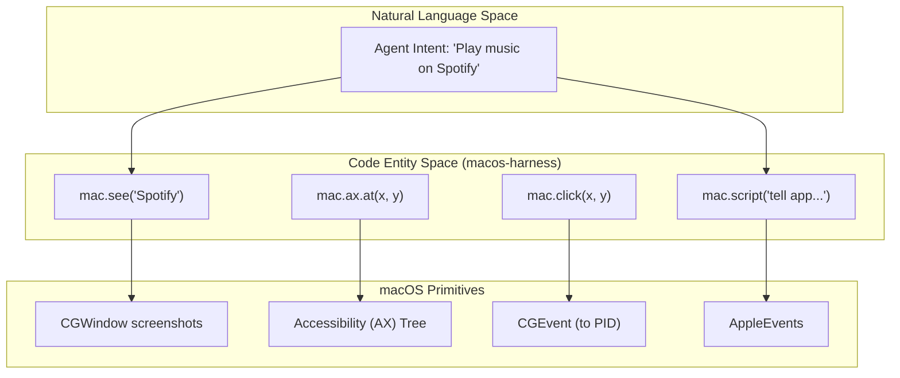
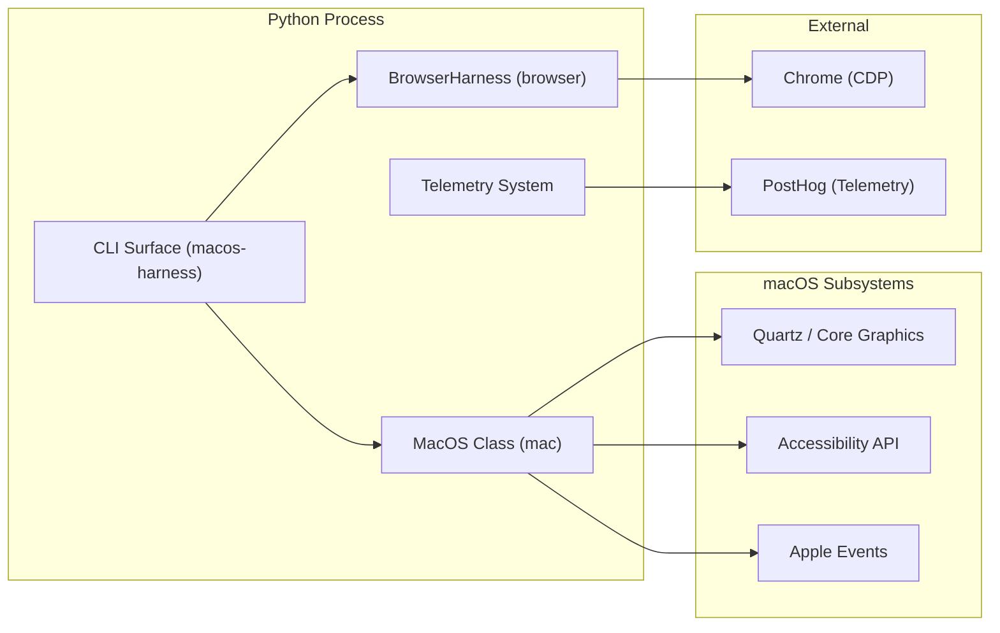

<!-- source: DeepWiki mcp.deepwiki.com · repo browser-use/macos-harness · page 1.2 Design Principles & Invariants · fetched 2026-10-30 -->

# Design Principles & Invariants

Relevant source files

The following files were used as context for generating this wiki page:

- [CONTRIBUTING.md](CONTRIBUTING.md)
- [README.md](README.md)
- [SECURITY.md](SECURITY.md)

This page outlines the foundational philosophy and technical constraints that govern the development and operation of `macos-harness`. These principles ensure that the harness remains a predictable, non-intrusive, and privacy-preserving tool for LLM agents.

## The Three Non-Negotiable Invariants

To maintain a "ghost-in-the-machine" experience where an agent can work alongside a human user without interference, the codebase must strictly adhere to three invariants [CONTRIBUTING.md:12-13]().

### 1. No Physical Pointer Movement
The harness never takes control of the system's hardware cursor. Instead of using `CGEventPost` to move the global cursor, it uses an animated, click-through overlay to provide visual feedback [README.md:78]().
*   **Implementation:** Input events are targeted directly at a specific Process Identifier (PID) using `CGEventPostToPid`.
*   **Benefit:** The user can continue using their mouse while the agent performs clicks in the background.

### 2. No Window Activation
The harness never "raises" or "activates" a target application to the foreground [README.md:76]().
*   **Implementation:** Screenshots are captured using `CGWindowListCreateImage` for specific window IDs, and input is sent to PIDs regardless of their focus state [README.md:68-73]().
*   **Benefit:** The agent can work on "Spotify" or "Slack" while the user is actively typing in a different window, like a code editor, without losing focus.

### 3. No User-Data Telemetry
Privacy is enforced at the architectural level. Telemetry is strictly limited to operational metadata [README.md:88-91]().
*   **Prohibited Data:** Screenshots, window titles, application names, UI text, file paths, and LLM prompts are never serialized or transmitted.
*   **Permitted Data:** Command category (e.g., `see`, `click`), success/failure status, duration, package version, and OS architecture.

---

## Thin Harness Philosophy

`macos-harness` is designed to be a "thin" bridge between an LLM and the operating system. It intentionally avoids "app-specific" logic [CONTRIBUTING.md:3-4]().

| Feature | Philosophy | Implementation |
| :--- | :--- | :--- |
| **Tooling** | No "Slack tools" or "Spotify tools". | Agents use the six core primitives to build their own logic [README.md:54-55](). |
| **Logic** | The agent writes missing logic mid-task. | Agents execute raw Python strings via the harness [README.md:16-18](). |
| **Surface** | Minimize the API surface area. | Focused on `see`, `key`, `type`, `click`, `ax`, and `script` [README.md:34-49](). |

### Logic Flow: Natural Language to Code Execution
The following diagram illustrates how an agent's intent is transformed into macOS primitive calls via the thin harness.

**Intent to Primitive Mapping**

Sources: [README.md:37-49](), [README.md:59-74]()

---

## Preference for Raw macOS Primitives

The harness prefers exposing the underlying macOS APIs over creating abstractions. This allows the LLM to leverage the full power of the OS rather than being limited by the harness's design.

*   **`mac.ax` (Accessibility):** Instead of a simplified "find button" function, the harness exposes the raw Accessibility tree via `controls.py`. This allows agents to query attributes like `AXRole`, `AXDescription`, and `AXValue` directly [README.md:43]().
*   **`mac.script` (AppleScript):** For complex inter-process communication that vision or AX cannot solve, the harness provides a direct execution path for AppleScript/JXA [README.md:44]().
*   **`mac.key` & `mac.type`:** These interact with `CGEvent` to simulate hardware-level keystrokes directed at specific applications, bypassing the need for the app to be "active" [README.md:77]().

### System Architecture & Data Flow
The architecture is centered around a single persistent Python process that manages multiple specialized bridges.

**Harness Subsystem Architecture**

Sources: [README.md:59-74](), [README.md:88-91]()

---

## Security Model

The harness operates under a principle of "Agent as User." It requires explicit macOS permissions to function, which are checked and reported via the `doctor` command [README.md:85-86]().

*   **Trust Boundary:** Agent instructions and third-party UI content are treated as **untrusted input** [SECURITY.md:7-8]().
*   **Permission Buckets:**
    1.  **Screen Recording:** Required for `mac.see()`.
    2.  **Accessibility:** Required for `mac.ax` and `mac.click()`.
    3.  **Automation:** Required for `mac.script()`.
    4.  **Post Events:** Required for `mac.key()` and `mac.type()`.

Users are encouraged to review irreversible actions performed by the agent and grant only the minimum permissions necessary for the task [SECURITY.md:8-9]().

Sources: [README.md:83-86](), [SECURITY.md:1-9]()

---

