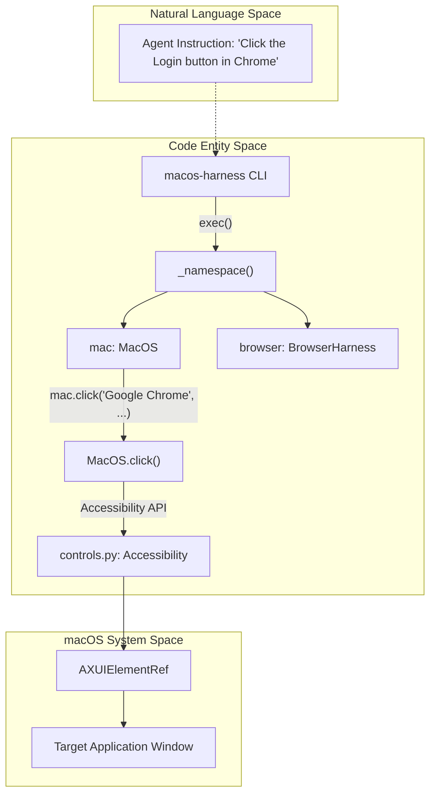
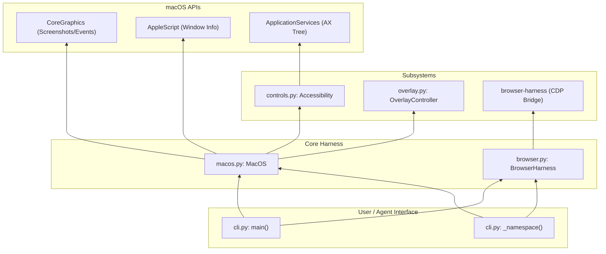

<!-- source: DeepWiki mcp.deepwiki.com · repo browser-use/macos-harness · page 2 Core Architecture · fetched 2026-10-30 -->

# Core Architecture

Relevant source files

The following files were used as context for generating this wiki page:

- [src/macos_harness/__init__.py](src/macos_harness/__init__.py)
- [src/macos_harness/cli.py](src/macos_harness/cli.py)
- [uv.lock](uv.lock)

The **macos-harness** is designed as a lightweight, persistent bridge between high-level agentic instructions and the low-level macOS C APIs. The architecture prioritizes a "thin harness" philosophy, exposing raw system primitives rather than complex abstractions, which allows LLM agents to orchestrate multi-app workflows using a standard six-verb interface.

## System Overview

The system operates as a persistent Python process that manages two primary interaction objects: `mac` (for native OS control) and `browser` (for web-specific automation). These objects are pre-populated into the execution namespace by the CLI, providing a unified surface for scripts.

### Execution Flow: Natural Language to Code Entity

This diagram illustrates how an agent's intent is translated through the harness's core entities into system-level actions.

**Intent Translation Pipeline**

**Sources:** [src/macos_harness/cli.py:21-28](), [src/macos_harness/cli.py:31-37](), [src/macos_harness/macos.py:32-45]()

## Layered Dependency Model

The harness is structured in layers, where each layer provides a more specific interface to the hardware and OS.

1.  **CLI & Execution Surface**: The entry point that handles process persistence and environment setup.
2.  **Harness Objects (`mac` & `browser`)**: The primary API surface for all automation.
3.  **Subsystems**: Specialized modules for Accessibility (AX), Window Management, and Browser Debugging.
4.  **OS Primitives**: Direct calls to `ApplicationServices`, `CoreGraphics`, and `AppleScript`.

**Component Interaction Map**

**Sources:** [src/macos_harness/cli.py:21-28](), [src/macos_harness/macos.py:32-45](), [src/macos_harness/browser.py:16-30](), [src/macos_harness/controls.py:18-35]()

## Core Components

### CLI & Execution Surface
The CLI provides the `_namespace()` helper [src/macos_harness/cli.py:21-28](), which pre-injects `mac`, `browser`, `Path`, and `subprocess` into the Python environment. This allows for stateless execution of complex scripts passed via `stdin`.
For details, see [CLI & Execution Surface](#2.1).

### MacOS Primitives (`mac`)
The `MacOS` class in `macos.py` is the primary engine for native interaction. It implements the **Six-Verb Surface**:
*   `see`: Captures the visual state [src/macos_harness/macos.py:203-247]().
*   `key`: Sends keyboard shortcuts.
*   `type`: Inputs text strings.
*   `click`: Interacts with coordinates or AX elements.
*   `ax`: Direct access to the Accessibility subsystem.
*   `script`: Executes raw AppleScript for app-specific control.

For details, see [MacOS Primitives Module](#2.2).

### Accessibility (AX) Subsystem
The `Accessibility` class in `controls.py` manages the inspection and manipulation of the macOS UI tree. It provides the `at()` and `query()` methods to locate elements without relying on fragile visual coordinates.
For details, see [Accessibility (AX) Subsystem](#2.3).

### Browser Harness Integration (`browser`)
The `BrowserHarness` class provides a lazy-proxy to Google Chrome via the Chrome DevTools Protocol (CDP). It bridges the gap between native `mac.*` commands and web-specific `browser.*` commands, including handling the macOS-specific "Allow remote debugging" permission dialogs.
For details, see [Browser Harness Integration](#2.4).

## Data Invariants
The architecture is strictly bound by three design invariants:
1.  **No Physical Pointer Movement**: The system uses `CGEventCreateMouseEvent` with specific PIDs to interact without hijacking the user's mouse.
2.  **No Window Activation**: Actions are performed in the background where possible to avoid disrupting the user.
3.  **Privacy-First Telemetry**: Only command metadata is collected; no screenshots or user data ever leave the machine.

**Sources:** [src/macos_harness/macos.py:442-458](), [src/macos_harness/telemetry.py:73-95]()

---

