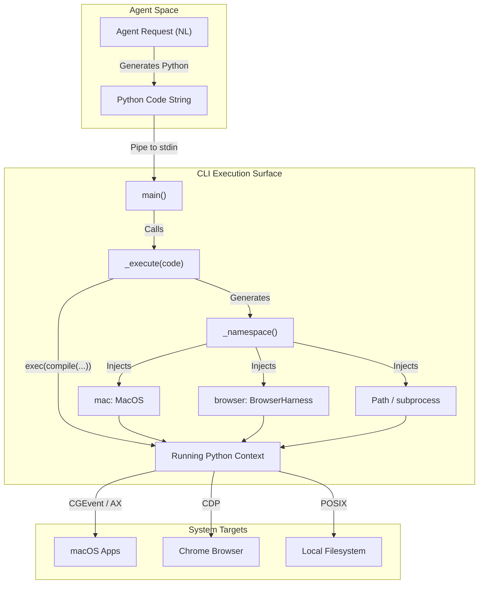
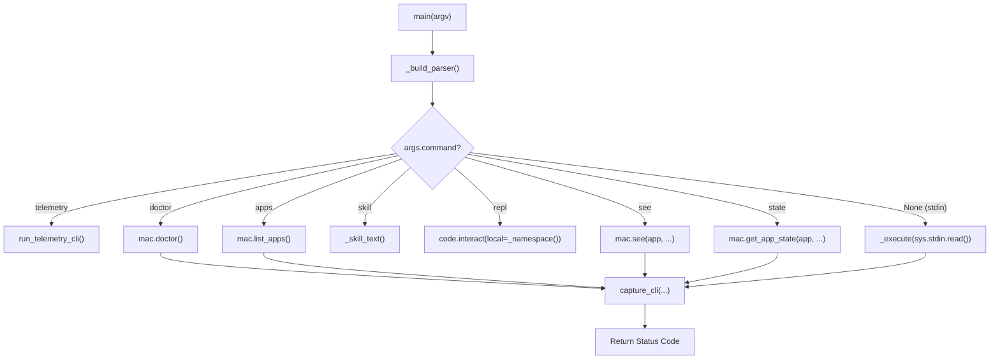

<!-- source: DeepWiki mcp.deepwiki.com · repo browser-use/macos-harness · page 2.1 CLI & Execution Surface · fetched 2026-10-30 -->

# CLI & Execution Surface

Relevant source files

The following files were used as context for generating this wiki page:

- [README.md](README.md)
- [macos-harness](macos-harness)
- [src/macos_harness/cli.py](src/macos_harness/cli.py)

The `macos-harness` CLI provides a unified execution environment where a persistent Python process is granted direct access to macOS system primitives, a real browser instance via CDP, and the local filesystem. It is designed to be the primary entry point for both human developers and LLM agents.

## Shell Wrapper & Entry Point

The harness is typically invoked via a shell wrapper script named `macos-harness` located in the project root. This script ensures the correct Python environment is utilized before calling the core CLI module.

### Implementation Details
- **Environment Resolution**: The script first checks for a local virtual environment at `.venv/bin/python` [macos-harness:6-8]().
- **Fallback**: If no local venv is found, it uses `uv` to run the module, ensuring dependencies are managed [macos-harness:10-10]().
- **Module Path**: The wrapper executes the `macos_harness.cli` module [macos-harness:7-7]().

**Sources:** [macos-harness:1-10]()

---

## Execution Surface: `_namespace()`

The core power of the harness lies in the `_namespace()` helper function. This function populates a Python dictionary that serves as the global namespace for code executed via `stdin` or the `repl`.

| Key | Object / Class | Purpose |
| :--- | :--- | :--- |
| `mac` | `MacOS()` | Access to `see`, `key`, `type`, `click`, `ax`, and `script`. |
| `browser` | `BrowserHarness()` | Lazy-proxy for Chrome DevTools Protocol integration. |
| `Path` | `pathlib.Path` | Standard library path manipulation for local file access. |
| `subprocess` | `subprocess` | Standard library for executing shell commands. |

**Sources:** [src/macos_harness/cli.py:21-29]()

### Data Flow: Natural Language to Code Execution

This diagram illustrates how a natural language request from an agent translates into the execution of Python code within the pre-populated namespace.

**Sources:** [src/macos_harness/cli.py:21-37](), [src/macos_harness/cli.py:85-152]()

---

## Subcommands Reference

The CLI uses `argparse` to handle several subcommands designed for environment verification, state inspection, and telemetry management.

### `doctor`
Checks the current runtime for necessary macOS permissions (Accessibility, Screen Recording, etc.).
- **Flag `--request`**: Triggers Apple's native permission prompts if access is missing [src/macos_harness/cli.py:96-97]().
- **Output**: Returns a JSON object containing the status of all required permissions [src/macos_harness/cli.py:98-98]().

### `apps`
Lists all currently running macOS applications with their process identifiers (PIDs) and bundle IDs.
- **Implementation**: Calls `MacOS().list_apps()` and prints the JSON result [src/macos_harness/cli.py:102-102]().

### `repl`
Starts a persistent interactive Python session using `code.interact` [src/macos_harness/cli.py:110-117]().
- **Environment**: The session is pre-loaded with the `_namespace()`, allowing immediate use of `mac` and `browser` objects.

### `skill`
Prints the content of `SKILL.md`. This is the system prompt that teaches an LLM how to use the harness [src/macos_harness/cli.py:105-108]().
- **Resolution**: It first looks for a bundled resource, then falls back to the local file path in the repository [src/macos_harness/cli.py:40-46]().

### `see`
Captures a screenshot of a specific application window without bringing it to the foreground.
- **Arguments**: `app` (name or PID), `--max-width`, `--max-height`, `--no-pointer`.
- **Implementation**: Wraps `MacOS().see()` [src/macos_harness/cli.py:121-126]().

### `state`
Dumps the Accessibility (AX) tree of a target application as JSON.
- **Arguments**: `app`, `--screenshot` (embeds base64 image), `--max-depth`, `--max-nodes`, `--include-menu-bar`.
- **Implementation**: Wraps `MacOS().get_app_state()` [src/macos_harness/cli.py:131-138]().

### `telemetry`
Inspects or modifies the anonymous telemetry settings.
- **Actions**: `status`, `enable`, `disable` [src/macos_harness/cli.py:68-68]().
- **Implementation**: Proxies to `run_telemetry_cli` [src/macos_harness/cli.py:89-89]().

### `stdin` (Default)
If no subcommand is provided and `stdin` is not a TTY, the CLI reads the input as Python code and executes it [src/macos_harness/cli.py:141-147](). This is the primary mode used by LLM agents.

**Sources:** [src/macos_harness/cli.py:48-82](), [src/macos_harness/cli.py:85-152]()

---

## Command Execution Flow

The following diagram maps the internal logic of `main()` as it routes different CLI commands to their respective `MacOS` or `BrowserHarness` methods.

### Telemetry Capture
Every command execution (including Python execution via stdin) triggers a telemetry event in a `finally` block [src/macos_harness/cli.py:153-154]().
- **Captured Data**: Command name (or "python"), success boolean, and duration in seconds.
- **Privacy**: No user-identifiable data or code content is sent.

**Sources:** [src/macos_harness/cli.py:85-155](), [src/macos_harness/telemetry.py:17-18]()

---

