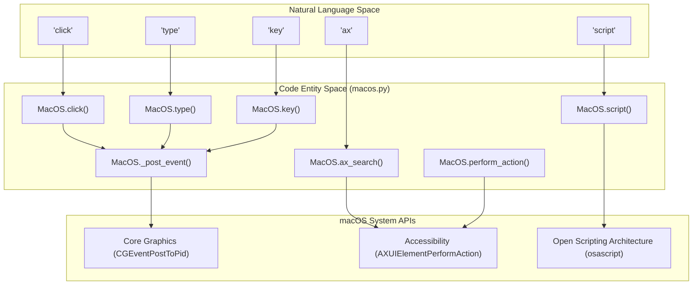
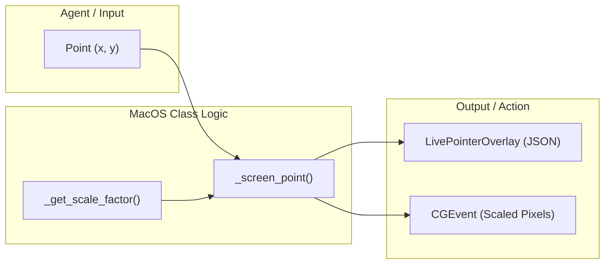

<!-- source: DeepWiki mcp.deepwiki.com · repo browser-use/macos-harness · page 2.2 MacOS Primitives Module · fetched 2026-10-30 -->

# MacOS Primitives Module

Relevant source files

The following files were used as context for generating this wiki page:

- [src/macos_harness/controls.py](src/macos_harness/controls.py)
- [src/macos_harness/macos.py](src/macos_harness/macos.py)

The `MacOS` class in `macos.py` serves as the foundational interface for interacting with the macOS operating system. It provides a "six-verb" surface (`see`, `key`, `type`, `click`, `ax`, `script`) that allows an agent or developer to observe the screen and manipulate the system without physical pointer movement or window activation.

[src/macos_harness/macos.py:271-274]()

## Core Architecture

The module leverages three primary macOS subsystems:
1.  **Accessibility (AXUIElement):** Used for semantic tree inspection and high-level actions (e.g., pressing a button by its index).
2.  **Core Graphics (CGEvent):** Used for low-level input injection (mouse clicks, keystrokes) targeted at specific PIDs to avoid interfering with the physical user.
3.  **AppKit (NSWorkspace):** Used for application discovery, window resolution, and state monitoring.

### Error Handling
The module defines specific exceptions to handle the unique constraints of macOS automation:
*   `MacOSError`: Base class for discovery or control failures [src/macos_harness/macos.py:36-37]().
*   `AccessibilityPermissionError`: Raised when the process lacks the necessary TCC permissions [src/macos_harness/macos.py:40-41]().
*   `FocusChangedError`: Raised when a background-targeted action unexpectedly forces a window to the front [src/macos_harness/macos.py:44-45]().

### Natural Language to Code Entity Mapping (Input & Action)

This diagram maps the conceptual "verbs" used by agents to the underlying implementation methods and macOS APIs.

Sources: [src/macos_harness/macos.py:328-331](), [src/macos_harness/macos.py:433-435](), [src/macos_harness/macos.py:488-490](), [src/macos_harness/macos.py:532-535]()

---

## Primary Verbs

### 1. `see` (Observation)
The `see` method captures the current state of the system, including a screenshot and a semantic accessibility tree.
*   **Retina Scaling:** It automatically detects the scale factor of the captured PNG to map pixel coordinates back to logical points [src/macos_harness/macos.py:246-252]().
*   **Window Resolution:** If an `app` name is provided, it resolves the PID and captures only that application's windows [src/macos_harness/macos.py:348-355]().

### 2. `click`, `drag`, `move`, `scroll` (Mouse Input)
Mouse interactions are performed via `CGEvent` and are targeted at a specific PID.
*   **Virtual Pointer:** Every move or click command triggers a JSON update to the `LivePointerOverlay` to visually represent the action without moving the hardware cursor [src/macos_harness/macos.py:377-385]().
*   **PID Targeting:** By using `CGEventPostToPid`, the harness can click buttons in background apps without changing the system focus [src/macos_harness/macos.py:756-760]().
*   **Scroll Splitting:** Large scroll deltas are split into smaller steps to ensure reliable processing by target applications [src/macos_harness/macos.py:258-268]().

### 3. `key` and `type` (Keyboard Input)
*   **`key`**: Used for modifier combos (e.g., `cmd+c`) or special keys (`enter`, `esc`). It uses a lookup table for macOS-specific keycodes [src/macos_harness/macos.py:160-227]().
*   **`type`**: Sends a sequence of characters. It handles shifted characters (like `!`) by automatically injecting the `shift` modifier flag [src/macos_harness/macos.py:228-230]().

### 4. `ax` (Accessibility)
The `ax` verb provides access to the `Accessibility` class in `controls.py`. This is the "escape hatch" for precise UI manipulation.
*   **`ax.query()`**: Searches the AX tree for elements matching specific criteria (role, title, etc.) [src/macos_harness/controls.py:59-73]().
*   **`ax.at(x, y)`**: Performs a "hit test" to find the AX element at specific coordinates [src/macos_harness/controls.py:28-48]().
*   **`ax.perform(index, action)`**: Triggers AX actions like `AXPress` or `AXShowMenu` [src/macos_harness/controls.py:101-102]().

### 5. `script` (AppleScript)
Executes arbitrary AppleScript via the `osascript` CLI. This is often the most robust way to control "Scriptable" applications like Music, Finder, or Calendar [src/macos_harness/macos.py:532-540]().

---

## Visual Feedback and Scaling

The harness must bridge the gap between the agent's view (logical points) and the system's reality (pixels).

### Coordinate Mapping Data Flow

Sources: [src/macos_harness/macos.py:716-725](), [src/macos_harness/macos.py:732-748]()

### Screenshot Pipeline
1.  **Capture:** Calls `/usr/sbin/screencapture -x` to a temporary file [src/macos_harness/macos.py:365-368]().
2.  **Size Detection:** Reads the PNG header to determine the physical pixel dimensions [src/macos_harness/macos.py:246-252]().
3.  **Scale Calculation:** Compares pixel dimensions against logical `NSScreen` dimensions to calculate the `scale_factor` (e.g., 2.0 for Retina) [src/macos_harness/macos.py:716-725]().

## Implementation Details: Element Indexing
To avoid passing complex objects to the agent, the `MacOS` class maintains a session-based cache of `AXUIElementRef` objects.
*   **`_remember_element(element)`**: Stores a reference and returns an integer index [src/macos_harness/macos.py:612-618]().
*   **`_element(index)`**: Retrieves the reference for a given index, raising a `MacOSError` if the index is invalid or expired [src/macos_harness/macos.py:620-625]().

Sources:
- `src/macos_harness/macos.py`
- `src/macos_harness/controls.py`
- `src/macos_harness/overlay.py`

---

