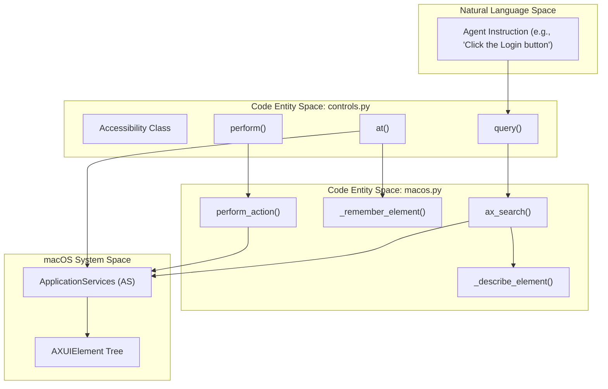
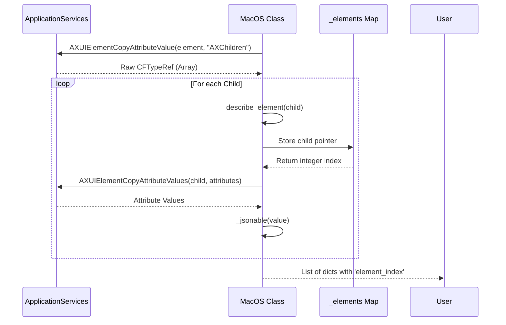

<!-- source: DeepWiki mcp.deepwiki.com · repo browser-use/macos-harness · page 2.3 Accessibility (AX) Subsystem · fetched 2026-10-30 -->

# Accessibility (AX) Subsystem

Relevant source files

The following files were used as context for generating this wiki page:

- [src/macos_harness/controls.py](src/macos_harness/controls.py)
- [src/macos_harness/macos.py](src/macos_harness/macos.py)

The Accessibility (AX) subsystem provides a semantic interface to macOS user interface elements. While the `MacOS.see()` verb provides visual state, the `Accessibility` class in `controls.py` allows for precise interrogation and manipulation of the UI tree using Apple's `ApplicationServices` framework.

## Overview

The `Accessibility` class acts as an "explicit escape hatch" for scenarios where visual-only interaction is insufficient [src/macos_harness/controls.py:1-15](). It enables agents to query element attributes (titles, roles, values), perform semantic actions (pressing buttons, incrementing sliders), and navigate the application hierarchy without relying on coordinate-based clicks.

### Key Data Structures

- **Element Indexing**: The harness maintains a mapping between integer IDs and raw `AXUIElementRef` objects to allow stateless-looking API calls from the agent [src/macos_harness/macos.py:348-356]().
- **Compact Attributes**: By default, the subsystem fetches a subset of critical attributes (`AXRole`, `AXTitle`, `AXDescription`, `AXValue`, `AXFrame`) to minimize IPC overhead [src/macos_harness/controls.py:17-23]().

## System Architecture

The following diagram illustrates the relationship between the `Accessibility` high-level API, the `MacOS` host class, and the underlying macOS `ApplicationServices` (AS) framework.

### Accessibility Control Flow
"This diagram maps the high-level Accessibility methods to their internal implementation logic."

Sources: [src/macos_harness/controls.py:14-119](), [src/macos_harness/macos.py:271-400]()

---

## Core API Methods

### `at(x, y, ...)`
Performs a hit-test at the specified coordinates. It converts the point to the appropriate coordinate space and calls `AXUIElementCopyElementAtPosition` [src/macos_harness/controls.py:28-57](). It returns a dictionary description of the element and registers it in the internal index.

### `query(...)`
Wraps `MacOS.ax_search()` to find elements based on criteria like `text`, `search_key` (role), or visibility [src/macos_harness/controls.py:59-86]().

### `get()` and `set()`
- `get(element_index, attributes)`: Retrieves specific AX attributes (e.g., `AXValue`) for a previously discovered element [src/macos_harness/controls.py:88-93]().
- `set(element_index, attribute, value)`: Updates an attribute. Commonly used for `AXFocused` or `AXSelected` [src/macos_harness/controls.py:95-96]().

### `perform(element_index, action)`
Executes a semantic action. Defaults to `AXPress`. It supports aliases like `confirm`, `increment`, and `show menu` [src/macos_harness/controls.py:101-102](), [src/macos_harness/macos.py:91-99]().

### `parameterized(element_index, attribute, parameter)`
Accesses advanced AX attributes that require an input parameter, such as line numbers in text areas [src/macos_harness/controls.py:104-112]().

### `dump(app)`
Captures the entire AX tree for a specific application [src/macos_harness/controls.py:117-119]().

---

## The AX Tree Pipeline

The subsystem relies on a pipeline to transform raw C-pointers from macOS into JSON-serializable dictionaries.

### Element Processing Pipeline
"This diagram shows the data flow from a raw AXUIElementRef to a serialized dictionary."

Sources: [src/macos_harness/macos.py:553-600](), [src/macos_harness/macos.py:650-680]()

### `_snapshot_tree` and Search Logic
The `ax_search` function implements a sophisticated retrieval logic [src/macos_harness/macos.py:603-647]():
1. **Chromium Predicate API**: It first attempts to use the high-performance `AXSearch` API (often used by browsers) [src/macos_harness/macos.py:619-625]().
2. **Bounded Fallback**: If the specialized search is unavailable or fails, it performs a depth-first traversal of the AX tree, bounded by `max_nodes` to prevent infinite loops or performance degradation in complex UIs [src/macos_harness/macos.py:633-647]().

## AXEnhancedUserInterface
For certain applications (notably Chrome and Electron-based apps), the harness attempts to enable `AXEnhancedUserInterface`. This attribute unlocks deeper accessibility information that is otherwise hidden to improve performance. The harness sets this on the application root element during the initial connection or search [src/macos_harness/macos.py:530-540]().

## Element Indexing & Memory
The `MacOS` instance maintains an internal dictionary `self._elements` [src/macos_harness/macos.py:348](). 
- When an element is encountered via `at()`, `query()`, or `dump()`, it is passed to `_remember_element(element)` [src/macos_harness/macos.py:672-680]().
- This function returns a stable integer `element_index`.
- This index is used by the agent in subsequent calls to `perform()` or `get()`, allowing the harness to look up the original `AXUIElementRef` pointer [src/macos_harness/macos.py:666-670]().

| Feature | Implementation |
| :--- | :--- |
| **Hit Testing** | `AS.AXUIElementCopyElementAtPosition` [src/macos_harness/controls.py:46]() |
| **Action Execution** | `AS.AXUIElementPerformAction` [src/macos_harness/macos.py:488]() |
| **Attribute Set** | `AS.AXUIElementSetAttributeValue` [src/macos_harness/macos.py:480]() |
| **Tree Traversal** | Recursive `AXChildren` retrieval in `_snapshot_tree` [src/macos_harness/macos.py:575]() |

**Sources:**
- `src/macos_harness/controls.py`
- `src/macos_harness/macos.py`

---

