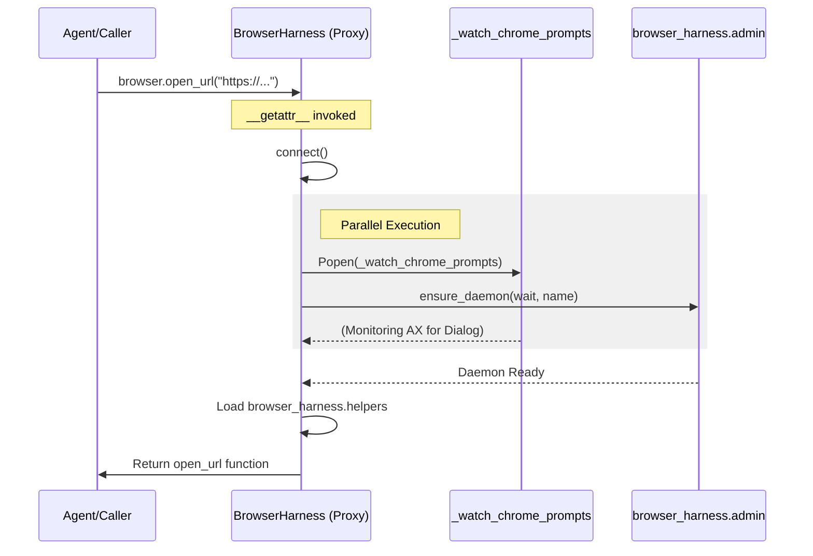
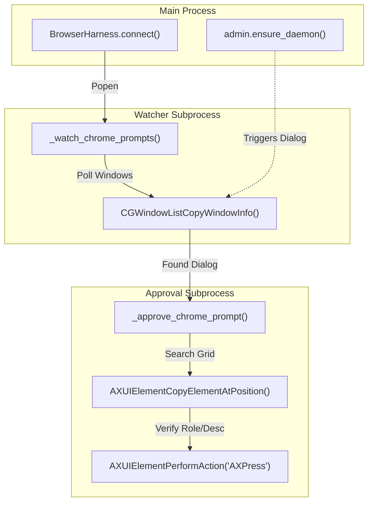

<!-- source: DeepWiki mcp.deepwiki.com · repo browser-use/macos-harness · page 2.4 Browser Harness Integration · fetched 2026-10-30 -->

# Browser Harness Integration

Relevant source files

The following files were used as context for generating this wiki page:

- [src/macos_harness/browser.py](src/macos_harness/browser.py)
- [uv.lock](uv.lock)

The Browser Harness integration provides a high-level, specialized interface for interacting with web browsers (primarily Google Chrome) via the Chrome DevTools Protocol (CDP). While the `mac` object handles native macOS primitives, the `browser` object leverages the `browser-harness` library to provide DOM-aware capabilities.

## Overview

The integration is encapsulated in the `BrowserHarness` class within [src/macos_harness/browser.py:106-168](). It acts as a **lazy proxy**, meaning it does not attempt to establish a connection to the browser or start the harness daemon until a method or attribute is first accessed [src/macos_harness/browser.py:155-164]().

Key responsibilities include:
1.  **Lazy Connection Management**: Delaying overhead until browser interaction is required.
2.  **Chrome Permission Handling**: Automatically bypassing the macOS-specific "Allow remote debugging?" dialog that appears when CDP is initiated.
3.  **Bridge to `browser-harness`**: Exposing the `helpers` module from the underlying `browser-harness` dependency.

### Relationship: `mac.*` vs `browser.*`

| Feature | `mac` (Native) | `browser` (Web) |
| :--- | :--- | :--- |
| **Target** | OS Windows, Menus, Native Apps | DOM Elements, Tabs, JS Context |
| **Mechanism** | AX (Accessibility), CGEvent, AppleScript | CDP (Chrome DevTools Protocol) |
| **Resolution** | PID/Window Name based | URL/Tab/CSS Selector based |
| **Visibility** | Visual screenshots (Retina) | DOM snapshots & CDP screenshots |

Sources: [src/macos_harness/browser.py:1-13](), [uv.lock:19-31]()

---

## The BrowserHarness Proxy

The `BrowserHarness` class implements `__getattr__` to ensure that any call to a browser primitive triggers the `connect()` sequence if the harness is not already active.

### Data Flow: Lazy Initialization

The following diagram illustrates the transition from a "Lazy" state to a "Connected" state upon the first call to a browser method (e.g., `browser.open_url()`).

**Title: BrowserHarness Connection Flow**

Sources: [src/macos_harness/browser.py:114-153](), [src/macos_harness/browser.py:155-164]()

---

## Automatic Chrome Dialog Approval

A significant challenge in automating Chrome on macOS is the "Allow remote debugging?" security prompt. `macos-harness` solves this by spawning a sidecar process that uses native Accessibility (AX) primitives to find and click the "Allow" button.

### `_approve_chrome_prompt` Logic
The harness uses `ApplicationServices` to inspect the system-wide AX tree [src/macos_harness/browser.py:26-30](). It specifically searches for a window where:
-   `kCGWindowOwnerName` is "Google Chrome" [src/macos_harness/browser.py:32-33]()
-   `kCGWindowName` is "Allow remote debugging?" [src/macos_harness/browser.py:34-35]()

Once found, it calculates the coordinates for the "Allow" button. Instead of a single point, it generates a grid of points near the bottom-right of the dialog to ensure the button is hit regardless of minor layout variations [src/macos_harness/browser.py:41-46](). It verifies the element at the position has `AXRole == "AXButton"` and `AXDescription == "Allow"` before performing the `AXPress` action [src/macos_harness/browser.py:57-63]().

### `_watch_chrome_prompts`
This function acts as a supervisor. It polls the window list using `CGWindowListCopyWindowInfo` [src/macos_harness/browser.py:87-89](). When the target dialog is detected, it spawns a short-lived subprocess to execute the approval logic [src/macos_harness/browser.py:96-102](). This separation ensures that the main harness thread is not blocked by AX polling during the connection phase.

**Title: Chrome Dialog Approval Subsystem**

Sources: [src/macos_harness/browser.py:15-69](), [src/macos_harness/browser.py:71-104]()

---

## Technical Details

### Dependency Bridge
The `browser` object is a thin wrapper around the `browser-harness` PyPI package.
-   **CDP Bridge**: Uses `cdp-use` and `websockets` for communication [uv.lock:19-27](), [uv.lock:34-41]().
-   **Daemon Management**: `admin.ensure_daemon` handles the lifecycle of the underlying browser automation server [src/macos_harness/browser.py:142]().
-   **Helper Injection**: Once connected, `self._helpers` (the `browser_harness.helpers` module) satisfies all attribute lookups [src/macos_harness/browser.py:152-163]().

### Configuration
-   **`name`**: An optional identifier for the browser session, stored in the `BU_NAME` environment variable [src/macos_harness/browser.py:118-119]().
-   **`wait`**: The timeout (default 60s) for the daemon to become available and for the AX approver to remain active [src/macos_harness/browser.py:109-111]().

### Error Handling
If `browser-harness` is not installed (e.g., `uv sync` was not run), the harness raises a `RuntimeError` during the `connect()` call, advising the user on how to resolve the environment [src/macos_harness/browser.py:123-127]().

Sources: [src/macos_harness/browser.py:106-168](), [uv.lock:1-45]()

---

