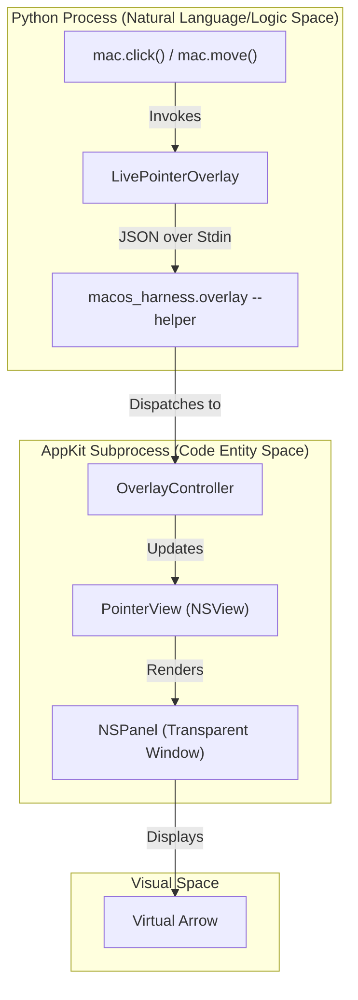
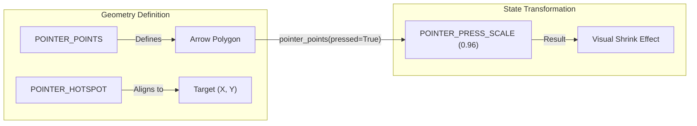

<!-- source: DeepWiki mcp.deepwiki.com · repo browser-use/macos-harness · page 3 Visual Feedback: Overlay & Pointer · fetched 2026-10-30 -->

# Visual Feedback: Overlay & Pointer

Relevant source files

The following files were used as context for generating this wiki page:

- [src/macos_harness/overlay.py](src/macos_harness/overlay.py)
- [src/macos_harness/pointer.py](src/macos_harness/pointer.py)

The visual feedback system in macOS Harness provides a way to observe the agent's actions in real-time without violating the core invariant that the physical system cursor must remain undisturbed. This is achieved through a virtual pointer rendered on a transparent, click-through AppKit overlay.

## System Architecture

The feedback system is split between a Python interface used by the harness and a specialized AppKit subprocess that handles the high-performance rendering and animation requirements of macOS.

### Interaction Flow
The following diagram illustrates how commands from the harness are translated into visual updates on the screen.

**Sources:**
- `LivePointerOverlay` class: [src/macos_harness/overlay.py:21-22]()
- Helper subprocess execution: [src/macos_harness/overlay.py:75-82]()
- `OverlayController` and `PointerView` definitions: [src/macos_harness/overlay.py:127-170]()

---

## Live Pointer Overlay

The `LivePointerOverlay` class manages a persistent background process that renders a non-activating, click-through `NSPanel` [src/macos_harness/overlay.py:180-184](). This panel sits at a high window level (`NSStatusWindowLevel + 1`) to ensure it remains visible above most other windows and across all Spaces [src/macos_harness/overlay.py:196-201]().

Key capabilities include:
*   **Asynchronous Communication**: Commands are sent via JSON strings over a pipe to avoid blocking the main harness execution [src/macos_harness/overlay.py:96-97]().
*   **State Management**: The overlay supports `move`, `show`, `hide`, and `click` commands [src/macos_harness/overlay.py:37-59]().
*   **Cubic Animation**: The helper process uses eased animations for pointer movement to provide a smooth, human-like visual experience.

For implementation details on the JSON protocol and AppKit window configuration, see **[Live Pointer Overlay](#3.1)**.

**Sources:**
- Command methods: [src/macos_harness/overlay.py:37-60]()
- Window properties (click-through, non-activating): [src/macos_harness/overlay.py:176-193]()

---

## Pointer Geometry

The visual appearance of the pointer is defined by a set of geometric constants that ensure the virtual cursor matches the look and feel of a standard macOS arrow while maintaining precise alignment with action coordinates.

The geometry system handles:
*   **Coordinate Mapping**: The arrow is defined relative to a "hotspot" (the tip of the arrow), which corresponds to the exact pixel where an action occurs [src/macos_harness/pointer.py:7-13]().
*   **Visual Press Feedback**: When a `click` command is issued, the pointer points are scaled down slightly (to 96% size) around the hotspot to simulate a physical press [src/macos_harness/pointer.py:14-24]().

For the specific point arrays and scaling logic, see **[Pointer Geometry](#3.2)**.

**Sources:**
- Geometry constants: [src/macos_harness/pointer.py:5-14]()
- Scaling function `pointer_points`: [src/macos_harness/pointer.py:17-24]()

---

