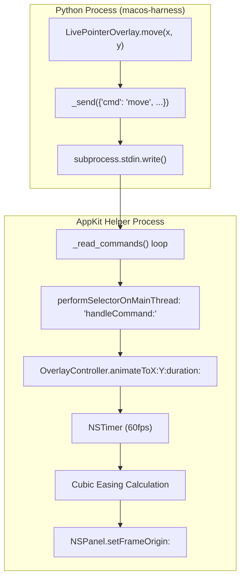
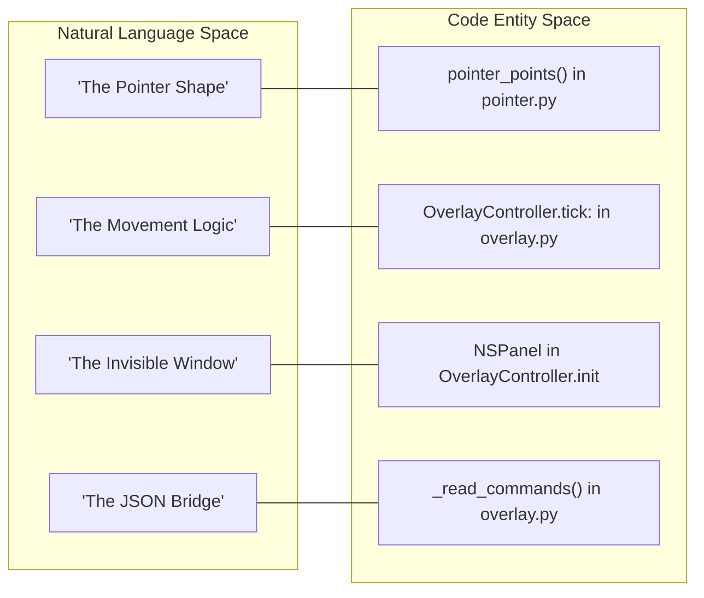

<!-- source: DeepWiki mcp.deepwiki.com · repo browser-use/macos-harness · page 3.1 Live Pointer Overlay · fetched 2026-10-30 -->

# Live Pointer Overlay

Relevant source files

The following files were used as context for generating this wiki page:

- [src/macos_harness/overlay.py](src/macos_harness/overlay.py)

The Live Pointer Overlay provides visual feedback for an LLM agent's actions without moving the physical macOS system cursor. It achieves this by spawning a dedicated AppKit helper process that renders a virtual pointer on a transparent, click-through window layer.

### Architecture & Data Flow

The overlay system consists of two parts: the `LivePointerOverlay` class in the main Python process and a subprocess running the AppKit event loop. Communication occurs via a JSON-based protocol over `stdin`.

#### Component Relationship

| Component | Responsibility |
| :--- | :--- |
| `LivePointerOverlay` | Manages the lifecycle of the helper process and provides the Python API (`move`, `click`, `show`, `hide`). [src/macos_harness/overlay.py:21-24]() |
| `OverlayController` | An Objective-C (`NSObject`) class in the helper process that manages the `NSPanel` and handles command dispatch. [src/macos_harness/overlay.py:170-171]() |
| `PointerView` | An AppKit `NSView` that draws the pointer shape using `NSBezierPath` and handles "pressed" state visuals. [src/macos_harness/overlay.py:127-129]() |
| `JSON Protocol` | A line-delimited JSON stream used to send commands from Python to the AppKit helper. [src/macos_harness/overlay.py:108-119]() |

Sources: [src/macos_harness/overlay.py:21-24](), [src/macos_harness/overlay.py:170-171](), [src/macos_harness/overlay.py:127-129](), [src/macos_harness/overlay.py:108-119]()

### JSON Command Protocol

The `LivePointerOverlay` class communicates with the helper via a `subprocess.Popen` pipe [src/macos_harness/overlay.py:75-82](). Commands are serialized as single-line JSON objects [src/macos_harness/overlay.py:96-97]().

| Command | Payload Example | Description |
| :--- | :--- | :--- |
| `move` | `{"cmd":"move","x":100,"y":200,"duration":0.16}` | Animates the pointer to a new coordinate over a specified duration. |
| `show` | `{"cmd":"show","x":100,"y":200}` | Immediately positions and displays the pointer. |
| `hide` | `{"cmd":"hide"}` | Hides the pointer panel. |
| `click` | `{"cmd":"click"}` | Triggers a visual "press" animation (scaling and shadow change). |
| `quit` | `{"cmd":"quit"}` | Gracefully terminates the helper process. |

Sources: [src/macos_harness/overlay.py:37-70](), [src/macos_harness/overlay.py:75-82](), [src/macos_harness/overlay.py:96-97]()

### AppKit Implementation Details

#### The Click-Through Window (`NSPanel`)
The overlay uses an `NSPanel` configured to be non-activating and transparent to mouse events. This ensures the virtual pointer does not interfere with the agent's ability to interact with the underlying UI.

Key `NSPanel` configurations:
* **Style Mask**: `NSWindowStyleMaskBorderless` and `NSWindowStyleMaskNonactivatingPanel` [src/macos_harness/overlay.py:176-179]().
* **Level**: `NSStatusWindowLevel + 1` ensures it stays above most system windows [src/macos_harness/overlay.py:196]().
* **Mouse Events**: `setIgnoresMouseEvents_(True)` allows clicks to pass through to the windows beneath [src/macos_harness/overlay.py:193]().
* **Collection Behavior**: Configured to join all spaces and full-screen apps [src/macos_harness/overlay.py:197-201]().

#### Coordinate Mapping & Multi-Display Support
The helper process maps standard macOS screen coordinates (where (0,0) is bottom-left) to the visual overlay position. It uses `Quartz.CGDisplayBounds(Quartz.CGMainDisplayID())` to determine the primary display dimensions for coordinate flipping [src/macos_harness/overlay.py:246-248]().

#### Cubic-Eased Animation
When a `move` command is received, the `OverlayController` uses a high-frequency timer (`NSTimer`) to update the pointer position [src/macos_harness/overlay.py:228-232](). The animation uses a cubic easing function (`t * t * (3 - 2 * t)`) to provide smooth, natural movement [src/macos_harness/overlay.py:265]().

### Pointer Rendering

The `PointerView` class draws the pointer dynamically. It fetches a list of points from `pointer_points()` [src/macos_harness/overlay.py:138](), which defines the arrow geometry.

* **Hotspot Alignment**: The pointer is drawn such that the tip of the arrow aligns with the target coordinate, accounting for the `POINTER_HOTSPOT` [src/macos_harness/pointer.py:9-11]().
* **Press State**: When `click()` is called, the `pressed` flag is set to `True`, causing `pointer_points` to return a scaled-down version of the arrow [src/macos_harness/pointer.py:24]().
* **Visual Styling**: The pointer includes a 2.5pt white stroke, a 0.65pt black inner stroke, and a subtle shadow for visibility against varied backgrounds [src/macos_harness/overlay.py:147-164]().

### Data Flow Diagram

The following diagram illustrates the flow from a Python `move()` call to the screen update in the AppKit helper.

**Pointer Movement Pipeline**

Sources: [src/macos_harness/overlay.py:37-46](), [src/macos_harness/overlay.py:96-97](), [src/macos_harness/overlay.py:108-116](), [src/macos_harness/overlay.py:228-235](), [src/macos_harness/overlay.py:265]()

### Entity Mapping

This diagram maps the logical concepts to the specific code entities implementing them.

**Logical to Code Entity Mapping**

Sources: [src/macos_harness/pointer.py:22-24](), [src/macos_harness/overlay.py:255-276](), [src/macos_harness/overlay.py:180-184](), [src/macos_harness/overlay.py:108-119]()

---

