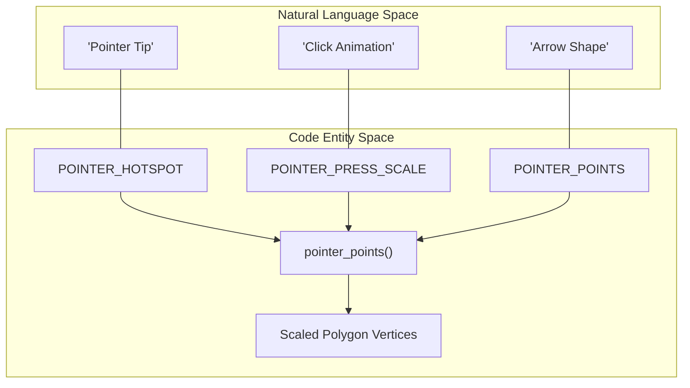
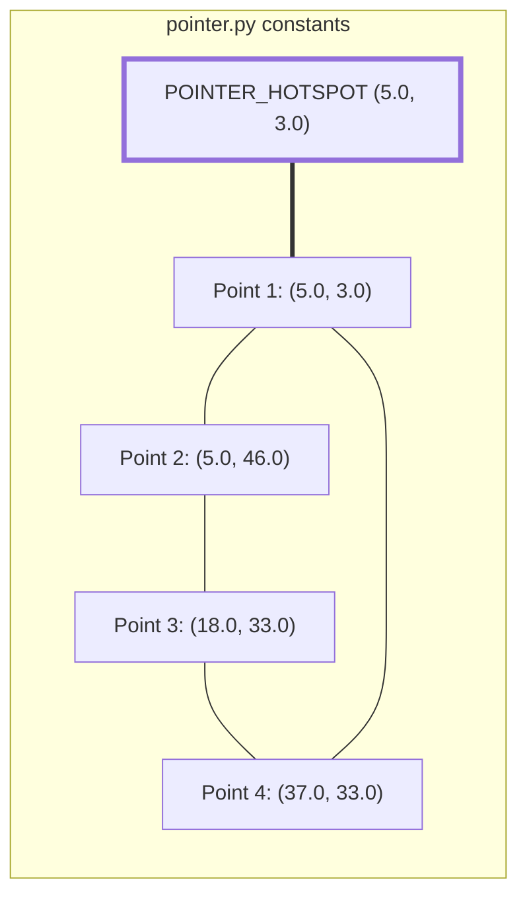

<!-- source: DeepWiki mcp.deepwiki.com · repo browser-use/macos-harness · page 3.2 Pointer Geometry · fetched 2026-10-30 -->

# Pointer Geometry

Relevant source files

The following files were used as context for generating this wiki page:

- [src/macos_harness/pointer.py](src/macos_harness/pointer.py)

The `macos-harness` virtual pointer system provides visual feedback to the user without moving the physical system cursor. This feedback is rendered in two places: as a live overlay using `AppKit` and as a rendered element in screenshots. The `pointer.py` module defines the shared geometry, dimensions, and scaling logic to ensure consistent appearance across both contexts.

### Data Flow: Geometry to Rendering
The geometry defined in `pointer.py` serves as the single source of truth for the pointer's shape. The `pointer_points()` function calculates the final coordinates by applying a scale factor relative to a fixed hotspot, which is then consumed by rendering logic to draw the pointer polygon.

**Pointer Geometry Definition**
| Constant | Value | Description |
| :--- | :--- | :--- |
| `POINTER_WIDTH` | `42.0` | Total width of the pointer bounding box. |
| `POINTER_HEIGHT` | `50.0` | Total height of the pointer bounding box. |
| `POINTER_HOTSPOT` | `(5.0, 3.0)` | The active "tip" of the pointer where clicks occur. |
| `POINTER_POINTS` | `((5.0, 3.0), ...)` | A tuple of 4 vertices defining the arrow polygon. |
| `POINTER_PRESS_SCALE` | `0.96` | The scale factor applied when the pointer is in a "pressed" state. |

**Sources:** [src/macos_harness/pointer.py:5-14]()

---

### Coordinate Scaling & Transformation

The primary logic in this module is contained within `pointer_points()`. This function transforms the static `POINTER_POINTS` based on the interaction state (pressed vs. idle). 

To simulate a "click" animation, the pointer shrinks slightly. Crucially, this scaling must occur relative to the `POINTER_HOTSPOT` rather than the center of the shape. This ensures that the tip of the arrow remains fixed at the target coordinate while the rest of the body retracts.

**Mapping Logic Diagram**

**Sources:** [src/macos_harness/pointer.py:17-24]()

---

### Implementation Details

#### The `pointer_points` Function
The function `pointer_points(*, pressed: bool = False)` implements the scaling math [src/macos_harness/pointer.py:17-24]().

1.  **Scale Selection**: It selects a `scale` factor (1.0 for idle, 0.96 for pressed) [src/macos_harness/pointer.py:19]().
2.  **Origin Translation**: For every vertex $(x, y)$ in `POINTER_POINTS`, it calculates the distance from the `POINTER_HOTSPOT` $(hot\_x, hot\_y)$.
3.  **Scaling**: It multiplies that distance by the `scale`.
4.  **Re-translation**: It adds the result back to the `POINTER_HOTSPOT` to return the point to the original coordinate space [src/macos_harness/pointer.py:22-23]().

**Mathematical Formula:**
$P'_{x} = hot\_x + (P_{x} - hot\_x) \times scale$
$P'_{y} = hot\_y + (P_{y} - hot\_y) \times scale$

#### Pointer Vertices
The pointer is defined as a 4-point polygon representing a standard macOS-style arrow:
1.  `(5.0, 3.0)`: The Tip (Hotspot)
2.  `(5.0, 46.0)`: Bottom-left
3.  `(18.0, 33.0)`: Inner-notch
4.  `(37.0, 33.0)`: Bottom-right

**Shape and Hotspot Relationship**

**Sources:** [src/macos_harness/pointer.py:7-13](), [src/macos_harness/pointer.py:20-24]()

---

