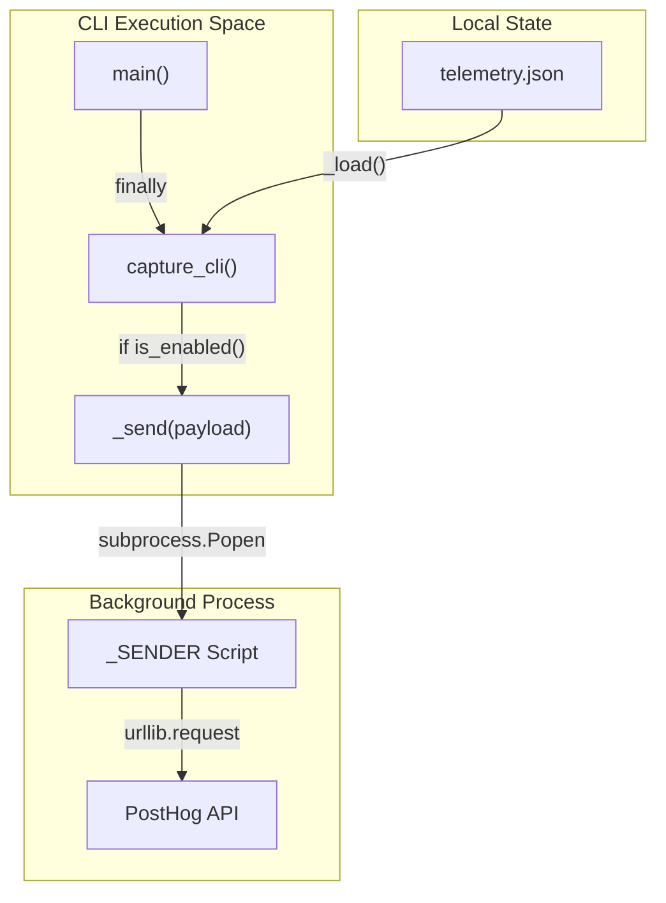

<!-- source: DeepWiki mcp.deepwiki.com · repo browser-use/macos-harness · page 4 Telemetry · fetched 2026-10-30 -->

# Telemetry

<details>
<summary>Relevant source files</summary>

The following files were used as context for generating this wiki page:

- [src/macos_harness/cli.py](src/macos_harness/cli.py)
- [src/macos_harness/telemetry.py](src/macos_harness/telemetry.py)

</details>


macOS Harness includes a tiny, privacy-safe, opt-out telemetry system designed to help maintainers understand usage patterns and improve reliability without ever touching sensitive user data. The system is strictly limited to capturing command categories and execution metadata.

## Design Philosophy & Privacy Invariants

The telemetry system is built on a "privacy-first" foundation with several non-negotiable invariants:
*   **No User Content:** The system never collects application names (except for known harness commands), screenshots, text, window titles, or file paths [src/macos_harness/telemetry.py:158-160]().
*   **Coarse Metadata:** Only coarse execution data (success/failure, duration) and environment metadata (OS version, architecture) are transmitted [src/macos_harness/telemetry.py:162-178]().
*   **Anonymized Identity:** A random UUID `install_id` is generated locally to distinguish installations without linking to real-world identities [src/macos_harness/telemetry.py:67-78]().
*   **Non-Blocking:** Telemetry is sent in a detached background process to ensure it never slows down the CLI or agent execution [src/macos_harness/telemetry.py:145-151]().

### Data Flow: CLI to PostHog

The following diagram illustrates how telemetry is captured at the end of a CLI command execution and dispatched.

**Telemetry Dispatch Pipeline**

Sources: [src/macos_harness/cli.py:153-154](), [src/macos_harness/telemetry.py:138-155]()

## Collected Data Points

When `capture_cli` is invoked, it strictly filters the `command` against a whitelist of known subcommands. If the command is not in the `COMMANDS` set, it is recorded as `"python"` to protect privacy [src/macos_harness/telemetry.py:21](), [src/macos_harness/telemetry.py:169]().

| Field | Description | Source |
| :--- | :--- | :--- |
| `command` | One of: `python`, `doctor`, `apps`, `repl`, `skill`, `see`, `state`. | [src/macos_harness/telemetry.py:21]() |
| `success` | Boolean indicating if the command returned exit code 0. | [src/macos_harness/cli.py:154]() |
| `duration_seconds` | Execution time rounded to 2 decimal places. | [src/macos_harness/telemetry.py:171]() |
| `macos_harness_version` | The version of the installed package. | [src/macos_harness/telemetry.py:104-109]() |
| `agent` | Detected LLM agent environment (e.g., `claude-code`, `cursor`). | [src/macos_harness/telemetry.py:111-121]() |
| `os` / `machine` | OS name and hardware architecture (e.g., `Darwin`, `arm64`). | [src/macos_harness/telemetry.py:174-175]() |

Sources: [src/macos_harness/telemetry.py:162-178]()

## Configuration & Opt-Out

Users can opt-out of telemetry through three different mechanisms: environment variables, the CLI, or direct config file modification.

### 1. Environment Overrides
The system checks several standard environment variables. If any are set to "disable" values, telemetry is suppressed [src/macos_harness/telemetry.py:16-20]().
*   `MACOS_HARNESS_TELEMETRY`: Set to `0`, `false`, `no`, or `off` to disable.
*   `DO_NOT_TRACK`: Set to `1`, `true`, `yes`, or `on` to disable.
*   `ANONYMIZED_TELEMETRY`: Set to `0`, `false`, `no`, or `off` to disable.

### 2. Configuration File
State is persisted in a JSON file. By default, this is located at `~/Library/Application Support/macos-harness/telemetry.json` [src/macos_harness/telemetry.py:24-32]().
*   **Custom Home:** Setting `MACOS_HARNESS_HOME` overrides the base directory [src/macos_harness/telemetry.py:25-28]().
*   **Permissions:** The configuration directory is restricted to `0o700` and the file to `0o600` for security [src/macos_harness/telemetry.py:46-50]().

### 3. CLI Subcommand
The `telemetry` subcommand provides a user-friendly interface to manage these settings [src/macos_harness/cli.py:88-89]().

```bash
# Check current status and install_id
macos-harness telemetry status

# Opt-out of telemetry
macos-harness telemetry disable

# Opt-in to telemetry
macos-harness telemetry enable
```
Sources: [src/macos_harness/telemetry.py:184-195](), [src/macos_harness/cli.py:65-68]()

## Implementation Details

The core logic resides in `telemetry.py`. It uses a detached `subprocess` to execute a minimal Python script (`_SENDER`) that performs the HTTP POST request using `urllib.request`. This ensures that even if the network is slow or the telemetry server is unreachable, the user experience is unaffected [src/macos_harness/telemetry.py:123-135]().

**Code Entity Mapping: Telemetry Logic**
```mermaid
classDiagram
    class CLI {
        +main(argv)
        +capture_cli(command, success, duration)
    }
    class TelemetryModule {
        +is_enabled() bool
        +status() dict
        +set_enabled(bool)
        +_send(payload)
        +_install_id() str
    }
    class PostHog {
        <<Service>>
        +POSTHOG_KEY
        +POSTHOG_HOST
    }

    CLI ..> TelemetryModule : calls capture_cli [cli.py:154]
    TelemetryModule ..> PostHog : sends payload [telemetry.py:138]
    TelemetryModule --> TelemetryFile : reads/writes [telemetry.py:31]
```
Sources: [src/macos_harness/cli.py:154](), [src/macos_harness/telemetry.py:14-15](), [src/macos_harness/telemetry.py:31]()

### Agent Detection
The `_agent()` function identifies the calling environment by checking for specific environment variables associated with popular AI coding tools [src/macos_harness/telemetry.py:111-121]():
*   `CLAUDECODE` -> `claude-code`
*   `CURSOR_AGENT` -> `cursor`
*   `CODEX_THREAD_ID` -> `codex`

Sources: [src/macos_harness/telemetry.py:111-121]()

---

