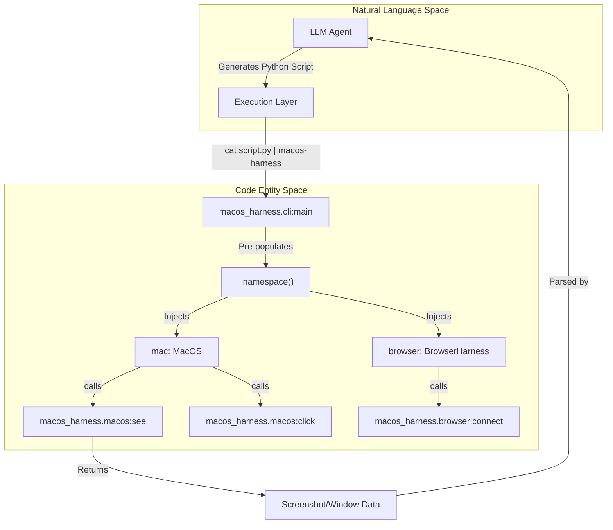
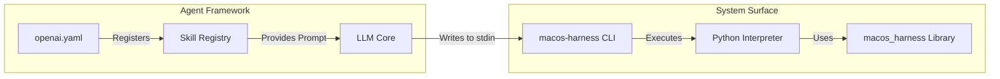

<!-- source: DeepWiki mcp.deepwiki.com · repo browser-use/macos-harness · page 5 Skill & Agent Integration · fetched 2026-10-30 -->

# Skill & Agent Integration

Relevant source files

The following files were used as context for generating this wiki page:

- [pyproject.toml](pyproject.toml)
- [skills/macos-harness/SKILL.md](skills/macos-harness/SKILL.md)
- [skills/macos-harness/agents/openai.yaml](skills/macos-harness/agents/openai.yaml)

The macOS Harness is designed to be consumed by LLM agents as a high-level "skill." It packages the complex interactions of macOS APIs into a compact, six-verb interface that allows an agent to control the operating system through a persistent Python execution environment. Integration is achieved through a combination of a structured prompt definition (`SKILL.md`) and framework-specific configuration files.

## Overview of Agent Integration

Integration with LLM frameworks relies on treating the `macos-harness` CLI as a tool that accepts Python scripts via `stdin`. This allows agents to execute multi-step logic in a single round trip, rather than invoking individual primitives one by one.

### The Skill Surface
The harness exposes a minimized API surface to the agent, centered around six primary verbs:
1.  `see`: Capture screenshots and window state.
2.  `key`: Send keyboard shortcuts to specific PIDs.
3.  `type`: Send text input to specific PIDs.
4.  `click`: Perform PID-targeted mouse events.
5.  `ax`: Interact with the Accessibility tree.
6.  `script`: Execute AppleScript for exact, focus-safe commands.

### Agent-Harness Interaction Flow

The following diagram illustrates how an LLM agent interacts with the macOS Harness through the CLI and the pre-populated Python namespace.

**Agent Execution Logic**

Sources: [src/macos_harness/cli.py:1-40](), [skills/macos-harness/SKILL.md:37-54](), [src/macos_harness/browser.py:1-30]()

## Skill Definition (SKILL.md)

The core of the integration is the `SKILL.md` file. This document serves as the "instruction manual" for the LLM, defining the operational constraints and the strategy for using the harness effectively. It is bundled into the Python package and can be force-included in builds.

**Key concepts covered in the skill definition:**
*   **Round-trip Minimization:** Instructions for agents to bundle deterministic steps (e.g., search + type + capture) into a single Python execution block to reduce latency.
*   **Mode Selection Hierarchy:** A decision tree for agents to choose the "lowest useful mode," preferring AppleScript (`script`) or Vision (`see`) over complex Accessibility (`ax`) tree traversals.
*   **Invariants:** Hard rules the agent must follow, such as never requesting window activation or moving the physical cursor.

For details on the specific prompt instructions and strategy, see [SKILL.md — Agent Prompt & Usage Guide](#5.1).

Sources: [skills/macos-harness/SKILL.md:1-96](), [pyproject.toml:50-51]()

## Agent Configuration

To make the harness discoverable by agent orchestrators (such as those using the OpenAI tool format), the repository includes standardized configuration metadata.

### OpenAI YAML Interface
The `agents/openai.yaml` file defines how the skill appears in compatible UIs and provides a `default_prompt` that triggers the harness's capabilities.

| Field | Value |
| :--- | :--- |
| `display_name` | macOS Harness |
| `short_description` | Simple visual control for the whole Mac |
| `default_prompt` | Use $macos-harness to see and control my Mac... |

For details on integrating with specific LLM providers and YAML fields, see [Agent Configuration (OpenAI YAML)](#5.2).

Sources: [skills/macos-harness/agents/openai.yaml:1-4]()

## Skill Registration Architecture

The harness is registered as a system-level tool. When the agent decides to use the "macOS Harness" skill, it formats its intent into a Python block that is piped into the `macos-harness` CLI.

**Skill Registration Flow**

Sources: [skills/macos-harness/agents/openai.yaml:1-4](), [pyproject.toml:39-40](), [skills/macos-harness/SKILL.md:10-21]()

---

