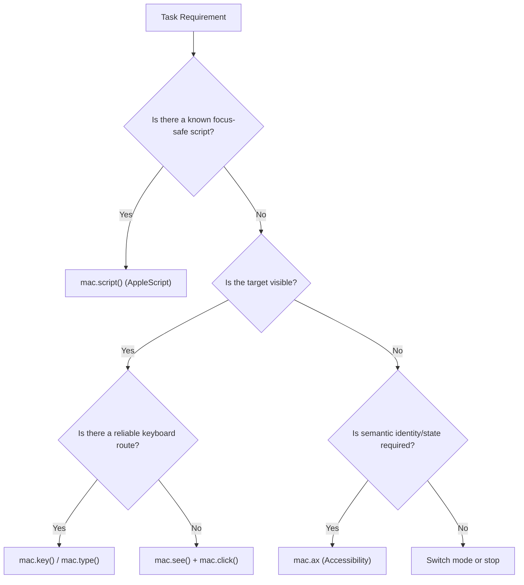
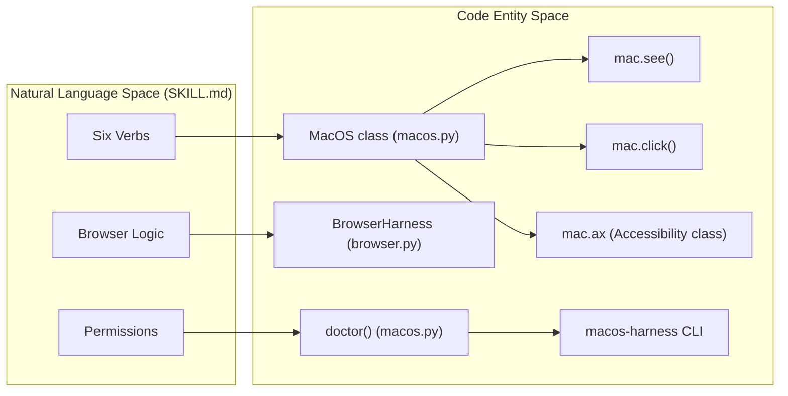

<!-- source: DeepWiki mcp.deepwiki.com · repo browser-use/macos-harness · page 5.1 SKILL.md — Agent Prompt & Usage Guide · fetched 2026-10-30 -->

# SKILL.md — Agent Prompt & Usage Guide

Relevant source files

The following files were used as context for generating this wiki page:

- [README.md](README.md)
- [skills/macos-harness/SKILL.md](skills/macos-harness/SKILL.md)

The `SKILL.md` file serves as the primary instruction set and behavioral contract for LLM agents utilizing the macOS Harness. It defines the operational boundaries, the minimized API surface, and the decision-making logic required to control macOS without violating the harness's core invariants.

## Purpose and Scope

The purpose of `SKILL.md` is to teach an agent how to interact with the `macos-harness` CLI and its preloaded Python environment. It shifts the agent's strategy from "step-by-step" tool calling to "burst execution," where the agent writes and executes Python scripts that perform multiple operations within a single round trip [skills/macos-harness/SKILL.md:8-18]().

## The Six-Verb Surface

The harness simplifies the vast macOS API into six primary verbs exposed through the `mac` object. Agents are instructed to think exclusively in these primitives to maintain consistency and reliability.

| Verb | Description | Code Entity |
| :--- | :--- | :--- |
| `see` | Captures a screenshot of a specific app window. | `mac.see()` |
| `key` | Sends a keyboard shortcut to a specific PID. | `mac.key()` |
| `type` | Sends a string of text to a specific PID. | `mac.type()` |
| `click` | Sends a raw mouse click to coordinates within a PID. | `mac.click()` |
| `ax` | Interacts with the macOS Accessibility tree. | `mac.ax` |
| `script` | Executes raw AppleScript/Apple Events. | `mac.script()` |

**Sources:** [skills/macos-harness/SKILL.md:37-51](), [README.md:34-55]()

## Round-Trip Minimization Strategy

To ensure efficiency and reduce latency, the harness encourages a "burst" execution model. Agents should bundle deterministic, reversible steps into a single Python program rather than making individual CLI calls for every click or keystroke [skills/macos-harness/SKILL.md:23-35]().

### Execution Flow
1.  **Identify Boundary:** The agent determines the next "decision point" (e.g., an irreversible action or a state requiring visual verification).
2.  **Compose Script:** The agent writes a Python script using the six verbs and standard libraries (`Path`, `subprocess`).
3.  **Execute Burst:** The script is piped into `macos-harness` via stdin.
4.  **Verify:** The script concludes with a final `mac.see()` or AX query to confirm the end-state.

**Sources:** [skills/macos-harness/SKILL.md:8-18](), [skills/macos-harness/SKILL.md:25-30]()

## Mode Selection Hierarchy

Agents follow a strict hierarchy when deciding how to interact with an application. They are instructed to choose the "lowest useful mode" to minimize overhead and maximize reliability.

### Decision Tree: Mode Selection

**Sources:** [skills/macos-harness/SKILL.md:56-69]()

## Invariant Rules for Agents

The harness enforces several non-negotiable invariants that the agent must respect to ensure it does not interfere with the human user's physical environment.

*   **No Physical Pointer Movement:** `mac.click()` and `mac.move()` interact with the target PID's event queue or the virtual overlay; the physical system cursor never moves [skills/macos-harness/SKILL.md:76-77]().
*   **No Window Activation:** The harness targets background PIDs. If an app becomes frontmost, the harness raises a `FocusChangedError` [skills/macos-harness/SKILL.md:72-74]().
*   **Retina Scaling:** All coordinates returned by `mac.see()` are pre-scaled for the window's backing store; agents must use these coordinates directly [skills/macos-harness/SKILL.md:80-81]().
*   **No Guessing:** `mac.click()` is a raw event. It does not "guess" AX actions. If a click fails, the agent must switch to `mac.ax` or `mac.script` [skills/macos-harness/SKILL.md:75-78]().

**Sources:** [skills/macos-harness/SKILL.md:70-86](), [README.md:76-81]()

## Browser vs. Native Logic

The agent must distinguish between native macOS UI and web content.

*   **Browser Harness (CDP):** Use the `browser` object for DOM manipulation, network requests, and tab management. Agents are forbidden from using AX to interact with elements *inside* a web page [skills/macos-harness/SKILL.md:89-90]().
*   **MacOS Harness (AX):** Used only to handle browser-level chrome, such as the "Allow remote debugging?" permission sheet, which is a native macOS dialog [skills/macos-harness/SKILL.md:90-92]().

**Sources:** [skills/macos-harness/SKILL.md:87-93]()

## Runtime Loading and Registration

The skill is designed to be self-bootstrapping. An agent typically registers the skill by following these steps:

1.  **Installation:** The agent installs the package using `uv` [README.md:27-29]().
2.  **Discovery:** The agent runs `macos-harness skill` to output the content of `SKILL.md` and the agent-specific YAML configuration [README.md:28]().
3.  **Verification:** The agent runs `macos-harness doctor` to check for Accessibility, Screen Recording, and Event Posting permissions [skills/macos-harness/SKILL.md:94-96]().

### System Component Mapping

The following diagram maps the natural language concepts in `SKILL.md` to the internal Python classes and CLI components.

**Sources:** [README.md:57-74](), [skills/macos-harness/SKILL.md:37-51](), [skills/macos-harness/SKILL.md:94-96]()

---

