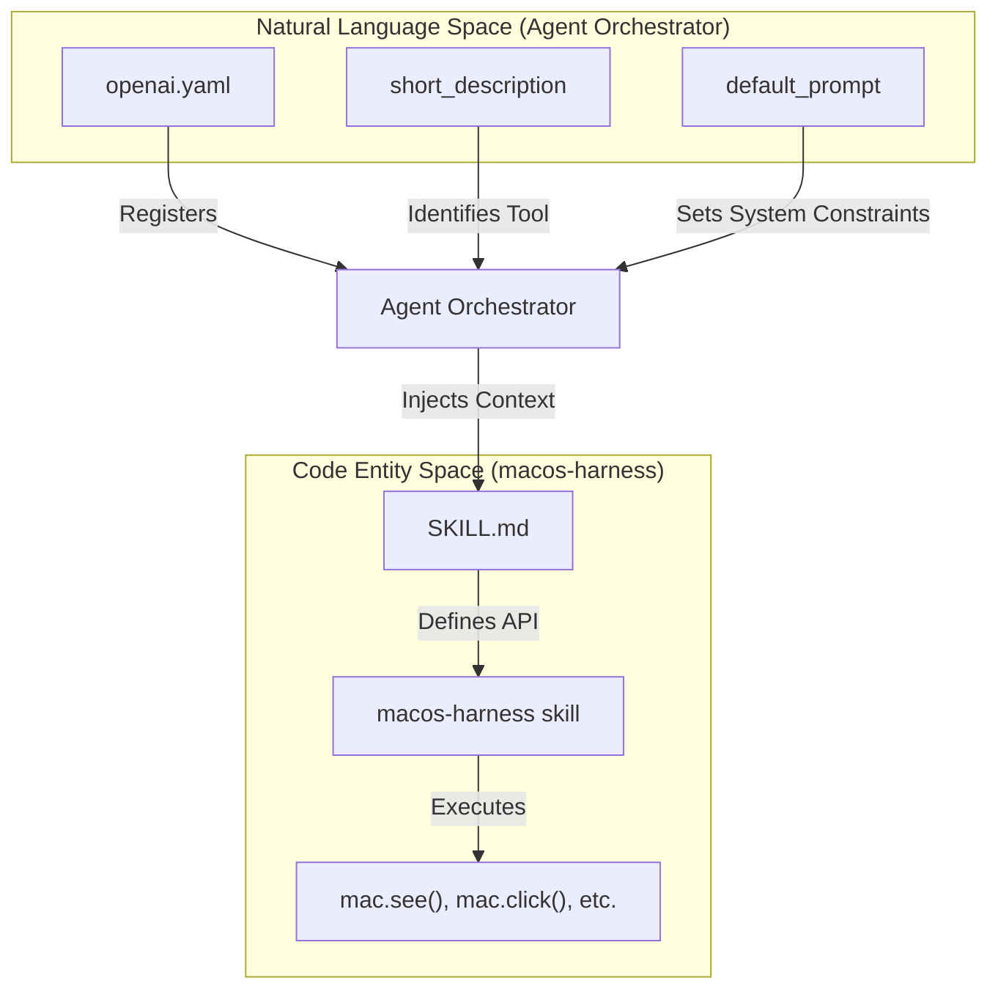
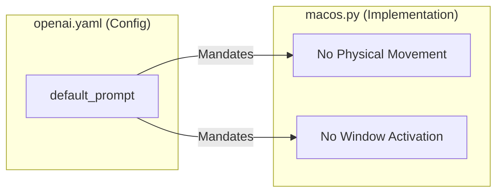

<!-- source: DeepWiki mcp.deepwiki.com · repo browser-use/macos-harness · page 5.2 Agent Configuration (OpenAI YAML) · fetched 2026-10-30 -->

# Agent Configuration (OpenAI YAML)

Relevant source files

The following files were used as context for generating this wiki page:

- [skills/macos-harness/agents/openai.yaml](skills/macos-harness/agents/openai.yaml)

The `macos-harness` is designed to be consumed by LLM agent orchestrators as a modular "skill." This integration is defined through a YAML interface specification that provides the necessary metadata for an agent to understand its capabilities and constraints.

## Purpose and Scope

The configuration file `skills/macos-harness/agents/openai.yaml` serves as the registration manifest for compatible agent frameworks (such as those following the OpenAI skill/plugin interface patterns). It defines the human-readable identity of the tool and, crucially, the `default_prompt` that establishes the operational constraints for the LLM when it invokes the harness.

### Data Flow: Registration to Execution

The following diagram illustrates how the YAML configuration bridges the gap between the "Natural Language Space" (the Agent's reasoning) and the "Code Entity Space" (the harness execution environment).

**Agent Integration Pipeline**

**Sources:** [skills/macos-harness/agents/openai.yaml:1-4]()

## Interface Definition

The interface is composed of three primary fields that dictate how the skill is presented to and used by the AI agent.

| Field | Value | Technical Role |
| :--- | :--- | :--- |
| `display_name` | `"macOS Harness"` | The primary identifier used in UI elements and tool listings [skills/macos-harness/agents/openai.yaml:2-2](). |
| `short_description` | `"Simple visual control for the whole Mac"` | A high-level summary used by the LLM to determine tool relevancy during the planning phase [skills/macos-harness/agents/openai.yaml:3-3](). |
| `default_prompt` | `"Use $macos-harness to see and control my Mac..."` | The system instruction injected into the agent's context to enforce core invariants [skills/macos-harness/agents/openai.yaml:4-4](). |

### The `default_prompt` Invariants

The `default_prompt` field in `openai.yaml` is not merely a description; it is a functional constraint that enforces the "Thin Harness" philosophy. 

1.  **Tool Reference:** It uses the `$macos-harness` variable to link the prompt to the specific tool implementation [skills/macos-harness/agents/openai.yaml:4-4]().
2.  **Pointer Invariant:** It explicitly instructs the agent to operate **"without moving my physical cursor"** [skills/macos-harness/agents/openai.yaml:4-4](). This aligns with the implementation of the `LivePointerOverlay` which uses a virtual pointer rather than `CGEventPost` for mouse movement.
3.  **Focus Invariant:** It mandates operation without **"taking focus"** [skills/macos-harness/agents/openai.yaml:4-4](). This reinforces the design of the `mac` primitives (e.g., `mac.click()`) which target specific PIDs to avoid disruptive window activation.

**Relationship between YAML and Execution**

**Sources:** [skills/macos-harness/agents/openai.yaml:4-4]()

## Implementation Details

The file `skills/macos-harness/agents/openai.yaml` is located within the `skills/` directory, which is packaged with the harness distribution. When an agent orchestrator loads this skill, it reads these fields to populate its internal tool registry.

*   **File Path:** `skills/macos-harness/agents/openai.yaml` [skills/macos-harness/agents/openai.yaml:1-4]()
*   **Format:** Standard YAML 1.2.

**Sources:**
*   [skills/macos-harness/agents/openai.yaml:1-4]()

---

