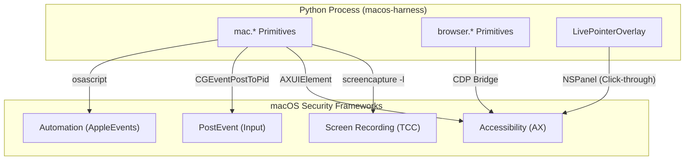

<!-- source: DeepWiki mcp.deepwiki.com · repo browser-use/macos-harness · page 6 Permissions & Security · fetched 2026-10-30 -->

# Permissions & Security

Relevant source files

The following files were used as context for generating this wiki page:

- [README.md](README.md)
- [SECURITY.md](SECURITY.md)
- [src/macos_harness/macos.py](src/macos_harness/macos.py)

macOS Harness operates by interfacing directly with system-level APIs to observe and control applications. Because these capabilities (screen capture, synthetic input, and UI inspection) are sensitive, macOS enforces a strict permission model. This page provides a high-level overview of the security architecture, the required permission buckets, and the harness's commitment to safety and privacy.

## Security Architecture Overview

The harness is designed around the **Principle of Least Privilege** and three non-negotiable safety invariants. Unlike traditional automation tools, it avoids global system changes in favor of targeted, process-specific interactions.

### The Three Invariants
1.  **No Physical Pointer Movement**: The harness never moves the user's actual mouse cursor. It draws a virtual overlay and sends events directly to application PIDs [src/macos_harness/macos.py:781-784]().
2.  **No Window Activation**: The harness captures screenshots and sends events to background windows without bringing them to the front, preventing "focus stealing" [src/macos_harness/macos.py:76-77]().
3.  **No User-Data Telemetry**: Telemetry is strictly limited to operational metadata (e.g., command success, duration) and explicitly excludes screenshots, window titles, or UI text [README.md:88-91]().

### Component Interaction & Security
The following diagram illustrates how the harness components interact with macOS security boundaries:

**Security Boundary Mapping**

Sources: [README.md:59-74](), [src/macos_harness/macos.py:1-6](), [src/macos_harness/overlay.py:44-55]()

---

## Permission Model

To function correctly, the harness requires four distinct macOS permissions. These are managed via the `doctor` command and the `request_permissions()` utility.

| Permission | Usage in Code | Consequence if Missing |
| :--- | :--- | :--- |
| **Accessibility** | `AXUIElement` APIs in `controls.py` | `AccessibilityPermissionError` raised; cannot inspect UI tree. |
| **Screen Recording** | `screencapture` in `mac.see()` | Screenshots will be empty or contain only the desktop wallpaper. |
| **Post Events** | `CGEventPostToPid` in `mac.click()` | Input events are ignored by target applications. |
| **Automation** | `osascript` in `mac.script()` | AppleScript execution fails with a "Not allowed" error. |

### The Doctor Command
The `macos-harness doctor` command serves as the primary diagnostic tool. It checks the current status of all four permissions using native system calls such as `AXIsProcessTrusted()` and `CGPreflightScreenCaptureAccess()` [src/macos_harness/macos.py:1134-1175]().

For details on how these checks are implemented and how to use the `--request` flag, see [Permission Model & Doctor Command](#6.1).

---

## Security Policy & Threat Model

The project maintains a formal security policy defined in `SECURITY.md`. This policy treats the LLM agent and the UI it interacts with as potential sources of untrusted input.

### Key Security Guidelines
*   **Vulnerability Reporting**: Security issues should be reported privately via GitHub Security Advisories [SECURITY.md:3-5]().
*   **Untrusted Input**: Developers and users must treat agent instructions and third-party application UI as untrusted [SECURITY.md:7-8]().
*   **Irreversible Actions**: The harness encourages a "human-in-the-loop" approach for irreversible actions [SECURITY.md:8-9]().

### Minimum Privilege Operation
The harness is designed to be scoped to specific PIDs whenever possible. For example, `mac.click()` and `mac.type()` target specific Process IDs rather than the global system event stream [src/macos_harness/macos.py:781-790]().

For a detailed breakdown of the threat model and safety recommendations, see [Security Policy & Threat Model](#6.2).

---

## Telemetry & Privacy

The harness includes an opt-out telemetry system. It is designed to be privacy-safe by construction: the code responsible for sending telemetry lacks access to the screenshot buffers or UI tree data.

*   **Collected**: Command category (e.g., `see`, `click`), success/failure, duration, OS version, and agent name [README.md:88-91]().
*   **Never Collected**: Prompts, app names, screenshots, UI text, or file paths [README.md:90-91]().
*   **Disabling**: Users can disable telemetry via `macos-harness telemetry disable` [README.md:94-95]().

Sources: [README.md:83-95](), [src/macos_harness/telemetry.py:1-20]()

---

