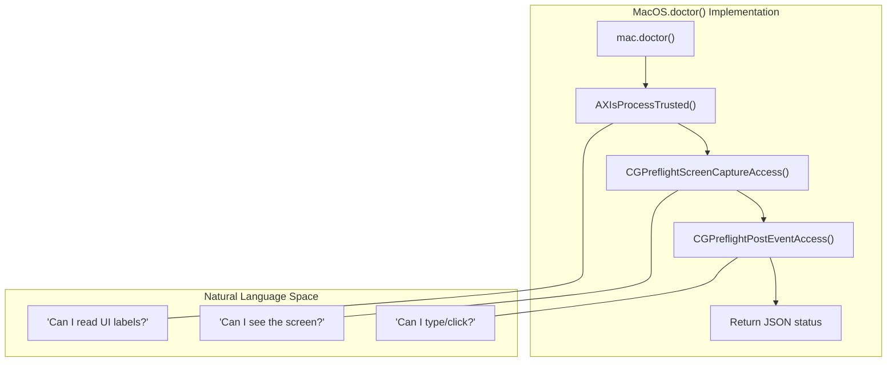
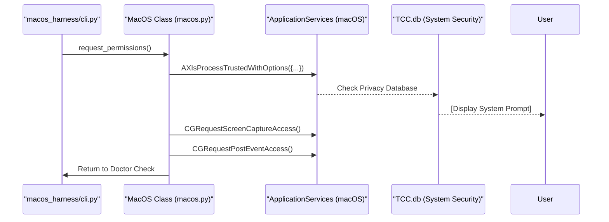

<!-- source: DeepWiki mcp.deepwiki.com · repo browser-use/macos-harness · page 6.1 Permission Model & Doctor Command · fetched 2026-10-30 -->

# Permission Model & Doctor Command

Relevant source files

The following files were used as context for generating this wiki page:

- [src/macos_harness/cli.py](src/macos_harness/cli.py)
- [src/macos_harness/macos.py](src/macos_harness/macos.py)

macOS Harness operates by interfacing with sensitive system-level APIs provided by the `ApplicationServices` and `AppKit` frameworks. To ensure security and user privacy, macOS requires explicit authorization for the harness to observe the screen, simulate input events, and inspect the Accessibility (AX) tree of other applications.

The `doctor` command serves as the primary diagnostic tool for verifying these permissions, while the `--request` flag provides a mechanism to trigger the native system prompts required for authorization.

## Permission Buckets

The harness requires four distinct permission "buckets" to function correctly. Each bucket corresponds to a specific set of macOS security constraints.

| Bucket | Purpose | Verification Method |
| :--- | :--- | :--- |
| **Accessibility** | Inspecting the AX tree and performing semantic actions (e.g., clicking a specific AX element). | `AS.AXIsProcessTrusted()` |
| **Screen Recording** | Capturing window screenshots via the `screencapture` CLI. | `AS.CGPreflightScreenCaptureAccess()` |
| **Post Events** | Simulating low-level mouse and keyboard events via `CGEventPost`. | `AS.CGPreflightPostEventAccess()` |
| **Automation** | Executing AppleScript to control applications (e.g., fetching the URL from a browser). | Checked via `tccutil` or by attempting a "no-op" script execution. |

### Implementation of Checks

The permission checks are implemented within the `MacOS.doctor()` method, which calls the underlying Core Graphics and Accessibility preflight functions.

**Sources:**
- Permission check logic: [src/macos_harness/macos.py:321-344]()
- Constant definitions: [src/macos_harness/macos.py:26-33]()

---

## The Doctor Command

The `doctor` command provides a JSON-formatted report of the current system state. This is intended for both human debugging and automated health checks by agent frameworks.

### JSON Output Format
The output of `mac.doctor()` (invoked via `macos-harness doctor`) returns a dictionary containing:
1.  **permissions**: Boolean status for `accessibility`, `screen_capture`, and `post_event`.
2.  **python**: The version of the current interpreter.
3.  **harness**: The version of the `macos-harness` package.
4.  **os**: System version and architecture (e.g., `macOS-14.5-arm64`).

**Sources:**
- CLI command handling: [src/macos_harness/cli.py:94-100]()
- `doctor()` return structure: [src/macos_harness/macos.py:321-344]()

---

## Requesting Permissions (`--request`)

Because macOS security policy prevents programmatic granting of permissions, the harness must trigger the system's native "Permission Requested" dialogs. 

When the `--request` flag is used (e.g., `macos-harness doctor --request`), the `MacOS.request_permissions()` method is called. This method utilizes "Request" variants of the preflight APIs which, unlike the "Preflight" variants, will pop up a system modal if the permission is currently denied or undetermined.

### Data Flow: Permission Request

**Sources:**
- `request_permissions` implementation: [src/macos_harness/macos.py:346-353]()
- CLI flag handling: [src/macos_harness/cli.py:59-61]() and [src/macos_harness/cli.py:96-97]()

---

## Accessibility Trust Verification

The most critical permission is **Accessibility**. Without it, the harness cannot resolve window hierarchies or interact with elements semantically.

The harness checks this using `AS.AXIsProcessTrusted()`. If a command is attempted while this permission is missing, the harness raises a specific `AccessibilityPermissionError`.

### Interaction Flow for AX Access

1.  **Initialization**: `MacOS.__init__` is called.
2.  **Check**: The harness verifies bindings are available via `_require_macos()`.
3.  **Execution**: When a command like `mac.ax()` or `mac.see()` is called, it implicitly relies on the process being trusted.
4.  **Failure**: If `AXIsProcessTrusted()` returns `False`, the system will often block the call silently or return an `AXError`. The harness wraps these into `MacOSError` or `AccessibilityPermissionError`.

**Sources:**
- `_require_macos` check: [src/macos_harness/macos.py:233-239]()
- Error definitions: [src/macos_harness/macos.py:40-41]()
- AX status check in doctor: [src/macos_harness/macos.py:322-322]()

---

