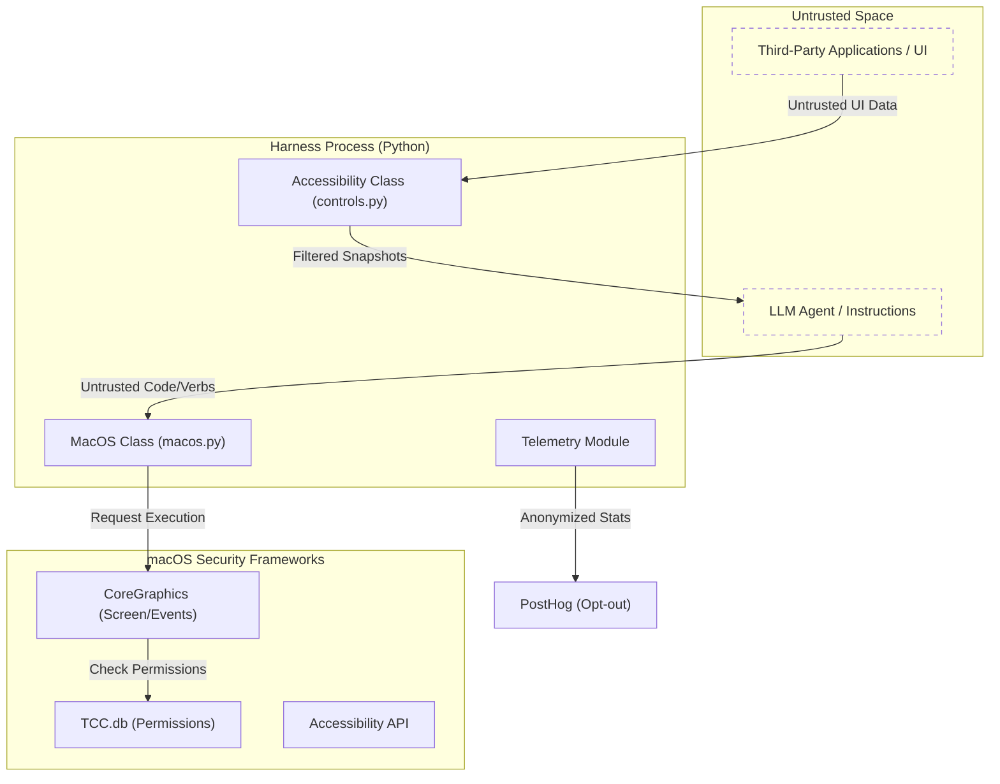
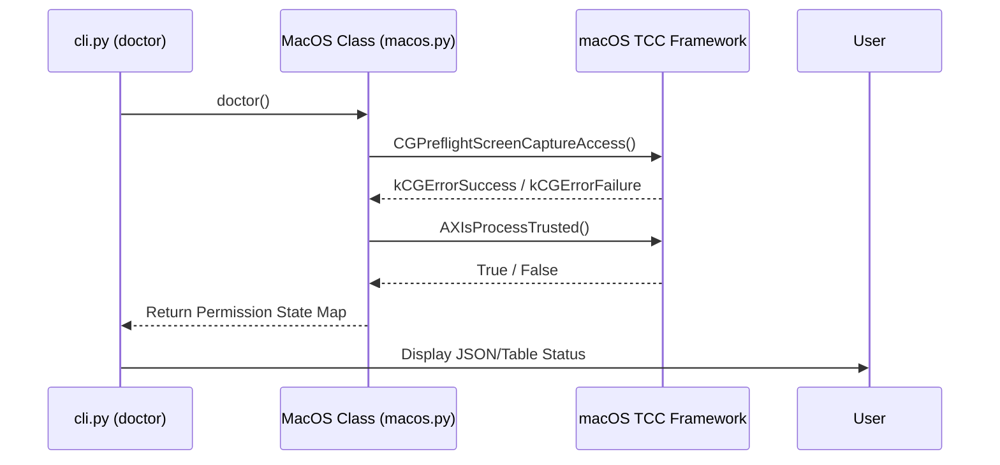

<!-- source: DeepWiki mcp.deepwiki.com · repo browser-use/macos-harness · page 6.2 Security Policy & Threat Model · fetched 2026-10-30 -->

# Security Policy & Threat Model

Relevant source files

The following files were used as context for generating this wiki page:

- [CONTRIBUTING.md](CONTRIBUTING.md)
- [SECURITY.md](SECURITY.md)

This page documents the security posture, vulnerability reporting procedures, and the threat model for `macos-harness`. As a tool designed to provide LLM agents with programmatic control over a macOS environment, the harness operates with elevated privileges (Accessibility, Screen Recording, and Event Injection). Understanding the trust boundaries and the principle of least privilege is critical for safe deployment.

## Vulnerability Reporting

The project maintains a private disclosure channel for security concerns. Users and researchers who discover vulnerabilities should not open public issues.

*   **Reporting Channel:** Vulnerabilities must be reported privately through **GitHub Security Advisories** for the `browser-use/macos-harness` repository [SECURITY.md:3-4]().
*   **Scope:** This includes exploits that could lead to unauthorized privilege escalation, bypass of user-granted permissions, or leakage of sensitive UI data beyond the configured agent interface.

## Threat Model & Trust Boundaries

The `macos-harness` security model is predicated on the user acting as the ultimate security principal. The harness itself is a "thin" intermediary that executes commands on behalf of an agent.

### Untrusted Inputs
The harness treats two primary sources as untrusted input:
1.  **Agent Instructions:** Any code or command sequence generated by an LLM agent is considered untrusted [SECURITY.md:7-8](). Agents may attempt to perform destructive actions or access sensitive information if not properly constrained by the orchestrator.
2.  **Third-Party UI:** Content read from the screen via `mac.see()` [macos.py:102-125]() or the Accessibility tree [controls.py:22-54]() is untrusted. Malicious applications could attempt "UI Injection" attacks, where text rendered in a window is designed to trick an agent's reasoning engine into executing unauthorized commands.

### Irreversible Actions
The policy mandates that users **review irreversible actions** [SECURITY.md:8-9](). Because the harness can simulate keyboard events [macos.py:223-234]() and mouse clicks [macos.py:236-258](), it has the technical capability to delete files, send emails, or modify system settings if the agent is granted those permissions.

### Data Flow & Trust Diagram
The following diagram illustrates the flow of untrusted data and the permission boundaries enforced by the macOS kernel.

**Data Flow Security Boundaries**

**Sources:** [SECURITY.md:7-9](), [macos.py:102-125](), [controls.py:22-54]().

## Principle of Least Privilege

The harness requires specific macOS permissions to function, but these should be granted judiciously based on the specific task requirements.

| Permission | Code Entity / Function | Security Impact |
| :--- | :--- | :--- |
| **Accessibility** | `AXIsProcessTrusted()` [macos.py:756-764]() | Allows reading the UI tree and interacting with elements via `controls.py`. |
| **Screen Recording** | `CGPreflightScreenCaptureAccess()` [macos.py:738-746]() | Allows `mac.see()` to capture pixels. Sensitive data in background windows may be captured. |
| **Post Events** | `CGPreflightPostEventAccess()` [macos.py:748-754]() | Allows `mac.click()` and `mac.type()` to inject input events into the system stream. |
| **Automation** | AppleScript `osascript` [macos.py:365-374]() | Allows direct control of specific apps (e.g., Chrome, Finder). |

Users are encouraged to grant the **minimum permissions needed** for the specific task [SECURITY.md:8-9](). For example, if an agent only needs to read text, Screen Recording may not be required if Accessibility is sufficient.

## Security Invariants

The codebase enforces three core invariants to protect the user's environment and privacy:

1.  **No Physical Pointer Movement:** The harness uses `CGEventCreateMouseEvent` with a specific PID or `kCGEventTargetUnixProcessID` to inject events without moving the hardware cursor [macos.py:246-255](). This prevents the agent from "stealing" the user's mouse focus [CONTRIBUTING.md:12-13]().
2.  **No Window Activation:** Commands should not force a window to the foreground (e.g., `make frontmost`) unless explicitly requested, preserving the user's active workspace [CONTRIBUTING.md:13]().
3.  **Privacy-Safe Telemetry:** The telemetry system is strictly opt-out and is architected to never collect user-identifiable data such as app names, screenshots, or window titles [CONTRIBUTING.md:13]().

**Permission Verification Logic**

**Sources:** [macos.py:730-775](), [CONTRIBUTING.md:12-13]().

---

