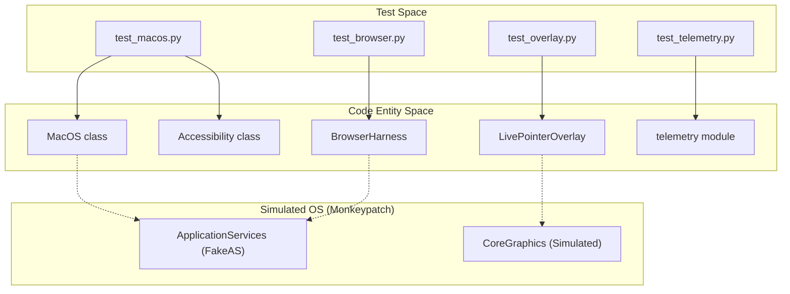

<!-- source: DeepWiki mcp.deepwiki.com · repo browser-use/macos-harness · page 7 Testing · fetched 2026-10-30 -->

# Testing

Relevant source files

The following files were used as context for generating this wiki page:

- [.github/workflows/ci.yml](.github/workflows/ci.yml)
- [tests/test_browser.py](tests/test_browser.py)
- [tests/test_macos.py](tests/test_macos.py)
- [tests/test_overlay.py](tests/test_overlay.py)
- [tests/test_telemetry.py](tests/test_telemetry.py)

The `macos-harness` test suite is designed to ensure the reliability of macOS-specific interactions while maintaining strict privacy and performance invariants. The suite utilizes `pytest` and leverages extensive monkeypatching of macOS system frameworks (via `ApplicationServices`) to simulate OS behavior without requiring physical hardware interaction or actual permission grants during CI.

The testing philosophy emphasizes:
- **Zero-Side-Effect Verification**: Ensuring input events are routed to specific PIDs without moving the physical cursor [tests/test_macos.py:179-190]().
- **Privacy Enforcement**: Validating that telemetry payloads never contain sensitive user data [tests/test_telemetry.py:35-58]().
- **AX Tree Robustness**: Testing the fallback mechanisms and depth-bounding of Accessibility tree queries [tests/test_macos.py:119-176]().

## Test Execution

Testing is integrated into the CI pipeline using `uv`. The suite is executed against macOS runners for Python versions 3.11 and 3.12.

| Command | Description |
| :--- | :--- |
| `uv run ruff check .` | Executes linting and static analysis. |
| `uv run pytest` | Runs the full test suite. |

**Sources:** [.github/workflows/ci.yml:19-20]()

## Testing Architecture

The following diagram illustrates how the test suite interacts with the core harness components and simulated macOS services.

### Test Interaction Model

**Sources:** [tests/test_macos.py:62-72](), [tests/test_browser.py:15-50](), [tests/test_overlay.py:34-42]()

## Core Test Modules

### macOS & Overlay Tests
These tests verify the core `MacOS` primitives and the visual feedback system. Key focus areas include:
- **Input Routing**: Asserting that `click` and `type` events are posted to the correct PID and do not trigger `CGWarpMouseCursorPosition` [tests/test_macos.py:179-190]().
- **Accessibility Fallbacks**: Ensuring `ax.query` correctly navigates the `AXUIElement` tree and enforces `max_nodes` limits [tests/test_macos.py:119-176]().
- **Overlay Protocol**: Validating the JSON-based communication between the harness and the `LivePointerOverlay` helper process [tests/test_overlay.py:34-68]().

For details, see [macOS & Overlay Tests](#7.1).

### Browser & Telemetry Tests
These tests focus on integration with external browsers and the privacy-safe telemetry system.
- **Chrome Approval**: Simulates the macOS Accessibility dialog that appears when Chrome is remotely controlled, ensuring the `_approve_chrome_prompt` logic can identify and click the "Allow" button via system-wide AX [tests/test_browser.py:8-54]().
- **Telemetry Sanitization**: A strict check ensuring that no "forbidden" keys (like `screenshot`, `window`, or `text`) ever appear in the serialized telemetry payloads [tests/test_telemetry.py:35-58]().
- **Environment Control**: Verifying that telemetry can be disabled via `MACOS_HARNESS_TELEMETRY` environment variables or local config files [tests/test_telemetry.py:22-34]().

For details, see [Browser & Telemetry Tests](#7.2).

## Data Integrity and Geometry
The suite includes utility tests for low-level data handling, such as:
- **PNG Validation**: Verifying that `_png_size` correctly parses IHDR chunks without loading the full image into memory [tests/test_macos.py:19-24]().
- **Scroll Splitting**: Ensuring `_split_scroll_delta` preserves the exact total movement across multiple events [tests/test_macos.py:47-50]().
- **Pointer Scaling**: Confirming that the virtual pointer scales correctly around its `POINTER_HOTSPOT` when in a pressed state [tests/test_overlay.py:69-77]().

**Sources:** [tests/test_macos.py:19-50](), [tests/test_overlay.py:69-77]()

---

