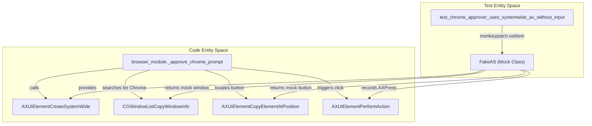
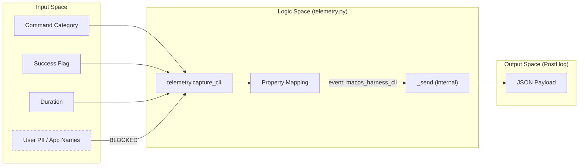

<!-- source: DeepWiki mcp.deepwiki.com · repo browser-use/macos-harness · page 7.2 Browser & Telemetry Tests · fetched 2026-10-30 -->

# Browser & Telemetry Tests

Relevant source files

The following files were used as context for generating this wiki page:

- [tests/test_browser.py](tests/test_browser.py)
- [tests/test_telemetry.py](tests/test_telemetry.py)

This section documents the verification suite for browser integration and telemetry privacy. These tests ensure that the harness can interact with system-level browser prompts without physical input and that the telemetry subsystem adheres to strict privacy invariants regarding user data.

## Browser Integration Tests

The browser testing suite, primarily located in `tests/test_browser.py`, focuses on the harness's ability to handle the "Allow remote debugging?" accessibility dialog that Google Chrome presents when a debugger attempts to attach.

### Chrome AX Approver Verification
The function `_approve_chrome_prompt` is tested using a sophisticated monkeypatching strategy that simulates the macOS `ApplicationServices` framework. This allows the test to verify the logic for finding and clicking the "Allow" button without requiring a physical macOS environment or an actual Chrome instance.

The test `test_chrome_approver_uses_systemwide_ax_without_input` validates:
1.  **System-Wide Access**: The approver correctly uses `AXUIElementCreateSystemWide` to gain a global view of the UI [tests/test_browser.py:20-21]().
2.  **Window Targeting**: It identifies the specific "Allow remote debugging?" window owned by "Google Chrome" [tests/test_browser.py:24-31]().
3.  **Coordinate Calculation**: It calculates the correct click position within the window bounds to target the "Allow" button [tests/test_browser.py:34-37]().
4.  **Action Execution**: It confirms that `AXUIElementPerformAction` is called with `AXPress` on the correct button element [tests/test_browser.py:45-47](), [tests/test_browser.py:54-54]().

### Browser Test Data Flow
The following diagram illustrates how the `FakeAS` (Fake Application Services) class intercepts calls from the `browser` module to simulate the macOS Accessibility API.

**Diagram: Browser AX Approver Mocking**

**Sources:** [tests/test_browser.py:8-54]()

---

## Telemetry Tests

The telemetry tests in `tests/test_telemetry.py` verify the privacy invariants and configuration persistence of the `macos_harness.telemetry` module.

### Config File Permissions
The system ensures that telemetry configuration is stored securely. When `telemetry.status()` is called, it initializes the configuration directory and file with restricted POSIX permissions:
*   **Directory**: `0o700` (Read/Write/Execute for owner only) [tests/test_telemetry.py:19-19]().
*   **JSON Config**: `0o600` (Read/Write for owner only) [tests/test_telemetry.py:18-18]().

### Opt-Out & Environment Overrides
Telemetry can be disabled through multiple channels, which are tested in `test_environment_and_config_can_disable_telemetry`:
1.  **Environment Variable**: Setting `MACOS_HARNESS_TELEMETRY="0"` immediately disables the subsystem [tests/test_telemetry.py:24-25]().
2.  **Programmatic Control**: `telemetry.set_enabled(False)` persists the opt-out state [tests/test_telemetry.py:28-29]().

### Privacy Invariants (Data Scrubbing)
A critical test, `test_capture_has_no_channel_for_user_data`, ensures that no PII (Personally Identifiable Information) or context-sensitive data is ever serialized into the telemetry payload. The test verifies that even if "unknown-user-values" are passed to the capture function, they are not sent to the backend [tests/test_telemetry.py:40-42]().

The test asserts that the following forbidden strings (or data related to them) never appear in the serialized JSON payload:
*   `app`, `window`, `title` (Application context)
*   `path`, `script` (System/User file paths or logic)
*   `screenshot`, `text`, `prompt` (User content)

**Diagram: Telemetry Data Scrubbing Logic**

**Sources:** [tests/test_telemetry.py:35-58]()

### Telemetry Implementation Summary
| Feature | Implementation | Verification |
| :--- | :--- | :--- |
| **Privacy** | Hardcoded key allowlist | `test_capture_has_no_channel_for_user_data` [tests/test_telemetry.py:35]() |
| **Storage** | `telemetry.json` in `MACOS_HARNESS_HOME` | `test_status_creates_private_anonymous_config` [tests/test_telemetry.py:9]() |
| **Security** | `chmod 600` on config files | `test_status_creates_private_anonymous_config` [tests/test_telemetry.py:18-19]() |
| **Opt-out** | `MACOS_HARNESS_TELEMETRY=0` | `test_environment_and_config_can_disable_telemetry` [tests/test_telemetry.py:22]() |

**Sources:** [tests/test_telemetry.py:1-58](), [tests/test_browser.py:1-54]()

---

