<!-- source: DeepWiki mcp.deepwiki.com · repo browser-use/macos-harness · page 8 CI/CD & Distribution · fetched 2026-10-30 -->

# CI/CD & Distribution

Relevant source files

The following files were used as context for generating this wiki page:

- [.github/workflows/ci.yml](.github/workflows/ci.yml)
- [.github/workflows/publish.yml](.github/workflows/publish.yml)
- [pyproject.toml](pyproject.toml)

This page provides a high-level overview of the automated pipelines and packaging configurations that ensure the stability and availability of the `macos-harness` library. The project utilizes GitHub Actions for both Continuous Integration (CI) and automated publishing to PyPI, leveraging the `uv` package manager for reproducible environments.

### Workflow Orchestration

The codebase relies on two primary GitHub Actions workflows located in the `.github/workflows/` directory. These pipelines manage the lifecycle of the code from pull request validation to official release distribution.

#### System Integration Diagram
The following diagram illustrates how the CI/CD environment interacts with the codebase and external package registries.

**CI/CD Pipeline Architecture**

```mermaid
graph TD
    subgraph "GitHub Actions Environment"
        CI_WF["ci.yml"]
        PUB_WF["publish.yml"]
    end

    subgraph "Execution Layer"
        MACOS_RUNNER["macos-latest Runner"]
        LINUX_RUNNER["ubuntu-latest Runner"]
    end

    subgraph "Tools & Build"
        UV["astral-sh/setup-uv"]
        RUFF["ruff check"]
        PYTEST["pytest"]
        HATCH["hatchling build-backend"]
    end

    CI_WF -->|"runs-on"| MACOS_RUNNER
    PUB_WF -->|"runs-on"| LINUX_RUNNER

    MACOS_RUNNER --> UV
    UV -->|"uv sync --locked"| RUFF
    UV -->|"uv run pytest"| PYTEST

    LINUX_RUNNER --> UV
    UV -->|"uv build"| HATCH
    HATCH -->|"OIDC Auth"| PYPI["PyPI Registry"]
```

**Sources:** [.github/workflows/ci.yml:1-20](), [.github/workflows/publish.yml:1-22](), [pyproject.toml:1-3]()

---

### Continuous Integration (CI)
The CI suite is designed to validate code quality and functional correctness across supported Python versions on macOS hardware. Because the harness interacts directly with macOS APIs (e.g., `pyobjc-framework-ApplicationServices`), the test suite requires a macOS environment to execute properly.

*   **Triggers:** Executes on every `push` and `pull_request` to the repository.
*   **Environment:** Uses `macos-latest` runners to accommodate native framework dependencies.
*   **Validation:** Includes linting via `ruff` and unit testing via `pytest`.
*   **Matrix:** Tests are executed against Python 3.11 and 3.12.

For details on the testing matrix and environment locking, see [Continuous Integration](#8.1).

**Sources:** [.github/workflows/ci.yml:3-20](), [pyproject.toml:20-22]()

---

### Publishing & Package Distribution
The distribution pipeline automates the creation of Python wheels and their upload to PyPI. The build process uses `hatchling` as the build backend and `uv` for artifact generation.

*   **Packaging Strategy:** The build is configured to include not only the source code in `src/macos_harness` but also the `SKILL.md` file required for LLM agent integration.
*   **Security:** Utilizes OIDC (OpenID Connect) Trusted Publishing, removing the need for long-lived PyPI tokens.
*   **Triggers:** Can be manually triggered via `workflow_dispatch` or automatically when a new GitHub `release` is published.

For details on the build configuration and PyPI authentication, see [Publishing & Package Distribution](#8.2).

**Sources:** [.github/workflows/publish.yml:3-22](), [pyproject.toml:1-3](), [pyproject.toml:47-51]()

---

### Build Configuration Summary
The project metadata and build requirements are defined in `pyproject.toml`. This file governs how the package is identified and what dependencies are required for installation.

| Entity | Configuration / Value |
| :--- | :--- |
| **Package Name** | `macos-harness` |
| **Build Backend** | `hatchling.build` |
| **Entry Point** | `macos-harness = macos_harness.cli:main` |
| **Python Support** | `>=3.11` |
| **Core Dependencies** | `browser-harness`, `pillow`, `pyobjc-framework-ApplicationServices` |
| **Included Assets** | `src/macos_harness`, `skills/macos-harness/SKILL.md` |

**Sources:** [pyproject.toml:5-10](), [pyproject.toml:26-30](), [pyproject.toml:39-40](), [pyproject.toml:50-51]()

---

