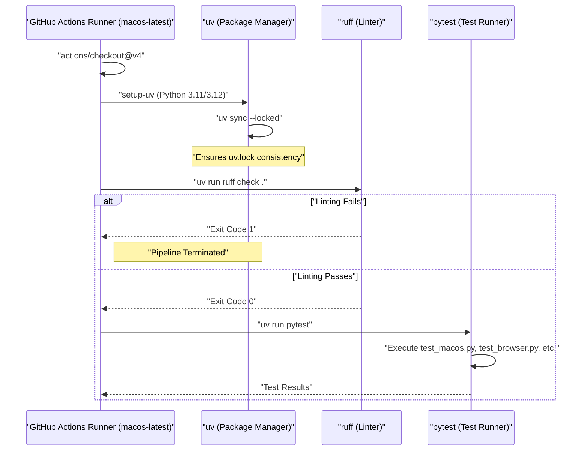
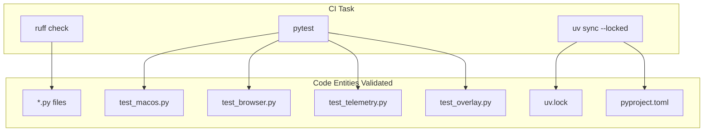

<!-- source: DeepWiki mcp.deepwiki.com · repo browser-use/macos-harness · page 8.1 Continuous Integration · fetched 2026-10-30 -->

# Continuous Integration

Relevant source files

The following files were used as context for generating this wiki page:

- [.github/workflows/ci.yml](.github/workflows/ci.yml)

The Continuous Integration (CI) pipeline for the `macos-harness` project is designed to ensure code quality, type safety, and functional correctness across supported Python versions on native macOS environments. Given the harness's deep integration with macOS-specific APIs (ApplicationServices, AppKit, CoreGraphics), the CI environment exclusively utilizes macOS runners to validate system-level interactions and permission-checking logic.

### Workflow Triggers and Environment

The CI workflow is defined in [.github/workflows/ci.yml:1-20](). It is configured to execute automatically under two primary conditions:
1.  **Push**: Any commit pushed to any branch triggers a build [.github/workflows/ci.yml:4-4]().
2.  **Pull Request**: Any pull request targeting the repository triggers the suite [.github/workflows/ci.yml:5-5]().

The pipeline utilizes the `macos-latest` runner image [.github/workflows/ci.yml:9-9](). This is a strict requirement because the codebase relies on Python modules that interface with macOS frameworks which are unavailable on Linux or Windows runners.

### Matrix Strategy

To ensure compatibility across the supported lifecycle of the project, the CI uses a build matrix targeting two specific Python versions [.github/workflows/ci.yml:10-12]():
*   **Python 3.11**
*   **Python 3.12**

This matrix ensures that syntax features and library dependencies (managed via `uv`) remain compatible across both versions.

### Execution Pipeline

The CI process follows a linear execution flow managed by `astral-sh/setup-uv`. This ensures high-performance dependency resolution and reproducible environments through lockfile enforcement.

#### CI Data Flow and Execution Logic

The following diagram illustrates the sequence of operations within the `test` job defined in [.github/workflows/ci.yml:8-20]().

**Diagram: CI Workflow Execution Sequence**

**Sources:** [.github/workflows/ci.yml:13-20]()

### Dependency Management and Reproducibility

The pipeline emphasizes environment reproducibility by using `uv sync --locked` [.github/workflows/ci.yml:18-18](). This command forces the environment to match the exact versions specified in the `uv.lock` file, preventing "it works on my machine" issues caused by transitive dependency updates.

### Quality Control Steps

The CI pipeline enforces two distinct stages of validation:

1.  **Static Analysis (Linting)**: The `ruff` linter is executed via `uv run ruff check .` [.github/workflows/ci.yml:19-19](). This checks for code style violations, logical errors, and maintains the codebase's structural integrity.
2.  **Automated Testing**: The full test suite is executed using `pytest` [.github/workflows/ci.yml:20-20](). This includes:
    *   Unit tests for the `mac` and `browser` objects.
    *   Mocked tests for macOS Accessibility (AX) services.
    *   Validation of the visual overlay JSON protocol.
    *   Telemetry configuration and privacy invariant checks.

**Diagram: Code Entity to CI Task Mapping**

**Sources:** [.github/workflows/ci.yml:18-20]()

### Failure Handling

If any step in the pipeline (sync, lint, or test) returns a non-zero exit code, the job is marked as failed in the GitHub UI. This blocks pull requests from being merged if the "Require status checks to pass before merging" branch protection rule is enabled.

**Sources:**
*   [.github/workflows/ci.yml:1-20]()

---

