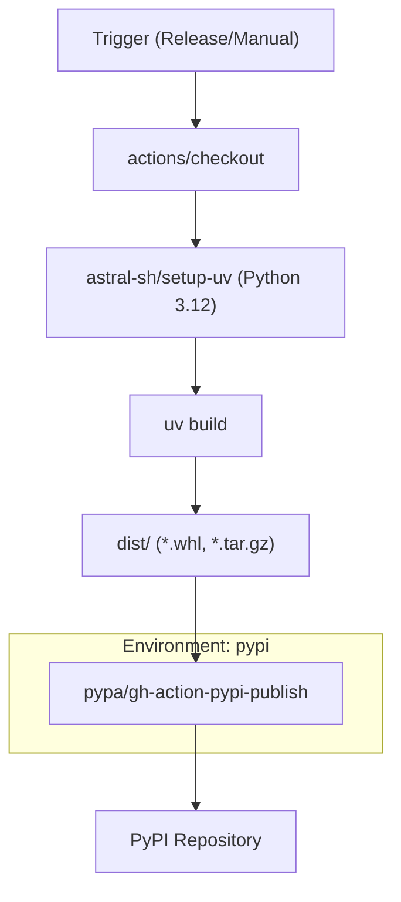
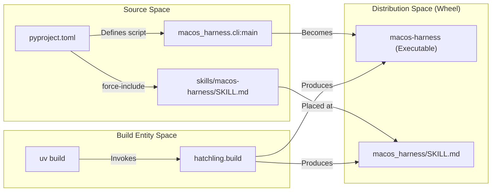

<!-- source: DeepWiki mcp.deepwiki.com · repo browser-use/macos-harness · page 8.2 Publishing & Package Distribution · fetched 2026-10-30 -->

# Publishing & Package Distribution

Relevant source files

The following files were used as context for generating this wiki page:

- [.github/workflows/publish.yml](.github/workflows/publish.yml)
- [pyproject.toml](pyproject.toml)

This page documents the automated release pipeline and packaging configuration for `macos-harness`. The project utilizes modern Python packaging standards with `uv` and `hatchling`, leveraging GitHub Actions and OIDC Trusted Publishing for secure delivery to PyPI.

## Build Configuration

The `macos-harness` build process is managed by `hatchling`, which is specified as the build backend in the project configuration [pyproject.toml:1-3]().

### Metadata and Dependencies
The package metadata defines the project as a specialized macOS automation tool [pyproject.toml:5-25](). Key runtime dependencies include:
*   `browser-harness`: For Chrome DevTools Protocol integration [pyproject.toml:27-27]().
*   `pillow`: For screenshot processing and image handling [pyproject.toml:28-28]().
*   `pyobjc-framework-ApplicationServices`: Required for native macOS API access, restricted to the `darwin` platform [pyproject.toml:29-29]().

### Artifact Generation
The build system generates a wheel by including the source code located in `src/macos_harness` [pyproject.toml:47-48](). A critical component of the distribution is the inclusion of `SKILL.md`, which contains the system prompt for LLM agents. This file is explicitly mapped into the package structure using the `force-include` directive [pyproject.toml:50-51]().

**Table: Build Artifact Mapping**

| Source Path | Target Path in Wheel | Purpose |
| :--- | :--- | :--- |
| `src/macos_harness` | `macos_harness/` | Core Python logic and CLI. |
| `skills/macos-harness/SKILL.md` | `macos_harness/SKILL.md` | Agent instructions and API surface documentation. |

### Entry Points
The package exposes a CLI command `macos-harness` which maps to the `main` function in the CLI module [pyproject.toml:39-40]().

Sources: [pyproject.toml:1-54]()

## Publish Workflow

The publishing process is automated via a GitHub Actions workflow defined in `.github/workflows/publish.yml`. It handles the transition from source code to a live PyPI release.

### Workflow Triggers
The workflow is designed to be triggered in two ways [.github/workflows/publish.yml:3-7]():
1.  **`release: published`**: Automatically runs when a new GitHub Release is created.
2.  **`workflow_dispatch`**: Allows maintainers to manually trigger a build and publish event from the GitHub Actions UI.

### Security and OIDC
The workflow uses **Trusted Publishing** (OIDC) to authenticate with PyPI. This eliminates the need for long-lived API tokens stored in GitHub Secrets.
*   The workflow requests `id-token: write` permissions to obtain the OIDC token [.github/workflows/publish.yml:8-10]().
*   The job is constrained to the `pypi` environment to ensure only authorized runs can publish [.github/workflows/publish.yml:15-15]().

### Execution Steps
The pipeline runs on `ubuntu-latest` and follows a linear execution path [.github/workflows/publish.yml:12-22]():

**Diagram: Publishing Data Flow**
"Publish Pipeline Execution"

Sources: [.github/workflows/publish.yml:1-22]()

## Distribution Architecture

The relationship between the build tools, the source files, and the final distribution artifact is illustrated below.

**Diagram: Code to Package Mapping**
"Natural Language to Code Entity Space: Packaging"

Sources: [pyproject.toml:1-51](), [.github/workflows/publish.yml:21-21]()

---

