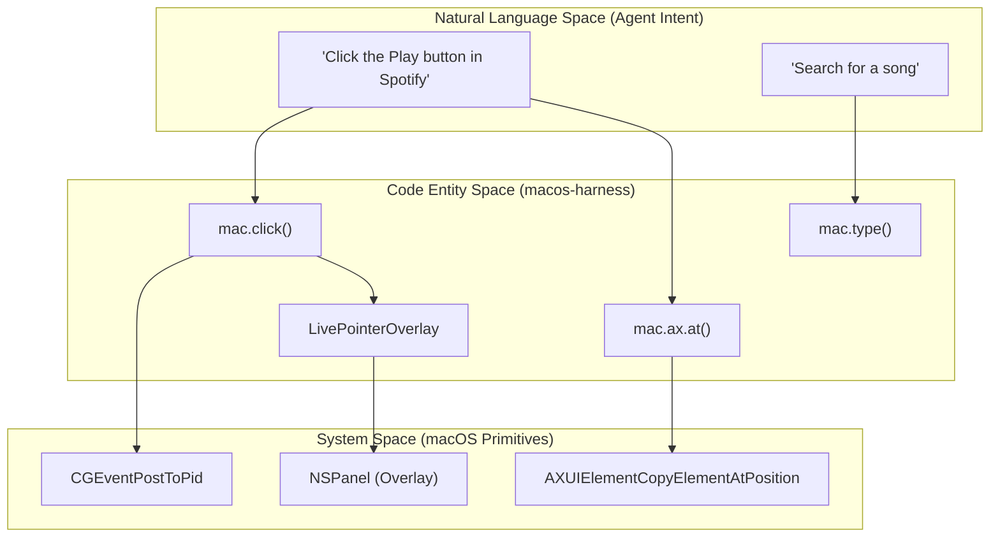
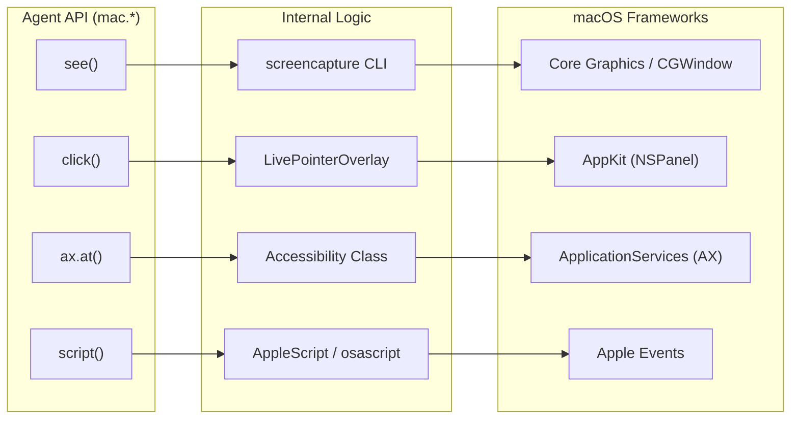

<!-- source: DeepWiki mcp.deepwiki.com · repo browser-use/macos-harness · page 9 Glossary · fetched 2026-10-30 -->

# Glossary

Relevant source files

The following files were used as context for generating this wiki page:

- [README.md](README.md)
- [skills/macos-harness/SKILL.md](skills/macos-harness/SKILL.md)
- [src/macos_harness/controls.py](src/macos_harness/controls.py)
- [src/macos_harness/macos.py](src/macos_harness/macos.py)
- [src/macos_harness/overlay.py](src/macos_harness/overlay.py)
- [src/macos_harness/telemetry.py](src/macos_harness/telemetry.py)
- [uv.lock](uv.lock)

This glossary defines the technical terms, macOS frameworks, and domain-specific concepts used within the `macos-harness` codebase. It serves as a reference for onboarding engineers to map natural language requirements to specific code entities and system behaviors.

## Core Concepts & Terms

| Term | Definition | Code Reference |
|:---|:---|:---|
| **AX (Accessibility)** | The macOS Accessibility framework (`ApplicationServices`) used to query the semantic UI tree and perform actions. | [src/macos_harness/controls.py:14-15]() |
| **AX Search Key** | Specific predicates (e.g., `AXButtonSearchKey`) used by the `ax_search` API to filter elements by role. | [src/macos_harness/macos.py:142-159]() |
| **CDP** | Chrome DevTools Protocol, used via `browser-harness` to control the real Chrome browser. | [README.md:68-70]() |
| **Click-through** | A property of the virtual pointer overlay that allows it to be visible without intercepting mouse events. | [src/macos_harness/overlay.py:1-1]() |
| **Doctor** | A diagnostic command that checks for required macOS permissions (Accessibility, Screen Recording, etc.). | [README.md:85-86]() |
| **FocusChangedError** | An error raised when a background-targeted input causes the target application to become the frontmost app. | [src/macos_harness/macos.py:44-46]() |
| **PID-targeted Input** | Sending keyboard or mouse events directly to a specific Process ID without requiring window focus. | [README.md:77-77]() |
| **Retina Scaling** | The process of doubling pixel coordinates for screenshots and inputs to match High-DPI macOS displays. | [README.md:80-81]() |
| **Six Verbs** | The primary API surface for agents: `see`, `key`, `type`, `click`, `ax`, and `script`. | [skills/macos-harness/SKILL.md:39-39]() |

---

## System Architecture & Data Flow

The following diagram illustrates how the `macos-harness` persistent Python process bridges natural language agent intent to native macOS system calls and code entities.

### Intent to Code Mapping

**Sources:** [README.md:59-74](), [src/macos_harness/macos.py:271-274](), [src/macos_harness/overlay.py:21-22]()

---

## Detailed Glossary Entries

### Accessibility (AX)
The `Accessibility` class provides a thin wrapper around `ApplicationServices` (AS). It allows the harness to "see" the semantic structure of an app (roles, titles, values) when raw vision (`mac.see`) is insufficient.
*   **Key Function:** `at(x, y)` performs a hit-test to find the AX element at specific coordinates [src/macos_harness/controls.py:28-37]().
*   **Key Function:** `query()` uses `ax_search` to find elements by criteria like `text` or `search_key` [src/macos_harness/controls.py:59-73]().

### CGEvent (Core Graphics Events)
Low-level input events used to simulate user interaction. Unlike standard mouse events, the harness uses `CGEventPostToPid` (implied by the PID-targeted input requirement) to ensure events are delivered to background apps without moving the physical cursor [README.md:77-78]().

### LivePointerOverlay
A separate Objective-C/AppKit helper process that renders a virtual cursor. It uses an `NSPanel` with `setIgnoresMouseEvents_(True)` to remain non-interactive [src/macos_harness/overlay.py:193-193]().
*   **Implementation:** Commands are sent via JSON over `stdin` to the helper process [src/macos_harness/overlay.py:96-97]().
*   **Pointer View:** The `PointerView` class handles the actual drawing of the arrow using `NSBezierPath` [src/macos_harness/overlay.py:127-139]().

### Telemetry
A privacy-safe collection system. It captures command categories (e.g., `doctor`, `see`) and duration but explicitly excludes sensitive data like app names or screenshots.
*   **Invariants:** It never records prompts, window titles, or UI text [README.md:88-91]().
*   **Opt-out:** Users can disable it via `MACOS_HARNESS_TELEMETRY=0` or the CLI [src/macos_harness/telemetry.py:55-64]().

---

## Mapping: API Surface to Implementation

This diagram maps the high-level `mac` object verbs to their internal implementation classes and the corresponding macOS framework.

### API to Framework Bridge

**Sources:** [README.md:60-74](), [src/macos_harness/macos.py:1-6](), [src/macos_harness/controls.py:14-15](), [src/macos_harness/overlay.py:21-22]()

---

## Abbreviation Reference

| Abbreviation | Full Name | Description |
|:---|:---|:---|
| **AE** | Apple Events | Inter-process communication protocol for controlling macOS apps via scripts. |
| **AS** | ApplicationServices | The umbrella framework for Accessibility and Core Graphics. |
| **PID** | Process Identifier | The unique ID for a running application instance, used for targeted input. |
| **RGBA** | Red Green Blue Alpha | The color space used for the virtual pointer drawing. |
| **uv** | uv | The Python package manager used to install and run the harness. |

**Sources:** [src/macos_harness/macos.py:25-33](), [src/macos_harness/overlay.py:155-157](), [README.md:28-28](), [src/macos_harness/telemetry.py:172-173]()