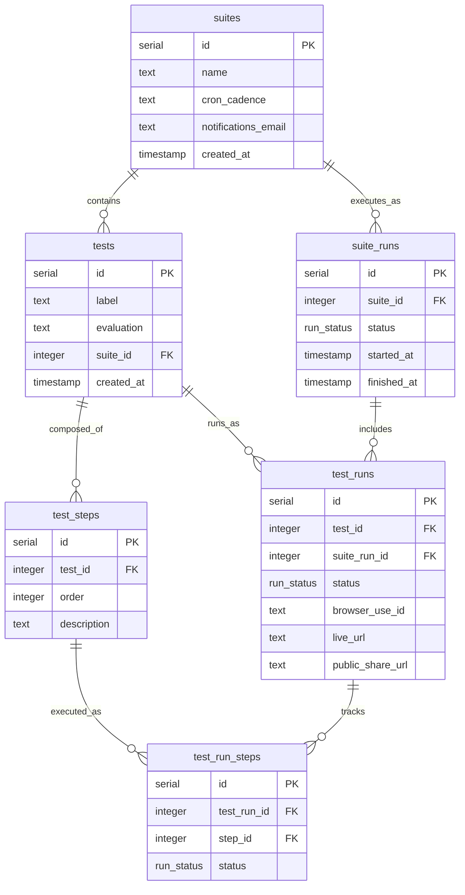
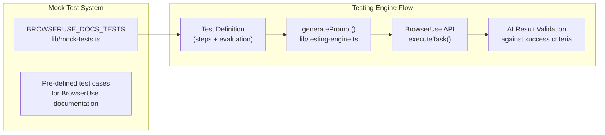
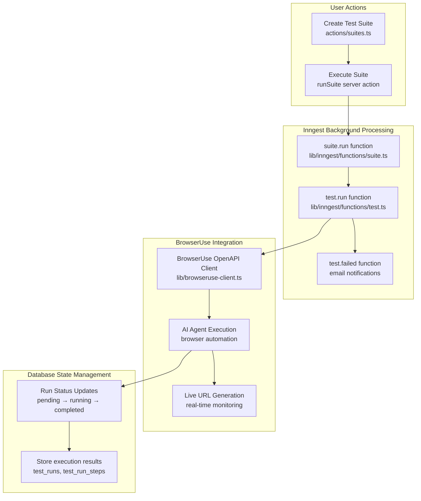

<!-- source: DeepWiki mcp.deepwiki.com · repo browser-use/qa-use · page 1 Overview · fetched 2026-10-30 -->

# Overview

<details>
<summary>Relevant source files</summary>

The following files were used as context for generating this wiki page:

- [README.md](README.md)

</details>


## Purpose and Scope

This document provides a comprehensive technical overview of the QA Use platform, an AI-powered end-to-end testing system that enables automated web application testing through natural language test definitions. The platform leverages BrowserUse AI agents to execute tests defined in plain English, providing intelligent browser automation with human-like testing capabilities.

This overview covers the high-level architecture, core components, and system interactions. For detailed implementation guidance, see [Getting Started](#2). For specific UI components and user workflows, see [User Interface](#4). For background processing details, see [Background Processing](#6).

## System Architecture Overview

QA Use is built as a modern web application with a clear separation between frontend presentation, backend services, and external AI-powered execution engines. The system orchestrates test execution through event-driven background processing while maintaining real-time visibility into test progress.

### High-Level Component Architecture

```mermaid
graph TB
    subgraph "Frontend_Layer" ["Frontend Layer"]
        NextApp["Next.js Application<br/>(app directory structure)"]
        Pages["Route Handlers<br/>page.tsx components"]
        Components["React Components<br/>TestDetails, SuiteRunDetails"]
    end
    
    subgraph "Backend_Services" ["Backend Services"] 
        ServerActions["Server Actions<br/>actions/suites, actions/tests"]
        ApiRoutes["API Routes<br/>api/inngest/route.ts"]
        InngestService["Inngest Background Jobs<br/>lib/inngest/client.ts"]
    end
    
    subgraph "Data_Layer" ["Data Layer"]
        DrizzleORM["Drizzle ORM<br/>lib/db/schema.ts"]
        PostgresDB[("PostgreSQL Database<br/>suites, tests, runs tables")]
    end
    
    subgraph "AI_Engine" ["AI Testing Engine"]
        TestingEngine["Testing Engine<br/>lib/testing-engine.ts"]
        MockTests["Mock Test Definitions<br/>lib/mock-tests.ts"]
    end
    
    subgraph "External_Services" ["External Services"]
        BrowserUseAPI["BrowserUse Cloud API<br/>api.browser-use.com"]
        ResendEmail["Resend Email Service<br/>email notifications"]
    end
    
    NextApp --> ServerActions
    NextApp --> Components
    ServerActions --> DrizzleORM
    ServerActions --> InngestService
    InngestService --> TestingEngine
    InngestService --> BrowserUseAPI
    TestingEngine --> MockTests
    TestingEngine --> BrowserUseAPI
    DrizzleORM --> PostgresDB
    InngestService --> ResendEmail
    ApiRoutes --> InngestService
```

**Sources:** [README.md:1-132](), [app/page.tsx:1-50](), [lib/db/schema.ts:1-200](), [lib/inngest/client.ts:1-50]()

### Technology Stack and Core Dependencies

The platform is built on a modern TypeScript stack with the following key technologies:

| Component | Technology | Purpose |
|-----------|------------|---------|
| **Frontend Framework** | Next.js 15 with App Router | Server-side rendering and routing |
| **UI Components** | React with Tailwind CSS | Component-based interface |
| **Database** | PostgreSQL with Drizzle ORM | Type-safe data persistence |
| **Background Processing** | Inngest | Event-driven job orchestration |
| **AI Testing** | BrowserUse Cloud API | AI-powered browser automation |
| **Email Notifications** | Resend API | Test failure alerts |
| **Containerization** | Docker Compose | Development and deployment |

**Sources:** [package.json:1-100](), [docker-compose.yaml:1-50](), [next.config.ts:1-20]()

## Core Components

### Database Schema and Data Model

The system uses a hierarchical data model that supports organizing tests into suites with detailed execution tracking:



**Sources:** [lib/db/schema.ts:10-150](), [lib/db/types.ts:1-50]()

### Testing Engine and AI Integration

The `TestingEngine` class serves as the core orchestrator for AI-powered test execution, handling prompt generation and result parsing:



**Sources:** [lib/testing-engine.ts:1-100](), [lib/mock-tests.ts:1-200]()

## Data Flow and Execution Pipeline

### Test Execution Orchestration

The platform uses an event-driven architecture where test execution is orchestrated through Inngest background jobs, ensuring reliable processing of long-running AI operations:



**Sources:** [actions/suites.ts:1-100](), [lib/inngest/functions/suite.ts:1-150](), [lib/inngest/functions/test.ts:1-200](), [lib/browseruse-client.ts:1-100]()

### Real-time Monitoring and Updates

The system provides real-time visibility into test execution through a combination of live URLs from BrowserUse and database polling for status updates. The frontend components refresh execution state to show progress as tests run.

**Sources:** [app/suites/[id]/runs/[runId]/page.tsx:1-100](), [components/test-details.tsx:1-200]()

## Key Integration Points

### External Service Dependencies

The platform integrates with several external services to provide its full functionality:

| Service | Integration Point | Purpose |
|---------|------------------|---------|
| **BrowserUse Cloud API** | `lib/browseruse-client.ts` | AI-powered browser automation |
| **Resend Email API** | Email notification functions | Test failure alerts |
| **Inngest** | Background job processing | Reliable test orchestration |

### Environment Configuration

Critical configuration is managed through environment variables defined in the `.env` file:

- `BROWSER_USE_API_KEY`: Required for AI agent execution
- `DATABASE_URL`: PostgreSQL connection string  
- `RESEND_API_KEY`: Optional email notification service
- `INNGEST_SIGNING_KEY`: Background job service authentication

**Sources:** [.env.example:1-20](), [lib/env.ts:1-50]()

The QA Use platform demonstrates a production-ready architecture for AI-powered testing, combining modern web development practices with intelligent automation capabilities through the BrowserUse ecosystem.

---

