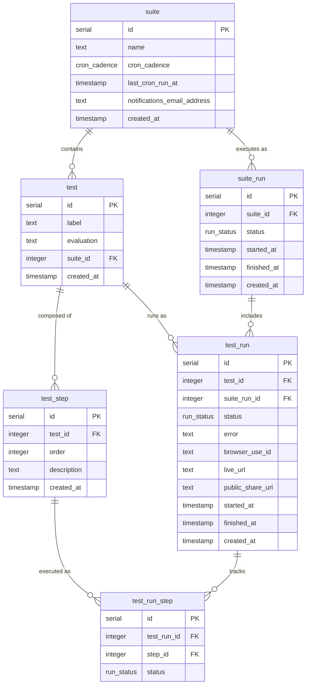
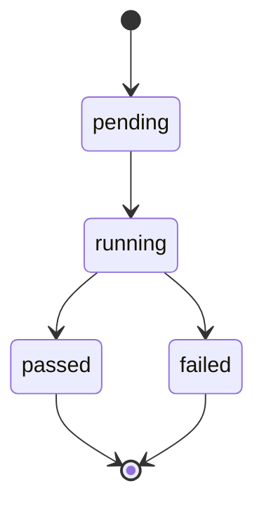
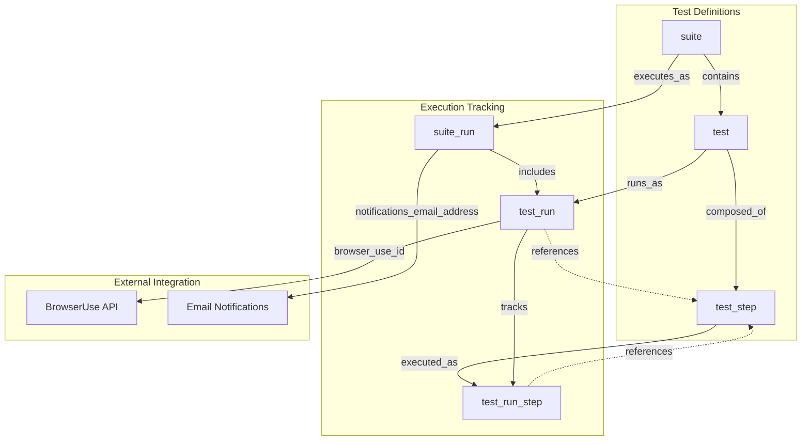

<!-- source: DeepWiki mcp.deepwiki.com · repo browser-use/qa-use · page 3 Core Concepts · fetched 2026-10-30 -->

# Core Concepts

Relevant source files

The following files were used as context for generating this wiki page:

- [drizzle/meta/0000_snapshot.json](drizzle/meta/0000_snapshot.json)
- [drizzle/meta/_journal.json](drizzle/meta/_journal.json)
- [src/lib/db/schema.ts](src/lib/db/schema.ts)

This document explains the fundamental data model and core entities that power the QA Use platform. It covers the database schema, entity relationships, and key concepts for organizing and executing AI-powered tests.

For information about the user interface components that interact with these entities, see [User Interface](#4). For details about how tests are executed using these data structures, see [AI Testing Engine](#5) and [Background Processing](#6).

## Data Model Overview

The QA Use platform is built around a hierarchical data model that organizes tests into suites and tracks their execution through dedicated run entities.

Sources: [src/lib/db/schema.ts:6-217]()

## Core Entities

### Test Suites

The `suite` table represents collections of related tests that can be executed together. Each suite functions as a container for organizing tests by feature, application area, or testing objective.

| Field | Type | Purpose |
|-------|------|---------|
| `id` | `serial` | Primary key identifier |
| `name` | `text` | Human-readable suite name |
| `cronCadence` | `cron_cadence` | Automated execution schedule (hourly/daily) |
| `lastCronRunAt` | `timestamp` | Tracks when automated execution last occurred |
| `notificationsEmailAddress` | `text` | Email recipient for test failure notifications |
| `createdAt` | `timestamp` | Suite creation timestamp |

The `cronCadence` field uses the `cron_cadence` enum with values `'hourly'` and `'daily'` to enable automated test execution scheduling.

Sources: [src/lib/db/schema.ts:6-31]()

### Tests

The `test` table defines individual test cases within a suite. Each test contains natural language instructions that will be converted into executable browser automation commands.

| Field | Type | Purpose |
|-------|------|---------|
| `id` | `serial` | Primary key identifier |
| `label` | `text` | Test name/description |
| `evaluation` | `text` | Success criteria in natural language |
| `suiteId` | `integer` | Foreign key to parent suite |
| `createdAt` | `timestamp` | Test creation timestamp |

The `evaluation` field contains the natural language criteria that the AI testing engine uses to determine whether a test passes or fails.

Sources: [src/lib/db/schema.ts:36-59]()

### Test Steps

The `testStep` table breaks down each test into ordered, executable actions. These steps represent the sequence of browser interactions that the AI agent will perform.

| Field | Type | Purpose |
|-------|------|---------|
| `id` | `serial` | Primary key identifier |
| `testId` | `integer` | Foreign key to parent test |
| `order` | `integer` | Execution sequence number |
| `description` | `text` | Natural language step instructions |
| `createdAt` | `timestamp` | Step creation timestamp |

The `order` field ensures steps execute in the correct sequence, while `description` contains human-readable instructions that get converted to browser automation commands.

Sources: [src/lib/db/schema.ts:61-85]()

## Execution Tracking

The platform maintains separate entities to track test execution independently from test definitions, enabling historical analysis and concurrent execution monitoring.

### Suite Runs

The `suiteRun` table represents individual execution instances of a test suite.

| Field | Type | Purpose |
|-------|------|---------|
| `id` | `serial` | Primary key identifier |
| `suiteId` | `integer` | Foreign key to executed suite |
| `status` | `run_status` | Current execution state |
| `startedAt` | `timestamp` | Execution start time |
| `finishedAt` | `timestamp` | Execution completion time |
| `createdAt` | `timestamp` | Run record creation timestamp |

Sources: [src/lib/db/schema.ts:99-126]()

### Test Runs

The `testRun` table tracks execution of individual tests within a suite run, including integration with the BrowserUse API for browser automation.

| Field | Type | Purpose |
|-------|------|---------|
| `id` | `serial` | Primary key identifier |
| `testId` | `integer` | Foreign key to executed test |
| `suiteRunId` | `integer` | Foreign key to parent suite run |
| `status` | `run_status` | Current execution state |
| `error` | `text` | Error message if execution fails |
| `browserUseId` | `text` | BrowserUse API execution identifier |
| `liveUrl` | `text` | Real-time execution monitoring URL |
| `publicShareUrl` | `text` | Shareable execution results URL |

The BrowserUse integration fields (`browserUseId`, `liveUrl`, `publicShareUrl`) connect the platform to external browser automation services.

Sources: [src/lib/db/schema.ts:128-186]()

### Test Run Steps

The `testRunStep` table provides granular execution tracking for individual test steps, enabling detailed progress monitoring and failure diagnosis.

| Field | Type | Purpose |
|-------|------|---------|
| `id` | `serial` | Primary key identifier |
| `testRunId` | `integer` | Foreign key to parent test run |
| `stepId` | `integer` | Foreign key to executed step definition |
| `status` | `run_status` | Individual step execution state |

A unique constraint on `(testRunId, stepId)` ensures each step is tracked exactly once per test run.

Sources: [src/lib/db/schema.ts:188-217]()

## Status Management

The platform uses a unified `run_status` enum to track execution progress across all run entities:

| Status | Description |
|--------|-------------|
| `pending` | Execution queued but not started |
| `running` | Currently executing |
| `passed` | Execution completed successfully |
| `failed` | Execution completed with errors |

This status model applies consistently to `suiteRun`, `testRun`, and `testRunStep` entities, providing uniform progress tracking across all execution levels.

Sources: [src/lib/db/schema.ts:89-97]()

## Entity Relationships and Data Flow

The following diagram illustrates how entities connect during the test execution lifecycle:

This separation between definition and execution entities enables:

- **Historical tracking**: Multiple runs of the same test/suite without losing previous results
- **Concurrent execution**: Multiple suite runs can execute simultaneously
- **Detailed monitoring**: Step-level progress tracking within each test run
- **External integration**: Clean interfaces to BrowserUse API and notification systems

Sources: [src/lib/db/schema.ts:28-31](), [src/lib/db/schema.ts:52-59](), [src/lib/db/schema.ts:80-85](), [src/lib/db/schema.ts:120-126](), [src/lib/db/schema.ts:174-186](), [src/lib/db/schema.ts:208-217]()

---

