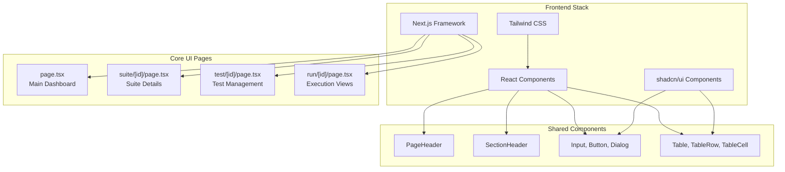
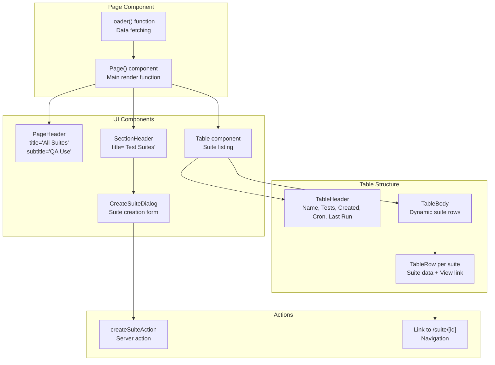

<!-- source: DeepWiki mcp.deepwiki.com · repo browser-use/qa-use · page 4 User Interface · fetched 2026-10-30 -->

# User Interface

<details>
<summary>Relevant source files</summary>

The following files were used as context for generating this wiki page:

- [src/app/layout.tsx](src/app/layout.tsx)
- [src/app/page.tsx](src/app/page.tsx)

</details>


## Purpose and Scope

This document covers the web application frontend of the QA Use platform, including the React components, page structure, navigation patterns, and user interaction flows. The UI is built using Next.js with React components and provides interfaces for managing test suites, creating tests, and monitoring execution.

For information about the underlying data structures and business logic, see [Core Concepts](#3). For details about form handling and data mutations, see [Server Actions](#8). For information about reusable UI components across the application, see [Shared Components](#4.4).

## UI Architecture Overview

The QA Use platform uses a Next.js application structure with React components organized around the core entities of suites, tests, and test runs.

### Frontend Technology Stack



**Sources:** [src/app/layout.tsx:1-36](), [src/app/page.tsx:1-120]()

## Application Layout Structure

The application uses a centralized layout pattern with consistent styling and responsive design.

### Root Layout Configuration

```mermaid
graph TD
    subgraph "RootLayout Component"
        HTML["html element<br/>lang='en'"]
        BODY["body element<br/>Geist fonts + bg-gray-50"]
        CONTAINER["div.min-h-screen"]
        CONTENT["div.max-w-6xl.mx-auto.px-3.py-12.md:py-16"]
    end
    
    subgraph "Font Configuration"
        GEIST_SANS["Geist Sans Font<br/>--font-geist-sans"]
        GEIST_MONO["Geist Mono Font<br/>--font-geist-mono"]
    end
    
    subgraph "Global Styles"
        GLOBALS["globals.css<br/>Tailwind CSS imports"]
        ANTIALIASED["antialiased class<br/>Font smoothing"]
    end
    
    HTML --> BODY
    BODY --> CONTAINER
    CONTAINER --> CONTENT
    CONTENT --> "children pages"
    
    GEIST_SANS --> BODY
    GEIST_MONO --> BODY
    GLOBALS --> BODY
    ANTIALIASED --> BODY
```

**Sources:** [src/app/layout.tsx:22-36](), [src/app/layout.tsx:7-15]()

The layout establishes a consistent container with maximum width of `6xl` (1152px) and responsive padding that creates the main content area for all pages.

## Main Dashboard Interface

The primary interface is implemented in the root page component, displaying all test suites in a tabular format with creation and navigation capabilities.

### Dashboard Component Structure



**Sources:** [src/app/page.tsx:25-76](), [src/app/page.tsx:78-108]()

### Suite Table Data Display

The main table displays suite information with the following columns:

| Column | Data Source | Formatting |
|--------|-------------|------------|
| Name | `suite.name` | Plain text display |
| Tests | `suite.tests.length` | Count with "tests" suffix |
| Created | `suite.createdAt` | Formatted via `formatDate()` |
| Cron | `suite.cronCadence` | Mapped via `getCronLabel()` |
| Last Run | `suite.lastCronRunAt` | Formatted date or "Never" |
| Actions | Navigation | Link to `/suite/${suite.id}` |

**Sources:** [src/app/page.tsx:41-73](), [src/app/page.tsx:110-119]()

### Suite Creation Dialog

The creation interface uses a modal dialog pattern with form submission:

```mermaid
graph LR
    subgraph "CreateSuiteDialog"
        TRIGGER["Button<br/>'Create Suite'<br/>Plus icon"]
        DIALOG["Dialog component<br/>Modal overlay"]
        FORM["form element<br/>action=createSuiteAction"]
        INPUT["Input field<br/>name='name'<br/>required"]
        SUBMIT["Submit Button<br/>'Create'"]
    end
    
    TRIGGER --> DIALOG
    DIALOG --> FORM
    FORM --> INPUT
    FORM --> SUBMIT
    SUBMIT --> "Server Action"
```

**Sources:** [src/app/page.tsx:78-108]()

## Dynamic Loading and Server-Side Rendering

The dashboard implements dynamic server-side rendering with data loading:

- `export const dynamic = 'force-dynamic'` ensures fresh data on each request [src/app/page.tsx:23]()
- Async `loader()` function fetches suite data before rendering [src/app/page.tsx:26]()
- Server actions handle form submissions without client-side JavaScript requirements

## Navigation Patterns

The UI implements navigation through Next.js `Link` components:

- Main dashboard accessible at root path `/`
- Suite detail pages at `/suite/[id]` [src/app/page.tsx:68]()
- External link to GitHub repository in page header [src/app/page.tsx:33]()

## Responsive Design Considerations

The layout uses Tailwind CSS responsive utilities:

- Container padding: `px-3` base, responsive on larger screens
- Vertical spacing: `py-12 md:py-16` with breakpoint variation
- Maximum width constraint: `max-w-6xl` with center alignment

**Sources:** [src/app/layout.tsx:31]()

---

