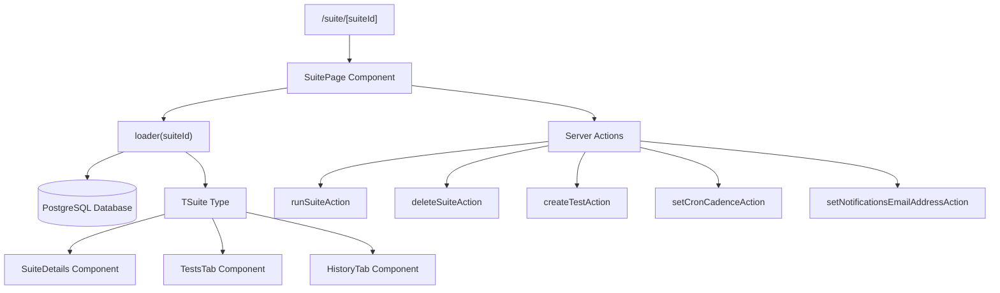
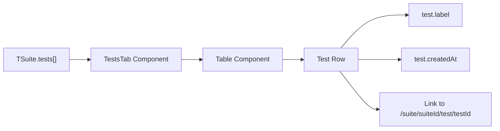
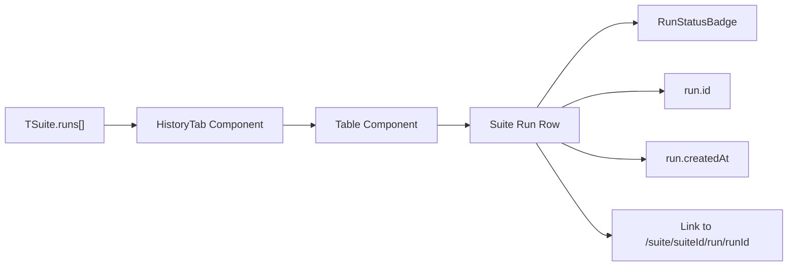
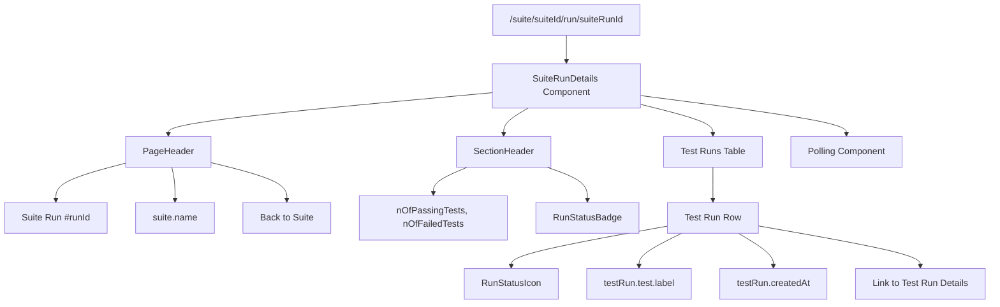
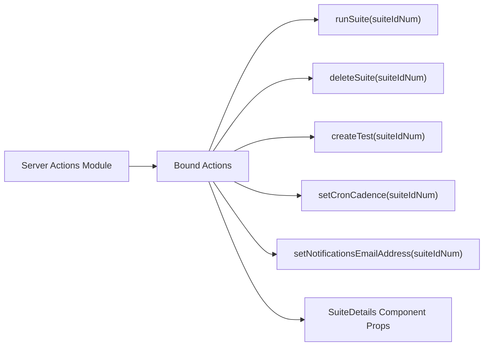

<!-- source: DeepWiki mcp.deepwiki.com · repo browser-use/qa-use · page 4.1 Suite Management · fetched 2026-10-30 -->

# Suite Management

Relevant source files

The following files were used as context for generating this wiki page:

- [src/app/suite/[suiteId]/loader.ts](src/app/suite/[suiteId]/loader.ts)
- [src/app/suite/[suiteId]/page.tsx](src/app/suite/[suiteId]/page.tsx)
- [src/components/shared/SectionHeader.tsx](src/components/shared/SectionHeader.tsx)
- [src/components/suite/HistoryTab.tsx](src/components/suite/HistoryTab.tsx)
- [src/components/suite/TestsTab.tsx](src/components/suite/TestsTab.tsx)
- [src/components/suite/run/SuiteRunDetails.tsx](src/components/suite/run/SuiteRunDetails.tsx)

This document covers the user interface components and pages for creating, viewing, and managing test suites within the QA Use platform. It focuses on the suite-level management interfaces, including the main suite details page, navigation tabs, and suite configuration options.

For information about managing individual tests within a suite, see [Test Management](#4.2). For monitoring test execution and viewing results, see [Test Execution Views](#4.3).

## Suite Details Page

The primary interface for suite management is implemented as a Next.js dynamic route at `/suite/[suiteId]`. This page provides a comprehensive view of a test suite including its configuration, contained tests, and execution history.

### Page Structure and Data Loading

The suite details page follows Next.js App Router conventions with server-side data loading and client-side interactions:

The data loader retrieves comprehensive suite information including related tests with their steps and execution history ordered by creation date.

Sources: [src/app/suite/[suiteId]/page.tsx:1-45](), [src/app/suite/[suiteId]/loader.ts:1-38]()

### Tab-Based Navigation

The suite interface uses a tabbed layout to organize different aspects of suite management:

| Tab | Purpose | Key Components |
|-----|---------|----------------|
| Tests | View and manage tests within the suite | `TestsTab`, test listing table |
| History | View suite execution history | `HistoryTab`, run status tracking |

#### Tests Tab

The Tests tab displays all tests contained within the suite in a tabular format:

Sources: [src/components/suite/TestsTab.tsx:1-41]()

#### History Tab

The History tab shows the execution history for the suite with run status indicators:

Sources: [src/components/suite/HistoryTab.tsx:1-46]()

## Suite Run Details Interface

When viewing individual suite runs, the platform provides detailed execution information through the `SuiteRunDetails` component:

The component automatically calculates test execution statistics and provides real-time updates through the `Polling` component when runs are in progress.

Sources: [src/components/suite/run/SuiteRunDetails.tsx:1-77]()

## Suite Actions and Server Integration

The suite management interface integrates with Next.js server actions to handle suite-level operations:

### Available Actions

| Action | Function | Purpose |
|--------|----------|---------|
| Run Suite | `runSuiteAction` | Triggers execution of all tests in the suite |
| Delete Suite | `deleteSuiteAction` | Removes the suite and all associated data |
| Create Test | `createTestAction` | Adds a new test to the suite |
| Set Cron Cadence | `setCronCadenceAction` | Configures automatic suite execution schedule |
| Set Notifications Email | `setNotificationsEmailAddressAction` | Configures email notifications for suite results |

### Action Binding Pattern

The page uses function binding to create suite-specific action handlers:

This pattern ensures type safety and eliminates the need to pass suite IDs through form data.

Sources: [src/app/suite/[suiteId]/page.tsx:29-42]()

## Real-Time Updates and Polling

Suite management interfaces implement real-time updates for active operations:

- **Suite Run Monitoring**: The `SuiteRunDetails` component includes a `Polling` component that refreshes data when `run.status` is `'running'` or `'pending'`
- **Status Indicators**: Components use `RunStatusBadge` and `RunStatusIcon` to provide visual feedback on execution states
- **Dynamic Content**: Date formatting and status calculations are performed client-side to handle timezone differences

Sources: [src/components/suite/run/SuiteRunDetails.tsx:74-75](), [src/components/shared/SectionHeader.tsx:1-31]()

---

