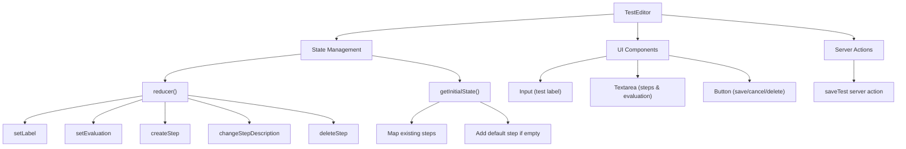
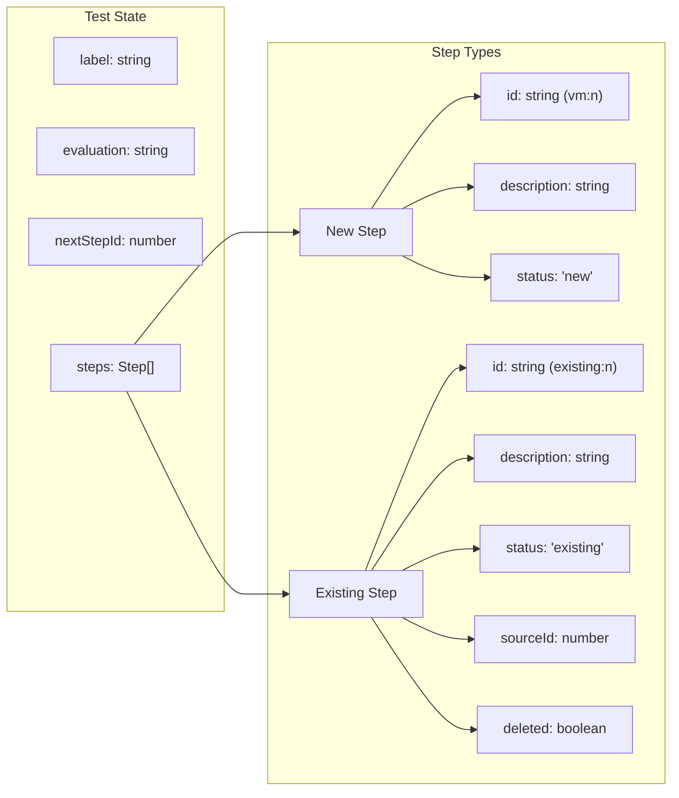
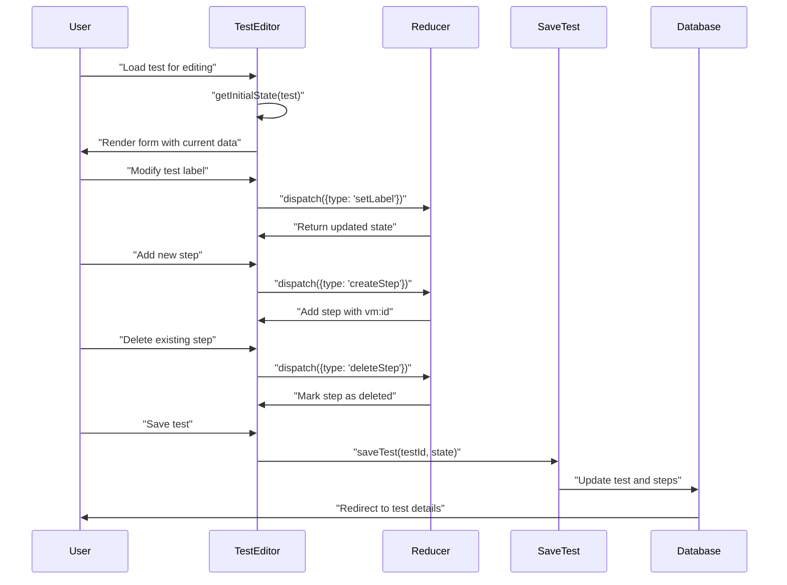
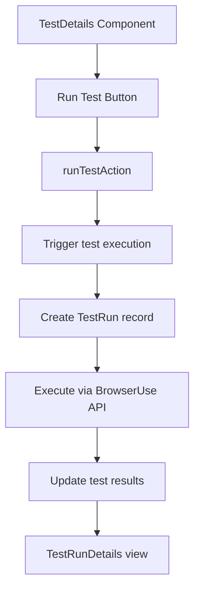
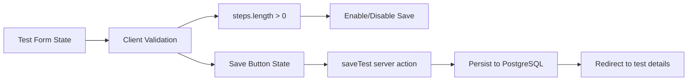

<!-- source: DeepWiki mcp.deepwiki.com · repo browser-use/qa-use · page 4.2 Test Management · fetched 2026-10-30 -->

# Test Management

Relevant source files

The following files were used as context for generating this wiki page:

- [src/app/suite/[suiteId]/run/[suiteRunId]/page.tsx](src/app/suite/[suiteId]/run/[suiteRunId]/page.tsx)
- [src/app/suite/[suiteId]/test/[testId]/edit/page.tsx](src/app/suite/[suiteId]/test/[testId]/edit/page.tsx)
- [src/app/suite/[suiteId]/test/[testId]/page.tsx](src/app/suite/[suiteId]/test/[testId]/page.tsx)
- [src/app/suite/[suiteId]/test/[testId]/run/[testRunId]/page.tsx](src/app/suite/[suiteId]/test/[testId]/run/[testRunId]/page.tsx)
- [src/components/test/TestEditor.tsx](src/components/test/TestEditor.tsx)

This document covers the user interface components and workflows for creating, editing, and executing individual tests within the QA Use platform. Test management focuses on the granular level of individual test cases, their steps, and execution monitoring.

For information about managing collections of tests, see [Suite Management](#4.1). For details about viewing test execution results and monitoring runs, see [Test Execution Views](#4.3).

## Purpose and Scope

The test management system enables users to:
- Create and edit individual test cases with natural language descriptions
- Manage test steps in a sequential, ordered manner
- Execute individual tests and monitor their progress
- View detailed test run results and execution history

## Test Editor Interface

The primary interface for test management is the `TestEditor` component, which provides a comprehensive form-based editor for test creation and modification.

### TestEditor Component Architecture

Sources: [src/components/test/TestEditor.tsx:1-230]()

### Test Data Model

The test editor manages a complex state structure that tracks both new and existing test steps:

Sources: [src/components/test/TestEditor.tsx:15-41]()

## Test Management Workflow

### Test Creation and Editing Flow

Sources: [src/components/test/TestEditor.tsx:66-125](), [src/app/suite/[suiteId]/test/[testId]/edit/actions.ts]()

### Test Execution Workflow

Sources: [src/app/suite/[suiteId]/test/[testId]/page.tsx:1-29]()

## Page Structure and Routes

The test management system spans several Next.js pages with specific responsibilities:

| Route | Component | Purpose |
|-------|-----------|---------|
| `/suite/[suiteId]/test/[testId]` | `TestDetails` | View test details and trigger execution |
| `/suite/[suiteId]/test/[testId]/edit` | `TestEditor` | Edit test metadata and steps |
| `/suite/[suiteId]/test/[testId]/run/[testRunId]` | `TestRunDetails` | View specific test run results |

Sources: [src/app/suite/[suiteId]/test/[testId]/page.tsx:1-29](), [src/app/suite/[suiteId]/test/[testId]/edit/page.tsx:1-19](), [src/app/suite/[suiteId]/test/[testId]/run/[testRunId]/page.tsx:1-26]()

## State Management Pattern

The `TestEditor` uses a React `useReducer` pattern for managing complex state transitions:

### Reducer Actions

| Action Type | Payload | Effect |
|-------------|---------|--------|
| `setLabel` | `label: string` | Updates test label |
| `setEvaluation` | `evaluation: string` | Updates test evaluation criteria |
| `createStep` | None | Adds new step with generated ID |
| `changeStepDescription` | `stepId: string, description: string` | Updates step description |
| `deleteStep` | `stepId: string` | Marks step as deleted or removes if new |

### Step ID Management

The editor maintains different ID formats for tracking step state:
- New steps: `vm:${nextStepId}` format for virtual IDs
- Existing steps: `existing:${sourceId}` format for database-backed steps

Sources: [src/components/test/TestEditor.tsx:66-125]()

## Form Validation and Submission

The test editor implements client-side validation and server-side persistence:

The save button is disabled when `state.steps.length === 0`, preventing submission of tests without steps.

Sources: [src/components/test/TestEditor.tsx:152-157](), [src/components/test/TestEditor.tsx:220-225]()

## Integration Points

The test management system integrates with several other platform components:

- **Server Actions**: Uses `saveTest` for persistence operations
- **Navigation**: Links back to suite views and test details
- **Execution Engine**: Triggers test runs through `runTestAction`
- **Results Viewing**: Connects to test run detail pages for execution monitoring

Sources: [src/app/suite/[suiteId]/test/[testId]/edit/actions.ts](), [src/app/suite/[suiteId]/test/[testId]/actions.ts]()

---

