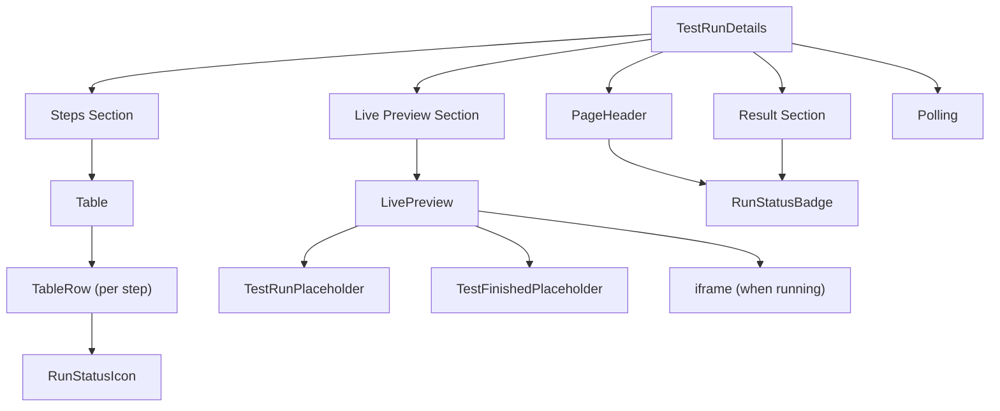
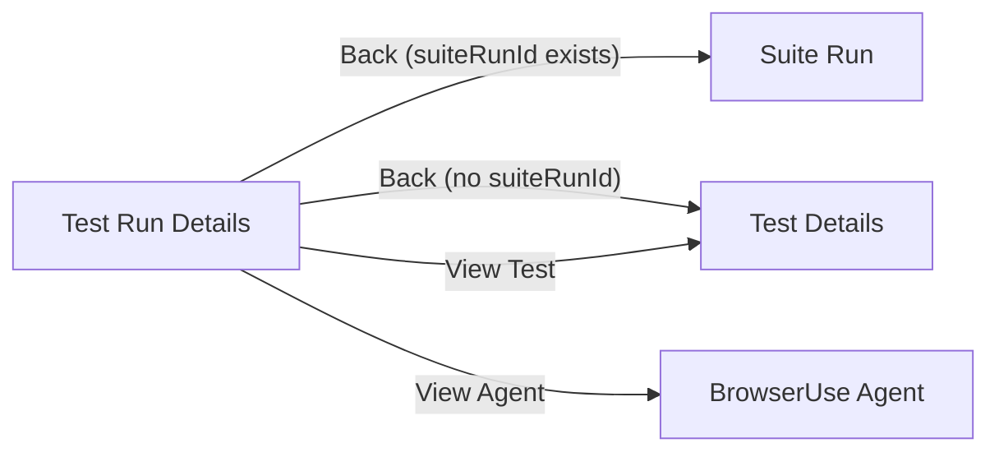
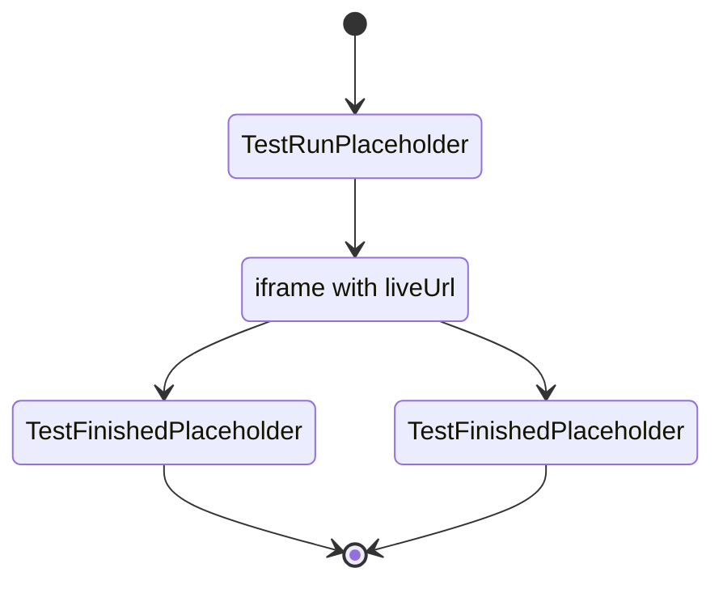
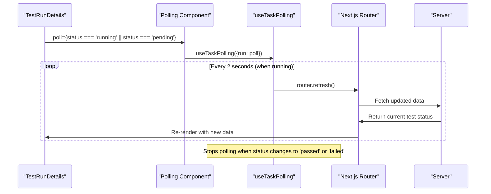
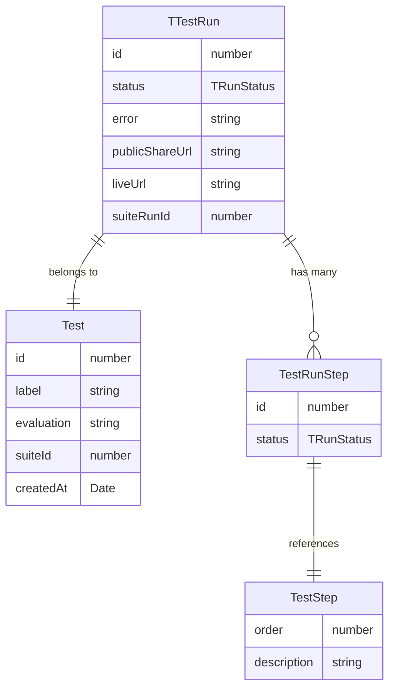

<!-- source: DeepWiki mcp.deepwiki.com · repo browser-use/qa-use · page 4.3 Test Execution Views · fetched 2026-10-30 -->

# Test Execution Views

Relevant source files

The following files were used as context for generating this wiki page:

- [src/app/suite/[suiteId]/test/[testId]/run/[testRunId]/loader.ts](src/app/suite/[suiteId]/test/[testId]/run/[testRunId]/loader.ts)
- [src/components/Polling.tsx](src/components/Polling.tsx)
- [src/components/test/run/TestRunDetails.tsx](src/components/test/run/TestRunDetails.tsx)

This document covers the user interface components and views for monitoring test execution and viewing test run results. These views provide real-time visibility into test progress, step-by-step execution status, and live browser previews during AI agent execution.

For information about creating and managing tests, see [Test Management](#4.2). For details about the underlying test execution engine, see [AI Testing Engine](#5).

## Overview

The test execution views consist of the primary `TestRunDetails` component that displays comprehensive information about a specific test run, including step-by-step progress, live browser preview, and final results. The interface supports real-time updates through polling mechanisms and provides direct access to external agent execution views.

Sources: [src/components/test/run/TestRunDetails.tsx:1-161]()

## Test Run Details Interface

The `TestRunDetails` component serves as the main interface for viewing test execution details. It presents information in a two-column layout with test steps on the left and live preview on the right.

### Component Structure

Sources: [src/components/test/run/TestRunDetails.tsx:16-106]()

### Test Steps Display

The steps section displays each test step in a table format with the following columns:

| Column | Content | Component |
|--------|---------|-----------|
| Status | Visual status indicator | `RunStatusIcon` |
| # | Step order number | Direct display |
| Description | Step description text | Direct display |

The table includes both individual test steps and the final evaluation criteria as the last row. Each step shows its current execution status through standardized status icons.

Sources: [src/components/test/run/TestRunDetails.tsx:53-80]()

### Navigation and Actions

The interface provides contextual navigation and actions through the `PageHeader`:

- **Back Navigation**: Returns to either the suite run (if part of suite execution) or individual test page
- **View Test Action**: Links to the test definition page
- **View Agent Action**: Links to the BrowserUse agent execution page (when available)

Sources: [src/components/test/run/TestRunDetails.tsx:19-35]()

## Live Preview System

The `LivePreview` component provides real-time visibility into test execution through an embedded iframe that displays the actual browser session being controlled by the AI agent.

### Preview States

The live preview system handles three distinct states:

### State-Specific Rendering

| Status | Display | Component | Description |
|--------|---------|-----------|-------------|
| `pending` | Placeholder with monitor icon | `TestRunPlaceholder` | Shows "Preview will appear when test is running" |
| `running` | Live iframe | Direct iframe element | Displays real-time browser session |
| `passed`/`failed` | Completion placeholder | `TestFinishedPlaceholder` | Shows completion status with optional agent link |

The iframe uses the `liveUrl` from the test run data and includes fullscreen permissions for optimal viewing.

Sources: [src/components/test/run/TestRunDetails.tsx:108-160]()

## Real-time Status Updates

The interface implements automatic polling to provide real-time updates during test execution through the `Polling` component and `useTaskPolling` hook.

### Polling Mechanism

### Polling Configuration

The polling system automatically:
- Starts when test status is `running` or `pending`
- Refreshes every 2 seconds by default
- Stops when test reaches a terminal state (`passed`, `failed`)
- Uses `router.refresh()` to trigger full page re-render with fresh data

Sources: [src/components/test/run/TestRunDetails.tsx:103](), [src/components/Polling.tsx:1-43]()

## Data Loading and Types

The test run views rely on the `loader` function to fetch comprehensive test run data including all related entities.

### Data Structure

The `loader` function uses Drizzle ORM with nested relations to fetch all required data in a single query, including test steps and their execution status.

Sources: [src/app/suite/[suiteId]/test/[testId]/run/[testRunId]/loader.ts:1-30]()

## Result Display

The results section provides immediate feedback on test execution outcomes:

- **Success State**: Displays "Test passed" message in green text
- **Failure State**: Shows error message in red text with full error details
- **Status Badge**: Visual indicator showing current execution status

The result section is always visible regardless of test status, providing consistent feedback throughout the execution lifecycle.

Sources: [src/components/test/run/TestRunDetails.tsx:82-91]()

---

