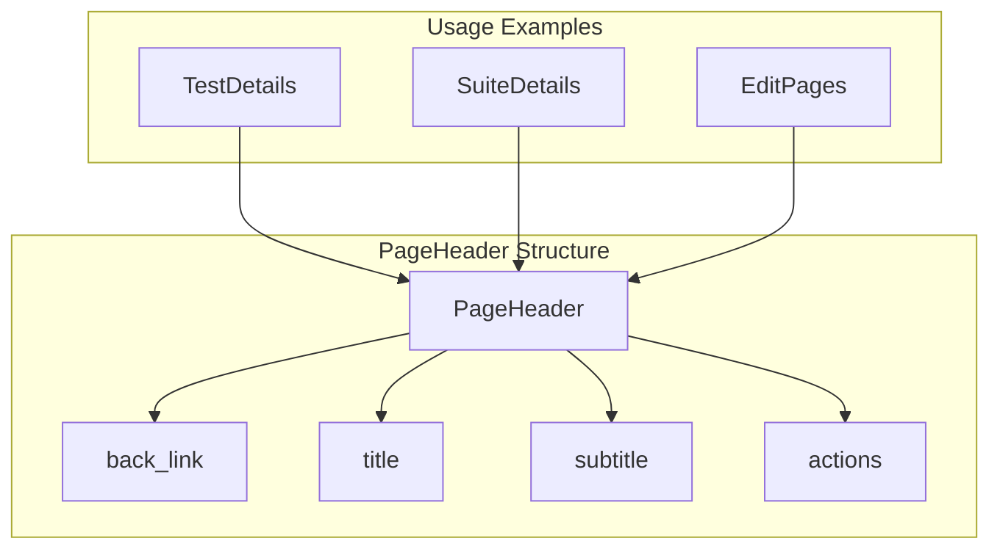
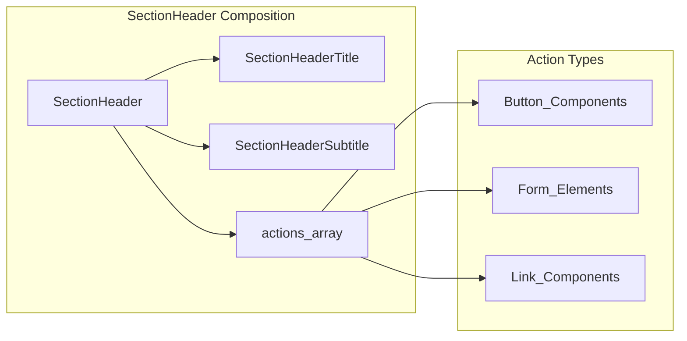
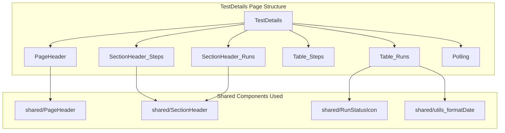
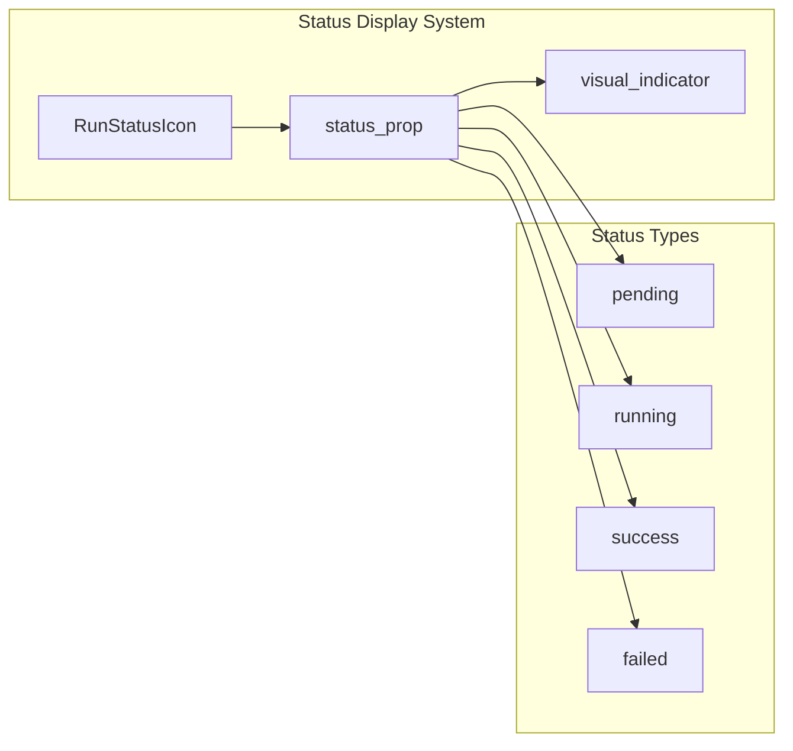
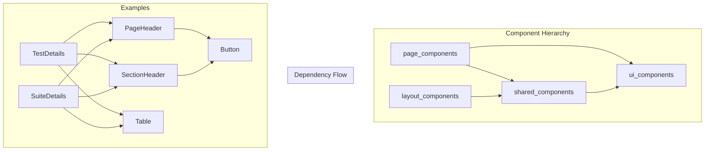
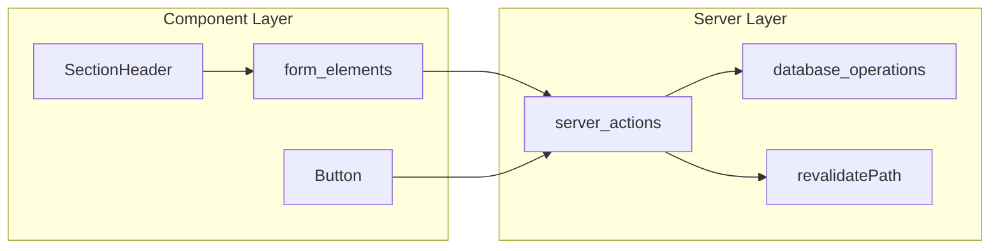

<!-- source: DeepWiki mcp.deepwiki.com · repo browser-use/qa-use · page 4.4 Shared Components · fetched 2026-10-30 -->

# Shared Components

Relevant source files

The following files were used as context for generating this wiki page:

- [pnpm-lock.yaml](pnpm-lock.yaml)
- [src/app/api/inngest/route.ts](src/app/api/inngest/route.ts)
- [src/app/suite/[suiteId]/loader.ts](src/app/suite/[suiteId]/loader.ts)
- [src/app/suite/[suiteId]/test/[testId]/actions.ts](src/app/suite/[suiteId]/test/[testId]/actions.ts)
- [src/components/shared/PageHeader.tsx](src/components/shared/PageHeader.tsx)
- [src/components/shared/SectionHeader.tsx](src/components/shared/SectionHeader.tsx)
- [src/components/test/TestDetails.tsx](src/components/test/TestDetails.tsx)

This page documents the reusable UI components and utilities that provide consistent user interface elements and functionality across the QA Use platform. These components form the foundation of the application's design system and are used throughout the test suite management interface.

For information about specific page components that consume these shared elements, see [Suite Management](#4.1), [Test Management](#4.2), and [Test Execution Views](#4.3).

## Overview

The shared components are organized into several categories that support different aspects of the user interface:

- **Layout Components**: Provide consistent page and section structure
- **UI Components**: Form controls, data display, and interactive elements
- **Status Components**: Display execution states and run information
- **Utility Functions**: Helper functions for formatting and common operations

## Layout Components

### PageHeader Component

The `PageHeader` component provides a consistent page-level header structure used across all major pages in the application.

The component accepts the following properties:
- `back`: Navigation link with href and label
- `title`: Primary page heading
- `subtitle`: Optional secondary information
- `actions`: Array of action links

Sources: [src/components/shared/PageHeader.tsx:4-49]()

### SectionHeader Component

The `SectionHeader` component provides section-level organization within pages, typically used to group related content with associated actions.

The component supports:
- Primary section title with consistent styling
- Optional subtitle for additional context
- Flexible actions array for buttons, forms, and links

Sources: [src/components/shared/SectionHeader.tsx:4-31]()

## Component Usage Patterns

### TestDetails Component Integration

The `TestDetails` component demonstrates how shared components are composed to create complex page layouts:

The integration shows:
- `PageHeader` for page-level navigation and title
- Multiple `SectionHeader` instances for "Steps" and "Runs" sections
- `RunStatusIcon` within table cells for status display
- `formatDate` utility for consistent date formatting

Sources: [src/components/test/TestDetails.tsx:1-150]()

## UI Component Library

### Table Components

The application uses a comprehensive table component system for data display:

| Component | Purpose | Usage |
|-----------|---------|-------|
| `Table` | Container wrapper | Data tables throughout the app |
| `TableHeader` | Column headers | Defines table structure |
| `TableBody` | Content rows | Contains data rows |
| `TableRow` | Individual row | Wraps table cells |
| `TableCell` | Cell content | Individual data points |
| `TableHead` | Header cell | Column definitions |
| `TableFooter` | Summary rows | Additional information |

Sources: [src/components/test/TestDetails.tsx:6]()

### Button Components

The `Button` component provides consistent interactive elements with support for:
- Variant styling (`outline`, `destructive`, etc.)
- Size options (`icon`, standard)
- Icon integration with Lucide React icons

Sources: [src/components/test/TestDetails.tsx:13]()

## Status and Utility Components

### RunStatusIcon Component

The `RunStatusIcon` component provides visual indicators for test execution states:

The component is used throughout the application to display:
- Test run status in tables
- Suite execution progress
- Individual step completion states

Sources: [src/components/test/TestDetails.tsx:10]()

### Utility Functions

#### formatDate Function

The `formatDate` utility provides consistent date formatting across the application, handling:
- Timestamp conversion
- Locale-specific formatting
- Hydration safety with `suppressHydrationWarning`

Sources: [src/components/test/TestDetails.tsx:12](), [src/components/test/TestDetails.tsx:131]()

## Component Architecture

### Reusability Strategy

The shared component architecture follows these principles:

### Import Patterns

Components follow consistent import patterns:
- Shared components imported from `../shared/ComponentName`
- UI components imported from `../ui/componentName`
- External libraries (Lucide icons, etc.) imported directly

### Composition Approach

The platform uses a composition-over-inheritance approach where:
- Complex components combine multiple shared components
- Props are passed down to configure behavior
- Actions are handled via form submissions and server actions

Sources: [src/components/test/TestDetails.tsx:8-13]()

## Integration with Server Actions

Shared components integrate seamlessly with the application's server action pattern:

This integration allows shared components to trigger backend operations while maintaining clean separation of concerns between UI and business logic.

Sources: [src/components/test/TestDetails.tsx:49-53](), [src/components/test/TestDetails.tsx:100-105]()

---

