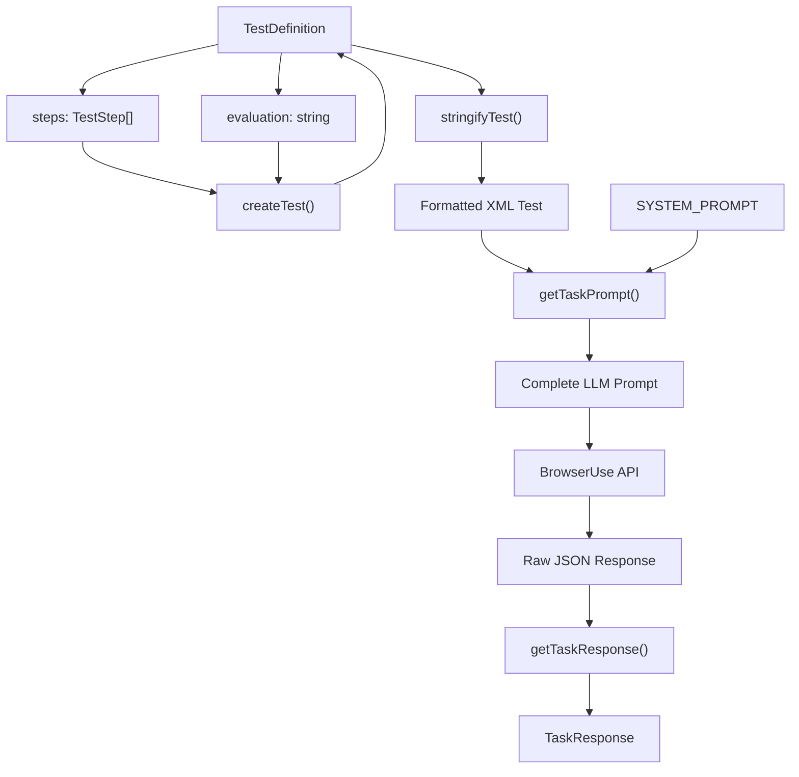
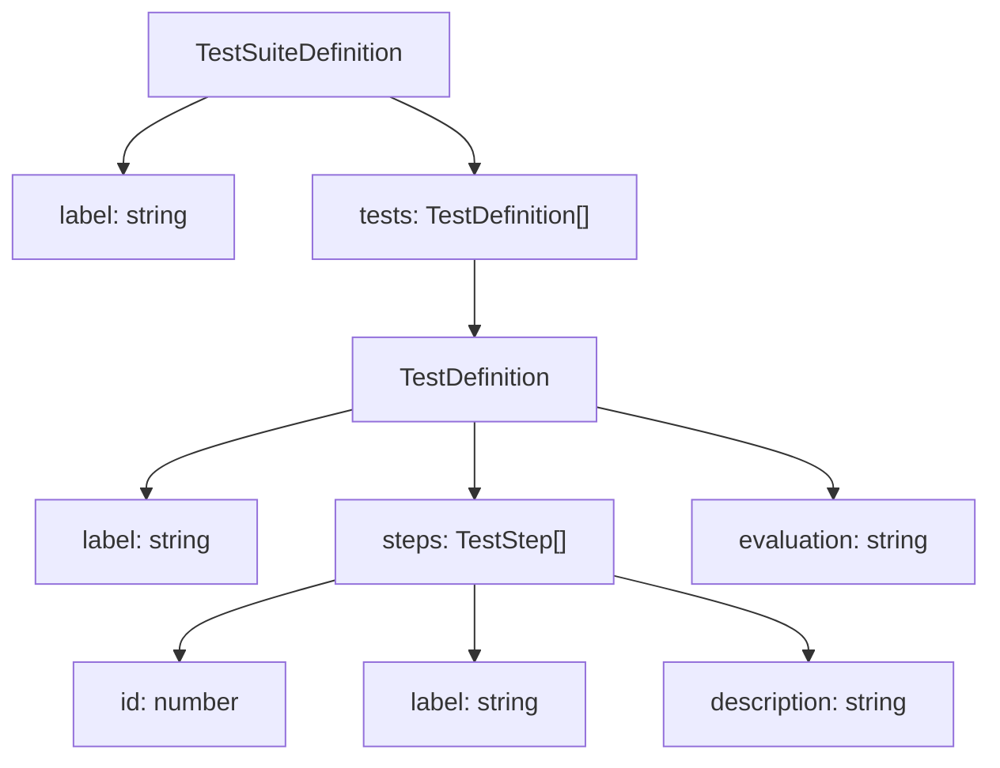
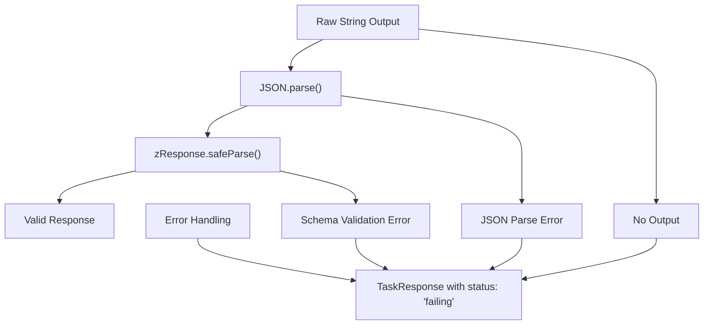
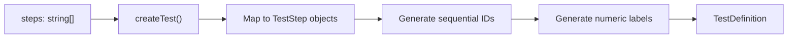
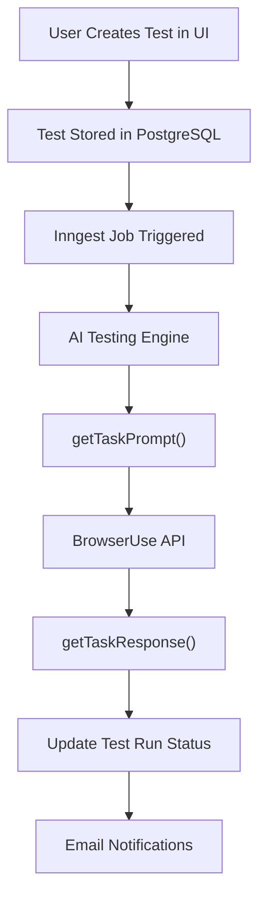

<!-- source: DeepWiki mcp.deepwiki.com · repo browser-use/qa-use · page 5 AI Testing Engine · fetched 2026-10-30 -->

# AI Testing Engine

<details>
<summary>Relevant source files</summary>

The following files were used as context for generating this wiki page:

- [src/lib/testing/engine.ts](src/lib/testing/engine.ts)
- [src/lib/testing/mock.ts](src/lib/testing/mock.ts)

</details>


## Purpose and Scope

The AI Testing Engine is the core component responsible for converting human-readable test definitions into structured prompts that can be executed by AI agents. It bridges the gap between natural language test descriptions and the formal instructions needed by LLM-powered browser automation agents.

This document covers the prompt generation system, response parsing, and test definition structures. For information about test execution orchestration, see [Background Processing](#6). For details about the BrowserUse API integration that actually runs these tests, see [External Integrations](#7).

## Core Architecture

The AI Testing Engine operates on a simple but powerful principle: convert structured test definitions into detailed LLM prompts that can be executed by browser automation agents.

### AI Testing Engine Flow



*Sources: [src/lib/testing/engine.ts:1-243]()*

## Data Structures

The engine is built around several key TypeScript interfaces that define the structure of tests and responses.

### Test Definition Structure



*Sources: [src/lib/testing/engine.ts:54-75]()*

### Response Structure

The engine expects responses from the AI agent in a specific JSON format defined by the `zResponse` schema:

| Field | Type | Description |
|-------|------|-------------|
| `status` | `'pass' \| 'failing'` | Overall test result |
| `steps` | `Array<{id: string, description: string}> \| null` | Successfully completed steps |
| `error` | `string \| null` | Error message if test failed |

*Sources: [src/lib/testing/engine.ts:3-18]()*

## Prompt Generation System

### System Prompt

The engine uses a comprehensive system prompt that instructs the AI agent on how to execute tests. The `SYSTEM_PROMPT` constant contains detailed instructions covering:

- Step execution requirements (exact order, no deviations)
- Success/failure criteria for individual steps
- Evaluation criteria for final state validation
- Required response format (JSON schema)
- Example tasks and responses

*Sources: [src/lib/testing/engine.ts:77-203]()*

### Test Formatting

The `stringifyTest()` function converts a `TestDefinition` into XML format that the LLM can easily parse:

```xml
<test>
  <steps>
    <step id="0" label="1">Go to docs.browser-use.com</step>
    <step id="1" label="2">Click on Cloud API V1 documentation.</step>
  </steps>
  <evaluation>The page needs to show POST request documentation.</evaluation>
</test>
```

The `getTaskPrompt()` function combines the system prompt with the formatted test to create the complete prompt sent to the AI agent.

*Sources: [src/lib/testing/engine.ts:208-230]()*

## Response Parsing

The `getTaskResponse()` function handles parsing and validation of AI agent responses:



*Sources: [src/lib/testing/engine.ts:23-52]()*

## Mock Test Examples

The engine includes several predefined test examples that demonstrate different scenarios:

### Test Types

| Test Name | Purpose | Expected Result |
|-----------|---------|-----------------|
| `DOCS_PASSING_SEARCH_TEST` | Demonstrates successful test execution | Pass |
| `DOCS_FAILING_EVAL_SEARCH_TEST` | Shows evaluation criteria mismatch | Fail (evaluation) |
| `DOCS_FAILING_TEST_SEARCH_TEST` | Shows step execution failure | Fail (step) |

### Example Test Structure

The `createTest()` helper function simplifies test creation by converting string arrays into properly structured `TestDefinition` objects:



*Sources: [src/lib/testing/mock.ts:1-51](), [src/lib/testing/engine.ts:232-242]()*

## Integration with External Systems

The AI Testing Engine serves as the translation layer between the QA Use platform and external AI services:

### Engine Integration Flow



*Sources: [src/lib/testing/engine.ts:222-230]()*

The engine's primary responsibility is ensuring that human-readable test descriptions are converted into precise, actionable instructions that AI agents can execute reliably. It achieves this through structured data types, comprehensive prompting, and robust response validation.

---

