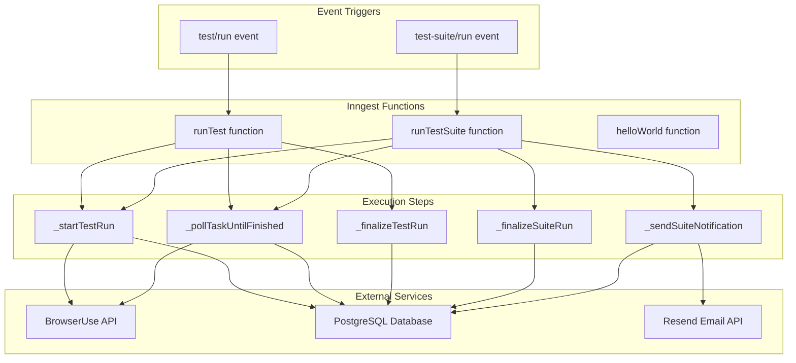
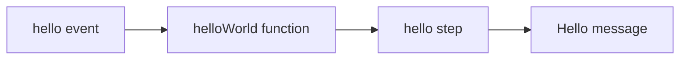
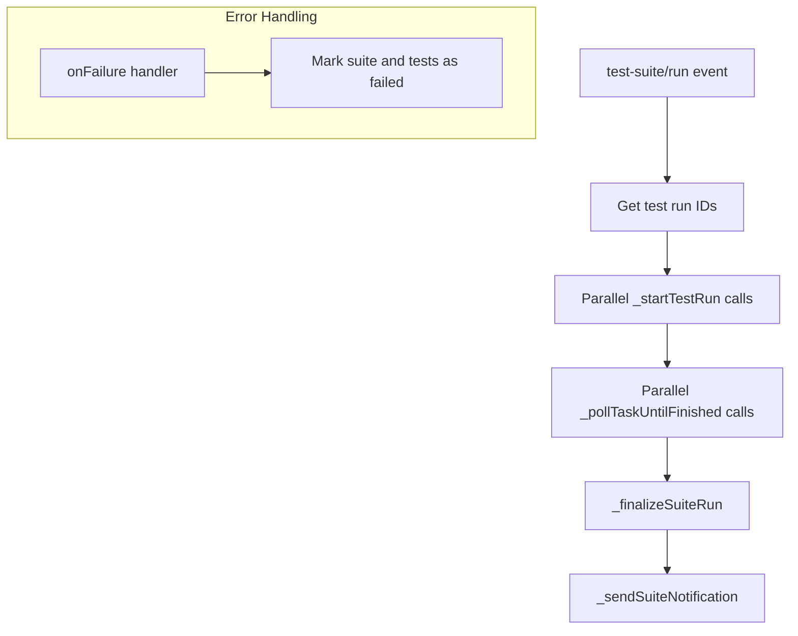
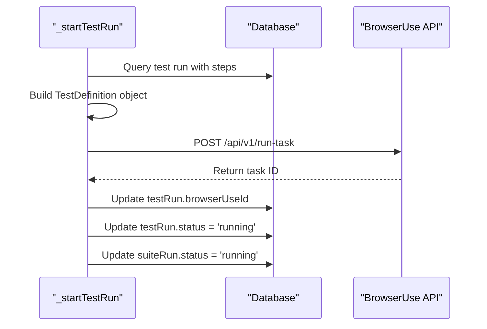
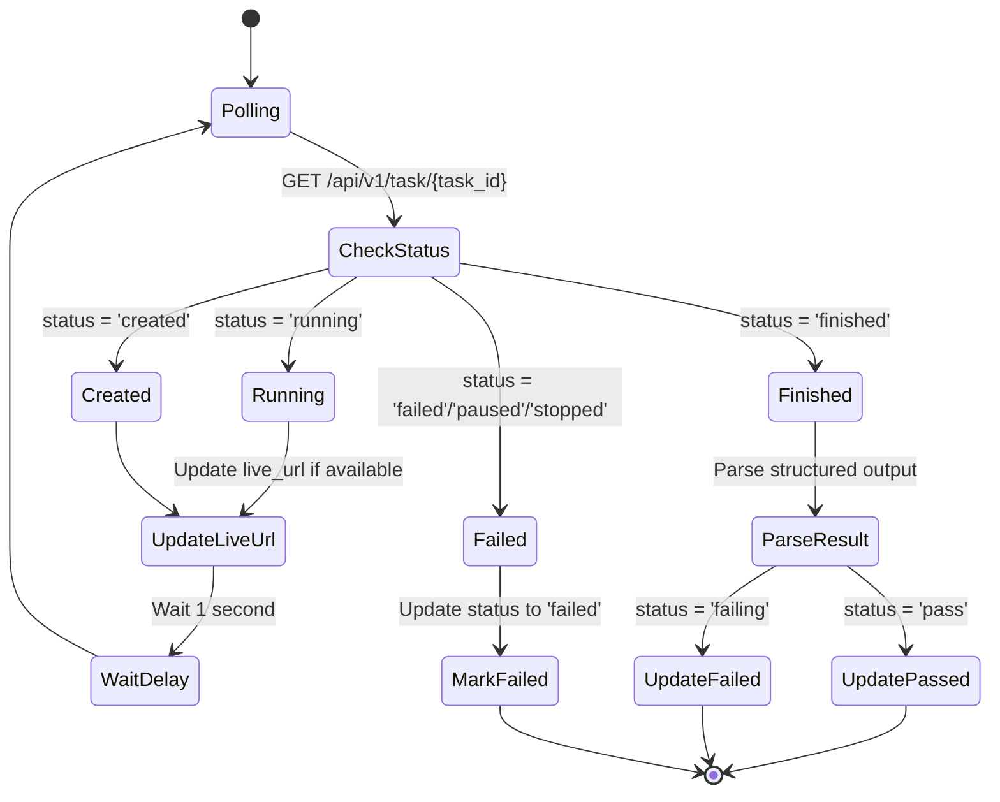
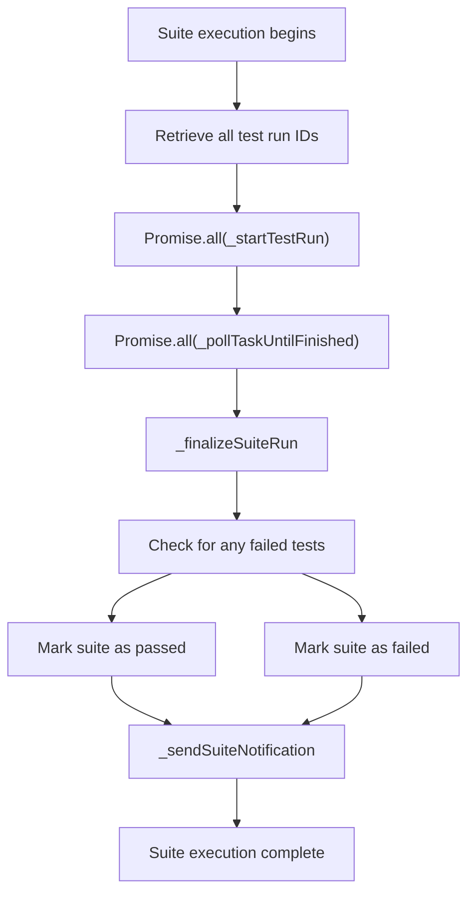
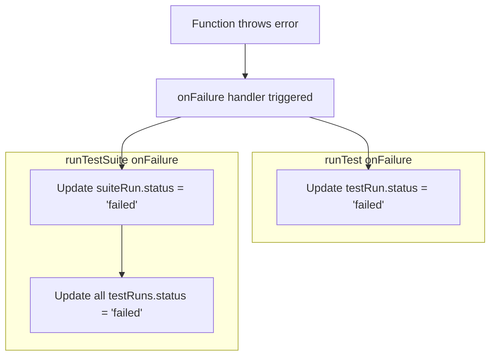
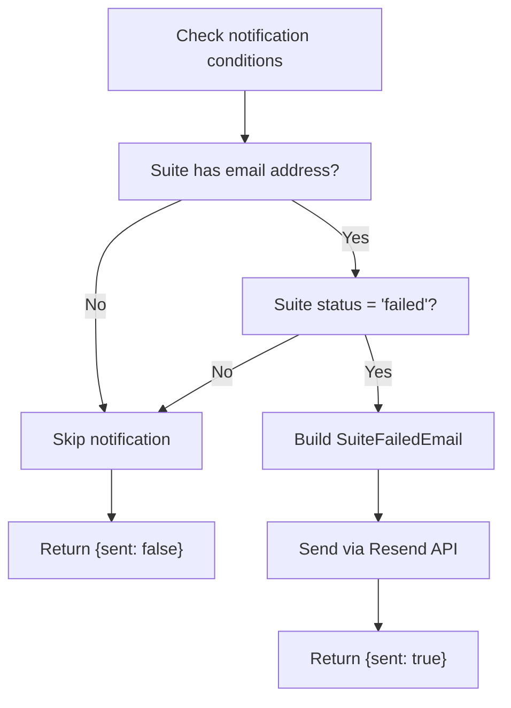
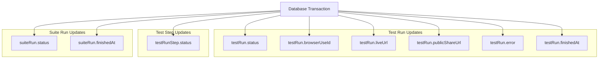

<!-- source: DeepWiki mcp.deepwiki.com · repo browser-use/qa-use · page 6 Background Processing · fetched 2026-10-30 -->

# Background Processing

<details>
<summary>Relevant source files</summary>

The following files were used as context for generating this wiki page:

- [src/components/test/run/TestRunDetails.tsx](src/components/test/run/TestRunDetails.tsx)
- [src/lib/inngest/functions.tsx](src/lib/inngest/functions.tsx)

</details>


The Background Processing system provides reliable, scalable orchestration of long-running test execution workflows using Inngest. This system handles the asynchronous execution of AI-powered browser tests, manages their lifecycle from creation to completion, and coordinates notifications and status updates.

For information about the AI Testing Engine that generates prompts for these background jobs, see [AI Testing Engine](#5). For details about external service integrations including BrowserUse API calls, see [External Integrations](#7).

## System Architecture

The background processing system is built on Inngest, which provides event-driven function orchestration with built-in retry logic, step isolation, and failure handling. The system processes two main types of events: individual test runs and complete test suite executions.



Sources: [src/lib/inngest/functions.tsx:1-401]()

## Core Inngest Functions

The system defines three main Inngest functions that handle different aspects of test execution:

### `helloWorld` Function

A utility function for testing Inngest connectivity and basic event processing.



Sources: [src/lib/inngest/functions.tsx:19-33]()

### `runTest` Function

Orchestrates the execution of a single test run through multiple isolated steps:

| Step | Function | Purpose |
|------|----------|---------|
| 1 | `_startTestRun` | Initialize test run and submit to BrowserUse API |
| 2 | `_pollTaskUntilFinished` | Monitor execution until completion |
| 3 | `_finalizeTestRun` | Update final status and timestamps |

The function includes automatic failure handling that marks the test run as failed if any step throws an unrecoverable error.

Sources: [src/lib/inngest/functions.tsx:38-59]()

### `runTestSuite` Function

Coordinates the execution of multiple tests within a suite, managing parallel execution and aggregated results:



Sources: [src/lib/inngest/functions.tsx:64-101]()

## Test Execution Workflow

The test execution workflow follows a structured pattern that integrates with both the BrowserUse API and the local database:

### Test Initialization (`_startTestRun`)

The initialization step performs several critical operations:

1. **Data Retrieval**: Fetches test definition from database including suite, test, and step information
2. **Prompt Generation**: Converts test definition to BrowserUse-compatible prompt using `getTaskPrompt`
3. **API Submission**: Submits task to BrowserUse API with specific configuration
4. **Status Updates**: Updates database records to reflect running status



The BrowserUse API call includes specific configuration parameters:
- Model selection (currently `o3` for higher accuracy)
- Structured output schema for result parsing
- Proxy and adblock settings
- Maximum agent steps limit

Sources: [src/lib/inngest/functions.tsx:108-182]()

### Task Monitoring (`_pollTaskUntilFinished`)

The polling mechanism continuously monitors task execution status:



The polling function handles different response scenarios:
- **Running/Created**: Updates live URLs and continues polling
- **Finished**: Parses structured output using `getTaskResponse` and updates test/step statuses
- **Failed/Paused/Stopped**: Marks test as failed and terminates

Sources: [src/lib/inngest/functions.tsx:187-306]()

## Suite Execution Coordination

Suite execution involves coordinating multiple parallel test runs and aggregating their results:

### Parallel Execution Strategy

The `runTestSuite` function executes tests in parallel using `Promise.all()` for both the start and polling phases:



Sources: [src/lib/inngest/functions.tsx:89-100]()

### Result Aggregation (`_finalizeSuiteRun`)

The finalization step determines overall suite status based on individual test results:

| Condition | Suite Status |
|-----------|--------------|
| All tests passed | `passed` |
| Any test failed | `failed` |

Sources: [src/lib/inngest/functions.tsx:330-344]()

## Error Handling and Retry Logic

The background processing system implements comprehensive error handling at multiple levels:

### Function-Level Error Handling

Both `runTest` and `runTestSuite` functions define `onFailure` handlers that automatically update database records when unrecoverable errors occur:



Sources: [src/lib/inngest/functions.tsx:41-47](), [src/lib/inngest/functions.tsx:67-74]()

### Step-Level Error Types

Individual steps can throw different types of errors:

- **`NonRetriableError`**: Used for data consistency issues (test not found, invalid state)
- **`RetryAfterError`**: Used for temporary API failures with specified retry delay

Sources: [src/lib/inngest/functions.tsx:2](), [src/lib/inngest/functions.tsx:159](), [src/lib/inngest/functions.tsx:209]()

## Notification System Integration

The background processing system includes automated email notifications for failed test suites:

### Notification Triggers

Notifications are sent only under specific conditions:
- Suite execution has completed with `failed` status
- Suite has a configured `notificationsEmailAddress`

### Email Composition

The `_sendSuiteNotification` function constructs emails using:
- **Template**: `SuiteFailedEmail` React component
- **Service**: Resend API client
- **Content**: Suite details, execution times, and individual test results



Sources: [src/lib/inngest/functions.tsx:346-400]()

## Real-Time UI Integration

The background processing system integrates with the frontend through polling mechanisms that provide real-time updates:

### Polling Component Integration

The `TestRunDetails` component includes a `<Polling>` component that automatically refreshes the page when tests are in running or pending states:

```typescript
<Polling poll={status === 'running' || status === 'pending'} />
```

### Live Preview Updates

During test execution, the system continuously updates `liveUrl` and `publicShareUrl` fields in the database, enabling real-time browser preview in the UI:

| Test Status | Preview Behavior |
|-------------|------------------|
| `pending` | Shows placeholder message |
| `running` | Displays live iframe with BrowserUse execution |
| `passed`/`failed` | Shows completion message with link to shared recording |

Sources: [src/components/test/run/TestRunDetails.tsx:103](), [src/components/test/run/TestRunDetails.tsx:122-128]()

## Database Schema Integration

The background processing system maintains strict consistency with the database schema through transactional updates:

### Status Synchronization

The system updates multiple related entities atomically:



All critical updates use database transactions to ensure data consistency, particularly when updating test results and their associated step statuses.

Sources: [src/lib/inngest/functions.tsx:217-236](), [src/lib/inngest/functions.tsx:240-264]()

---

