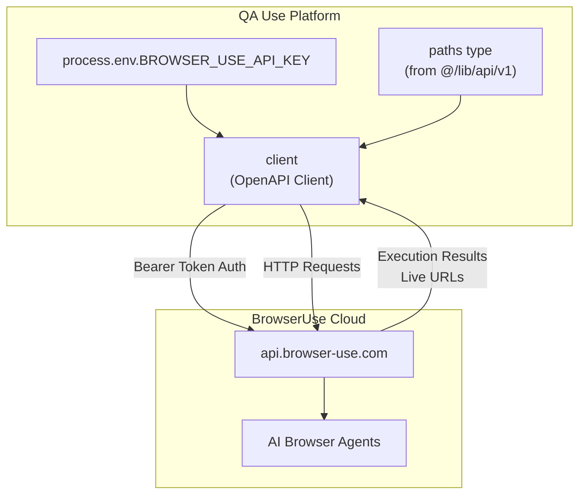
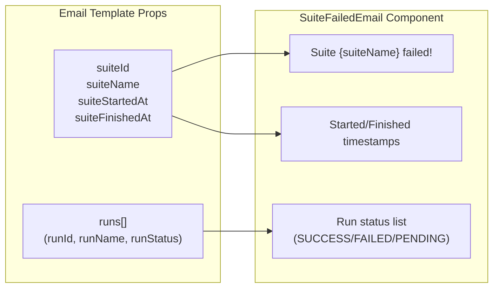
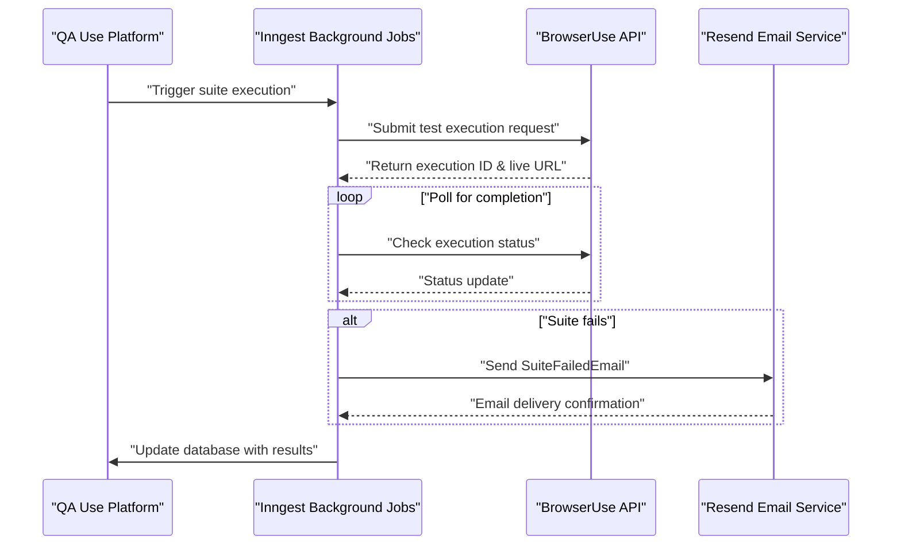
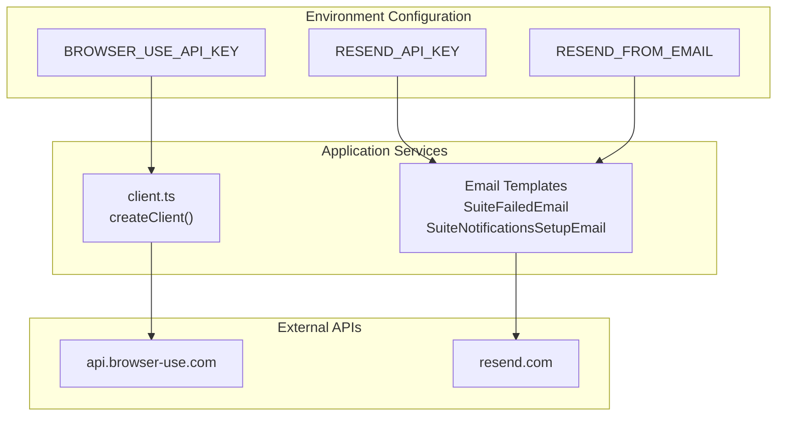

<!-- source: DeepWiki mcp.deepwiki.com · repo browser-use/qa-use · page 7 External Integrations · fetched 2026-10-30 -->

# External Integrations

Relevant source files

The following files were used as context for generating this wiki page:

- [.env.example](.env.example)
- [src/lib/api/client.ts](src/lib/api/client.ts)
- [src/lib/resend/emails/SuiteFailedEmail.tsx](src/lib/resend/emails/SuiteFailedEmail.tsx)
- [src/lib/resend/emails/SuiteNotificationsSetupEmail.tsx](src/lib/resend/emails/SuiteNotificationsSetupEmail.tsx)

This document covers the external service integrations used by the QA Use platform. The platform relies on two primary external services: the BrowserUse Cloud API for AI-powered browser automation and the Resend email service for notification delivery. For information about the internal AI testing engine that coordinates with these services, see [AI Testing Engine](#5). For details about the background processing system that orchestrates these integrations, see [Background Processing](#6).

## Overview

The QA Use platform integrates with external services to provide its core functionality:

| Service | Purpose | Configuration |
|---------|---------|---------------|
| BrowserUse Cloud API | AI agent execution for browser automation | `BROWSER_USE_API_KEY` |
| Resend Email Service | Email notification delivery | `RESEND_API_KEY`, `RESEND_FROM_EMAIL` |

## BrowserUse API Integration

### Client Configuration

The platform uses an OpenAPI-generated client to communicate with the BrowserUse Cloud API. The client is configured in [src/lib/api/client.ts:1-11]() and establishes a connection to `https://api.browser-use.com/` using Bearer token authentication.

**BrowserUse API Client Architecture**

The client uses the `createClient` function from the `openapi-fetch` library to generate type-safe API calls. The `paths` type provides TypeScript definitions for all available API endpoints.

### Authentication

Authentication is handled through a Bearer token specified in the `Authorization` header. The token is sourced from the `BROWSER_USE_API_KEY` environment variable as configured in [src/lib/api/client.ts:9]().

Sources: [src/lib/api/client.ts:1-11](), [.env.example:1-2]()

## Resend Email Integration

### Email Templates

The platform includes React-based email templates for user notifications:

| Template | Purpose | File |
|----------|---------|------|
| `SuiteFailedEmail` | Notify users when test suite execution fails | [src/lib/resend/emails/SuiteFailedEmail.tsx]() |
| `SuiteNotificationsSetupEmail` | Confirm notification setup for a suite | [src/lib/resend/emails/SuiteNotificationsSetupEmail.tsx]() |

### SuiteFailedEmail Template

The `SuiteFailedEmail` component renders failure notifications with detailed information about the failed suite execution. It accepts props including `suiteId`, `suiteName`, timing information, and an array of `runs` with their respective statuses.

**SuiteFailedEmail Template Structure**

The template displays suite execution details in a structured format with timing information and individual run statuses.

### Email Configuration

Email integration requires three environment variables as defined in [.env.example:4-9]():

- `RESEND_API_KEY`: Authentication token for the Resend service
- `RESEND_FROM_EMAIL`: Sender email address and display name

The configuration includes a note about using `onboarding@resend.dev` for testing and recommending domain verification for production deployments.

Sources: [src/lib/resend/emails/SuiteFailedEmail.tsx:1-46](), [src/lib/resend/emails/SuiteNotificationsSetupEmail.tsx:1-30](), [.env.example:4-9]()

## Integration Flow

### Test Execution Integration

**External Service Integration Sequence**

This sequence shows how the platform coordinates between BrowserUse for test execution and Resend for failure notifications.

### Configuration Dependencies

**External Integration Configuration Flow**

The diagram shows how environment variables flow through the application to configure external service connections.

Sources: [src/lib/api/client.ts:7-10](), [.env.example:1-9]()

## Error Handling and Reliability

The platform handles external service integration failures through several mechanisms:

- **Authentication Errors**: Missing or invalid API keys will cause service initialization to fail
- **Network Failures**: The Inngest background job system provides retry logic for transient failures
- **Email Delivery**: Resend provides delivery status reporting for notification reliability

The `createClient` function from `openapi-fetch` provides built-in error handling for HTTP status codes and network connectivity issues when communicating with the BrowserUse API.

Sources: [src/lib/api/client.ts:1-11]()

---

